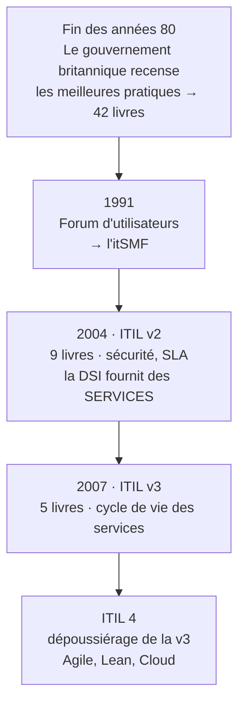
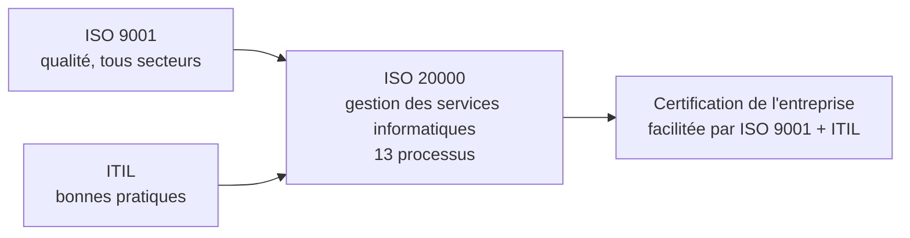
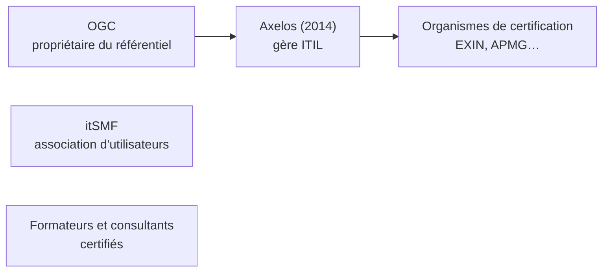

# Module 1 : Présentation d'ITIL et gestion de parc

*Cours : [Cours 6 - Sensibilisation ITIL et gestion de parc](../index.md)*

## 🎯 Objectif du module

Savoir **ce qu'est ITIL**, d'où il vient et **qui** le fait vivre.

!!! abstract "En clair"
    **ITIL** est un **recueil de bonnes pratiques** pour gérer l'informatique d'une entreprise **comme un service** rendu à des clients. Ce n'est ni un logiciel ni une loi : c'est une **méthode** et un **vocabulaire commun** (incident, changement, SLA…) que tu retrouveras dans tous les outils de ticketing comme **GLPI**.

## 🗺️ L'essentiel en schémas

!!! info "Référentiel TSSR 2026"
    **CCP 1 · compétence 3 : Apporter une assistance technique.** Le référentiel demande de « qualifier et traiter les demandes et incidents », d'appliquer les procédures d'**escalade** et d'assurer la **traçabilité** : c'est exactement le vocabulaire ITIL.

**① ITIL en quelques dates**

**② ITIL et les normes**

**③ Qui fait vivre ITIL ?**

## 📖 Cours consolidé

### 1. ITIL, c'est quoi ?

- **ITIL** = *Information Technology Infrastructure Library*, la « bibliothèque pour l'infrastructure informatique ».
- Des **bonnes pratiques** pour un système d'information **efficace** (il atteint ses objectifs) et **efficient** (sans gaspiller de ressources).
- Il apporte : les **bonnes pratiques** de gestion des services, un **langage commun** et un **cadre de travail**.
- L'idée clé de la v3 : passer d'une informatique gérée **en projets** à une informatique gérée **en services**, tournée vers le client.

### 2. L'historique

| Date | Étape | Ce qui change |
|---|---|---|
| Fin des années 80 | Étude du gouvernement britannique | 42 livres : l'informatique **fournit des moyens** |
| 1991 | Création du forum d'utilisateurs | Devient l'**itSMF** |
| 2004 | **ITIL v2** (9 livres) | Processus de **sécurité**, **SLA** · l'informatique **fournit des services** |
| 2007 | **ITIL v3** (5 livres) | Le **cycle de vie des services** (module 2) |
| ITIL 4 | 4ᵉ génération | Pas une nouvelle version : un **dépoussiérage** de la v3 avec l'**Agile**, le **Lean** et le **Cloud** |

💡 ITIL appartient aujourd'hui à **PeopleCert**, qui a racheté Axelos en 2021 : c'est elle qui délivre les certifications ITIL 4.

### 3. Les normes à connaître

| Norme | Pour qui ? | Lien avec ITIL |
|---|---|---|
| **ISO 9001** | Tous les secteurs | Système de gestion de la **qualité** par les processus |
| **ISO 20000** | L'informatique | **13 processus** de gestion des services, tous décrits dans ITIL |

📌 ITIL **n'est pas une norme** : on ne « certifie » pas une entreprise ITIL. On certifie des **personnes** (ITIL Foundation…) et des **entreprises ISO 20000**.

### 4. Les acteurs

| Acteur | Rôle |
|---|---|
| **OGC** (*Office of Government Commerce*) | Office public britannique, **propriétaire** du référentiel |
| **Axelos** | Société créée en 2014 pour **gérer ITIL** |
| **Organismes de certification** | Font passer les examens (EXIN, APMG…) |
| **itSMF** | Association d'**utilisateurs** qui partagent leurs expériences |
| **Formateurs et consultants** | Accrédités, certifiés ITIL |

## 📝 Fiche de révision

| Notion | À retenir |
|---|---|
| **ITIL** | Bonnes pratiques de gestion des services informatiques |
| **Apport** | Bonnes pratiques + langage commun + cadre de travail |
| **v2 (2004)** | 9 livres, sécurité, SLA |
| **v3 (2007)** | 5 livres, cycle de vie des services |
| **ITIL 4** | Dépoussiérage de la v3 : Agile, Lean, Cloud |
| **ISO 20000** | Norme des services informatiques, 13 processus |
| **itSMF** | Association des utilisateurs d'ITIL |

### ⚠️ Les pièges

- ITIL est un **référentiel de bonnes pratiques**, **pas une norme** ni une obligation.
- **ISO 9001** = qualité en général · **ISO 20000** = services **informatiques**.
- ITIL 4 n'**efface** pas la v3 : il la modernise.

### ✏️ Entraîne-toi (clique pour voir la correction)

??? question "1. Ton responsable dit « on applique ITIL ». Qu'est-ce que ça change pour toi, technicien support ?"
    Tu utilises un **vocabulaire commun** (incident, demande, changement, problème), tu **enregistres** chaque demande dans l'outil de tickets, tu respectes les **délais** promis et les **procédures d'escalade**. C'est ce que demande le référentiel TSSR : qualifier, traiter, tracer.

??? question "2. Une entreprise veut prouver à ses clients la qualité de sa gestion informatique. Peut-elle être « certifiée ITIL » ?"
    **Non** : ITIL n'est pas une norme. Elle peut viser la certification **ISO 20000**, facilitée si elle applique déjà ITIL (et ISO 9001). Les **personnes**, elles, peuvent passer une certification ITIL.

## 🧠 Quiz — entraîne-toi

