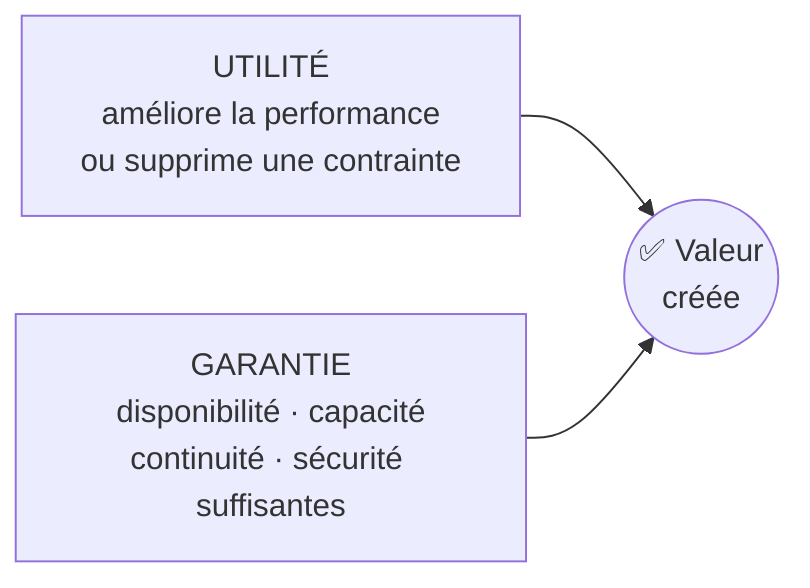
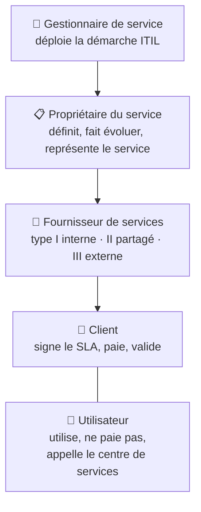
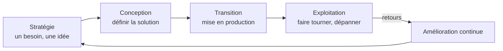

# Module 2 : La gestion des services

*Cours : [Cours 6 - Sensibilisation ITIL et gestion de parc](../index.md)*

## 🎯 Objectif du module

Comprendre ce qu'est un **service**, qui sont ses **acteurs**, et ce que veulent dire **processus**, **fonction** et **rôle** (matrice **RACI**).

!!! abstract "En clair"
    Pour l'utilisateur, la messagerie n'est pas « un serveur Exchange » : c'est **un service** qui doit marcher, être sécurisé et dépanné vite. ITIL organise le travail de la DSI autour de ces services : **qui** les paie, **qui** les utilise, **qui** en est responsable, et **comment** on les fait tourner (les processus).

## 🗺️ L'essentiel en schémas

!!! info "Référentiel TSSR 2026"
    **CCP 1 · compétence 3 : Apporter une assistance technique.** Savoir qui est le client, qui est l'utilisateur et qui décide, c'est savoir **à qui escalader** et **qui informer**.

**① Un service crée de la valeur s'il est utile ET garanti**

**② Les 5 acteurs d'un service**

**③ Le cycle de vie des services (ITIL v3)**

## 📖 Cours consolidé

### 1. Projet ou service ?

| | **Projet** | **Service** |
|---|---|---|
| But | **Mettre en place** quelque chose de nouveau | **Fournir** au quotidien ce qui a été promis |
| Déclencheur | Nouveau besoin, nouvelle loi, nouvelle technologie | Le client l'utilise tous les jours |
| Critères | Délais, budget | Coller aux **besoins du client**, **qualité**, **coûts maîtrisés** |

**Un service**, c'est apporter de la **valeur** au client **sans qu'il en porte les coûts ni les risques**. Concrètement : une application installée sur une infrastructure, **avec** sa documentation, la formation des utilisateurs, le support et l'assistance.

### 2. Utilité + garantie = valeur

- **Utilité** : la raison d'être du service (il améliore la performance et/ou supprime une contrainte).
- **Garantie** : l'assurance qu'il sera là **comme promis** : heures d'ouverture, **disponibilité**, performance, **continuité**, **sécurité**.
- Il faut **les deux** : un service utile mais toujours en panne ne vaut rien.

### 3. Les 5 acteurs

| Acteur | Ce qu'il fait |
|---|---|
| **Fournisseur de services** | Met les services à disposition · **type I** : interne à un département · **type II** : partagé, la DSI sert tous les services de l'entreprise · **type III** : externe |
| **Client** | Le **donneur d'ordre** : exprime le besoin, **négocie et signe le SLA**, valide, **paie** |
| **Utilisateur** | Utilise le service au quotidien, **ne paie pas**, contacte la DSI par le **centre de services** |
| **Propriétaire du service** | Responsable d'**un** service : définition, évolutions, tableaux de bord, négociation des SLA/OLA, destinataire des **incidents majeurs** |
| **Gestionnaire de service** | Responsable de la **démarche ITIL** dans l'entreprise, coordonne les propriétaires |

### 4. Processus, fonction, rôle

| Notion | Définition | Exemple |
|---|---|---|
| **Processus** | Suite d'**activités** structurées vers un **objectif**, avec entrées, sorties, déclencheur, client, **mesures**, documenté et contrôlé | La gestion des incidents |
| **Fonction** | Une **équipe** avec ses outils, qui réalise des activités de plusieurs processus | Le centre de services |
| **Rôle** | **Qui fait quoi** à un moment donné | Le technicien qui traite le ticket |

- On mesure un processus avec deux indicateurs : l'**efficacité** (objectif atteint ?) et l'**efficience** (sans gaspiller argent, temps, personnes ?).
- **Les 4 fonctions ITIL** : le **centre de services**, la gestion des **opérations**, la gestion **technique**, la gestion des **applications**.

### 5. La matrice RACI

Pour chaque activité, on dit qui est :

| Lettre | Signifie | Combien ? |
|---|---|---|
| **R** · *Responsible* | **Réalise** l'action | Au moins 1 |
| **A** · *Accountable* | **Assume** et valide, rend des comptes | **Un seul** |
| **C** · *Consulted* | **Consulté**, donne son avis | 0 ou plus |
| **I** · *Informed* | **Informé** du déroulement et du résultat | 0 ou plus |

**Exemple (arrivée d'un salarié)** : les RH accueillent (R) · le centre de services crée le compte (R) · l'équipe serveurs intervient si besoin (C) · les RH testent et sont informées (I).

## 📝 Fiche de révision

| Notion | À retenir |
|---|---|
| **Service** | Apporter de la valeur sans les coûts ni les risques pour le client |
| **Valeur** | Utilité **ET** garantie |
| **Client / utilisateur** | Le client **signe et paie** · l'utilisateur **utilise** |
| **Fournisseur type I / II / III** | Interne · partagé (DSI) · externe |
| **Processus** | Activités + objectif + mesures |
| **Efficacité / efficience** | Objectif atteint / sans gaspillage |
| **4 fonctions** | Centre de services, opérations, technique, applications |
| **RACI** | Réalise, **Assume (un seul)**, Consulté, Informé |
| **Cycle de vie** | Stratégie → Conception → Transition → Exploitation → Amélioration continue |

### ⚠️ Les pièges

- **Client ≠ utilisateur** : l'utilisateur ne signe pas le SLA.
- Dans une RACI, **un seul A** par activité.
- **Efficace** (le but est atteint) ≠ **efficient** (sans gaspiller).
- Une **fonction** est une équipe ; un **processus** est une suite d'activités.

### ✏️ Entraîne-toi (clique pour voir la correction)

??? question "1. La DSI d'un groupe fournit la messagerie à toutes ses filiales. Quel type de fournisseur est-elle ?"
    **Type II**, fournisseur de **services partagés** : une direction informatique au service de toutes les entités de l'entreprise.

??? question "2. Remplis la RACI : « installer un nouveau logiciel de paie ». Le DSI valide, le technicien installe, le service paie donne ses exigences, la direction est tenue au courant."
    DSI = **A** · technicien = **R** · service paie = **C** · direction = **I**.

## 🧠 Quiz — entraîne-toi

