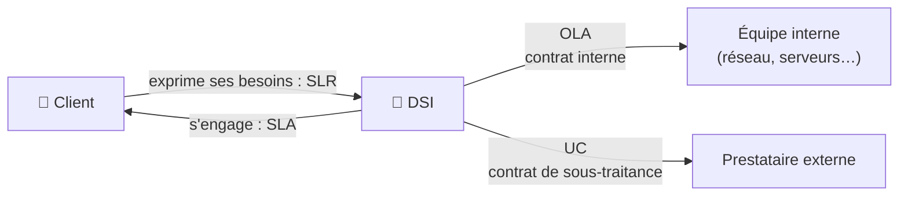
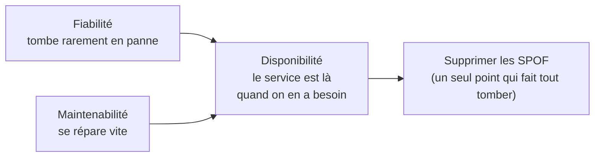
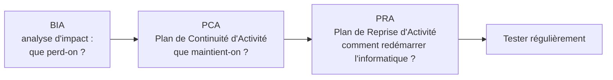

# Module 3 : Les publications centrales - Stratégie et conception des services

*Cours : [Cours 6 - Sensibilisation ITIL et gestion de parc](../index.md)*

## 🎯 Objectif du module

Connaître les deux premières phases du cycle de vie : la **stratégie** (quels services offrir ?) et la **conception** (comment les construire ?), et savoir ce que contient un **SLA**.

!!! abstract "En clair"
    Avant de proposer un service, la DSI se demande **lequel** offrir, **pour qui** et **à quel prix** : c'est la **stratégie**. Ensuite, elle le **dessine** : besoins du client, solution technique, niveau de qualité promis dans un **contrat (SLA)**, disponibilité, sécurité, fournisseurs : c'est la **conception**.

## 🗺️ L'essentiel en schémas

!!! info "Référentiel TSSR 2026"
    **CCP 1 · compétence 3** (respecter les engagements de délai d'un SLA) et **CCP 3 · compétence 9 : Assurer la continuité et la reprise** (PCA, PRA, disponibilité, SPOF).

**① Les contrats autour d'un service**

**② Disponibilité = fiabilité + maintenabilité**

**③ Continuité : préparer la catastrophe**

## 📖 Cours consolidé

### 1. La stratégie des services

**But** : offrir des services de qualité qui apportent de la **valeur**, en restant proche des métiers et **concurrentiel**.

| Processus | Rôle |
|---|---|
| **Gestion de la stratégie** | Définir la stratégie selon le marché, les clients, la concurrence et les moyens de l'entreprise |
| **Gestion du portefeuille** | Liste de **tous** les services : futurs, actuels, retirés. Les actuels forment le **catalogue** |
| **Gestion des demandes** | Anticiper les besoins **futurs** des clients (l'un des plus critiques) |
| **Gestion financière** | Calculer le **coût** d'un service pour en fixer le **prix** |
| **Gestion de la relation métier** | Garder la **confiance** et la satisfaction des clients |

**Les 4 P de la stratégie** : **Perspective** (vision, mission) · **Position** (se différencier) · **Plans** (comment y arriver) · **Patterns** (des décisions cohérentes dans la durée).

| Terme | Sens |
|---|---|
| **ROI** | Retour sur investissement : ce que rapporte une dépense, et en combien de temps |
| **TCO** | Coût total de possession : **tous** les coûts, y compris cachés (ex. techniciens mal formés) |
| **Coûts directs / indirects** | Factures de matériel / frais de l'entreprise (locaux…) |
| **Prix** | Coût + marge |

### 2. La conception des services

**But** : construire le service à partir de la stratégie : recueillir les **exigences** du client (**SLR**), définir la **solution**, les **processus** et les **indicateurs**.

**Faire ou faire faire ?** Réalisation interne ou **sous-traitance**, maintenance applicative par un tiers (**TMA**), exploitation **infogérée**, sous-traitance d'un processus métier comme la paie (**BPO**), service hébergé chez un fournisseur (**ASP**), consultants experts (**KPO**).

| Processus | Rôle |
|---|---|
| **Coordination de la conception** | Fait travailler les processus ensemble |
| **Gestion du catalogue** | Tenir à jour la liste des services disponibles |
| **Gestion des niveaux de service** | Négocier et suivre les **SLA** |
| **Gestion de la disponibilité** | Respecter les SLA de disponibilité, supprimer les **SPOF** |
| **Gestion de la capacité** | Assez de ressources, au meilleur coût · 3 niveaux : métier (besoins futurs), service (performances actuelles), composants (ressources) |
| **Gestion de la continuité** | Continuer en mode **dégradé** : **PCA** testé régulièrement |
| **Gestion de la sécurité** | Disponibilité, confidentialité, intégrité, authenticité, non-répudiation |
| **Gestion des fournisseurs** | Contrats, qualité, litiges avec les prestataires |

**Les 4 P de la conception** : **Personnes** · **Processus** · **Produits** (outils) · **Partenaires** (fournisseurs).

### 3. Le SLA et ses cousins

| Sigle | C'est… | Entre qui ? |
|---|---|---|
| **SLR** | L'**expression des besoins** du client | Client → DSI |
| **SLA** | L'**accord de niveau de service** | DSI ↔ **client** |
| **OLA** | Accord **interne** pour tenir le SLA (souvent sans pénalités) | DSI ↔ **équipe interne** |
| **UC** | **Contrat de sous-traitance** pour tenir le SLA (avec clauses juridiques) | DSI ↔ **prestataire externe** |
| **SLM** | Le **responsable** des niveaux de service | — |
| **SIP** | Programme d'**amélioration** des services | — |

**Ce que contient un SLA** : description du service, **heures du support**, **disponibilité**, performances, continuité, sécurité, changements, mise en production, **reporting**, coûts et prix, devoirs du client, date de début et durée.

### 4. Disponibilité, continuité, sécurité : le vocabulaire

| Terme | Sens |
|---|---|
| **Fiabilité** | Fonctionner longtemps sans incident |
| **Maintenabilité** | Être remis en marche rapidement |
| **Résilience** | Continuer même si un composant tombe |
| **SPOF** | *Single Point Of Failure* : un élément unique dont la panne arrête tout |
| **BIA** | Analyse d'impact : quelles pertes si l'activité s'arrête ? |
| **PCA** | Plan de **Continuité** d'Activité : ce qu'on maintient pendant la crise |
| **PRA** | Plan de **Reprise** d'Activité : comment on redémarre l'informatique |
| **Intégrité** | L'information n'a pas été modifiée frauduleusement |
| **Confidentialité** | Accessible **seulement** aux personnes autorisées |
| **Non-répudiation** | Impossible de nier avoir fait une action |

## 📝 Fiche de révision

| Notion | À retenir |
|---|---|
| **Portefeuille / catalogue** | Tous les services (passés, présents, futurs) / seulement les services actuels |
| **ROI / TCO** | Retour sur investissement / coût total de possession |
| **SLR → SLA** | Besoin du client → engagement de la DSI |
| **OLA / UC** | Contrat interne / contrat de sous-traitance |
| **Disponibilité** | Fiabilité + maintenabilité |
| **SPOF** | Point unique de défaillance, à supprimer |
| **PCA / PRA** | Continuer / redémarrer |
| **Sécurité** | Disponibilité, confidentialité, intégrité, authenticité, non-répudiation |

### ⚠️ Les pièges

- **SLA** = avec le **client** ; **OLA** = en **interne** ; **UC** = avec un **prestataire**.
- **Portefeuille ≠ catalogue** : le catalogue ne contient que les services **actuels**.
- **PCA ≠ PRA** : le PCA maintient l'activité, le PRA la fait redémarrer.

### ✏️ Entraîne-toi (clique pour voir la correction)

??? question "1. Le SLA promet la messagerie disponible 99,5 % du temps. L'équipe serveurs s'engage à remplacer un disque en 4 h, et le fabricant à livrer la pièce en 24 h. Nomme les 3 contrats."
    Client ↔ DSI : **SLA** · DSI ↔ équipe serveurs : **OLA** · DSI ↔ fabricant : **UC**.

??? question "2. Toute l'entreprise dépend d'un seul routeur Internet. Quel est le problème, et quel processus s'en occupe ?"
    C'est un **SPOF** : sa panne coupe tout. La **gestion de la disponibilité** cherche à le supprimer (routeur de secours, 2ᵉ lien).

## 🧠 Quiz — entraîne-toi

