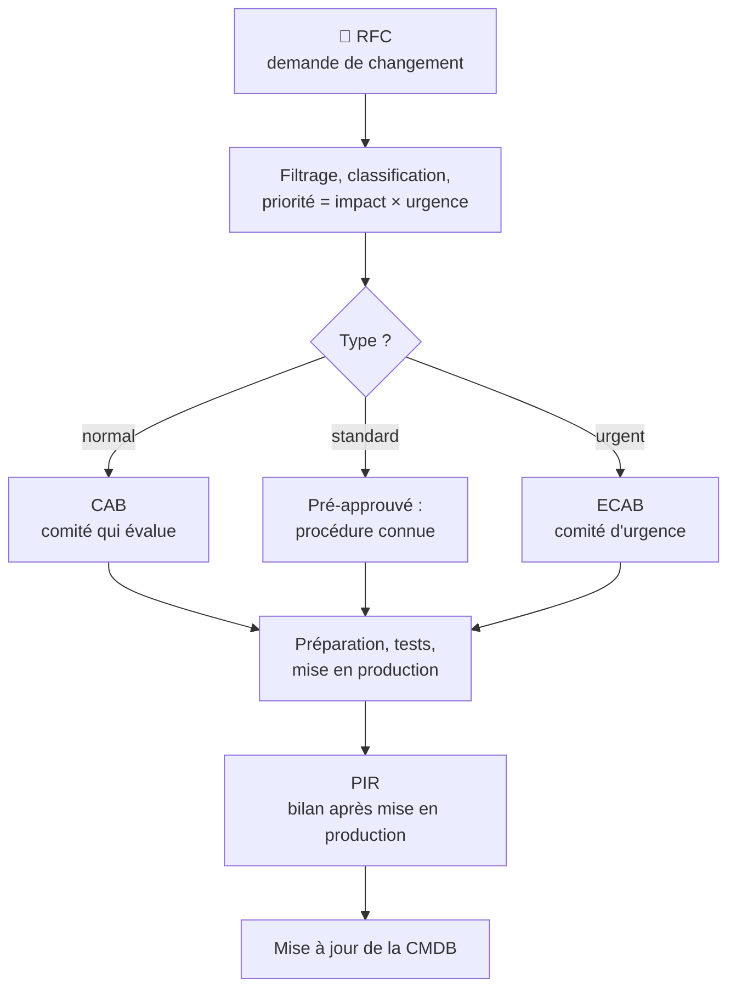
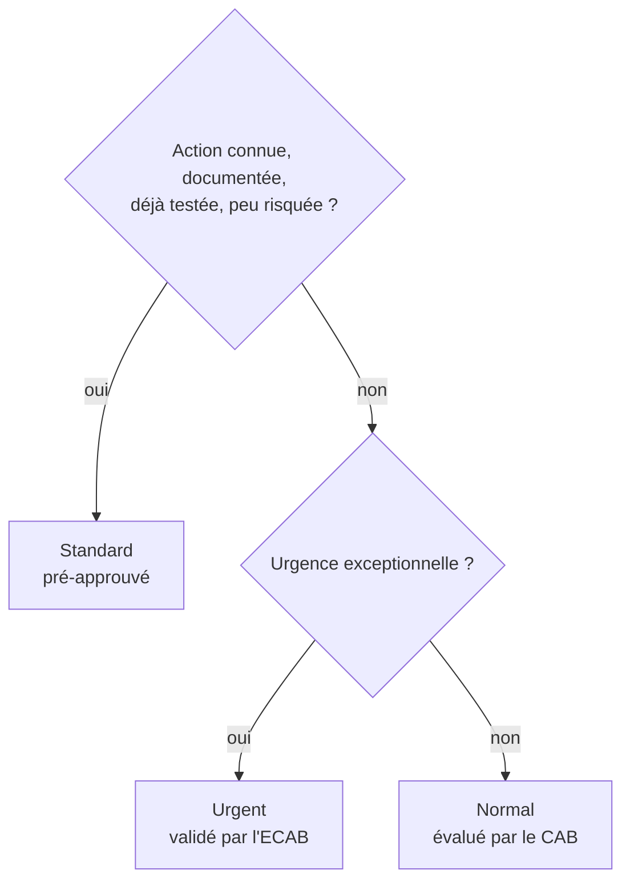
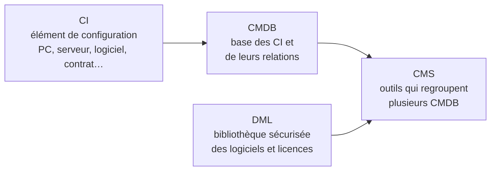

# Module 4 : La transition des services

*Cours : [Cours 6 - Sensibilisation ITIL et gestion de parc](../index.md)*

## 🎯 Objectif du module

Comprendre comment un service passe **en production** sans casser l'existant : la **gestion des changements** (RFC, CAB, types de changement), les **éléments de configuration** et la **CMDB**, les **déploiements** et la **gestion de la connaissance**.

!!! abstract "En clair"
    Mettre à jour un serveur, ajouter un logiciel, changer un pare-feu : chaque modification peut provoquer une panne. ITIL impose de **demander** (RFC), de **faire valider**, de **tester**, de **planifier**, puis de **mettre à jour l'inventaire** (CMDB). Rien ne change « en douce ».

## 🗺️ L'essentiel en schémas

!!! info "Référentiel TSSR 2026"
    **CCP 3 · compétence 10 : Mettre à jour les éléments de l'infrastructure** (une mise à jour est un **changement**) et **CCP 1 · compétence 3** (traçabilité, base de connaissances).

**① La vie d'une demande de changement**

**② Changement standard, normal ou urgent ?**

**③ Où sont rangées les informations ?**

## 📖 Cours consolidé

### 1. La transition des services

**But** : **mettre en production** les services nouveaux ou modifiés, en respectant la conception, les coûts, la qualité, la sécurité et les délais. Tout commence par une **RFC** (*Request For Change*).

Ses processus : gestion des **changements** · gestion des **actifs et des configurations** · **planification** et support à la transition · **évaluation** des changements · **validation et tests** · gestion des **déploiements et mises en production** · gestion de la **connaissance**.

### 2. La gestion des changements

Un **changement** = l'**ajout**, la **modification** ou le **retrait** d'un élément du système d'information.

**Les 7 R** à se poser : **R**aised (qui demande ?) · **R**eason (pourquoi ?) · **R**eturn (quel gain ?) · **R**isks (quels risques ?) · **R**esources (quels moyens ?) · **R**esponsible (qui en répond ?) · **R**elationship (lien avec d'autres changements ?).

**Une RFC contient** : un identifiant unique, la date, le demandeur, une **priorité proposée (impact × urgence)**, la description, les **risques**, les dates de mise en place, les ressources nécessaires.

| Type | Caractéristiques | Qui autorise ? |
|---|---|---|
| **Standard** | Connu, documenté, testé, faible risque, dans un catalogue de changements pré-autorisés | **Pré-approuvé** |
| **Normal** | Évaluation complète nécessaire | Le **CAB** |
| **Urgent** | Exceptionnel, procédures raccourcies | L'**ECAB** |

| Sigle | Sens |
|---|---|
| **CAB** | *Change Advisory Board* : comité qui évalue les changements normaux |
| **ECAB** | *Emergency CAB* : comité qui autorise les changements urgents |
| **PIR** | *Post Implementation Review* : bilan après la mise en production |

### 3. Actifs et configurations

- Un **CI** (*Configuration Item*) = un composant qui contribue à un service : **matériel**, **logiciel**, équipement **réseau**, téléphonie, **contrat**, **documentation**, procédure… Il a un type, des **attributs** et des **relations** avec d'autres CI.
- La **CMDB** (*Configuration Management DataBase*) enregistre les CI ; le **CMS** regroupe plusieurs CMDB ; la **DML** (*Definitive Media Library*) stocke en sécurité les **logiciels** de référence, leurs médias et leurs **licences**.
- Activités : **identifier** (étiqueter, définir les attributs) · **contrôler** · suivre les **états** · **vérifier et auditer** (les données sont-elles à jour ?).

💡 Dans GLPI, le **parc** (ordinateurs, logiciels, réseau, contrats) joue le rôle de la CMDB.

### 4. Mises en production et déploiements

| Mode | Principe |
|---|---|
| **Push** | Le centre **envoie** la mise à jour vers les postes |
| **Pull** | La mise à jour est **mise à disposition** ; l'utilisateur la lance |
| **Big bang** | Tout le monde **en une fois** |
| **Par phases** | Par **groupes**, selon un plan |
| **Manuel / automatique** | Par un technicien / sans intervention (conseillé) |

Les autres processus : l'**évaluation** mesure l'impact et produit la **PIR** · la **validation et les tests** produisent les **procès-verbaux de recette** · la **planification** gère les ressources de la transition.

### 5. La gestion de la connaissance

But : donner **la bonne information**, au **bon niveau de détail**, à la **bonne personne**, pour décider vite et **ne pas résoudre deux fois le même problème**. L'outil : le **SKMS** (*Service Knowledge Management System*), dont fait partie la **base de connaissances**.

📌 Une base de connaissances **utilisée** vaut mieux qu'une base énorme que personne ne lit.

## 📝 Fiche de révision

| Notion | À retenir |
|---|---|
| **RFC** | Demande de changement formalisée |
| **Priorité** | Impact × urgence |
| **Standard / normal / urgent** | Pré-approuvé / CAB / ECAB |
| **PIR** | Bilan après mise en production |
| **CI** | Tout composant qui contribue à un service |
| **CMDB** | Base des CI et de leurs relations |
| **DML** | Bibliothèque des logiciels et licences de référence |
| **Push / pull** | Envoyé / mis à disposition |
| **SKMS** | Système de gestion de la connaissance |

### ⚠️ Les pièges

- Le **CAB** évalue les changements **normaux** ; l'**ECAB** autorise les **urgents** ; les **standards** sont **pré-approuvés**.
- Un **contrat** ou une **documentation** peuvent être des **CI**.
- Après un changement, on **met à jour la CMDB**, sinon l'inventaire devient faux.

### ✏️ Entraîne-toi (clique pour voir la correction)

??? question "1. Chaque mois, tu installes les correctifs Windows avec la même procédure testée. Quel type de changement ?"
    **Standard** : connu, documenté, testé, faible risque, donc **pré-approuvé**.

??? question "2. Une faille critique est exploitée sur le pare-feu ce matin. Le correctif doit passer avant ce soir. Qui autorise ?"
    C'est un changement **urgent** : il est autorisé par l'**ECAB**. On fera ensuite une **PIR** et on mettra à jour la **CMDB**.

## 🧠 Quiz — entraîne-toi

