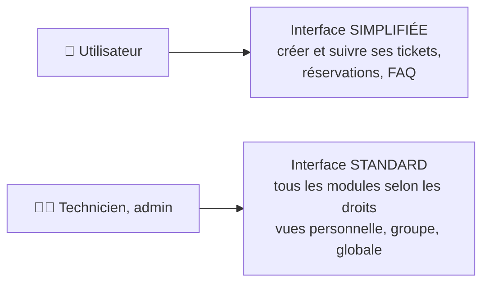
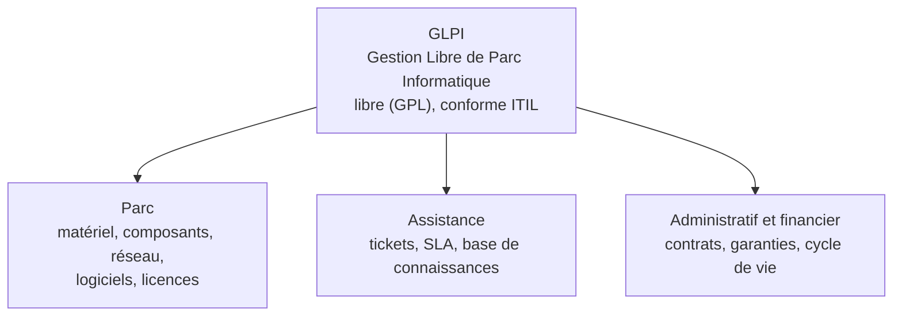
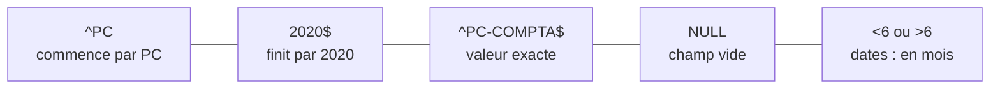

# Module 5 : GLPI

*Cours : [Cours 6 - Sensibilisation ITIL et gestion de parc](../index.md)*

## 🎯 Objectif du module

Découvrir **GLPI**, l'outil libre de **gestion de parc** et de **centre de services**, ses deux interfaces et surtout ses **recherches**.

!!! abstract "En clair"
    GLPI, c'est **l'inventaire** de tout le matériel et les logiciels de l'entreprise **et** l'outil de **tickets** du support, dans une seule application web. Savoir y **chercher vite** (« tous les PC Windows 10 achetés avant 2020 ») est une compétence de tous les jours.

## 🗺️ L'essentiel en schémas

!!! info "Référentiel TSSR 2026"
    **CCP 1 · compétence 3 : Apporter une assistance technique** (outil de tickets, traçabilité) et **compétence 2 : Assurer le déploiement des équipements numériques** (inventaire et cycle de vie du matériel).

**① GLPI : deux interfaces, deux publics**

**② Ce que gère GLPI**

**③ Les caractères spéciaux de recherche**

## 📖 Cours consolidé

### 1. GLPI en bref

- **GLPI** = *Gestion Libre de Parc Informatique* : logiciel **libre** (licence **GPL**), en plusieurs langues, avec des **plugins**, installable sous **Linux ou Windows**.
- C'est un outil **ITSM** (*IT Service Management*) **conforme à ITIL** : **gestion de parc** + **centre de services**.
- Pour les petits comme les grands systèmes d'information.

### 2. Ce que contient le parc

Inventaire **matériel** (vue détaillée, connexions), **composants** internes, **réseau** (cartographie), **systèmes d'exploitation**, **logiciels et licences**, **cycle de vie** et **historique** de chaque élément, **réservation** de matériel, informations **administratives et financières**.

### 3. Les deux interfaces

| Interface | Pour qui ? | Ce qu'on y fait |
|---|---|---|
| **Simplifiée** | Les **utilisateurs** | Créer un ticket, suivre ses tickets, réservations, **FAQ** |
| **Standard** | **Techniciens et administrateurs** | Tous les modules selon les droits · 3 vues : **personnelle**, **groupe**, **globale** |

### 4. Chercher dans GLPI

| Recherche | Principe |
|---|---|
| **Rapide** | Sur les champs **affichés** |
| **Multicritère** | Plusieurs critères reliés par **ET / OU / ET PAS / OU PAS** · opérateurs : *contient, est, n'est pas, sous, avant, après…* |
| **Avancée** | Avec des **caractères spéciaux** (ci-dessous) |
| **Sauvegardée** | Un nom, une visibilité, une entité : on la relance en un clic |

| Caractère | Effet | Exemple |
|---|---|---|
| `^` | **Commence** par | `^PC` |
| `$` | **Finit** par | `2020$` |
| `^…$` | Valeur **exacte** | `^PC-COMPTA$` |
| `NULL` | Champ **vide** | numéro de série manquant |
| `<6` / `>6` | Dates : il y a **moins / plus de 6 mois** | garanties qui expirent |
| `AAAA-MM-JJ` | Une date précise | `2026-11-20` |

### 5. Travailler sur une liste

- **Colonnes personnalisables**, nombre d'éléments par page, **export** (CSV, PDF…), **corbeille**.
- **Modification massive** : on cherche, on coche les résultats, on applique **la même action** à tous (changer le lieu, le statut, l'utilisateur…).
- **Fiche d'un élément** : tous ses onglets (composants, logiciels, réseau, historique, tickets liés…).

## 📝 Fiche de révision

| Notion | À retenir |
|---|---|
| **GLPI** | Gestion Libre de Parc Informatique, libre (GPL), ITSM conforme ITIL |
| **Interface simplifiée** | Utilisateurs : tickets, réservations, FAQ |
| **Interface standard** | Techniciens et admins : tous les modules |
| **`^` / `$` / `^…$`** | Commence / finit / exact |
| **`NULL`** | Champ vide |
| **`<6` sur une date** | Moins de 6 mois |
| **Modification massive** | Même action sur tous les résultats d'une recherche |

### ⚠️ Les pièges

- La recherche **rapide** ne porte que sur les champs **affichés**.
- `^PC$` cherche **exactement** « PC », pas « PC-01 ».
- Une modification massive s'applique à **tous** les résultats : vérifie la recherche avant.

### ✏️ Entraîne-toi (clique pour voir la correction)

??? question "1. Trouve tous les ordinateurs dont le numéro de série n'a jamais été saisi."
    Parc → Ordinateurs → critère **Numéro de série** → valeur **`NULL`**.

??? question "2. 40 PC déménagent du site de Lyon à celui de Nantes. Comment changer leur lieu sans ouvrir 40 fiches ?"
    Recherche **Lieu = Lyon**, coche les résultats, puis **Actions → Modifier** (modification massive) → Lieu = **Nantes**.

## 🧠 Quiz — entraîne-toi

