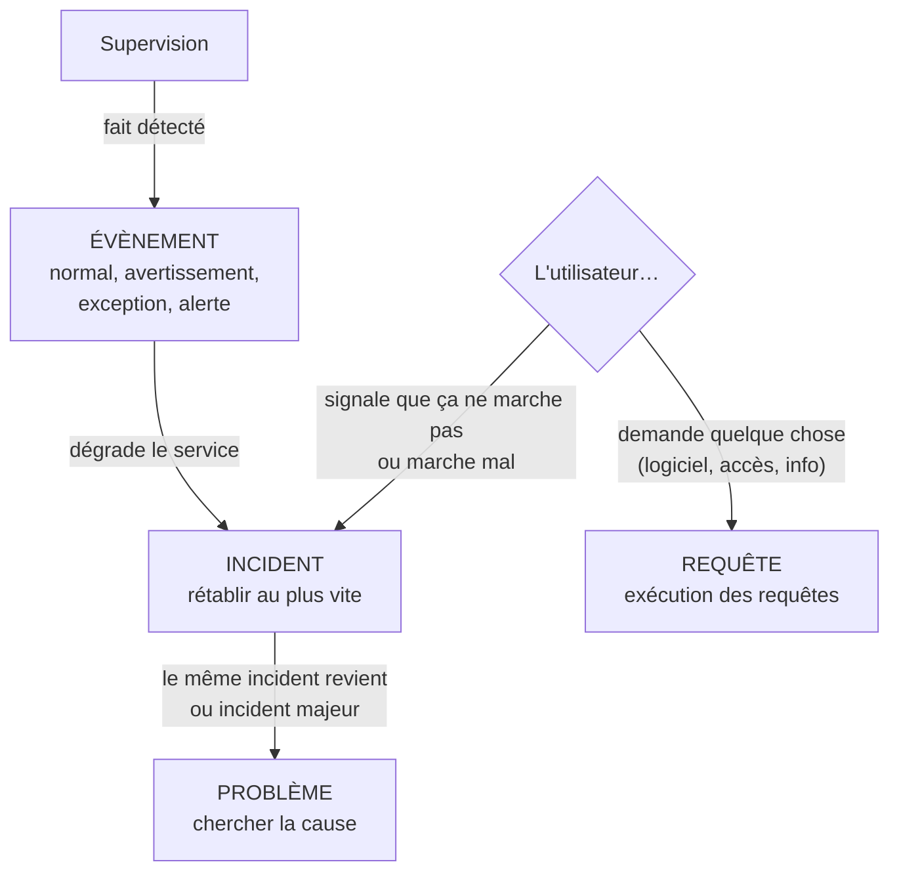
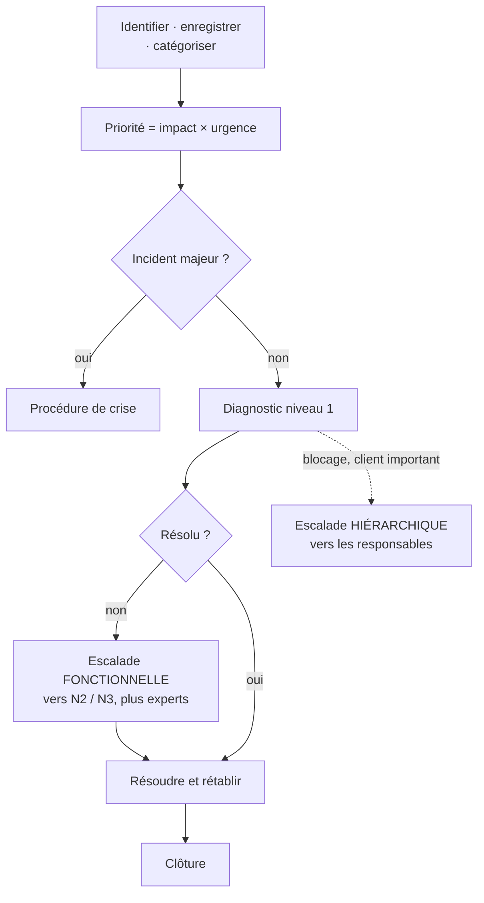
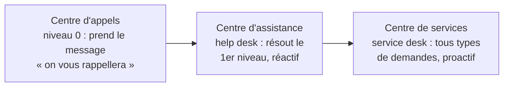

# Module 6 : Les publications centrales - Exploitation des services

*Cours : [Cours 6 - Sensibilisation ITIL et gestion de parc](../index.md)*

## 🎯 Objectif du module

Connaître la phase d'**exploitation** : le **centre de services**, les **niveaux de support**, les **architectures** de centre de services, et les 5 processus : **requêtes**, **accès**, **incidents**, **problèmes**, **évènements**.

!!! abstract "En clair"
    C'est **ton futur quotidien** de technicien. L'utilisateur appelle le **centre de services** (le *service desk*). Si quelque chose est cassé, c'est un **incident** : on **rétablit vite**, même avec un contournement. Si le même incident revient sans cesse, on ouvre un **problème** pour trouver la **cause**. Si l'utilisateur demande quelque chose (un logiciel, un accès), c'est une **requête**.

## 🗺️ L'essentiel en schémas

!!! info "Référentiel TSSR 2026"
    **CCP 1 · compétence 3 : Apporter une assistance technique** (qualifier, prioriser, escalader, tracer) et **CCP 3 · compétence 10 : Superviser** (gestion des évènements, seuils, alertes).

**① Incident, requête, problème ou évènement ?**

**② Traiter un incident**

**③ Du centre d'appels au centre de services**

## 📖 Cours consolidé

### 1. L'exploitation des services

**But** : faire **tourner** les services au quotidien en tenant les **SLA** : exploitation, supervision, pilotage, support, maintenance. Elle cherche l'équilibre entre **stabilité** et **réactivité**, entre **coûts** et **qualité**, entre **réagir** et **anticiper** (proactivité).

**Les 4 fonctions** : le **centre de services** · la gestion **technique** (serveurs, réseau, stockage, datacenters) · la gestion des **opérations** (consoles, ordonnancement, impressions, **sauvegardes**, moyens généraux) · la gestion des **applications** (métiers, finance, RH).

### 2. Le centre de services (*service desk*)

- **Point de contact unique** des utilisateurs, **vitrine** de la DSI.
- Répond aux questions et demandes, **rétablit** le service au plus vite dans les délais du SLA.
- Assure le **niveau 1**, gère les **escalades** vers les niveaux 2 et 3, et **coordonne**.
- Ses activités : prendre l'appel → **ouvrir le ticket** → enregistrer → **catégoriser** → codifier (priorité) → diagnostiquer → **escalader** si besoin → **suivre** → résoudre et **clôturer** → enquête de **satisfaction** → mettre à jour la **base de connaissances**.

| Niveau | Nom | Ce qu'il fait |
|---|---|---|
| 0 | **Centre d'appels** | Prend l'appel et le transmet, très peu de valeur ajoutée |
| 1 | **Centre d'assistance** (*help desk*) | Résout les incidents de 1er niveau, **réactif** |
| — | **Centre de services** (*service desk*) | Toutes les demandes, **proactif**, participe aux changements et mises en production |

### 3. Les 4 architectures de centre de services

| Architecture | Principe | ➕ | ➖ |
|---|---|---|---|
| **Local** | Sur le **même site** que les utilisateurs | Proximité, réactivité | Pas de mutualisation |
| **Centralisé** | Un **site unique**, joint par téléphone, mail, intranet | Mutualisation, procédures homogènes | Moins proche, moins réactif → **prise en main à distance**, technicien de proximité |
| **Virtuel** | Plusieurs centres reliés : l'appel va au **technicien au meilleur profil** | Crédibilité, réactivité | Outils téléphoniques (SVI), coordination |
| **Qui suit le soleil** | Centres répartis sur **plusieurs fuseaux horaires** : 24 h/24 | Toujours une équipe de jour | Procédures et **langue communes** (souvent l'anglais) |

**Outils** : autocommutateur, **SVI** (serveur vocal interactif, « tapez 1 »), couplage téléphonie-informatique, outil de tickets, **CMS**, **KEDB**, **SKMS**, portail en **libre-service**.

### 4. Les 5 processus de l'exploitation

| Processus | Rôle |
|---|---|
| **Exécution des requêtes** | Traiter les **demandes** des utilisateurs : assistance, conseil, information, matériel, accès, **plainte**, changement standard simple · s'appuie sur un **catalogue des requêtes** |
| **Gestion des accès** | Donner les **droits** prévus par la politique de sécurité : **identité**, droits, accès, groupes |
| **Gestion des incidents** | **Rétablir** le service au plus vite, sans chercher la cause |
| **Gestion des problèmes** | Trouver la **cause** des incidents **récurrents** ou majeurs |
| **Gestion des évènements** | Surveiller **tout ce qui est détectable** pour **anticiper** les incidents |

### 5. La gestion des incidents

- **Incident** = un évènement qui **arrête ou dégrade** un service. Tous les évènements ne deviennent pas des incidents.
- On cherche à **rétablir**, quitte à utiliser une **solution de contournement** : la **cause** est l'affaire de la gestion des problèmes.
- **Codifier** = fixer la **priorité** à partir de l'**impact** (combien d'utilisateurs bloqués, obligations légales…) et de l'**urgence** (le temps dont on dispose).

| Priorité | Description | Délai de résolution (exemple du cours) |
|---|---|---|
| 1 | Critique | 1 heure |
| 2 | Élevée | 8 heures |
| 3 | Moyenne | 24 heures |
| 4 | Faible | 48 heures |
| 5 | Planifiée | Au mieux |

- **Incident majeur** : fort impact, hors grille, traité par une **procédure de crise** (puis un *post-mortem*).
- **Escalade fonctionnelle** : on passe à une équipe **plus experte** ou d'un autre domaine (N1 → N2 → N3).
- **Escalade hiérarchique** : on alerte la **hiérarchie** (incident majeur, client important, manque de moyens).

### 6. La gestion des problèmes

- **Problème** = la **cause inconnue** d'un ou plusieurs incidents. On en ouvre un pour des incidents **récurrents** ou un incident **majeur**.
- **Erreur connue** = un problème dont on connaît la **cause** et un **contournement** ou une solution. Elles sont rangées dans la **KEDB** (*Known Error DataBase*), consultée par le centre de services.
- Si la solution demande une modification → **RFC** vers la gestion des changements (module 4).

| | Gestion des incidents | Gestion des problèmes |
|---|---|---|
| Quand ? | **Tout de suite** (en première ligne) | **Ensuite** (en coulisses) |
| But | **Rétablir** | Trouver la **cause** |

### 7. La gestion des évènements

**Évènement** = un fait **détectable** et **mesurable** sur le SI (changement d'état d'un composant). **Sans outil de supervision, pas d'évènement.**

| Type | Sens |
|---|---|
| **Normal** (information) | Fonctionnement normal |
| **Avertissement** | Inhabituel : on **approche d'un seuil** |
| **Exception** | Anormal : peut devenir un **incident** |
| **Alerte** | Un **seuil** prédéfini est franchi : **intervention** selon une consigne |

## 📝 Fiche de révision

| Notion | À retenir |
|---|---|
| **Centre de services** | Point de contact unique, niveau 1, escalades |
| **Help desk / service desk** | Réactif, 1er niveau / toutes demandes, proactif |
| **Requête** | Une **demande** (ce n'est pas une panne) |
| **Incident** | Service arrêté ou dégradé → **rétablir** |
| **Problème** | **Cause** inconnue d'incidents récurrents |
| **Erreur connue / KEDB** | Cause connue + contournement / leur base |
| **Évènement** | Fait détectable : normal, avertissement, exception, alerte |
| **Priorité** | Impact × urgence |
| **Escalade fonctionnelle / hiérarchique** | Vers plus expert / vers la hiérarchie |
| **Architectures** | Local, centralisé, virtuel, qui suit le soleil |

### ⚠️ Les pièges

- **Incident ≠ problème** : l'incident se **rétablit**, le problème se **résout à la cause**.
- **Requête ≠ incident** : « je voudrais un 2ᵉ écran » n'est pas une panne.
- **Fonctionnelle** = vers plus **compétent** ; **hiérarchique** = vers plus **haut placé**.
- Un **évènement** ne devient incident **que s'il dégrade** le service.

### ✏️ Entraîne-toi (clique pour voir la correction)

??? question "1. Classe : a) « Mon imprimante n'imprime plus » · b) « Je voudrais accès au dossier Compta » · c) l'imprimante du 2ᵉ étage tombe en panne pour la 5ᵉ fois ce mois-ci · d) la supervision signale un disque à 85 %."
    a) **Incident** · b) **Requête** (gestion des accès) · c) **Problème** (incidents récurrents : chercher la cause) · d) **Évènement** de type **avertissement**.

??? question "2. Le serveur de paie tombe la veille du versement des salaires, 300 personnes impactées. Que fais-tu ?"
    Impact **élevé** + urgence **élevée** → priorité **1**, probablement un **incident majeur** : procédure de **crise**, **escalade hiérarchique** (prévenir les responsables) et **fonctionnelle** (équipe serveurs). Ensuite, ouverture d'un **problème** pour trouver la cause.

## 🧠 Quiz — entraîne-toi

