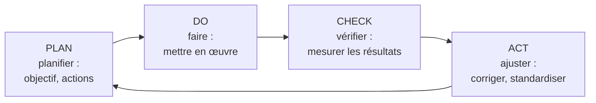
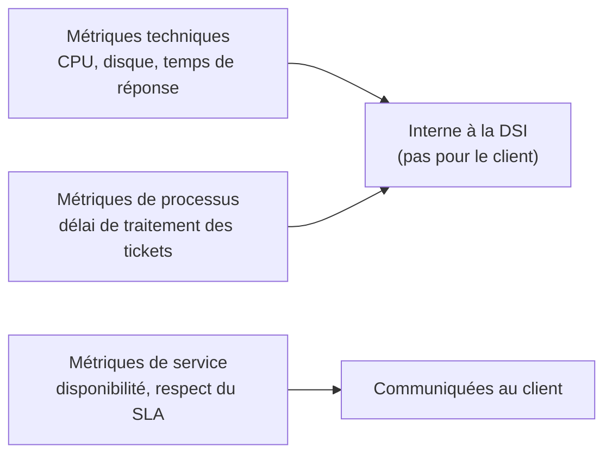

# Module 7 : Les publications centrales - Amélioration continue des services

*Cours : [Cours 6 - Sensibilisation ITIL et gestion de parc](../index.md)*

## 🎯 Objectif du module

Comprendre l'**amélioration continue des services** et la **roue de Deming** (PDCA).

!!! abstract "En clair"
    Un service n'est jamais « fini » : on **mesure** ce qu'il donne, on **compare** avec ce qu'on a promis (SLA), on **corrige**, puis on recommence. C'est la **roue de Deming** : **P**lanifier, **D**éployer, **C**ontrôler, **A**juster.

## 🗺️ L'essentiel en schémas

!!! info "Référentiel TSSR 2026"
    **CCP 3 · compétence 10 : Superviser** (les mesures et indicateurs) et **CCP 1 · compétence 3** (enquêtes de satisfaction, amélioration du support).

**① La roue de Deming (PDCA)**

**② Quelles mesures, pour qui ?**

## 📖 Cours consolidé

### 1. Les objectifs

- **Analyser** les résultats des contrats (**SLA**, **OLA**, **UC**).
- Trouver et mettre en œuvre les actions qui **améliorent** les services.
- Améliorer la **rentabilité sans baisser la qualité** (efficience) et la **relation client**.
- Vérifier que les méthodes de gestion sont **efficaces**.

### 2. Les missions

Analyser les **tendances**, mener des **enquêtes de satisfaction** et des **audits internes**, faire des **recommandations**, conduire des **revues** d'amélioration.

### 3. Les indicateurs

| Sigle | Sens |
|---|---|
| **KPI** (*Key Performance Indicator*) | Indicateur **chiffré** de performance (ex. % de tickets résolus en moins de 8 h) |
| **CSF** (*Critical Success Factor*) | Facteur **clé de succès** : ce qui doit absolument réussir (ex. « un support réactif ») |
| **Base de référence** (*baseline*) | Le **point de départ** mesuré, pour comparer ensuite |

| Type de mesure | Exemple | Pour qui ? |
|---|---|---|
| **Technique** | Charge CPU, espace disque | DSI seulement |
| **De processus** | Temps moyen de traitement d'un ticket | DSI |
| **De service** | Disponibilité de la messagerie sur le mois | **Le client** |

### 4. La roue de Deming

| Étape | En clair | Exemple au support |
|---|---|---|
| **Plan** | Fixer un objectif et un plan | « Résoudre 80 % des tickets en N1 » |
| **Do** | Agir | Rédiger 20 articles de base de connaissances |
| **Check** | Mesurer | Taux de résolution en N1 le mois suivant |
| **Act** | Corriger, généraliser | Ajouter les articles manquants, former l'équipe |

## 📝 Fiche de révision

| Notion | À retenir |
|---|---|
| **Amélioration continue** | Mesurer → comparer aux SLA → améliorer |
| **PDCA** | Plan, Do, Check, Act |
| **KPI** | Indicateur chiffré de performance |
| **CSF** | Facteur clé de succès |
| **Baseline** | Point de départ mesuré |
| **Métriques de service** | Les seules communiquées au client |

### ⚠️ Les pièges

- **KPI** = un **chiffre** · **CSF** = un **objectif qualitatif** à atteindre.
- On ne montre **pas** les métriques **techniques** au client : il veut savoir si **son service** marche.

### ✏️ Entraîne-toi (clique pour voir la correction)

??? question "1. Les utilisateurs se plaignent du support. Applique le PDCA."
    **Plan** : mesurer la satisfaction actuelle (baseline) et viser un objectif · **Do** : actions (base de connaissances, formation, horaires) · **Check** : nouvelle enquête, KPI de délai · **Act** : garder ce qui marche, corriger le reste, et recommencer.

## 🧠 Quiz — entraîne-toi

