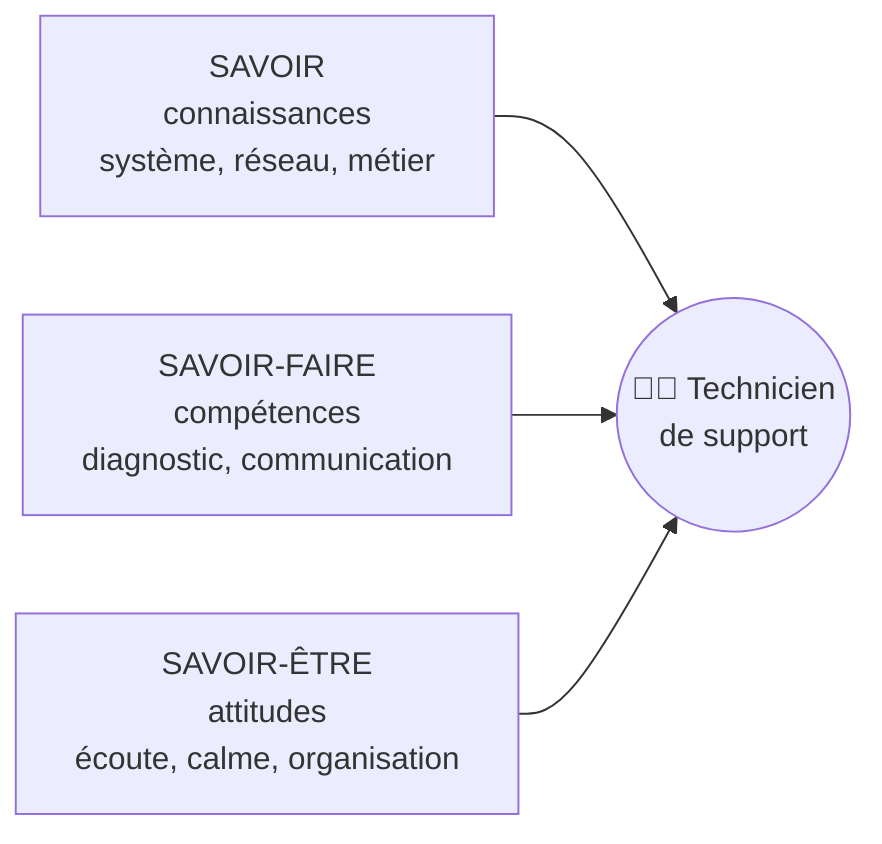
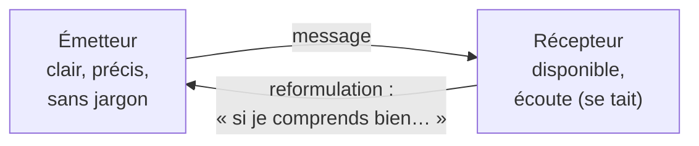

# Module 8 : Savoirs, savoir-faire et savoir-être

*Cours : [Cours 6 - Sensibilisation ITIL et gestion de parc](../index.md)*

## 🎯 Objectif du module

Connaître les **savoirs** (connaissances), **savoir-faire** (compétences, surtout la **communication**) et **savoir-être** (attitudes) d'un bon technicien de support.

!!! abstract "En clair"
    Un excellent technicien qui **parle mal** à l'utilisateur laisse une mauvaise image de toute la DSI. Au support, la manière de **écouter**, **reformuler**, **expliquer** et **écrire** compte autant que la technique.

## 🗺️ L'essentiel en schémas

!!! info "Référentiel TSSR 2026"
    **CCP 1 · compétence 3 : Apporter une assistance technique.** Le référentiel insiste sur l'accompagnement des utilisateurs, y compris **en situation de handicap**, la **sensibilisation** aux bonnes pratiques et la **rédaction** de documentation : ce sont des savoir-faire et savoir-être évalués à l'oral.

**① Les 3 savoirs du technicien**

**② Bien communiquer : on est tour à tour émetteur et récepteur**

## 📖 Cours consolidé

### 1. Le rôle du technicien de support

Régler les **incidents** et **problèmes** des utilisateurs, **diagnostiquer**, réparer le matériel, proposer des **contournements**, remplacer le matériel défectueux, **installer** du matériel, **surveiller la sécurité**, **former** les utilisateurs.

### 2. Les 3 savoirs

| Savoir | Définition | Exemples |
|---|---|---|
| **Savoir** | Les **connaissances** | Système, réseau, logiciels et métier du client |
| **Savoir-faire** | Les **compétences** acquises par l'expérience | Diagnostiquer, communiquer, rédiger |
| **Savoir-être** | Les **attitudes** adaptées aux autres | Écoute, calme, relationnel, efficacité, organisation, **veille** |

### 3. Le savoir : ne pas résoudre deux fois le même problème

« J'ai déjà eu ce problème, mais je ne sais plus comment je l'ai réglé… » → il faut une **base de connaissances** (wiki, intranet, **GLPI**) et une **veille technologique**.

- **Documenter** les bonnes pratiques, **partager** les solutions des incidents courants.
- Permettre aux utilisateurs de se **dépanner seuls** (FAQ).
- Rendre les articles visibles **aux bonnes personnes**.
- ➕ Solutions 24 h/24, **moins d'appels** au support, résolution plus rapide, donc **SLA respectés**.

### 4. Le savoir-faire : la communication

Entre ce que je pense, ce que je dis, ce que l'autre entend et ce qu'il comprend, il y a **au moins 10 occasions** de ne pas se comprendre (Bernard Werber).

- **Émetteur** : sois **clair**, **précis**, **compréhensible** (pas de jargon technique avec un utilisateur).
- **Récepteur** : sois **disponible** et **écoute** (donc tais-toi).
- **Communication externe** : informer, créer un **langage commun** (ITIL), créer la **relation**, convaincre.
- **Communication interne** : implication, adaptation au changement, bonne ambiance, **fin des rumeurs**.

### 5. Le non-verbal

| Signe | Ce qu'il peut montrer |
|---|---|
| Sourire, bras décroisés, regard direct, buste vers l'avant | **Ouverture**, sympathie |
| Sourcils froncés, poings serrés, index pointé | **Agressivité** |
| Bras croisés, peu de regard, corps tourné | **Défense** |
| Regard ailleurs, tapotement des doigts, tête dans la main | **Ennui**, distraction |

📌 Au téléphone, il n'y a pas de gestes : la **voix** (ton, débit, sourire qui s'entend) porte tout le message.

### 6. La communication écrite

Dans un ticket ou un mail : **un sujet clair**, des **phrases courtes**, **les étapes** numérotées, **sans jargon** pour l'utilisateur, **sans faute**, et un ton **courtois**. Le ticket doit permettre à **un collègue** de reprendre le travail sans te poser de question.

## 📝 Fiche de révision

| Notion | À retenir |
|---|---|
| **Savoir** | Connaissances |
| **Savoir-faire** | Compétences (expérience) |
| **Savoir-être** | Attitudes, comportement |
| **Base de connaissances** | Ne pas résoudre deux fois le même problème |
| **Écoute active** | Se taire, écouter, **reformuler** |
| **Non-verbal** | Gestes, regard, posture, voix |

### ⚠️ Les pièges

- Parler **technique** à un utilisateur non technicien.
- Couper la parole avant d'avoir **compris** le problème.
- Fermer un ticket sans **expliquer** la solution à l'utilisateur.

### ✏️ Entraîne-toi (clique pour voir la correction)

??? question "1. Un utilisateur énervé appelle : « Votre informatique ne marche jamais ! ». Que fais-tu ?"
    Rester **calme**, le **laisser s'exprimer**, montrer qu'on comprend la gêne, puis **reformuler** et poser des **questions précises** (« Qu'est-ce qui ne marche pas exactement, depuis quand ? »). On **ouvre un ticket** et on annonce la suite (délai, prochaine étape).

## 🧠 Quiz — entraîne-toi

