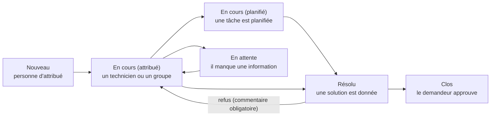
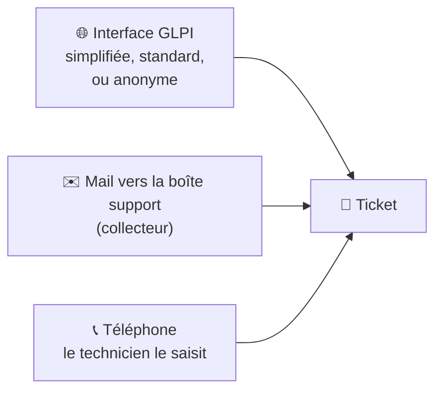
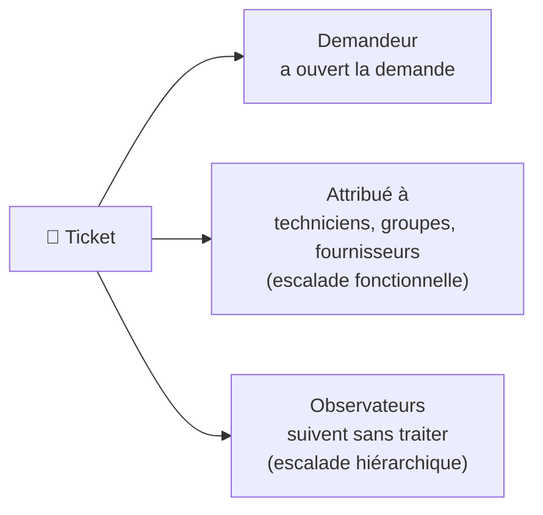

# Module 9 : Assistance avec GLPI

*Cours : [Cours 6 - Sensibilisation ITIL et gestion de parc](../index.md)*

## 🎯 Objectif du module

Savoir **créer**, **traiter** et **clôturer** un ticket dans **GLPI**, et utiliser la **base de connaissances**.

!!! abstract "En clair"
    Tout passe par un **ticket** : il garde la **trace** de la demande, de ce qui a été fait, et de qui l'a fait. Un bon ticket permet à n'importe quel collègue de reprendre le dossier, et donne des **statistiques** pour améliorer le service.

## 🗺️ L'essentiel en schémas

!!! info "Référentiel TSSR 2026"
    **CCP 1 · compétence 3 : Apporter une assistance technique** : « qualifier et traiter les demandes et incidents, appliquer les procédures de résolution et d'escalade, assurer la traçabilité ».

**① Le cycle de vie d'un ticket GLPI**

**② Trois façons de créer un ticket**

**③ Qui voit le ticket ?**

## 📖 Cours consolidé

### 1. Pourquoi des tickets ?

Un ticket est soit un **incident**, soit une **demande** (module 6). Il apporte : **traçabilité**, **détection des problèmes** (incidents qui se répètent), **répartition des tâches**, **communication** avec l'utilisateur, et des **statistiques**.

Un ticket doit contenir au minimum : le **demandeur**, la **description** claire, la **catégorie**, l'**urgence**, et si possible l'**élément concerné** (son PC, son imprimante).

### 2. Le cycle de vie

| Statut | Signification |
|---|---|
| **Nouveau** | Aucun technicien ni groupe attribué |
| **En cours (attribué)** | Au moins un technicien ou un groupe s'en occupe |
| **En cours (planifié)** | Une **tâche** a été planifiée |
| **En attente** | Il manque un élément (réponse de l'utilisateur, pièce…) : statut mis **à la main** |
| **Résolu** | Une **solution** a été apportée |
| **Clos** | Le demandeur a **approuvé** la solution |

### 3. Traiter un ticket

| Élément | Rôle |
|---|---|
| **Attribution** | Techniciens, **groupes** ou **fournisseurs** chargés du ticket · sert à l'**escalade fonctionnelle** · peut être **automatique** selon des règles |
| **Observateurs** | Reçoivent les notifications **sans traiter** · servent à l'**escalade hiérarchique** |
| **SLA** | Temps de résolution maximum, avec des **niveaux d'escalade** · dépasser l'échéance n'est **pas bloquant**, seulement **signalé** |
| **Validation** | Accord **hiérarchique** demandé (ex. achat), manuel ou automatique, **non bloquant** |
| **Onglet Traitement** | **Suivi** (échanges), **Tâche** (travail réalisé, avec durée), **Solution**, **Document** |
| **Éléments liés** | Le **CI** concerné (PC, imprimante) : aide au diagnostic et aux statistiques, si la **CMDB** est à jour |

**Clôture** : le ticket est **clos** quand le **demandeur approuve** la solution (par le mail ou l'interface simplifiée). En cas de **refus**, un **commentaire est obligatoire** et le ticket repart en traitement.

### 4. La base de connaissances

- Centralise les **solutions** des techniciens et propose une **FAQ** aux utilisateurs.
- Dans GLPI : **Outils → Base de connaissances**.
- Un article a des **cibles** (entité, profil, groupe, utilisateur). **Sans cible, il n'est pas publié** : seul son créateur le voit.
- Gestion des **révisions**, **validation** avant publication, liens avec les **tickets** et le **parc**.
- La **FAQ** (publique) évite la création de tickets : l'utilisateur trouve la réponse seul.

## 📝 Fiche de révision

| Notion | À retenir |
|---|---|
| **Statuts** | Nouveau → En cours (attribué / planifié) → En attente → Résolu → Clos |
| **Résolu / clos** | Solution donnée / solution **approuvée** par le demandeur |
| **Attribué** | Traite le ticket (escalade fonctionnelle) |
| **Observateur** | Suit sans traiter (escalade hiérarchique) |
| **Suivi / tâche / solution** | Échange / travail réalisé / réponse finale |
| **SLA dans GLPI** | Échéance signalée, non bloquante |
| **Article sans cible** | Non publié |
| **FAQ** | Base de connaissances publique pour les utilisateurs |

### ⚠️ Les pièges

- **Résolu ≠ clos** : c'est le **demandeur** qui clôt en approuvant.
- Un **observateur** ne peut pas traiter le ticket.
- Un article **sans cible** reste invisible pour les autres.
- Un ticket mal rédigé = un collègue qui doit **tout redemander**.

### ✏️ Entraîne-toi (clique pour voir la correction)

??? question "1. Tu attends que l'utilisateur te rappelle avec le message d'erreur exact. Quel statut mets-tu ?"
    **En attente** (statut à mettre à la main). Ajoute un **suivi** qui explique ce que tu attends.

??? question "2. Le même problème d'imprimante revient chaque semaine et tu as trouvé la manipulation. Que fais-tu dans GLPI ?"
    Rédige un **article** dans la base de connaissances, donne-lui des **cibles** (le groupe support, voire la **FAQ** si l'utilisateur peut le faire seul), et **lie-le** au ticket. Si l'origine reste inconnue, signale-le pour l'ouverture d'un **problème**.

## 🧠 Quiz — entraîne-toi

