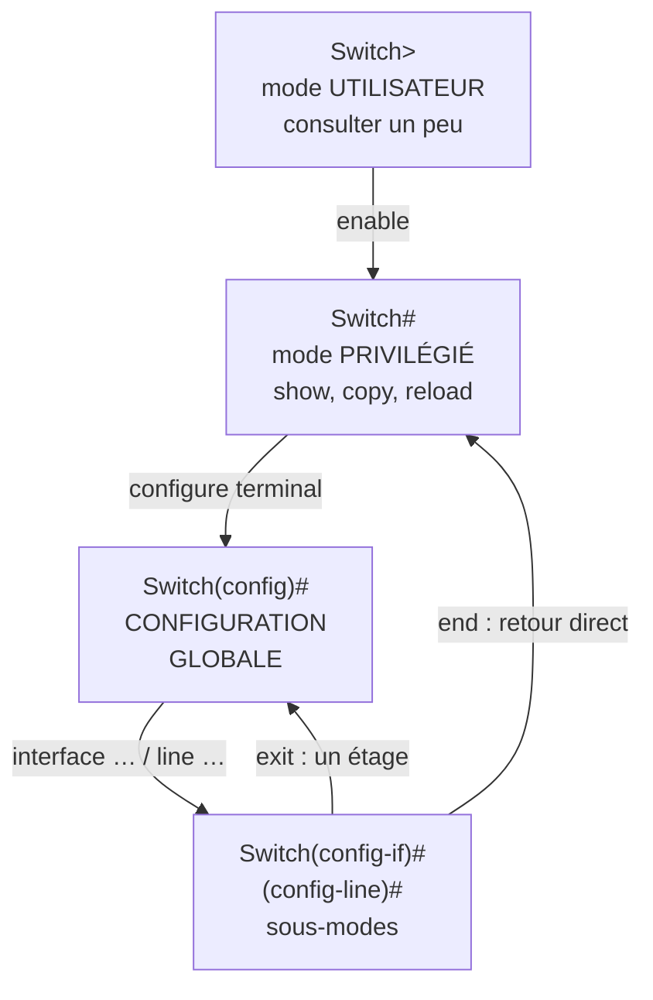
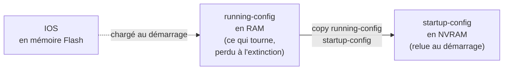

# Module 1 : La configuration initiale des périphériques

*Cours : [Cours 7 - Les infrastructures réseau](../index.md)*

## 🎯 Objectif du module

Prendre en main un équipement **Cisco** (routeur ou commutateur) : se connecter en **console**, naviguer entre les **modes** de l'IOS, faire la **configuration de base** (nom, bannière, mots de passe) et **enregistrer** la configuration.

!!! abstract "En clair"
    Un switch ou un routeur Cisco n'a pas d'écran : on le configure en tapant des commandes dans son système, **Cisco IOS**. Les commandes sont rangées par **étages** (les modes) : on monte d'un étage pour avoir plus de pouvoir. Et tant qu'on n'a pas **sauvegardé**, tout est perdu au redémarrage.

## 🗺️ L'essentiel en schémas

!!! info "Référentiel TSSR 2026"
    **CCP 2 · compétence 4 : Exploiter un réseau IP.** Configurer et sécuriser l'accès à un équipement réseau est la base de l'exploitation d'un réseau.

**① Les modes de l'IOS : on monte et on redescend**



**② Où vit la configuration**



## 📖 Cours consolidé

### 1. Se connecter

- Première connexion : **câble console** (bleu) sur le port **console** de l'équipement, et un émulateur de terminal comme **PuTTY** (liaison série, **9600 bauds**). C'est aussi le seul accès quand on a perdu les mots de passe.
- Ensuite, on administre **à distance** par les lignes **VTY** (Telnet ou mieux **SSH**, voir [module 2](../module-2-la-commutation-ethernet/index.md)).
- Au démarrage : test du matériel (**POST**), chargement de l'**IOS** depuis la **Flash**, puis lecture de la **startup-config**. Si elle n'existe pas, l'équipement propose un assistant (*Would you like to enter the initial configuration dialog?*) : on répond **no**.

### 2. Les modes et l'aide

| Invite | Mode | Pour entrer | Usage |
|---|---|---|---|
| `>` | Utilisateur | (à la connexion) | Quelques commandes de consultation, `ping` |
| `#` | Privilégié | `enable` | Toutes les commandes `show`, `copy`, `reload`, `debug` |
| `(config)#` | Configuration globale | `configure terminal` | Réglages de tout l'équipement |
| `(config-if)#`, `(config-line)#`… | Sous-modes | `interface …`, `line …` | Réglages d'une interface, d'une ligne |

- `exit` remonte **d'un** étage, `end` (ou `Ctrl+Z`) revient **directement** en mode privilégié.
- `?` affiche l'aide : la liste des commandes ou des mots possibles à cet endroit. `Tab` complète un mot.
- Une commande est faite de **mots-clés** (fixes : `show ip interface`) et d'**arguments** (valeurs : `gigabitEthernet 0/1`). Le symbole `^` montre où se trouve une erreur de frappe.
- On peut **abréger** : `conf t` = `configure terminal`, `copy run start` = `copy running-config startup-config`.
- Le mot `no` devant une commande l'**annule** : `no hostname`, `no shutdown`.

### 3. La configuration de base

```text
Switch> enable
Switch# configure terminal
Switch(config)# hostname SW1
SW1(config)# banner motd #Acces reserve au personnel autorise#
SW1(config)# enable secret MotDePasseLong!2026
SW1(config)# line console 0
SW1(config-line)# password MotDePasseConsole
SW1(config-line)# login
SW1(config-line)# exit
SW1(config)# line vty 0 15
SW1(config-line)# password MotDePasseDistant
SW1(config-line)# login
SW1(config-line)# exit
SW1(config)# service password-encryption
SW1(config)# end
SW1# copy running-config startup-config
```

| Commande | Rôle |
|---|---|
| `hostname SW1` | Nommer l'équipement (l'invite change) |
| `banner motd #…#` | Message affiché à la connexion (`#` = début et fin du texte) |
| `enable secret …` | Mot de passe du mode privilégié, stocké **haché** : à préférer à `enable password` |
| `line console 0` + `password` + `login` | Protéger l'accès console |
| `line vty 0 15` + `password` + `login` | Protéger les 16 accès à distance (0 à 15) |
| `service password-encryption` | Masquer les mots de passe en clair dans la configuration (protection **faible**, contre un regard par-dessus l'épaule) |

### 4. Enregistrer, vérifier, effacer

| Commande (mode `#`) | Rôle |
|---|---|
| `show running-config` | Configuration **en cours** (RAM) |
| `show startup-config` | Configuration **enregistrée** (NVRAM) |
| `copy running-config startup-config` | **Enregistrer** (sinon perdu au redémarrage) |
| `show version` | Version de l'IOS, mémoire, durée de fonctionnement |
| `erase startup-config` puis `reload` | Effacer la configuration enregistrée et redémarrer « à neuf » |

💡 Une modification ratée et **pas encore enregistrée** ? Un `reload` (en refusant d'enregistrer) ramène à la dernière configuration sauvegardée.

## 📝 Fiche de révision

| Notion | À retenir |
|---|---|
| **Cisco IOS** | Le système des équipements Cisco, en ligne de commande |
| **Console** | Câble bleu, PuTTY, 9600 bauds, accès de secours |
| **`>` / `#` / `(config)#`** | Utilisateur / privilégié (`enable`) / configuration (`conf t`) |
| **`exit` / `end`** | Un étage / retour au mode privilégié |
| **`?`** | Aide à tout moment |
| **`enable secret`** | Mot de passe privilégié haché |
| **`line vty 0 15`** | Les 16 accès à distance |
| **running / startup** | RAM (en cours) / NVRAM (enregistrée) |
| **`copy run start`** | Enregistrer la configuration |

### ⚠️ Les pièges

- Oublier `copy running-config startup-config` : tout disparaît à la prochaine coupure.
- Utiliser `enable password` (lisible) au lieu de `enable secret` (haché).
- Croire que `service password-encryption` chiffre vraiment : c'est un simple masquage, facile à décoder.
- Mettre `password` sur une ligne **sans** `login` : le mot de passe n'est pas demandé.

### ✏️ Entraîne-toi (clique pour voir la correction)

??? question "1. Tu as configuré un switch, il a redémarré après une coupure de courant et ta configuration a disparu. Pourquoi, et comment l'éviter ?"
    La configuration était seulement dans la **running-config** (RAM, effacée à l'extinction). Il fallait l'enregistrer dans la **startup-config** (NVRAM) avec `copy running-config startup-config`, à faire après chaque modification validée.

## 🧠 Quiz — entraîne-toi

<div id="quiz-cours-07-les-infrastructures-reseau-module-1-la-configuration-initiale-des-peripheriques"></div>

<script type="application/json" id="quiz-cours-07-les-infrastructures-reseau-module-1-la-configuration-initiale-des-peripheriques-data">
[
  {
    "question": "Quelle commande fait passer du mode utilisateur (>) au mode privilégié (#) ?",
    "options": [
      "configure terminal",
      "enable",
      "login",
      "end"
    ],
    "correctIndex": 1,
    "explanation": "enable donne accès au mode privilégié, celui des commandes show, copy et reload. configure terminal s'utilise ensuite, depuis le mode privilégié, pour entrer en configuration globale."
  },
  {
    "question": "Où se trouve la configuration en cours d'utilisation (running-config) ?",
    "options": [
      "En NVRAM",
      "En RAM, effacée à l'extinction",
      "En Flash",
      "Sur un serveur TFTP"
    ],
    "correctIndex": 1,
    "explanation": "La running-config vit en RAM, une mémoire vidée quand l'équipement s'éteint. La configuration relue au démarrage est la startup-config, en NVRAM (une mémoire qui garde ses données sans courant)."
  },
  {
    "question": "Quelle commande enregistre la configuration pour qu'elle survive à un redémarrage ?",
    "options": [
      "save config",
      "copy running-config startup-config",
      "write erase",
      "show startup-config"
    ],
    "correctIndex": 1,
    "explanation": "Elle copie la configuration en cours (RAM) vers la configuration de démarrage (NVRAM). show startup-config ne fait qu'afficher, et write erase efface au contraire."
  },
  {
    "question": "Pourquoi préférer enable secret à enable password ?",
    "options": [
      "Il est plus court",
      "Le mot de passe est stocké haché (illisible), et non en clair",
      "Il protège la console",
      "Il est obligatoire pour SSH"
    ],
    "correctIndex": 1,
    "explanation": "Hacher un mot de passe, c'est le transformer en une empreinte d'où on ne peut pas le retrouver facilement. enable password est stocké en clair dans la configuration, lisible par quiconque voit l'écran ou le fichier."
  },
  {
    "question": "Que fait la commande end depuis le mode (config-if)# ?",
    "options": [
      "Elle remonte d'un seul étage",
      "Elle revient directement au mode privilégié #",
      "Elle éteint l'interface",
      "Elle enregistre la configuration"
    ],
    "correctIndex": 1,
    "explanation": "end (ou Ctrl+Z) ramène en une fois au mode privilégié. exit, lui, ne remonte que d'un étage, ici vers (config)#. Aucune des deux n'enregistre la configuration."
  },
  {
    "question": "À quoi correspond line vty 0 15 ?",
    "options": [
      "Aux 16 ports Ethernet",
      "Aux 16 lignes d'accès à distance (Telnet/SSH)",
      "À la console",
      "Aux VLAN 0 à 15"
    ],
    "correctIndex": 1,
    "explanation": "Les lignes VTY (terminaux virtuels) servent aux connexions à distance. 0 15 les sélectionne toutes les 16 pour leur appliquer la même protection. La console se configure avec line console 0."
  },
  {
    "question": "Que montre le symbole ^ sous une commande tapée ?",
    "options": [
      "La commande a réussi",
      "L'endroit où l'IOS a trouvé une erreur de saisie",
      "Un raccourci clavier",
      "Le mode privilégié"
    ],
    "correctIndex": 1,
    "explanation": "L'IOS place ^ sous le caractère où il ne comprend plus la commande : c'est là qu'il faut corriger la frappe. ? aide à voir ce qui est attendu à cet endroit."
  },
  {
    "question": "Which file is loaded when a Cisco device boots?",
    "options": [
      "running-config",
      "startup-config",
      "vlan.dat only",
      "banner motd"
    ],
    "correctIndex": 1,
    "explanation": "Traduction : « Quel fichier est chargé au démarrage d'un équipement Cisco ? » La startup-config, stockée en NVRAM, devient la running-config une fois chargée."
  }
]
</script>

<script>
  document.addEventListener("DOMContentLoaded", function () {
    TSSRQuiz.init({
      containerId: "quiz-cours-07-les-infrastructures-reseau-module-1-la-configuration-initiale-des-peripheriques",
      dataId: "quiz-cours-07-les-infrastructures-reseau-module-1-la-configuration-initiale-des-peripheriques-data",
    });
  });
</script>
