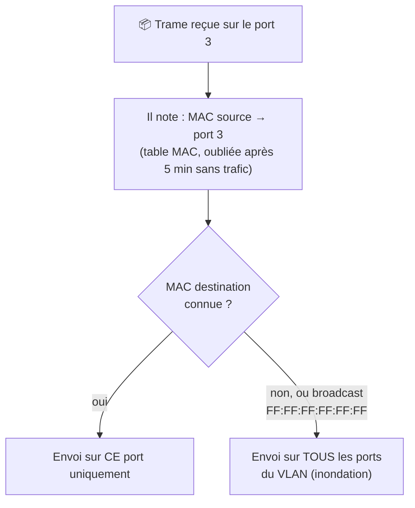
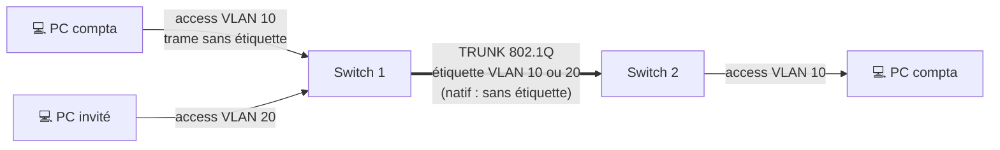

# Module 2 : La commutation Ethernet

*Cours : [Cours 7 - Les infrastructures réseau](../index.md)*

## 🎯 Objectif du module

Comprendre comment un **commutateur** fait circuler les trames (table **MAC**), découper un réseau en **VLAN**, relier des switchs par un **trunk 802.1Q**, administrer le switch **en SSH** et **sécuriser** ses ports.

!!! abstract "En clair"
    Le switch apprend **qui est branché où** en lisant l'adresse MAC des trames. Les **VLAN** découpent un même switch en plusieurs réseaux séparés (compta, invités, téléphones). Entre deux switchs, un seul câble **trunk** transporte tous les VLAN, chaque trame portant une **étiquette** avec son numéro de VLAN.

## 🗺️ L'essentiel en schémas

!!! info "Référentiel TSSR 2026"
    **CCP 2 · compétence 4 : Exploiter un réseau IP** (VLAN, trunk) et **compétence 7 : Gérer les accès et la sécurité** (SSH, sécurité des ports).

**① Comment le switch apprend et transmet**



**② Ports access et trunk**



## 📖 Cours consolidé

### 1. La commutation

| Notion | À retenir |
|---|---|
| **Trame Ethernet** | MAC destination, MAC source, type, **données** (souvent un paquet IP), **FCS** (contrôle d'erreur) |
| **Table MAC** | Le switch associe chaque **MAC source** au port d'arrivée ; une entrée inutilisée disparaît après **5 min** |
| **Inondation** | MAC inconnue ou **broadcast** (`FF:FF:FF:FF:FF:FF`) : envoi sur tous les ports du VLAN |
| **Domaine de collision** | Un par port de switch |
| **Domaine de diffusion** | Tout le VLAN ; seul un **routeur** le coupe |
| **Duplex** | **Full** (émettre et recevoir en même temps) ou half ; laisser **auto** des deux côtés |
| **CSMA/CD / CSMA/CA** | Gestion des collisions en filaire (détection) / en Wi-Fi (évitement) |

```text
SW1# show mac-address-table
SW1# show interfaces fastEthernet 0/5        (vitesse et duplex négociés)
```

### 2. Les VLAN

Un **VLAN** = un domaine de diffusion = un réseau IP. Numéros utilisables : **1 à 4094** (tous les ports sont dans le **VLAN 1** par défaut, qu'on ne peut pas supprimer). Les VLAN sont stockés dans le fichier **`vlan.dat`** (Flash).

```text
SW1(config)# vlan 10
SW1(config-vlan)# name COMPTA
SW1(config-vlan)# exit
SW1(config)# interface range fastEthernet 0/5 - 6
SW1(config-if-range)# switchport mode access
SW1(config-if-range)# switchport access vlan 10
SW1(config-if-range)# switchport voice vlan 30        (téléphone IP sur le même port)
SW1# show vlan brief
```

**VLAN voix** : un téléphone IP et le PC branché derrière lui partagent un port ; le PC reste dans le VLAN de données (sans étiquette), la voix part étiquetée dans le VLAN voix, avec une **priorité** (QoS).

### 3. Le trunk 802.1Q

```text
SW1(config)# interface gigabitEthernet 0/2
SW1(config-if)# switchport mode trunk
SW1(config-if)# switchport trunk native vlan 100
SW1(config-if)# switchport trunk allowed vlan 10,20,100
SW1# show interfaces trunk
```

- **802.1Q** ajoute à chaque trame une **étiquette** de 4 octets contenant le numéro de VLAN.
- Le **VLAN natif** circule **sans étiquette** : il doit être **le même des deux côtés** du trunk. Bonne pratique : un VLAN natif dédié et inutilisé, pas le VLAN 1.
- `allowed vlan` limite les VLAN transportés.

### 4. Administrer le switch à distance en SSH

Les ports d'un switch n'ont pas d'adresse IP : on en donne une à une **interface VLAN virtuelle (SVI)**.

```text
SW1(config)# vlan 60
SW1(config-vlan)# name ADMIN
SW1(config)# interface vlan 60
SW1(config-if)# ip address 172.18.60.252 255.255.255.0
SW1(config-if)# no shutdown
SW1(config)# ip default-gateway 172.18.60.254

SW1(config)# ip domain-name formation.local
SW1(config)# crypto key generate rsa              (taille : 2048 bits)
SW1(config)# ip ssh version 2
SW1(config)# username admin secret MotDePasseLong!2026
SW1(config)# line vty 0 15
SW1(config-line)# login local                      (comptes locaux)
SW1(config-line)# transport input ssh              (SSH seulement, pas Telnet)
SW1# show ip ssh
SW1# show users
```

SSH exige un **nom d'hôte**, un **nom de domaine** (pour générer les clés RSA) et une image IOS avec chiffrement (« k9 »).

### 5. Sécuriser les ports

- **Désactiver** les ports inutilisés (`shutdown`) et les placer dans un VLAN « poubelle ».
- **Port Security** : limiter le nombre d'adresses MAC sur un port (1 pour un PC, 2 pour téléphone + PC), en apprentissage **sticky** (retenues dans la configuration). En cas de violation : **shutdown** (port coupé, par défaut), **restrict** (trames bloquées + alerte) ou **protect** (trames bloquées sans alerte).

```text
SW1(config-if)# switchport port-security
SW1(config-if)# switchport port-security maximum 2
SW1(config-if)# switchport port-security mac-address sticky
SW1(config-if)# switchport port-security violation shutdown
SW1# show port-security
```

Après une violation en mode shutdown, on réactive le port par `shutdown` puis `no shutdown`.

## 📝 Fiche de révision

| Notion | À retenir |
|---|---|
| **Table MAC** | MAC source → port, vieillissement 5 min |
| **Broadcast** | `FF:FF:FF:FF:FF:FF`, envoyé partout dans le VLAN |
| **VLAN** | 1 à 4094, un VLAN = un réseau IP |
| **Access / trunk** | Un VLAN sans étiquette / plusieurs VLAN étiquetés |
| **802.1Q** | Étiquette de 4 octets avec le numéro de VLAN |
| **VLAN natif** | Sans étiquette, identique des deux côtés |
| **SVI** | `interface vlan X` : l'IP d'administration du switch |
| **SSH** | Domaine + clés RSA + `ip ssh version 2` + `login local` + `transport input ssh` |
| **Port Security** | Maximum de MAC, sticky, violation shutdown/restrict/protect |
| **Vérifier** | `show vlan brief` · `show interfaces trunk` · `show mac-address-table` |

### ⚠️ Les pièges

- Oublier `switchport mode access` : le port peut négocier un trunk avec un équipement pirate.
- Un **VLAN natif différent** de chaque côté du trunk : trafic mélangé entre VLAN.
- Créer le VLAN sur un switch mais **pas sur l'autre** : le trunk ne le transporte pas utilement.
- Oublier `ip default-gateway` : le switch répond en local mais pas depuis un autre réseau.
- Laisser `transport input telnet` : les mots de passe circulent en clair.

### ✏️ Entraîne-toi (clique pour voir la correction)

??? question "1. Deux PC du VLAN 10, branchés sur deux switchs différents, ne se joignent pas. Que vérifies-tu ?"
    1) `show vlan brief` sur les deux switchs : le VLAN 10 existe-t-il et les ports sont-ils dedans ? · 2) `show interfaces trunk` : le lien entre les switchs est-il un trunk, le VLAN 10 est-il **autorisé**, le **VLAN natif** est-il le même ? · 3) les deux PC sont-ils dans le **même réseau IP** ?

## 🧠 Quiz — entraîne-toi

<div id="quiz-cours-07-les-infrastructures-reseau-module-2-la-commutation-ethernet"></div>

<script type="application/json" id="quiz-cours-07-les-infrastructures-reseau-module-2-la-commutation-ethernet-data">
[
  {
    "question": "Comment un switch remplit-il sa table d'adresses MAC ?",
    "options": [
      "Avec le DHCP",
      "En notant l'adresse MAC source de chaque trame reçue et le port d'arrivée",
      "En interrogeant le routeur",
      "À la main uniquement"
    ],
    "correctIndex": 1,
    "explanation": "Chaque trame contient l'adresse MAC de son expéditeur. Le switch retient « cette MAC est derrière tel port », et pourra ensuite envoyer les trames destinées à cette MAC sur ce seul port."
  },
  {
    "question": "Que fait un switch d'une trame dont il ne connaît pas l'adresse MAC de destination ?",
    "options": [
      "Il la supprime",
      "Il l'envoie sur tous les ports du VLAN sauf celui d'arrivée",
      "Il la renvoie à l'expéditeur",
      "Il la transmet au routeur uniquement"
    ],
    "correctIndex": 1,
    "explanation": "C'est l'inondation (flooding) : faute de savoir où est le destinataire, le switch l'envoie partout dans le VLAN. Quand le destinataire répondra, le switch apprendra où il se trouve."
  },
  {
    "question": "Quelle est la plage des numéros de VLAN utilisables ?",
    "options": [
      "0 à 255",
      "1 à 4094",
      "1 à 4096",
      "10 à 99"
    ],
    "correctIndex": 1,
    "explanation": "L'étiquette 802.1Q code le VLAN sur 12 bits (0 à 4095), mais 0 et 4095 sont réservés : il reste 1 à 4094. Le VLAN 1 existe par défaut et ne peut pas être supprimé."
  },
  {
    "question": "Quel est le rôle d'un lien trunk ?",
    "options": [
      "Relier un PC à un VLAN",
      "Transporter plusieurs VLAN sur un même câble, chaque trame portant son numéro de VLAN",
      "Accélérer le débit",
      "Remplacer le routeur"
    ],
    "correctIndex": 1,
    "explanation": "Sur un trunk, la norme 802.1Q ajoute une étiquette avec le numéro de VLAN, ce qui permet à l'autre switch de remettre chaque trame dans le bon VLAN. Un port access, lui, n'appartient qu'à un seul VLAN."
  },
  {
    "question": "Qu'est-ce que le VLAN natif d'un trunk ?",
    "options": [
      "Le VLAN le plus rapide",
      "Le VLAN dont les trames circulent sans étiquette sur le trunk",
      "Le VLAN des téléphones",
      "Le VLAN d'administration obligatoire"
    ],
    "correctIndex": 1,
    "explanation": "Les trames du VLAN natif traversent le trunk sans étiquette. Il doit être le même des deux côtés, sinon le trafic passe d'un VLAN à l'autre. On choisit un VLAN dédié plutôt que le VLAN 1."
  },
  {
    "question": "Pourquoi donner une adresse IP à interface vlan 60 sur un switch ?",
    "options": [
      "Pour router entre VLAN",
      "Pour pouvoir administrer le switch à distance (SSH) par cette adresse",
      "Pour activer le trunk",
      "Pour créer le VLAN 60"
    ],
    "correctIndex": 1,
    "explanation": "Les ports d'un switch de niveau 2 n'ont pas d'adresse IP. L'interface VLAN virtuelle (SVI) donne au switch une adresse joignable pour l'administrer. Il faut aussi une passerelle (ip default-gateway) pour y accéder depuis un autre réseau."
  },
  {
    "question": "Quelle commande limite l'accès VTY au seul protocole SSH ?",
    "options": [
      "ip ssh version 2",
      "transport input ssh",
      "login local",
      "crypto key generate rsa"
    ],
    "correctIndex": 1,
    "explanation": "transport input ssh refuse Telnet, dont les mots de passe circulent en clair. Les autres commandes sont aussi nécessaires à SSH (clés, version, comptes), mais ne bloquent pas Telnet."
  },
  {
    "question": "With port security in « shutdown » violation mode, what happens when an unknown MAC address is detected?",
    "options": [
      "Nothing",
      "The port is disabled (err-disabled)",
      "The switch reboots",
      "The VLAN is deleted"
    ],
    "correctIndex": 1,
    "explanation": "Traduction : « Avec la sécurité de port en mode de violation shutdown, que se passe-t-il quand une adresse MAC inconnue est détectée ? » Le port est désactivé. On le réactive par shutdown puis no shutdown. Les modes restrict et protect bloquent seulement les trames."
  }
]
</script>

<script>
  document.addEventListener("DOMContentLoaded", function () {
    TSSRQuiz.init({
      containerId: "quiz-cours-07-les-infrastructures-reseau-module-2-la-commutation-ethernet",
      dataId: "quiz-cours-07-les-infrastructures-reseau-module-2-la-commutation-ethernet-data",
    });
  });
</script>
