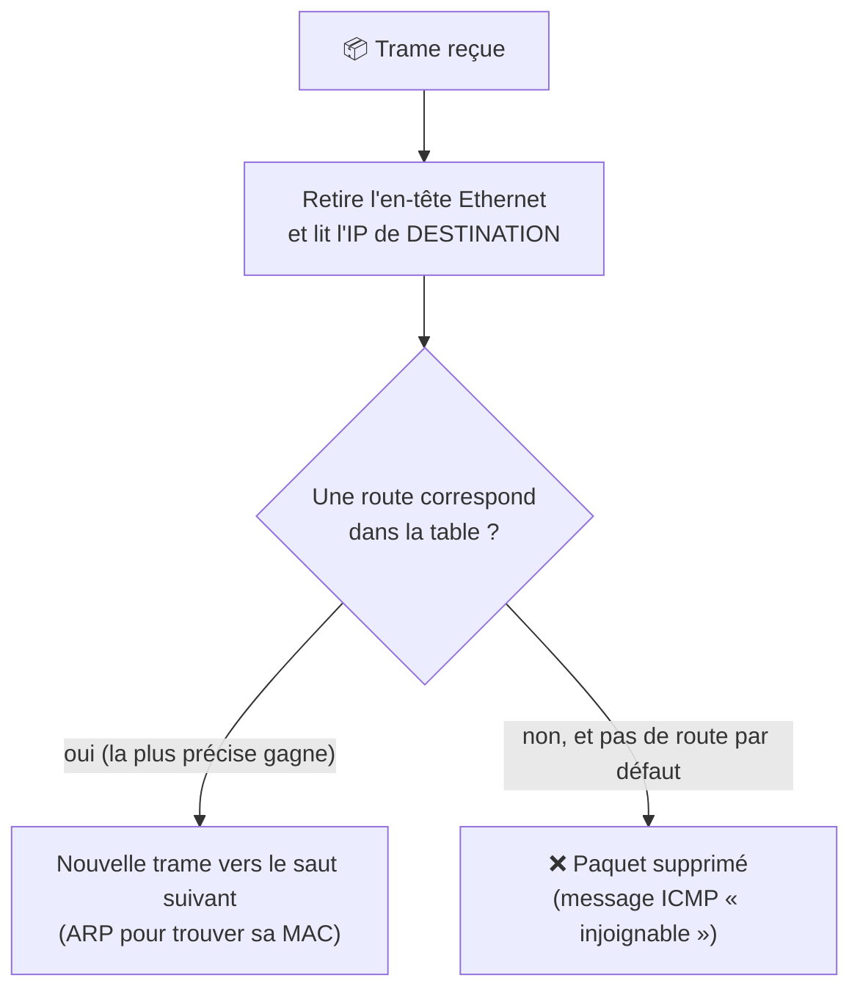
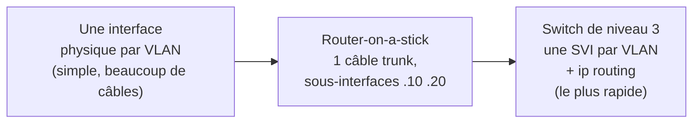

# Module 3 : Le routage

*Cours : [Cours 7 - Les infrastructures réseau](../index.md)*

## 🎯 Objectif du module

Comprendre comment un **routeur** choisit le chemin d'un paquet, lire une **table de routage**, configurer des **routes statiques**, un routage **dynamique** (RIPv2) et faire communiquer des **VLAN** entre eux (routage inter-VLAN).

!!! abstract "En clair"
    Le routeur relie des **réseaux différents**. Pour chaque paquet, il regarde l'**adresse IP de destination** et cherche dans sa **table de routage** par où l'envoyer. Les réseaux qu'il ne connaît pas, on les lui apprend **à la main** (routes statiques) ou les routeurs se les **échangent** (routage dynamique).

## 🗺️ L'essentiel en schémas

!!! info "Référentiel TSSR 2026"
    **CCP 2 · compétence 4 : Exploiter un réseau IP.** Le routage, statique et inter-VLAN, est au cœur de l'exploitation d'un réseau.

**① Ce que fait un routeur avec chaque paquet**



**② Trois façons de router entre VLAN**



## 📖 Cours consolidé

### 1. La table de routage

| Code | Origine de la route |
|---|---|
| **C** | Réseau **directement connecté** à une interface |
| **L** | Adresse **locale** de l'interface elle-même (/32) |
| **S** | Route **statique** (saisie à la main) ; **S\*** = route **par défaut** |
| **R** / **O** | Apprise par **RIP** / par **OSPF** |

- **Route par défaut** `0.0.0.0/0` : « tout le reste », souvent vers Internet.
- Si plusieurs routes correspondent, la **plus précise** gagne (le masque le plus long : /24 avant /16).
- **Distance administrative (AD)** : départage deux routes **d'origines différentes** ; la plus **petite** gagne. Valeurs à connaître : connecté **0**, statique **1**, OSPF **110**, RIP **120**.
- **Métrique** : départage deux routes **du même protocole** (RIP : nombre de sauts ; OSPF : coût calculé sur la bande passante).

### 2. Configuration de base et routes statiques

```text
R1(config)# interface gigabitEthernet 0/0/0
R1(config-if)# ip address 192.168.10.254 255.255.255.0
R1(config-if)# no shutdown                         (interfaces éteintes par défaut)
R1(config)# ip route 192.168.30.0 255.255.255.0 192.168.20.2
R1(config)# ip route 0.0.0.0 0.0.0.0 203.0.113.1  (route par défaut)
R1# show ip interface brief
R1# show ip route
```

`ip route` *réseau masque saut-suivant* : « pour joindre ce réseau, envoie au routeur voisin à cette adresse ». Il faut raisonner **routeur par routeur** : chaque routeur doit connaître l'**aller** et le **retour**.

### 3. Le routage dynamique

| Famille | Principe | Exemple |
|---|---|---|
| **IGP** | Routage **à l'intérieur** d'une organisation | RIP, OSPF |
| **EGP** | Routage **entre** organisations (Internet) | BGP |
| **Vecteur de distance** | Chaque routeur transmet sa table à ses voisins | RIP |
| **État de lien** | Chaque routeur connaît la carte complète du réseau | OSPF |

**RIPv2** : vecteur de distance, métrique = **nombre de sauts** (au-delà de **15**, le réseau est injoignable), annonces toutes les **30 s** en multicast, **IPv4 uniquement** (pour IPv6 : RIPng). Simple, utile pour apprendre, peu utilisé en entreprise.

```text
R1(config)# router rip
R1(config-router)# version 2
R1(config-router)# no auto-summary
R1(config-router)# network 192.168.10.0
R1(config-router)# network 192.168.20.0
R1# debug ip rip          (puis undebug all pour arrêter)
```

### 4. Le routage inter-VLAN

Deux VLAN sont deux réseaux : pour communiquer, ils passent par un **routeur**, qui sert de **passerelle** à chaque VLAN.

**Router-on-a-stick** (un seul câble trunk entre le switch et le routeur) :

```text
R1(config)# interface gigabitEthernet 0/0/0.10
R1(config-subif)# encapsulation dot1Q 10
R1(config-subif)# ip address 192.168.10.254 255.255.255.0
R1(config)# interface gigabitEthernet 0/0/0.20
R1(config-subif)# encapsulation dot1Q 20
R1(config-subif)# ip address 192.168.20.254 255.255.255.0
R1(config)# interface gigabitEthernet 0/0/0
R1(config-if)# no shutdown
SW1(config-if)# switchport mode trunk              (port du switch vers le routeur)
```

**Switch de niveau 3** :

```text
SW1(config)# ip routing
SW1(config)# interface vlan 10
SW1(config-if)# ip address 192.168.10.254 255.255.255.0
SW1(config)# interface vlan 20
SW1(config-if)# ip address 192.168.20.254 255.255.255.0
```

Vérifier depuis un PC : `tracert` vers une machine de l'autre VLAN montre le passage par la passerelle.

## 📝 Fiche de révision

| Notion | À retenir |
|---|---|
| **Routeur** | Relie des réseaux, bloque les broadcasts |
| **C / L / S / R / O** | Connecté / locale / statique / RIP / OSPF |
| **0.0.0.0/0** | Route par défaut |
| **Masque le plus long** | La route la plus précise gagne |
| **AD** | Connecté 0, statique 1, OSPF 110, RIP 120 (la plus petite gagne) |
| **`ip route`** | Réseau + masque + saut suivant |
| **RIPv2** | Sauts (15 max), 30 s, IPv4 uniquement |
| **Router-on-a-stick** | Trunk + sous-interfaces `encapsulation dot1Q` |
| **Switch L3** | SVI + `ip routing` |
| **Vérifier** | `show ip route` · `show ip interface brief` |

### ⚠️ Les pièges

- Oublier `no shutdown` : les interfaces d'un routeur sont **éteintes** par défaut.
- Configurer l'**aller** mais pas le **retour** : le ping échoue alors que la route semble bonne.
- Oublier `ip routing` sur un switch de niveau 3 : les SVI répondent, mais rien n'est routé.
- Un numéro de VLAN différent dans `encapsulation dot1Q` et sur le switch.

### ✏️ Entraîne-toi (clique pour voir la correction)

??? question "1. R1 (réseau 192.168.10.0/24) et R2 (192.168.30.0/24) sont reliés par 192.168.20.0/24 (R1 = .1, R2 = .2). Quelles routes statiques ?"
    Sur R1 : `ip route 192.168.30.0 255.255.255.0 192.168.20.2`. Sur R2 : `ip route 192.168.10.0 255.255.255.0 192.168.20.1`. Il faut les **deux** : l'aller et le retour. Vérifier avec `show ip route` (lignes **S**) puis un `ping`.

## 🧠 Quiz — entraîne-toi

<div id="quiz-cours-07-les-infrastructures-reseau-module-3-le-routage"></div>

<script type="application/json" id="quiz-cours-07-les-infrastructures-reseau-module-3-le-routage-data">
[
  {
    "question": "Que fait un routeur d'un paquet dont aucune route ne correspond à la destination, sans route par défaut ?",
    "options": [
      "Il l'envoie partout",
      "Il le supprime",
      "Il le renvoie au switch",
      "Il attend une route"
    ],
    "correctIndex": 1,
    "explanation": "Contrairement à un switch, un routeur n'inonde jamais : sans route, il jette le paquet et peut prévenir l'expéditeur par un message ICMP « destination injoignable ». C'est pourquoi on ajoute souvent une route par défaut 0.0.0.0/0."
  },
  {
    "question": "Que signifie la lettre S dans show ip route ?",
    "options": [
      "Switch",
      "Route statique, saisie à la main",
      "Sous-réseau",
      "Sécurisée"
    ],
    "correctIndex": 1,
    "explanation": "S = static. C signifie directement connecté, L adresse locale, R apprise par RIP, O par OSPF. S* désigne la route statique par défaut."
  },
  {
    "question": "Deux routes mènent au même réseau, l'une statique (AD 1), l'autre apprise par RIP (AD 120). Laquelle est utilisée ?",
    "options": [
      "La RIP",
      "La statique, car sa distance administrative est plus petite",
      "Les deux en alternance",
      "Aucune"
    ],
    "correctIndex": 1,
    "explanation": "La distance administrative mesure la confiance dans l'origine d'une route : plus elle est petite, plus la route est prioritaire. Connecté 0, statique 1, OSPF 110, RIP 120."
  },
  {
    "question": "Que veut dire ip route 192.168.30.0 255.255.255.0 192.168.20.2 ?",
    "options": [
      "Donner l'adresse 192.168.30.0 à l'interface",
      "Pour joindre le réseau 192.168.30.0/24, envoyer les paquets au routeur 192.168.20.2",
      "Bloquer le réseau 192.168.30.0",
      "Créer le VLAN 30"
    ],
    "correctIndex": 1,
    "explanation": "Une route statique donne : le réseau à joindre, son masque, et le saut suivant, c'est-à-dire l'adresse du routeur voisin qui sait aller plus loin."
  },
  {
    "question": "Quelle métrique utilise RIP ?",
    "options": [
      "La bande passante",
      "Le nombre de sauts (routeurs traversés), 15 au maximum",
      "Le délai",
      "Le prix"
    ],
    "correctIndex": 1,
    "explanation": "RIP compte les routeurs à traverser. Au-delà de 15, il considère le réseau injoignable, ce qui le réserve aux petits réseaux. OSPF calcule un coût basé sur la bande passante."
  },
  {
    "question": "En router-on-a-stick, que fait encapsulation dot1Q 10 sur la sous-interface G0/0/0.10 ?",
    "options": [
      "Elle crée le VLAN 10",
      "Elle associe la sous-interface aux trames étiquetées VLAN 10 du trunk",
      "Elle active RIP",
      "Elle bloque le VLAN 10"
    ],
    "correctIndex": 1,
    "explanation": "Un seul câble trunk arrive au routeur. Chaque sous-interface traite les trames d'un VLAN, reconnu grâce à l'étiquette 802.1Q, et porte l'adresse de passerelle de ce VLAN."
  },
  {
    "question": "Quelle commande active le routage entre VLAN sur un switch de niveau 3 ?",
    "options": [
      "router rip",
      "ip routing",
      "switchport mode trunk",
      "no shutdown"
    ],
    "correctIndex": 1,
    "explanation": "Un switch de niveau 3 ne route pas tant que ip routing n'est pas activé, même si ses interfaces VLAN (SVI) ont une adresse IP. Chaque SVI sert alors de passerelle à son VLAN."
  },
  {
    "question": "What is a default route?",
    "options": [
      "A route used when no more specific route matches, written 0.0.0.0/0",
      "The first route configured",
      "A route to the router itself",
      "A VLAN route"
    ],
    "correctIndex": 0,
    "explanation": "Traduction : « Qu'est-ce qu'une route par défaut ? » C'est la route utilisée quand aucune route plus précise ne correspond. Elle s'écrit 0.0.0.0/0 et mène souvent vers Internet."
  }
]
</script>

<script>
  document.addEventListener("DOMContentLoaded", function () {
    TSSRQuiz.init({
      containerId: "quiz-cours-07-les-infrastructures-reseau-module-3-le-routage",
      dataId: "quiz-cours-07-les-infrastructures-reseau-module-3-le-routage-data",
    });
  });
</script>
