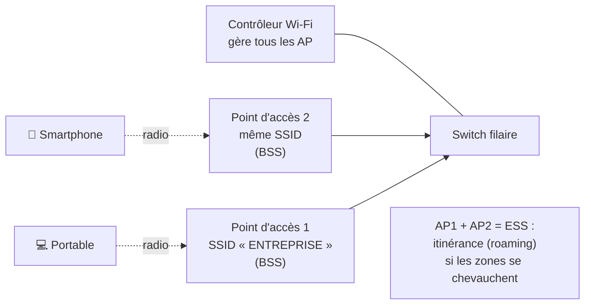
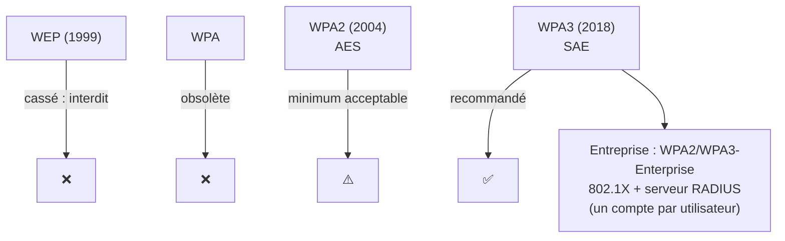

# Module 4 : Les réseaux sans fil

*Cours : [Cours 7 - Les infrastructures réseau](../index.md)*

## 🎯 Objectif du module

Comprendre le **Wi-Fi** : les normes **802.11** (Wi-Fi 4 à 7), les **bandes** de fréquences, les modes **ad hoc** et **infrastructure** (SSID, BSS, ESS), l'accès au support (**CSMA/CA**) et la **sécurité** (WPA2, WPA3, 802.1X).

!!! abstract "En clair"
    Un **point d'accès** est un pont entre le Wi-Fi et le réseau filaire. Tous les appareils d'un même point d'accès **partagent** la même radio et parlent **chacun leur tour**. Le nom du réseau est le **SSID** ; plusieurs points d'accès avec le **même SSID** permettent de se déplacer sans coupure.

## 🗺️ L'essentiel en schémas

!!! info "Référentiel TSSR 2026"
    **CCP 2 · compétence 4 : Exploiter un réseau IP** et **compétence 7 : Gérer les accès et la sécurité** (sécuriser l'accès sans fil).

**① Le mode infrastructure**

**② Choisir la sécurité**

## 📖 Cours consolidé

### 1. Les normes Wi-Fi

La norme **IEEE 802.11** (1997) a reçu de nombreuses évolutions ; la **Wi-Fi Alliance** leur donne des noms simples.

| Nom commercial | Norme | Bandes | Débit théorique max |
|---|---|---|---|
| Wi-Fi 4 | 802.11n | 2,4 et 5 GHz | 600 Mbit/s |
| Wi-Fi 5 | 802.11ac | 5 GHz | ~3,5 Gbit/s |
| Wi-Fi 6 / 6E | 802.11ax | 2,4, 5 (et 6 GHz pour le 6E) | ~9,6 Gbit/s |
| Wi-Fi 7 | 802.11be | 2,4, 5 et 6 GHz | ~46 Gbit/s |

- **2,4 GHz** : porte **plus loin**, traverse mieux les murs, mais peu de canaux (1, 6 et 11 ne se chevauchent pas) et beaucoup d'interférences.
- **5 GHz** et **6 GHz** : **plus de débit** et de canaux, mais portée plus courte.
- Les débits réels sont bien inférieurs : la radio est **partagée** entre tous les appareils.

### 2. Les équipements et les modes

| Notion | À retenir |
|---|---|
| **Point d'accès (AP)** | Pont entre le Wi-Fi et le réseau filaire |
| **Contrôleur Wi-Fi** | Configure et supervise tous les AP d'un site depuis un seul endroit |
| **Mode ad hoc (IBSS)** | Appareils reliés **directement** entre eux, sans AP : peu de portée, peu d'appareils |
| **Mode infrastructure** | Les appareils passent par un **AP** : le mode normal en entreprise |
| **BSS / BSA** | Un AP et ses clients / sa zone de couverture |
| **ESS** | Plusieurs AP avec le **même SSID** : **itinérance** si les zones se chevauchent |
| **SSID / BSSID** | Nom du réseau / adresse MAC de la radio de l'AP |

**Association d'un appareil** : il détecte le SSID → s'authentifie (clé ou 802.1X) → s'associe et échange sur le **canal** de l'AP.

### 3. L'accès au support : CSMA/CA

En Wi-Fi, un appareil ne peut pas émettre et écouter en même temps (**half-duplex**) : il ne peut pas **détecter** une collision, il cherche donc à l'**éviter** (**CA**, *Collision Avoidance*). Il écoute, attend que le canal soit libre, peut réserver le canal (**RTS/CTS**), émet, et chaque trame reçue est confirmée par un **accusé de réception (ACK)**.

### 4. Sécuriser le Wi-Fi

| Protection | À retenir |
|---|---|
| **WEP** | Cassé en quelques minutes : **interdit** |
| **WPA** | Obsolète |
| **WPA2** (2004, AES) | Encore répandu ; une faille (**KRACK**, 2017) a été corrigée par mises à jour |
| **WPA3** (2018) | **Recommandé** : échange de clé **SAE**, résiste à la devinette de mot de passe |
| **Personal (PSK)** | Une **clé partagée** par tous : maison, petite structure |
| **Enterprise (802.1X)** | Chaque utilisateur s'authentifie avec **son compte**, vérifié par un serveur **RADIUS** (souvent relié à l'AD) |

L'ANSSI publie des recommandations pour sécuriser les réseaux Wi-Fi : chiffrement **WPA2 minimum** (WPA3 de préférence), **802.1X** en entreprise, **réseau invités séparé** (VLAN dédié, isolé du LAN), clés longues, mises à jour des AP, désactivation du **WPS**.

## 📝 Fiche de révision

| Notion | À retenir |
|---|---|
| **802.11** | La norme Wi-Fi (IEEE) |
| **Wi-Fi 5 / 6 / 7** | 802.11ac / ax / be |
| **2,4 GHz / 5-6 GHz** | Portée / débit |
| **Canaux 1, 6, 11** | Sans chevauchement en 2,4 GHz |
| **SSID / BSSID** | Nom du réseau / MAC de l'AP |
| **BSS / ESS** | Un AP / plusieurs AP même SSID (itinérance) |
| **CSMA/CA** | Éviter les collisions, ACK de chaque trame |
| **WPA3** | Recommandé (SAE) ; WEP et WPA interdits |
| **802.1X + RADIUS** | Un compte par utilisateur en entreprise |

### ⚠️ Les pièges

- Croire que **cacher le SSID** protège : il se retrouve facilement.
- Un Wi-Fi invités **sur le même réseau** que les postes de l'entreprise.
- Deux AP voisins sur le **même canal** (ou des canaux qui se chevauchent) en 2,4 GHz : interférences.
- Une clé WPA2 partagée **jamais changée**, même après le départ d'un salarié.

### ✏️ Entraîne-toi (clique pour voir la correction)

??? question "1. Une PME veut un Wi-Fi pour ses salariés et un autre pour ses visiteurs. Que proposes-tu ?"
    Deux **SSID** sur les mêmes AP, chacun dans son **VLAN**. Salariés : **WPA3-Enterprise** (ou WPA2) avec **802.1X/RADIUS** et leur compte AD. Invités : un VLAN **isolé** qui n'accède qu'à Internet (règles de pare-feu), avec une clé changée régulièrement ou un **portail captif**.

## 🧠 Quiz — entraîne-toi

