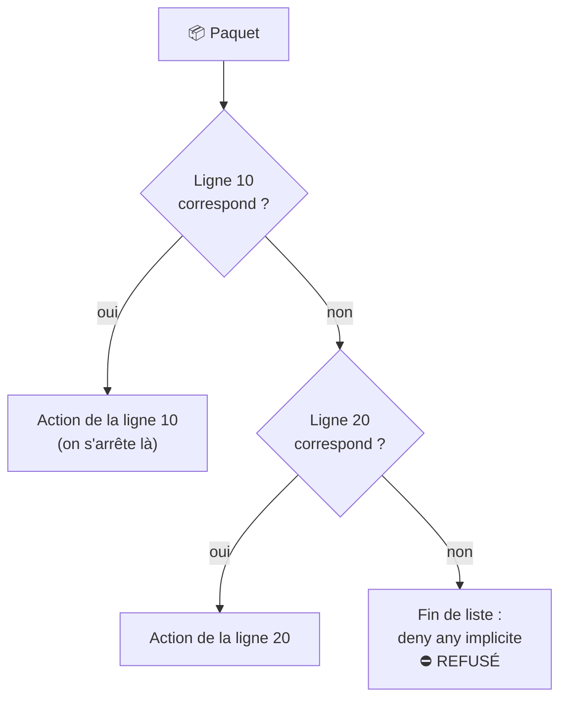
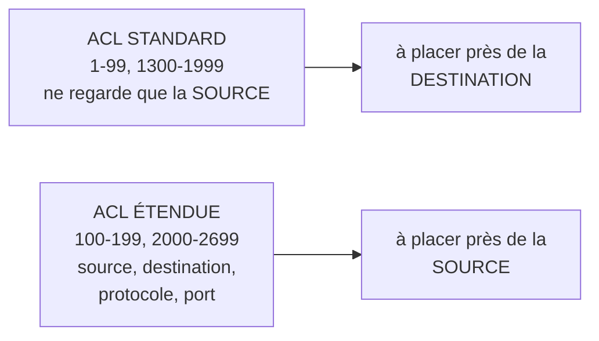

# Module 5 : Les listes de contrôle d'accès

*Cours : [Cours 7 - Les infrastructures réseau](../index.md)*

## 🎯 Objectif du module

Filtrer le trafic sur un routeur avec des **listes de contrôle d'accès (ACL)** : ACL **standard** et **étendue**, **masque générique** (wildcard), **placement** et **sens** d'application, et protection de l'**accès d'administration**.

!!! abstract "En clair"
    Une ACL est une **liste de règles** « autoriser / refuser » que le routeur lit **de haut en bas** pour chaque paquet. Il applique la **première** règle qui correspond, et tout ce qui ne correspond à aucune règle est **refusé** (refus implicite en bas de liste).

## 🗺️ L'essentiel en schémas

!!! info "Référentiel TSSR 2026"
    **CCP 2 · compétence 7 : Gérer les accès et la sécurité** et **compétence 4 : Exploiter un réseau IP** (filtrage des flux).

**① Comment le routeur lit une ACL**



**② Standard ou étendue, et où la placer**



## 📖 Cours consolidé

### 1. Les principes

- Une ACL est une suite de lignes (**ACE**) : `permit` (autoriser) ou `deny` (refuser).
- Lecture **de haut en bas**, **première correspondance** appliquée : les règles **précises** en haut.
- **Refus implicite** : une ligne invisible `deny any` termine toute ACL. Une ACL qui ne contient que des `deny` bloque donc **tout**.
- Une ACL ne fait rien tant qu'elle n'est pas **appliquée** sur une interface, dans un **sens** : **in** (en entrant dans le routeur) ou **out** (en sortant).
- Une ACL par interface, par sens et par protocole.

### 2. Le masque générique (wildcard)

Il indique les bits à vérifier : **0** = « doit être identique », **1** = « peu importe ». C'est l'**inverse du masque** : 255.255.255.255 − masque.

| Masque | Wildcard | Raccourci |
|---|---|---|
| 255.255.255.0 (/24) | `0.0.0.255` | |
| 255.255.0.0 (/16) | `0.0.255.255` | |
| une seule adresse (/32) | `0.0.0.0` | `host 192.168.10.5` |
| toutes les adresses | `255.255.255.255` | `any` |

### 3. ACL standard

Elle ne regarde que l'**adresse source** : placée près de la source, elle couperait cette source de **toutes** les destinations, d'où son placement **près de la destination**.

```text
R1(config)# ip access-list standard LAN20
R1(config-std-nacl)# remark Interdire le reseau 10 vers le LAN 20
R1(config-std-nacl)# deny 192.168.10.0 0.0.0.255
R1(config-std-nacl)# permit any
R1(config)# interface gigabitEthernet 0/0/2
R1(config-if)# ip access-group LAN20 out
```

Forme numérotée équivalente : `access-list 5 deny 192.168.10.0 0.0.0.255` puis `access-list 5 permit any`. La forme **nommée** (`ip access-list`) est recommandée : on peut **insérer** ou **supprimer** une ligne par son numéro (`no 10`, `15 permit …`).

### 4. ACL étendue

Elle filtre sur **source, destination, protocole et port** : on la place **près de la source** pour arrêter le trafic indésirable au plus tôt.

```text
R1(config)# ip access-list extended BLOQUER_HTTP
R1(config-ext-nacl)# deny tcp 192.168.20.0 0.0.0.255 192.168.30.0 0.0.0.255 eq 80
R1(config-ext-nacl)# permit ip any any
R1(config)# interface gigabitEthernet 0/0/1
R1(config-if)# ip access-group BLOQUER_HTTP in
```

Un flux se décrit par **5 éléments** : IP source, IP destination, protocole, port source, port destination. Côté client, le port source est **tiré au hasard** (49152 à 65535) : on filtre donc surtout sur le **port de destination** (80, 443, 22…). Le mot-clé `established` laisse passer les réponses TCP (paquets marqués ACK ou RST), mais ce n'est **pas** un vrai pare-feu à états : il ne suit pas les connexions.

### 5. Protéger l'accès d'administration

```text
R1(config)# ip access-list standard ADMIN
R1(config-std-nacl)# permit host 192.168.10.5
R1(config)# line vty 0 15
R1(config-line)# access-class ADMIN in
```

`access-class` (sur les lignes VTY) et non `access-group` (sur les interfaces) : seul le poste 192.168.10.5 peut se connecter en SSH au routeur.

### 6. Vérifier

| Commande | Rôle |
|---|---|
| `show access-lists` | Les ACL et le **nombre de correspondances** de chaque ligne |
| `show ip interface g0/0/2` | Quelle ACL est appliquée, dans quel sens |
| `clear access-list counters` | Remettre les compteurs à zéro avant un test |

## 📝 Fiche de révision

| Notion | À retenir |
|---|---|
| **ACL** | Liste de permit/deny lue de haut en bas, 1ʳᵉ correspondance |
| **Refus implicite** | `deny any` invisible en fin de liste |
| **Standard** | Source seule · 1-99, 1300-1999 · près de la destination |
| **Étendue** | Source, destination, protocole, port · 100-199, 2000-2699 · près de la source |
| **Wildcard** | Inverse du masque : 0.0.0.255 pour un /24 |
| **host / any** | Une adresse / toutes |
| **`ip access-group X in/out`** | Appliquer sur une interface |
| **`access-class X in`** | Filtrer l'accès aux lignes VTY |
| **Vérifier** | `show access-lists` (compteurs) |

### ⚠️ Les pièges

- Oublier le `permit` final : le refus implicite bloque **tout le reste**.
- Mettre une règle large **au-dessus** d'une règle précise : la précise n'est jamais lue.
- Se tromper de **sens** (in/out) ou d'**interface**.
- Écrire un **masque** (255.255.255.0) au lieu d'un **wildcard** (0.0.0.255).
- Appliquer à distance une ACL qui bloque… sa propre session SSH.

### ✏️ Entraîne-toi (clique pour voir la correction)

??? question "1. Le réseau 192.168.20.0/24 ne doit pas accéder au serveur web 192.168.30.10 (HTTP et HTTPS), tout le reste est autorisé. Écris l'ACL."
    ACL **étendue**, appliquée **en entrée** sur l'interface du routeur côté 192.168.20.0 (près de la source) :
    `deny tcp 192.168.20.0 0.0.0.255 host 192.168.30.10 eq 80` · `deny tcp 192.168.20.0 0.0.0.255 host 192.168.30.10 eq 443` · `permit ip any any`, puis `ip access-group NOM in`. Vérifier avec `show access-lists`.

## 🧠 Quiz — entraîne-toi

<div id="quiz-cours-07-les-infrastructures-reseau-module-5-les-listes-de-controle-d-acces"></div>

<script type="application/json" id="quiz-cours-07-les-infrastructures-reseau-module-5-les-listes-de-controle-d-acces-data">
[
  {
    "question": "Dans quel ordre un routeur lit-il les lignes d'une ACL ?",
    "options": [
      "De la plus récente à la plus ancienne",
      "De haut en bas, et il applique la première ligne qui correspond",
      "Il lit toutes les lignes et garde la plus restrictive",
      "Au hasard"
    ],
    "correctIndex": 1,
    "explanation": "Dès qu'une ligne correspond au paquet, le routeur applique son action (permit ou deny) et ne lit pas la suite. Il faut donc placer les règles précises au-dessus des règles larges."
  },
  {
    "question": "Que se passe-t-il pour un paquet qui ne correspond à aucune ligne d'une ACL ?",
    "options": [
      "Il est autorisé",
      "Il est refusé par le deny any implicite de fin de liste",
      "Il est envoyé à l'administrateur",
      "Il est mis en attente"
    ],
    "correctIndex": 1,
    "explanation": "Toute ACL se termine par une règle invisible « tout refuser ». C'est pourquoi une ACL qui ne contient que des deny bloque tout : il faut un permit pour laisser passer le reste."
  },
  {
    "question": "Quel est le masque générique (wildcard) d'un réseau /24 ?",
    "options": [
      "255.255.255.0",
      "0.0.0.255",
      "0.0.0.0",
      "255.255.255.255"
    ],
    "correctIndex": 1,
    "explanation": "Le wildcard est l'inverse du masque : 255.255.255.255 − 255.255.255.0 = 0.0.0.255. Les 0 signifient « ce bit doit être identique », les 1 « peu importe »."
  },
  {
    "question": "Sur quoi filtre une ACL standard ?",
    "options": [
      "Le port de destination",
      "Uniquement l'adresse IP source",
      "Le protocole",
      "L'adresse MAC"
    ],
    "correctIndex": 1,
    "explanation": "Une ACL standard ne voit que l'adresse de l'expéditeur. Pour filtrer selon la destination, le protocole ou le port (par exemple bloquer seulement le web), il faut une ACL étendue."
  },
  {
    "question": "Où place-t-on de préférence une ACL étendue ?",
    "options": [
      "Près de la destination",
      "Près de la source, pour bloquer le trafic indésirable au plus tôt",
      "Sur le switch",
      "N'importe où"
    ],
    "correctIndex": 1,
    "explanation": "Comme elle connaît la destination et le port, elle peut être placée près de la source sans bloquer autre chose. Cela évite que le trafic refusé traverse inutilement le réseau. Une ACL standard, au contraire, se place près de la destination."
  },
  {
    "question": "Que fait la commande ip access-group BLOQUER_HTTP in sur une interface ?",
    "options": [
      "Elle crée l'ACL",
      "Elle applique l'ACL aux paquets qui entrent par cette interface",
      "Elle supprime l'ACL",
      "Elle filtre les lignes VTY"
    ],
    "correctIndex": 1,
    "explanation": "Une ACL créée ne fait rien tant qu'elle n'est pas appliquée. in = paquets qui entrent dans le routeur par cette interface ; out = paquets qui en sortent. Pour les lignes VTY, on utilise access-class."
  },
  {
    "question": "Comment autoriser seulement le poste 192.168.10.5 à se connecter en SSH au routeur ?",
    "options": [
      "ip access-group sur l'interface Wi-Fi",
      "Une ACL standard « permit host 192.168.10.5 » appliquée avec access-class … in sur line vty 0 15",
      "transport input telnet",
      "no login"
    ],
    "correctIndex": 1,
    "explanation": "access-class applique l'ACL aux lignes d'accès à distance (VTY) du routeur lui-même. host 192.168.10.5 désigne une seule adresse, et tous les autres postes sont refusés par le refus implicite."
  },
  {
    "question": "Which number range is used for standard numbered IPv4 ACLs?",
    "options": [
      "1-99 and 1300-1999",
      "100-199 and 2000-2699",
      "200-299",
      "1-4094"
    ],
    "correctIndex": 0,
    "explanation": "Traduction : « Quelle plage de numéros est utilisée pour les ACL IPv4 standard numérotées ? » 1 à 99 et 1300 à 1999. Les étendues utilisent 100 à 199 et 2000 à 2699. 1 à 4094 est la plage des VLAN."
  }
]
</script>

<script>
  document.addEventListener("DOMContentLoaded", function () {
    TSSRQuiz.init({
      containerId: "quiz-cours-07-les-infrastructures-reseau-module-5-les-listes-de-controle-d-acces",
      dataId: "quiz-cours-07-les-infrastructures-reseau-module-5-les-listes-de-controle-d-acces-data",
    });
  });
</script>
