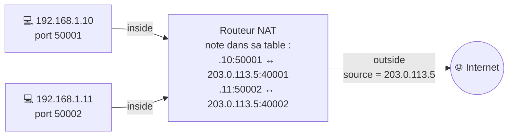
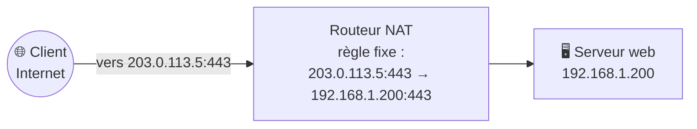

# Module 6 : La traduction d'adresses réseau

*Cours : [Cours 7 - Les infrastructures réseau](../index.md)*

## 🎯 Objectif du module

Comprendre et configurer la **traduction d'adresses (NAT)** sur un routeur Cisco : **PAT** (NAT avec surcharge) pour faire sortir tout un réseau privé avec une seule IP publique, et **NAT statique** pour publier un serveur interne.

!!! abstract "En clair"
    Les adresses **privées** (192.168…) ne circulent pas sur Internet. En sortant, le routeur **remplace** l'adresse privée par **son** adresse publique et **note** l'échange dans une table ; au retour, il fait l'opération **inverse** pour rendre la réponse au bon poste. C'est ce que fait ta box à la maison.

## 🗺️ L'essentiel en schémas

!!! info "Référentiel TSSR 2026"
    **CCP 2 · compétence 4 : Exploiter un réseau IP** (NAT, adressage privé et public).

**① Le PAT : un seul accès Internet pour tous**



**② Le NAT statique : publier un serveur**



## 📖 Cours consolidé

### 1. Pourquoi le NAT

- Il n'y a **plus assez d'adresses IPv4 publiques** pour toutes les machines.
- Les plages **privées** (RFC 1918) — **10.0.0.0/8**, **172.16.0.0/12**, **192.168.0.0/16** — sont libres d'usage dans tout réseau interne, mais **non routées** sur Internet.
- ➕ Plan d'adressage interne libre, une seule IP publique pour des centaines de postes, machines internes non joignables directement. ➖ Charge pour le routeur, **traçabilité** plus difficile (qui se cache derrière l'IP publique ?), certains protocoles et tunnels compliqués.

### 2. Le vocabulaire Cisco

| Terme | Signification | Exemple |
|---|---|---|
| **inside / outside** | Interface côté réseau privé / côté Internet | `ip nat inside` / `ip nat outside` |
| **Inside local** | Adresse **privée** du poste interne | 192.168.1.10 |
| **Inside global** | Adresse **publique** qui le représente sur Internet | 203.0.113.5 |
| **Outside global** | Adresse du serveur distant sur Internet | 8.8.8.8 |

| Type | Principe |
|---|---|
| **NAT statique** | Une correspondance **fixe** privée ↔ publique (éventuellement par port) : **publier** un serveur |
| **NAT dynamique** | Les postes reçoivent une adresse d'un **groupe** (pool) d'IP publiques, une par connexion active |
| **PAT** (NAT *overload*, NAPT) | **Tous** les postes partagent **une** IP publique, distingués par le **port** : le cas le plus courant |

### 3. Configurer le PAT

```text
R1(config)# interface gigabitEthernet 0/0
R1(config-if)# ip nat inside                       (côté LAN)
R1(config)# interface gigabitEthernet 0/1
R1(config-if)# ip nat outside                      (côté Internet)
R1(config)# access-list 5 permit 192.168.0.0 0.0.255.255
R1(config)# ip nat inside source list 5 interface gigabitEthernet 0/1 overload
```

L'ACL dit **quelles adresses** ont le droit d'être traduites ; `interface … overload` = utiliser l'IP de l'interface Internet, partagée grâce aux ports.

### 4. Publier un serveur : NAT statique par port

```text
R1(config)# ip nat inside source static tcp 192.168.1.200 443 203.0.113.5 443
R1(config)# ip nat inside source static tcp 192.168.1.101 25 203.0.113.5 25
```

Ordre : **adresse privée et port**, puis **adresse publique et port**. Un même IP publique peut ainsi servir plusieurs serveurs, un par port. Le serveur publié est de préférence placé en **DMZ** ([cours 16 · module 2](../../cours-16-reseau-et-securite/module-2-exposer-des-services-vers-l-exterieur/index.md)).

### 5. Vérifier

| Commande | Rôle |
|---|---|
| `show ip nat translations` | Les traductions en cours (inside local ↔ inside global) |
| `show ip nat statistics` | Compteurs, interfaces inside/outside |
| `show access-lists` | L'ACL du NAT est-elle bien utilisée ? |
| `clear ip nat translation *` | Vider la table (tests) |

## 📝 Fiche de révision

| Notion | À retenir |
|---|---|
| **RFC 1918** | 10.0.0.0/8 · 172.16.0.0/12 · 192.168.0.0/16 |
| **inside / outside** | Interface LAN / interface Internet |
| **Inside local / global** | IP privée / IP publique qui la représente |
| **PAT (overload)** | Une IP publique pour tous, distingués par le port |
| **NAT statique** | Correspondance fixe : publier un serveur |
| **NAT dynamique** | Pool d'IP publiques |
| **Configurer le PAT** | inside/outside + ACL + `ip nat inside source list … overload` |
| **Vérifier** | `show ip nat translations` |

### ⚠️ Les pièges

- Oublier `ip nat inside` ou `ip nat outside` sur une interface : rien n'est traduit.
- Une ACL du NAT qui n'inclut pas tous les réseaux internes.
- Oublier `overload` : un seul poste à la fois peut sortir.
- Publier un serveur en NAT statique **sans** filtrer le reste du trafic.

### ✏️ Entraîne-toi (clique pour voir la correction)

??? question "1. Les postes du LAN (192.168.1.0/24) n'accèdent pas à Internet, alors que le routeur, lui, ping 8.8.8.8. Que vérifies-tu ?"
    Le NAT : 1) `show ip nat statistics` → les interfaces **inside** (LAN) et **outside** (Internet) sont-elles bien déclarées ? · 2) l'**ACL** du NAT autorise-t-elle 192.168.1.0 0.0.0.255 ? · 3) la commande `ip nat inside source list … overload` est-elle présente ? · 4) `show ip nat translations` pendant un ping d'un poste. Et côté poste : la **passerelle** est-elle bien le routeur ?

## 🧠 Quiz — entraîne-toi

<div id="quiz-cours-07-les-infrastructures-reseau-module-6-la-traduction-d-adresses-reseau"></div>

<script type="application/json" id="quiz-cours-07-les-infrastructures-reseau-module-6-la-traduction-d-adresses-reseau-data">
[
  {
    "question": "Pourquoi utilise-t-on le NAT ?",
    "options": [
      "Pour chiffrer le trafic",
      "Parce que les adresses privées ne circulent pas sur Internet et que les IPv4 publiques manquent",
      "Pour créer des VLAN",
      "Pour accélérer Internet"
    ],
    "correctIndex": 1,
    "explanation": "Les réseaux internes utilisent des adresses privées (RFC 1918), réutilisables partout mais bloquées sur Internet. Le NAT les remplace par une adresse publique pour sortir, ce qui permet aussi d'économiser les rares adresses IPv4 publiques."
  },
  {
    "question": "Laquelle de ces plages est une plage privée RFC 1918 ?",
    "options": [
      "172.16.0.0/12",
      "100.64.0.0/10",
      "169.254.0.0/16",
      "8.8.8.0/24"
    ],
    "correctIndex": 0,
    "explanation": "Les trois plages privées sont 10.0.0.0/8, 172.16.0.0/12 et 192.168.0.0/16. 169.254.0.0/16 est la plage APIPA, et 8.8.8.0/24 appartient à Google sur Internet."
  },
  {
    "question": "Que permet le PAT (NAT avec overload) ?",
    "options": [
      "Donner une IP publique à chaque poste",
      "Faire sortir tous les postes avec une seule IP publique, en les distinguant par les numéros de port",
      "Publier un serveur",
      "Bloquer Internet"
    ],
    "correctIndex": 1,
    "explanation": "Le routeur change l'adresse et, si besoin, le port source de chaque connexion. Il note tout dans sa table de traduction pour rendre chaque réponse au bon poste. C'est ce que fait une box internet."
  },
  {
    "question": "À quoi sert le NAT statique ?",
    "options": [
      "À faire sortir les postes",
      "À rendre un serveur interne joignable depuis Internet par une correspondance fixe",
      "À économiser des ports",
      "À remplacer le DHCP"
    ],
    "correctIndex": 1,
    "explanation": "Une règle fixe dit : ce qui arrive sur cette IP publique (et ce port) va vers ce serveur interne. On s'en sert pour publier un site web ou une messagerie, de préférence placés en DMZ."
  },
  {
    "question": "Dans le vocabulaire Cisco, qu'est-ce que l'adresse « inside local » ?",
    "options": [
      "L'adresse publique du routeur",
      "L'adresse privée d'un poste du réseau interne",
      "L'adresse du serveur sur Internet",
      "L'adresse MAC du routeur"
    ],
    "correctIndex": 1,
    "explanation": "Inside = côté réseau interne ; local = telle qu'on la voit à l'intérieur, donc l'adresse privée. L'inside global est l'adresse publique qui représente ce poste sur Internet."
  },
  {
    "question": "Le NAT est configuré mais rien n'est traduit. Quel oubli est le plus probable ?",
    "options": [
      "Le nom d'hôte",
      "Les commandes ip nat inside et ip nat outside sur les interfaces",
      "La bannière",
      "Le VLAN natif"
    ],
    "correctIndex": 1,
    "explanation": "Le routeur ne traduit qu'entre une interface marquée inside et une interface marquée outside. Sans ces marques, la règle NAT existe mais ne s'applique jamais. show ip nat statistics permet de le vérifier."
  },
  {
    "question": "Quelle commande affiche les traductions NAT en cours ?",
    "options": [
      "show ip route",
      "show ip nat translations",
      "show vlan brief",
      "show running-config interface"
    ],
    "correctIndex": 1,
    "explanation": "Elle liste chaque correspondance entre adresse privée (inside local) et adresse publique (inside global), avec les ports en PAT. Elle se remplit quand des postes communiquent."
  },
  {
    "question": "What does PAT use to distinguish multiple internal hosts sharing one public IP address?",
    "options": [
      "MAC addresses",
      "Port numbers",
      "VLAN IDs",
      "Host names"
    ],
    "correctIndex": 1,
    "explanation": "Traduction : « Qu'utilise le PAT pour distinguer plusieurs machines internes qui partagent une seule adresse IP publique ? » Les numéros de port : chaque connexion reçoit un port différent dans la table de traduction."
  }
]
</script>

<script>
  document.addEventListener("DOMContentLoaded", function () {
    TSSRQuiz.init({
      containerId: "quiz-cours-07-les-infrastructures-reseau-module-6-la-traduction-d-adresses-reseau",
      dataId: "quiz-cours-07-les-infrastructures-reseau-module-6-la-traduction-d-adresses-reseau-data",
    });
  });
</script>
