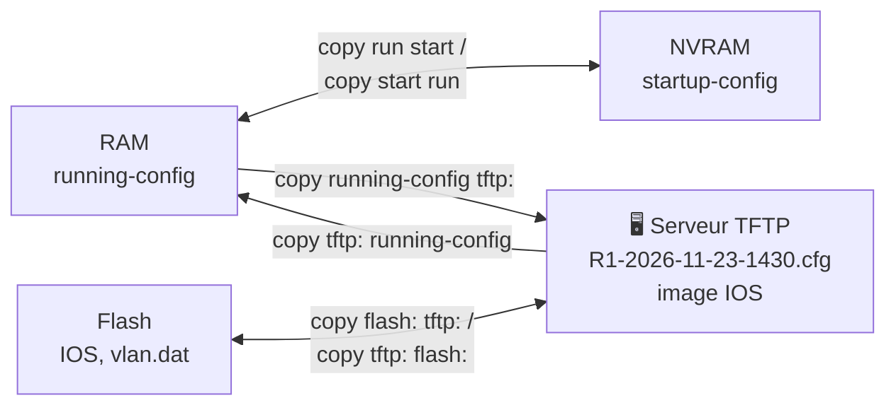
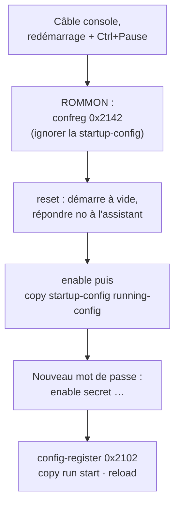

# Module 7 : La sauvegarde et la maintenance

*Cours : [Cours 7 - Les infrastructures réseau](../index.md)*

## 🎯 Objectif du module

Sauvegarder et restaurer la **configuration** et l'**IOS** d'un équipement Cisco (serveur **TFTP**), réinitialiser un routeur ou un switch, utiliser le mode de secours **ROMMON** et **récupérer un mot de passe** perdu.

!!! abstract "En clair"
    Un équipement réseau se sauvegarde comme un serveur : sa **configuration** (un simple fichier texte) et son **système** (l'IOS) doivent avoir une copie **ailleurs**, sur un serveur. Et si l'on a perdu le mot de passe, il existe une procédure… à condition d'avoir un **accès physique** (console).

## 🗺️ L'essentiel en schémas

!!! info "Référentiel TSSR 2026"
    **CCP 3 · compétence 9 : Assurer la continuité et la reprise de l'infrastructure** et **compétence 10 : Mettre à jour** les éléments de l'infrastructure.

**① Les mémoires et les copies**

**② Mot de passe perdu : la récupération**

## 📖 Cours consolidé

### 1. Où est quoi

| Mémoire | Contenu | Perdue à l'extinction ? |
|---|---|---|
| **RAM** | running-config, tables en cours | Oui |
| **NVRAM** | startup-config | Non |
| **Flash** | IOS, `vlan.dat` (switch) | Non |
| **ROM** | POST, **ROMMON** (mode de secours) | Non |

### 2. Sauvegarder et restaurer

Un serveur **TFTP** (logiciel simple de transfert de fichiers, sans mot de passe : à réserver au réseau d'administration ; **SCP** ou **FTP** sont plus sûrs) reçoit les copies. Nommer les fichiers avec l'**équipement**, la **date** et l'**heure**.

| Commande (mode `#`) | Rôle |
|---|---|
| `copy running-config tftp:` | Sauvegarder la configuration sur le serveur |
| `show flash:` | Voir le nom du fichier IOS |
| `copy flash: tftp:` | Sauvegarder l'IOS |
| `copy tftp: running-config` | Restaurer une configuration (appliquée **immédiatement**, fusionnée avec l'existante) |
| `copy tftp: flash:` | Installer une image IOS (prise en compte au **prochain démarrage**) |

### 3. Réinitialiser un équipement

- **Routeur** : `erase startup-config` puis `reload` (répondre **no** à « Save? »).
- **Switch** : en plus, `delete flash:vlan.dat` pour effacer les VLAN, puis `reload`.

### 4. ROMMON, le mode de secours

Si l'IOS est absent ou abîmé, l'équipement démarre en **ROMMON** (invite `rommon 1 >`). On peut y télécharger une IOS depuis un serveur TFTP : on règle les variables `IP_ADDRESS`, `IP_SUBNET_MASK`, `DEFAULT_GATEWAY`, `TFTP_SERVER`, `TFTP_FILE` (`set` pour les voir), puis `tftpdnld` (efface la Flash et télécharge l'image), et enfin `reset`.

### 5. Récupérer un mot de passe perdu

Le **registre de configuration** indique comment démarrer : **0x2102** = normal (lit la startup-config) ; **0x2142** = **ignore** la startup-config (on démarre sans mot de passe).

1. Câble **console**, redémarrer, **interrompre** le démarrage (`Ctrl+Pause` dans PuTTY) → ROMMON.
2. `confreg 0x2142` puis `reset`.
3. Répondre **no** à l'assistant, `enable`, puis `copy startup-config running-config` (on récupère la configuration, **sans** perdre son contenu).
4. Définir un nouveau mot de passe (`enable secret …`), réactiver les interfaces si besoin (`no shutdown`).
5. `config-register 0x2102` (mode configuration), `copy running-config startup-config`, `reload`.

⚠️ D'où l'importance de **protéger l'accès physique** aux équipements (baie fermée à clé).

## 📝 Fiche de révision

| Notion | À retenir |
|---|---|
| **RAM / NVRAM / Flash / ROM** | running / startup / IOS + vlan.dat / ROMMON |
| **`copy running-config tftp:`** | Sauvegarder la configuration |
| **`copy flash: tftp:`** | Sauvegarder l'IOS |
| **`copy tftp: running-config`** | Restaurer (immédiat) |
| **Réinitialiser** | `erase startup-config` (+ `delete flash:vlan.dat`) + `reload` |
| **ROMMON** | Secours : `tftpdnld` pour recharger une IOS |
| **0x2102 / 0x2142** | Démarrage normal / sans startup-config |
| **Récupération** | Ctrl+Pause → confreg 0x2142 → copy start run → nouveau mot de passe → 0x2102 |

### ⚠️ Les pièges

- Faire `copy running-config startup-config` **avant** `copy startup-config running-config` pendant une récupération : on **écrase** la vraie configuration par une configuration vide.
- Oublier de remettre le registre à **0x2102** : au prochain démarrage, la configuration est encore ignorée.
- Oublier `delete flash:vlan.dat` sur un switch : les VLAN reviennent après réinitialisation.
- Garder les sauvegardes **uniquement** sur l'équipement lui-même.

### ✏️ Entraîne-toi (clique pour voir la correction)

??? question "1. Avant une mise à jour de l'IOS d'un routeur, que sauvegardes-tu et comment ?"
    La **configuration** (`copy running-config tftp:`, fichier nommé avec l'équipement et la date) et l'**IOS actuelle** (`show flash:` pour son nom, puis `copy flash: tftp:`), pour pouvoir revenir en arrière. Puis on installe la nouvelle image (`copy tftp: flash:`), on vérifie et on redémarre pendant une **fenêtre de maintenance**.

## 🧠 Quiz — entraîne-toi

