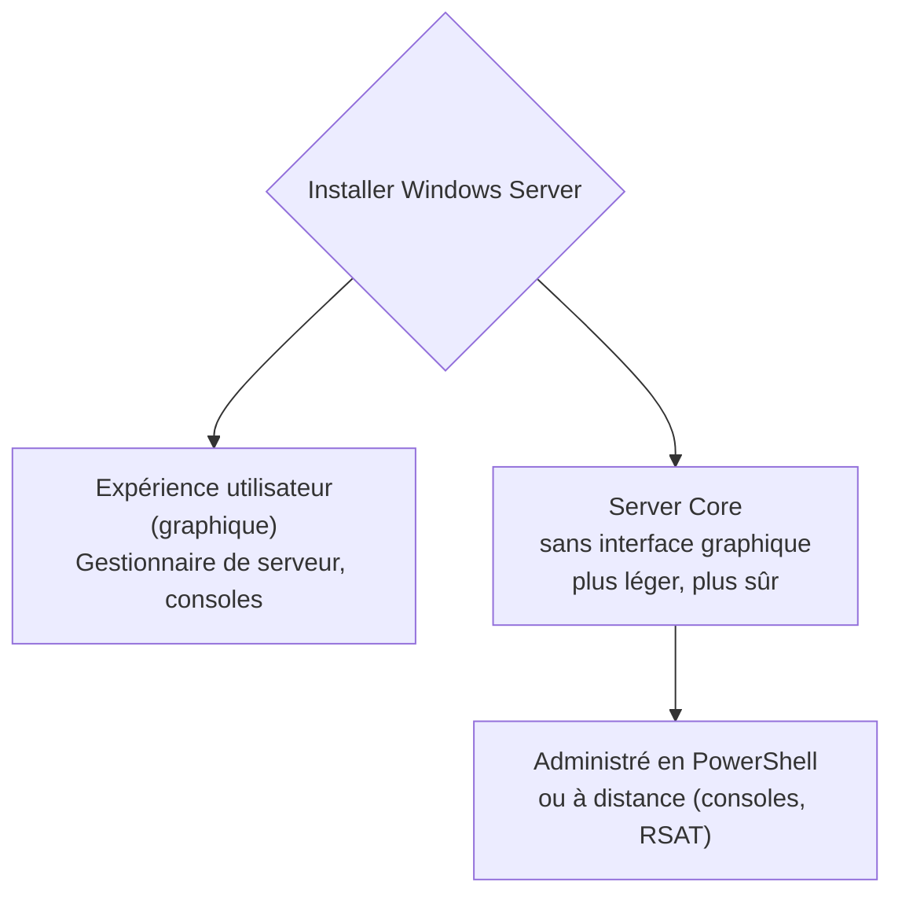
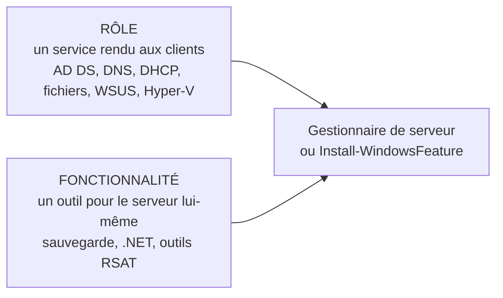
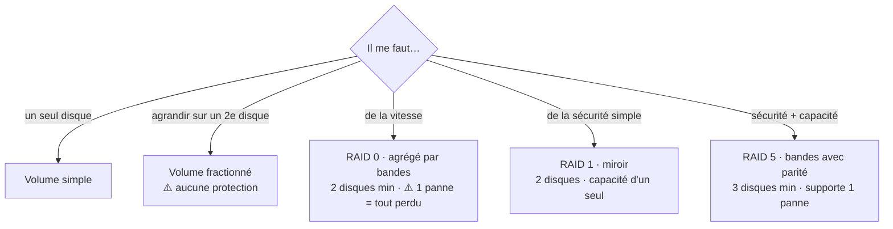

# Module 1 : Administration Windows

*Cours : [Cours 8 - Les services réseau en environnement Microsoft](../index.md)*

## 🎯 Objectif du module

Savoir **installer** et **préparer** un Windows Server : versions et licences, mode **graphique** ou **Core**, **rôles** et **fonctionnalités**, outils d'administration, et **stockage** (disques dynamiques, **RAID**).

!!! abstract "En clair"
    Un **serveur** rend des **services** à tout le réseau : annuaire des comptes (Active Directory), noms (DNS), adresses IP (DHCP), fichiers, mises à jour… Sous Windows Server, chaque service s'ajoute comme un **rôle**. Et parce qu'un serveur ne doit jamais perdre ses données, on protège ses disques avec du **RAID**.

## 🗺️ L'essentiel en schémas

!!! info "Référentiel TSSR 2026"
    **CCP 2 · compétence 5 : Installer et assurer l'exploitation de serveurs Windows et Linux.** L'épreuve du CCP 2 se passe sur des **serveurs et clients virtuels** : installer un serveur et ajouter des rôles est la base.

**① Graphique ou Core ?**



**② Rôle ou fonctionnalité ?**



**③ Quel volume pour quel besoin ?**



## 📖 Cours consolidé

### 1. Versions, éditions et licences

- Versions successives : Windows Server **2008 R2**, **2012 R2**, **2016**, **2019**, **2022** et **2025** (la plus récente).
- Éditions : **Standard** (la plus courante, celle du cours), **Datacenter** (virtualisation sans limite), **Essentials** (petites structures, fonctions réduites).
- Chaque poste a sa licence Windows, **mais** pour **se connecter à un serveur** de l'entreprise il faut aussi une **CAL** (*Client Access License*), par **utilisateur** ou par **appareil** ([cours 2 · module 1](../../cours-02-systeme-client-microsoft/module-1-les-systemes-d-exploitation-et-microsoft-windows-10/index.md)).

### 2. Les services d'un Windows Server

| Rôle | Sert à… | Vu au… |
|---|---|---|
| **AD DS** (Active Directory) | Centraliser utilisateurs, ordinateurs, groupes | [Module 2](../module-2-active-directory/index.md) |
| **DNS** | Traduire les noms en adresses IP | [Module 6](../module-6-le-service-dns/index.md) |
| **DHCP** | Distribuer les adresses IP | [Module 5](../module-5-le-service-dhcp/index.md) |
| **Services de fichiers et d'impression** | Partages, imprimantes | [Module 2](../module-2-active-directory/index.md) |
| **WSUS** | Gérer les mises à jour Windows du parc | Cours 17 |
| **Hyper-V** | Virtualiser des serveurs | Cours 13 |

### 3. Les deux modes d'installation

| Mode | Interface | ➕ | ➖ |
|---|---|---|---|
| **Expérience utilisateur** (graphique) | Bureau, Gestionnaire de serveur | Familier | Plus lourd, plus de mises à jour |
| **Server Core** (par défaut depuis 2008) | **Aucune** interface graphique | **Léger**, moins de failles, moins de redémarrages | Il faut maîtriser **PowerShell** (ou administrer à distance) |

### 4. Rôles, fonctionnalités et outils

- **Rôle** : un **service** rendu aux clients du réseau (ex. **Serveur de fichiers**).
- **Fonctionnalité** : un **composant** utile au serveur lui-même (ex. Sauvegarde Windows Server, outils d'administration).
- On les ajoute avec le **Gestionnaire de serveur** (*Ajouter des rôles et fonctionnalités*) ou en **PowerShell**.
- Les **consoles MMC** (`dsa.msc`, `dhcpmgmt.msc`, `dnsmgmt.msc`…) peuvent être installées sur un **poste d'administration** (outils **RSAT**) pour gérer le serveur à distance.

```powershell
Get-WindowsFeature                                         # liste des rôles et fonctionnalités
Install-WindowsFeature AD-Domain-Services -IncludeManagementTools
Install-WindowsFeature -Name Web-Server -IncludeManagementTools
Get-Command -Module Storage                                # les cmdlets de stockage
```

### 5. Le stockage d'un serveur

**Table de partitions** ([cours 2 · module 4](../../cours-02-systeme-client-microsoft/module-4-la-gestion-du-stockage/index.md)) : **MBR** (historique, fragile car tout est dans le 1er secteur) ou **GPT** (moderne, UEFI, en-tête **dupliquée** donc plus tolérant aux pannes). On peut convertir MBR → GPT sur un disque **vide**.

| Disque | Contient | Limites |
|---|---|---|
| **De base** | Des **partitions** : 4 principales, ou 3 principales + 1 étendue (lecteurs logiques) | Pas de RAID logiciel |
| **Dynamique** | Des **volumes** qui peuvent s'étendre sur **plusieurs disques** | Conversion de base → dynamique sans perte ; l'inverse demande d'**effacer** |

| Volume dynamique | Disques | Capacité utile | Si un disque tombe |
|---|---|---|---|
| **Simple** | 1 | 100 % | Données perdues |
| **Fractionné** | 2 ou plus | Somme des tailles | **Tout est perdu** |
| **Agrégé par bandes** (RAID 0) | 2 ou plus, même taille | 100 % | **Tout est perdu** · mais **écriture rapide** |
| **Miroir** (RAID 1) | 2 | **50 %** (2 × 100 Go = 100 Go) | ✅ L'autre disque prend le relais |
| **RAID 5** (bandes avec parité) | **3 minimum** | Total − 1 disque | ✅ Reconstruit grâce à la **parité** |

**Pour rendre un disque utilisable** : **initialiser** → **partitionner** (ou créer un volume) → **formater** → y mettre des données. Outils : *Gestion des disques* (`diskmgmt.msc`), `diskpart` (`convert dynamic`, `convert gpt`…), cmdlets du module **Storage**.

💡 Aujourd'hui, Microsoft recommande les **Espaces de stockage** (*Storage Spaces*) plutôt que les disques dynamiques pour faire du RAID logiciel : `New-VirtualDisk … -ResiliencySettingName Mirror` crée par exemple un miroir.

### 6. FAT32 ou NTFS ?

**FAT32** est limité à des fichiers de **4 Go** et n'a **aucun droit** : un serveur utilise **NTFS** (droits ACL, quotas, chiffrement).

## 📝 Fiche de révision

| Notion | À retenir |
|---|---|
| **Éditions** | Standard · Datacenter · Essentials |
| **CAL** | Licence d'accès d'un utilisateur ou appareil au serveur |
| **Server Core** | Sans interface graphique, administré en PowerShell |
| **Rôle / fonctionnalité** | Service pour les clients / outil pour le serveur |
| **RSAT** | Consoles d'administration installées sur un poste |
| **Disque dynamique** | Volumes sur plusieurs disques, RAID logiciel |
| **RAID 0** | Rapide, aucune tolérance de panne |
| **RAID 1** | Miroir, 50 % de capacité utile |
| **RAID 5** | 3 disques min, supporte la panne d'un disque |

### 🔧 Les commandes

| Je veux… | Commande |
|---|---|
| Lister les rôles et fonctionnalités | `Get-WindowsFeature` |
| Installer un rôle avec ses consoles | `Install-WindowsFeature NomDuRôle -IncludeManagementTools` |
| Gérer les disques en graphique | `diskmgmt.msc` |
| Convertir un disque | `diskpart` → `select disk 1` → `convert dynamic` (ou `convert gpt`) |
| Voir les cmdlets de stockage | `Get-Command -Module Storage` |

### ⚠️ Les pièges

- **RAID 0 n'est pas une sauvegarde**, et même aucune protection : un disque en panne = tout perdu.
- **Aucun RAID n'est une sauvegarde** : un fichier supprimé l'est aussi sur le miroir.
- Repasser un disque **dynamique en disque de base** oblige à **effacer** ses volumes.
- En **Server Core**, pas de bureau : prépare tes commandes PowerShell.

### ✏️ Entraîne-toi (clique pour voir la correction)

??? question "1. Tu as 3 disques de 500 Go. Quelle capacité utile en RAID 1 (sur 2 disques) ? En RAID 5 (sur les 3) ?"
    RAID 1 : **500 Go** (le 2ᵉ disque est une copie). RAID 5 : 3 × 500 − 500 = **1 000 Go**, et le volume survit à la panne d'**un** disque.

??? question "2. Installe le rôle DHCP avec sa console, en PowerShell."
    `Install-WindowsFeature DHCP -IncludeManagementTools`

## 🧠 Quiz — entraîne-toi

<div id="quiz-cours-08-les-services-reseau-en-environnement-microsoft-module-1-administration-windows"></div>

<script type="application/json" id="quiz-cours-08-les-services-reseau-en-environnement-microsoft-module-1-administration-windows-data">
[
  {
    "question": "Qu'est-ce que Server Core ?",
    "options": [
      "Une édition payante de Windows Server",
      "Une installation sans interface graphique, administrée en PowerShell ou à distance",
      "Le noyau de Windows 11",
      "Un rôle de virtualisation"
    ],
    "correctIndex": 1,
    "explanation": "Server Core est plus léger et plus sûr, mais se gère en ligne de commande ou avec des consoles à distance."
  },
  {
    "question": "Quelle est la différence entre un rôle et une fonctionnalité ?",
    "options": [
      "Aucune",
      "Un rôle rend un service aux clients du réseau, une fonctionnalité est un outil pour le serveur",
      "Un rôle est payant",
      "Une fonctionnalité ne s'installe qu'en PowerShell"
    ],
    "correctIndex": 1,
    "explanation": "Exemples : DHCP est un rôle ; la Sauvegarde Windows Server est une fonctionnalité."
  },
  {
    "question": "Quelle commande installe le rôle Active Directory avec ses outils ?",
    "options": [
      "Add-ADRole",
      "Install-WindowsFeature AD-Domain-Services -IncludeManagementTools",
      "New-ADDomain",
      "dcpromo /install"
    ],
    "correctIndex": 1,
    "explanation": "Install-WindowsFeature ajoute les rôles et fonctionnalités ; -IncludeManagementTools ajoute les consoles."
  },
  {
    "question": "Combien de disques faut-il au minimum pour un RAID 5 ?",
    "options": [
      "1",
      "2",
      "3",
      "4"
    ],
    "correctIndex": 2,
    "explanation": "Le RAID 5 répartit données et parité sur au moins 3 disques et supporte la panne d'un disque."
  },
  {
    "question": "Deux disques de 100 Go en miroir (RAID 1) donnent…",
    "options": [
      "200 Go",
      "100 Go",
      "50 Go",
      "150 Go"
    ],
    "correctIndex": 1,
    "explanation": "Le second disque est une copie du premier : la capacité utile est celle d'un seul disque."
  },
  {
    "question": "Que se passe-t-il si un disque d'un volume agrégé par bandes (RAID 0) tombe en panne ?",
    "options": [
      "Rien, l'autre prend le relais",
      "Toutes les données du volume sont perdues",
      "Le volume passe en lecture seule",
      "La parité reconstruit les données"
    ],
    "correctIndex": 1,
    "explanation": "Le RAID 0 est rapide mais n'offre aucune tolérance de panne."
  },
  {
    "question": "Que faut-il pour qu'un poste se connecte légalement à un serveur Windows de l'entreprise ?",
    "options": [
      "Rien de plus que sa licence Windows",
      "Une CAL (licence d'accès client)",
      "Une licence OEM",
      "Un compte Microsoft"
    ],
    "correctIndex": 1,
    "explanation": "La CAL, par utilisateur ou par appareil, est obligatoire pour accéder aux services d'un serveur Windows."
  },
  {
    "question": "Peut-on repasser un disque dynamique en disque de base sans perte ?",
    "options": [
      "Oui, toujours",
      "Non, il faut d'abord supprimer ses volumes",
      "Oui, avec convert basic seulement s'il est en RAID 5",
      "Oui, avec chkdsk"
    ],
    "correctIndex": 1,
    "explanation": "De base vers dynamique : sans perte. De dynamique vers base : il faut effacer les volumes."
  },
  {
    "question": "Which RAID level provides mirroring?",
    "options": [
      "RAID 0",
      "RAID 1",
      "RAID 5",
      "RAID 10 only"
    ],
    "correctIndex": 1,
    "explanation": "RAID 1 = mirror (miroir) : chaque donnée est écrite sur les deux disques."
  }
]
</script>

<script>
  document.addEventListener("DOMContentLoaded", function () {
    TSSRQuiz.init({
      containerId: "quiz-cours-08-les-services-reseau-en-environnement-microsoft-module-1-administration-windows",
      dataId: "quiz-cours-08-les-services-reseau-en-environnement-microsoft-module-1-administration-windows-data",
    });
  });
</script>
