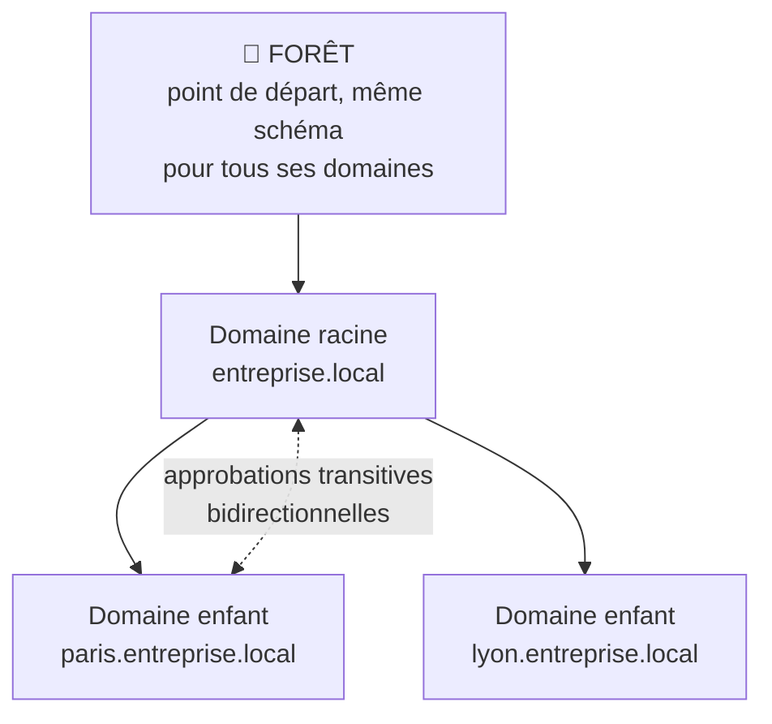
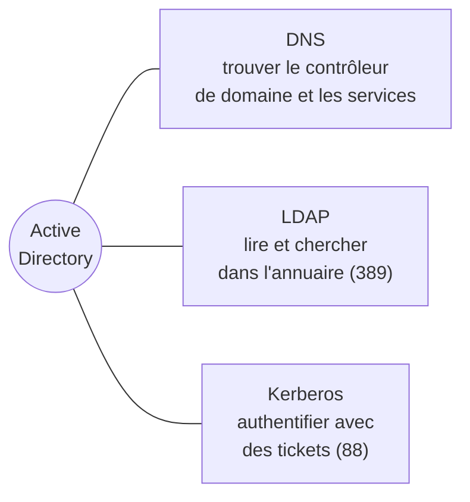
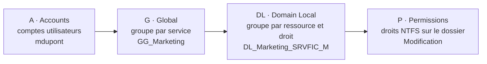
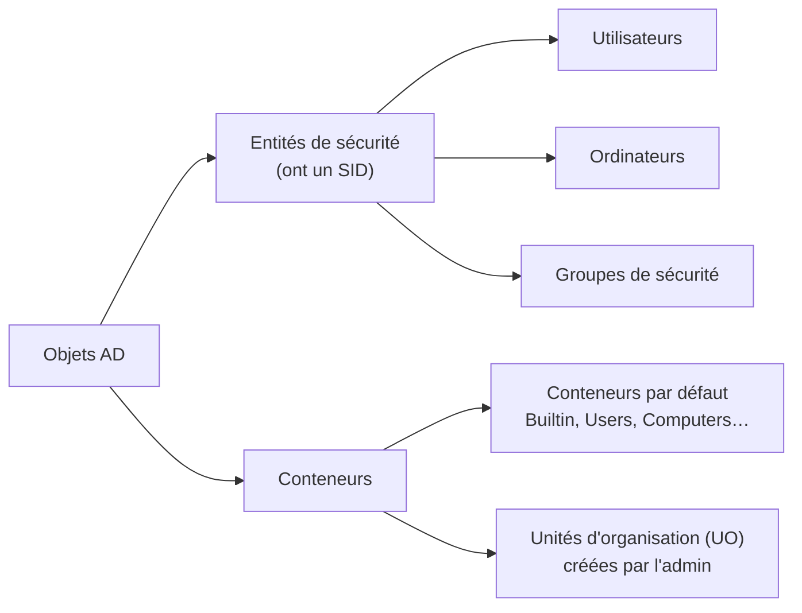

# Module 2 : Active Directory

*Cours : [Cours 8 - Les services réseau en environnement Microsoft](../index.md)*

## 🎯 Objectif du module

Comprendre **Active Directory** (annuaire, forêt, domaine, contrôleur de domaine), gérer ses **objets** (utilisateurs, ordinateurs, groupes, unités d'organisation), donner l'accès aux **ressources** avec la méthode **AGDLP**, et mettre en place un **serveur d'impression**.

!!! abstract "En clair"
    Sans Active Directory, chaque PC a ses propres comptes : 50 PC = 50 fois le même compte à créer. Avec AD, **un seul annuaire central** : l'utilisateur a **un seul compte** qui marche sur **tous les PC du domaine**, et l'administrateur gère tout depuis **une console**. Le serveur qui porte cet annuaire est le **contrôleur de domaine**.

## 🗺️ L'essentiel en schémas

!!! info "Référentiel TSSR 2026"
    **CCP 2 · compétence 5 : Installer et exploiter des serveurs Windows** et **compétence 7 : Gérer les accès et la sécurité dans un environnement hybride** (Active Directory est la base locale du « hybride », synchronisée avec Microsoft Entra ID).

**① Forêt, arbre, domaine**



**② Les 3 protocoles d'Active Directory**



**③ AGDLP : donner l'accès à un dossier partagé**



**④ Les objets de l'annuaire**



## 📖 Cours consolidé

### 1. Le service d'annuaire

**Active Directory** (AD DS) **centralise l'authentification** et la gestion des **objets** du réseau : utilisateurs, ordinateurs, groupes, imprimantes, dossiers partagés. Il sert de base à beaucoup d'outils Microsoft (stratégies de groupe, Exchange…).

| Protocole | Rôle | Image |
|---|---|---|
| **DNS** | Localiser les machines **et les services** (où est le contrôleur de domaine ?) | L'annuaire des adresses |
| **LDAP** | Lire et chercher dans l'annuaire | Feuilleter un annuaire papier |
| **Kerberos** | **Authentifier** grâce à des **tickets** | Le billet de cinéma : on l'achète une fois, puis on le présente à l'entrée de la salle |

### 2. Forêt, domaine, contrôleur de domaine

- **Forêt** : créée à la **première installation**, c'est le **point de départ**. Tous ses domaines partagent le même **schéma** (la liste des types d'objets et de leurs attributs).
- **Domaine** : un ensemble d'ordinateurs qui partagent **la même base d'annuaire** et les mêmes règles. Une PME a souvent **un seul domaine** ; un grand groupe peut avoir un **domaine racine** et des **domaines enfants**, reliés par des **approbations transitives et bidirectionnelles**.
- **Contrôleur de domaine** (DC) : le serveur qui héberge l'annuaire. En avoir **au moins deux** évite un point unique de défaillance.
- **Site** : un regroupement **géographique** (réseau local) qui optimise la **réplication** entre contrôleurs et l'authentification.
- **Niveau fonctionnel** : définit les fonctions disponibles selon la **plus ancienne** version de Windows Server des contrôleurs (ex. la **corbeille AD** n'existe qu'à partir de 2008 R2).

**Les 5 rôles FSMO** (des rôles uniques tenus par un seul contrôleur) :

| Niveau | Rôles |
|---|---|
| **Forêt** (1 par forêt) | Maître de **schéma** · Maître d'**attribution des noms de domaine** |
| **Domaine** (1 par domaine) | Maître **RID** · Émulateur **PDC** · Maître d'**infrastructure** |

### 3. Installer un domaine

**Prérequis** : serveur à jour, **adresse IP statique**, **nom de machine** définitif, plan d'adressage, et un **DNS** (installé en même temps que le contrôleur de domaine).

```powershell
Install-WindowsFeature AD-Domain-Services -IncludeManagementTools   # 1. le rôle
Install-ADDSForest -DomainName "entreprise.local"                   # 2. promotion : nouvelle forêt
# Sur un poste client (DNS du poste = IP du contrôleur de domaine) :
Add-Computer -DomainName "entreprise.local" -Restart                # 3. joindre le domaine
```

On peut aussi **rétrograder** un contrôleur de domaine pour en refaire un serveur membre.

### 4. Les objets et les outils

| Famille | Exemples |
|---|---|
| **Entités de sécurité** (avec un **SID**) | Utilisateurs, ordinateurs, groupes de sécurité |
| **Conteneurs** | Conteneurs par défaut et **unités d'organisation** |

**Outils** : console **Utilisateurs et ordinateurs Active Directory** (`dsa.msc`), **Centre d'administration Active Directory**, et **PowerShell** (module ActiveDirectory).

```powershell
Get-ADUser -Filter * | Select-Object Name, SamAccountName     # lister les utilisateurs
New-ADOrganizationalUnit -Name "Compta"                        # créer une UO
New-ADUser -Name "Marie Dupont" -SamAccountName mdupont -Path "OU=Compta,DC=entreprise,DC=local" -AccountPassword (Read-Host -AsSecureString) -Enabled $true
Add-ADGroupMember -Identity GG_Compta -Members mdupont
```

**Utilisateurs** : informations générales, compte, groupes, **profil**. Astuce Microsoft : un **compte modèle** (désactivé) que l'on **copie** pour créer les nouveaux arrivants d'un service. Le **profil itinérant** suit l'utilisateur sur tous les postes (copié depuis un serveur à l'ouverture, resynchronisé à la fermeture, donc parfois lent).

**Ordinateurs** : un **nom normalisé** (ex. `PC-COMPTA-01`) permet de retrouver la machine et de lui appliquer les bonnes règles. Un ordinateur peut, lui aussi, être membre de groupes.

**Conteneurs par défaut** : **Builtin** (groupes locaux prédéfinis), **Computers** (où arrivent les PC joints au domaine), **Users** (utilisateurs et groupes par défaut), **Domain Controllers**, et **System** (fonctionnement interne). On crée ses propres **UO** pour organiser (par service, par site) : un objet est dans **un seul** conteneur, et les UO sont **protégées contre la suppression accidentelle**.

**Import en masse** depuis un CSV :

```powershell
Import-Csv "C:\utilisateurs.csv" -Delimiter ";" | ForEach-Object {
    New-ADUser -Name "$($_.Prenom) $($_.Nom)" -SamAccountName $_.Login -Path "OU=Utilisateurs,DC=entreprise,DC=local" -AccountPassword (ConvertTo-SecureString $_.MotDePasse -AsPlainText -Force) -Enabled $true
}
```

### 5. Les groupes

| Type | Sert à |
|---|---|
| **Sécurité** | Donner des **droits** (a un SID) |
| **Distribution** | Envoyer des **mails** à une liste (pas de droits) |

| Étendue | Contient | Usage AGDLP |
|---|---|---|
| **Globale** | Des comptes **du même domaine** | Regrouper les **personnes** (par service) |
| **Domaine local** | Comptes et groupes globaux | Porter les **droits sur une ressource** |
| **Universelle** | Objets de toute la forêt | Grandes forêts multidomaines |

### 6. Les ressources partagées et la méthode AGDLP

Les droits sur un partage combinent **droits de partage** et **droits NTFS** (le plus restrictif gagne) : revois le [cours 2 · module 6](../../cours-02-systeme-client-microsoft/module-6-la-securite-ntfs-et-les-acl/index.md) et le [module 8](../../cours-02-systeme-client-microsoft/module-8-le-partage-de-ressources/index.md). Les droits NTFS se **cumulent**, le **refus l'emporte**, l'**héritage** part de la racine.

**AGDLP** : **A**ccounts → **G**lobal → **D**omain **L**ocal → **P**ermissions.

1. Mettre les **comptes** dans un **groupe global** par service (`GG_Marketing`).
2. Créer, **pour chaque ressource**, un **groupe de domaine local par niveau de droit** : `DL_Marketing_SRVFIC_CT` (contrôle total), `_M` (modification), `_L` (lecture), `_R` (refus).
3. Mettre le **groupe global** dans le **bon groupe de domaine local**.
4. Donner les **droits NTFS** **uniquement** aux groupes de domaine local.

➕ Un nouvel arrivant ? On l'ajoute **dans un seul groupe global** : il hérite de **tous** les accès de son service.

### 7. Le serveur d'impression

| Terme | Sens |
|---|---|
| **Port d'impression** | Le lien de communication entre le serveur et l'imprimante (souvent un port TCP/IP) |
| **File d'attente** | Les documents en attente d'impression |
| **Imprimante locale** | Branchée en USB sur un poste ou un serveur |
| **Imprimante partagée** | Rendue accessible sur le réseau par un poste ou un serveur |
| **Imprimante réseau** | Possède sa **propre carte réseau** |

- Rôle **Services d'impression et de numérisation de document** → console **Gestion de l'impression** (`printmanagement.msc`).
- Autorisations : **Imprimer**, **Gérer les documents**, **Gérer cette imprimante**.
- **Déploiement** : manuel (l'utilisateur tape `\\SRV-IMPR` et double-clique l'imprimante) ou **par stratégie de groupe** selon l'UO de l'utilisateur ou du poste ([module 3](../module-3-les-strategies-de-groupe/index.md)).

## 📝 Fiche de révision

| Notion | À retenir |
|---|---|
| **AD DS** | Annuaire central : authentification et objets |
| **DNS / LDAP / Kerberos** | Localiser / interroger / authentifier |
| **Forêt** | Point de départ, un même schéma |
| **Contrôleur de domaine** | Serveur qui héberge l'annuaire (2 minimum conseillés) |
| **FSMO** | 5 rôles : 2 de forêt, 3 de domaine |
| **UO** | Conteneur créé par l'admin pour organiser |
| **Groupe global / domaine local** | Les personnes / les droits sur une ressource |
| **AGDLP** | Comptes → Global → Domaine Local → Permissions |
| **Profil itinérant** | Le profil suit l'utilisateur sur tous les postes |

### 🔧 Les commandes

| Je veux… | Commande |
|---|---|
| Installer le rôle | `Install-WindowsFeature AD-Domain-Services -IncludeManagementTools` |
| Créer une forêt | `Install-ADDSForest -DomainName "entreprise.local"` |
| Joindre un poste | `Add-Computer -DomainName "entreprise.local" -Restart` |
| Lister les utilisateurs | `Get-ADUser -Filter *` |
| Créer une UO / un utilisateur | `New-ADOrganizationalUnit` · `New-ADUser` |
| Ajouter à un groupe | `Add-ADGroupMember -Identity GG_Compta -Members mdupont` |
| Console graphique | `dsa.msc` |

### ⚠️ Les pièges

- Un contrôleur de domaine **sans IP fixe** ou des postes qui n'utilisent **pas le DNS du domaine** = jonction impossible.
- Donner des droits **directement aux utilisateurs** : ingérable. Toujours **AGDLP**.
- Un objet n'est que dans **une seule** UO.
- Les nouveaux PC arrivent dans **Computers**, qui **n'est pas une UO** : on ne peut pas y lier de GPO, il faut les **déplacer**.

### ✏️ Entraîne-toi (clique pour voir la correction)

??? question "1. Le service RH doit lire et modifier \\\\SRVFIC\\RH, la direction seulement le lire. Applique AGDLP."
    Groupes globaux : `GG_RH` (les RH), `GG_Direction`. Groupes de domaine local : `DL_RH_SRVFIC_M` et `DL_RH_SRVFIC_L`. `GG_RH` → `DL_RH_SRVFIC_M`, `GG_Direction` → `DL_RH_SRVFIC_L`. Droits NTFS du dossier : **Modification** à `DL_RH_SRVFIC_M`, **Lecture** à `DL_RH_SRVFIC_L`.

??? question "2. Un poste n'arrive pas à rejoindre le domaine entreprise.local (« domaine introuvable »). Que vérifies-tu en premier ?"
    Le **DNS** du poste : il doit pointer vers l'**IP du contrôleur de domaine** (`ipconfig /all`), car c'est par le DNS que le poste trouve le domaine. Puis la connectivité (`ping` du DC) et le nom du domaine.

## 🧠 Quiz — entraîne-toi

<div id="quiz-cours-08-les-services-reseau-en-environnement-microsoft-module-2-active-directory"></div>

<script type="application/json" id="quiz-cours-08-les-services-reseau-en-environnement-microsoft-module-2-active-directory-data">
[
  {
    "question": "Sur quels 3 protocoles repose Active Directory ?",
    "options": [
      "HTTP, FTP, SMTP",
      "DNS, LDAP, Kerberos",
      "DHCP, SNMP, RDP",
      "SMB, NTP, ICMP"
    ],
    "correctIndex": 1,
    "explanation": "DNS pour localiser, LDAP pour interroger l'annuaire, Kerberos pour authentifier."
  },
  {
    "question": "Que crée-t-on obligatoirement lors de la toute première installation d'Active Directory ?",
    "options": [
      "Une UO",
      "Une forêt",
      "Un site",
      "Un groupe universel"
    ],
    "correctIndex": 1,
    "explanation": "La forêt est le point de départ : elle contient le premier domaine (domaine racine)."
  },
  {
    "question": "Dans la méthode AGDLP, à quel groupe donne-t-on les droits NTFS ?",
    "options": [
      "Au groupe global",
      "Au groupe de domaine local",
      "Directement aux utilisateurs",
      "Au groupe universel"
    ],
    "correctIndex": 1,
    "explanation": "Les comptes vont dans des groupes globaux, eux-mêmes dans des groupes de domaine local qui portent les permissions."
  },
  {
    "question": "Combien de rôles FSMO existe-t-il ?",
    "options": [
      "3",
      "4",
      "5",
      "7"
    ],
    "correctIndex": 2,
    "explanation": "2 au niveau de la forêt (schéma, attribution des noms de domaine) et 3 au niveau du domaine (RID, émulateur PDC, infrastructure)."
  },
  {
    "question": "Quel prérequis est indispensable avant de promouvoir un serveur en contrôleur de domaine ?",
    "options": [
      "Une adresse IP statique",
      "Une édition Famille",
      "Un compte Microsoft",
      "Le rôle Hyper-V"
    ],
    "correctIndex": 0,
    "explanation": "Un contrôleur de domaine doit avoir une IP fixe : les postes le trouvent par le DNS."
  },
  {
    "question": "Où arrivent par défaut les ordinateurs joints au domaine ?",
    "options": [
      "Dans l'UO Domain Controllers",
      "Dans le conteneur Computers",
      "Dans le conteneur Builtin",
      "Dans le conteneur Users"
    ],
    "correctIndex": 1,
    "explanation": "Computers n'est pas une UO : pour leur appliquer des GPO, on les déplace dans une UO."
  },
  {
    "question": "Quel type de groupe ne sert qu'à envoyer des mails ?",
    "options": [
      "Sécurité",
      "Distribution",
      "Domaine local",
      "Global"
    ],
    "correctIndex": 1,
    "explanation": "Un groupe de distribution n'a pas de SID : il ne peut pas recevoir de droits."
  },
  {
    "question": "Quelle cmdlet joint un poste au domaine ?",
    "options": [
      "Join-ADDomain",
      "Add-Computer -DomainName",
      "New-ADComputer -Join",
      "Set-Domain"
    ],
    "correctIndex": 1,
    "explanation": "Add-Computer -DomainName entreprise.local -Restart joint le poste puis le redémarre."
  },
  {
    "question": "Un poste ne trouve pas le domaine. Que vérifies-tu en premier ?",
    "options": [
      "La carte graphique",
      "Que son serveur DNS est le contrôleur de domaine",
      "Sa licence Office",
      "Le fuseau horaire uniquement"
    ],
    "correctIndex": 1,
    "explanation": "C'est par le DNS que le poste localise le contrôleur de domaine."
  },
  {
    "question": "Which protocol does Active Directory use to authenticate users with tickets?",
    "options": [
      "LDAP",
      "Kerberos",
      "NTLM only",
      "RADIUS"
    ],
    "correctIndex": 1,
    "explanation": "Kerberos délivre des tickets (port 88). LDAP sert à interroger l'annuaire."
  }
]
</script>

<script>
  document.addEventListener("DOMContentLoaded", function () {
    TSSRQuiz.init({
      containerId: "quiz-cours-08-les-services-reseau-en-environnement-microsoft-module-2-active-directory",
      dataId: "quiz-cours-08-les-services-reseau-en-environnement-microsoft-module-2-active-directory-data",
    });
  });
</script>
