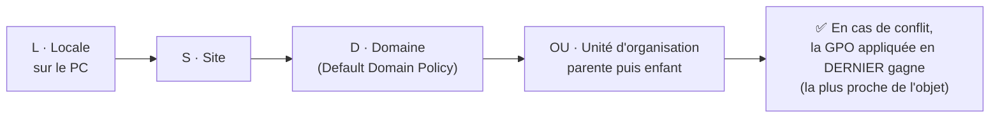
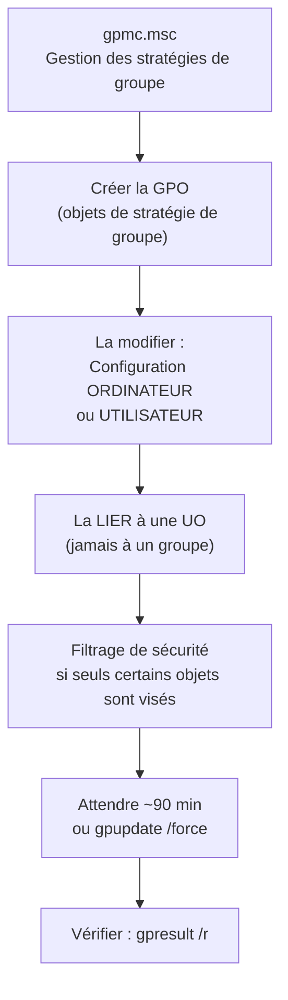
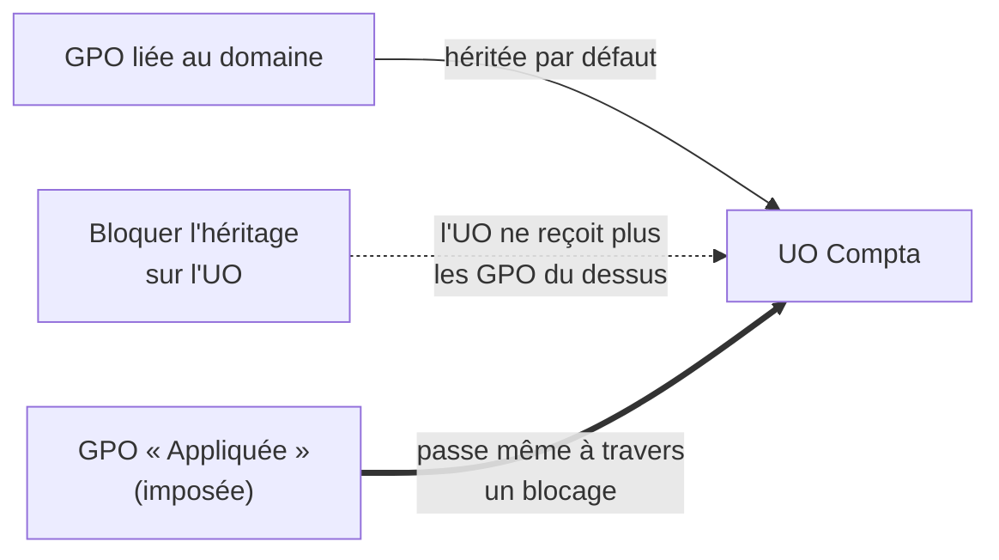

# Module 3 : Les stratégies de groupe

*Cours : [Cours 8 - Les services réseau en environnement Microsoft](../index.md)*

## 🎯 Objectif du module

Savoir **créer**, **lier** et **cibler** une stratégie de groupe (GPO) dans un domaine, comprendre l'**ordre d'application**, et l'utiliser pour **rediriger des dossiers** et **déployer des imprimantes**.

!!! abstract "En clair"
    Au [cours 2](../../cours-02-systeme-client-microsoft/module-13-les-strategies-de-groupe-locales/index.md), une stratégie locale réglait **un seul PC**. Dans un domaine, une **GPO** règle **des centaines de PC et d'utilisateurs d'un coup** : fond d'écran, sécurité, imprimantes, dossiers redirigés vers le serveur… On la crée une fois, on la **lie** à une **UO**, et tous les objets de l'UO la reçoivent.

## 🗺️ L'essentiel en schémas

!!! info "Référentiel TSSR 2026"
    **CCP 2 · compétence 7 : Gérer les accès et la sécurité** (sécuriser les postes) et **compétence 5 : Exploiter des serveurs Windows** ; **CCP 1 · compétence 2** (déployer imprimantes et réglages sur le parc).

**① L'ordre d'application : LSDOU, la dernière gagne**



**② Créer et appliquer une GPO**



**③ Héritage : bloquer ou imposer ?**



## 📖 Cours consolidé

### 1. À quoi servent les GPO ?

Elles configurent les **ordinateurs** et les **utilisateurs** du domaine : **sécurité** (mots de passe, verrouillage), **scripts** d'ouverture de session, **déploiement** de logiciels et d'imprimantes, **restrictions** (panneau de configuration, éteindre la machine…), **personnalisation** d'Office grâce à ses modèles d'administration.

- Une GPO a deux parties : **Configuration ordinateur** (appliquée au démarrage, aux objets **ordinateurs**) et **Configuration utilisateur** (appliquée à l'ouverture de session, aux objets **utilisateurs**).
- Chaque paramètre a un **nom**, un **état** (Non configuré, Activé, Désactivé), une **description** et les **versions de Windows** prises en charge.
- ⚠️ Les GPO dépendent du **système** : un paramètre prévu pour une ancienne version peut n'avoir **aucun effet**.

### 2. Les GPO par défaut

| GPO | Liée à | Contient |
|---|---|---|
| **Default Domain Policy** (DDP) | La **racine du domaine** | La politique de **mots de passe** et de verrouillage du domaine |
| **Default Domain Controllers Policy** | L'UO **Domain Controllers** | Les droits des contrôleurs de domaine |

📌 Bonne pratique : **ne pas tout mettre dans la DDP**. On crée **une GPO par besoin**, liée à la bonne UO.

### 3. Quand s'appliquent-elles ?

- Au **démarrage** (partie ordinateur) et à l'**ouverture de session** (partie utilisateur).
- Puis **toutes les 90 minutes**, avec un décalage aléatoire de **± 30 minutes**.
- Pour forcer : `gpupdate /force`. Pour vérifier : `gpresult /r` (ou `gpresult /h rapport.html`).
- Côté poste, ce sont les **extensions côté client** (CSE) qui récupèrent et appliquent les paramètres.

### 4. Cibler : liaisons, héritage, filtres

- On **lie** une GPO à un **site**, au **domaine** ou à une **UO**. **Pas à un groupe**, et pas au conteneur **Computers** ou **Users** (ce ne sont pas des UO).
- **Héritage** : une GPO liée en haut s'applique aux UO du dessous.
- **Ordre LSDOU** : Locale → Site → Domaine → UO. En cas de **conflit**, la **dernière appliquée gagne** (la plus proche de l'objet).
- **Bloquer l'héritage** (sur une UO) : elle ne reçoit plus les GPO des niveaux supérieurs.
- **Appliquée** (*Enforced*, sur une liaison) : la GPO s'impose **même** à travers un blocage, et gagne les conflits.
- **Filtrage de sécurité** : par défaut, « Utilisateurs authentifiés ». On le remplace par un **groupe** pour n'appliquer la GPO qu'à ses membres : c'est **ainsi** qu'on cible un groupe.

### 5. La redirection des dossiers

**Configuration utilisateur → Stratégies → Paramètres Windows → Redirection de dossiers** : les dossiers **Documents**, **Bureau**… de l'utilisateur sont stockés **sur le serveur** au lieu du PC.

- ➕ Données **sauvegardées** avec le serveur, accessibles depuis **n'importe quel poste**, ouverture de session plus rapide qu'un profil itinérant complet.
- **De base** (même cible pour tous) ou **avancée** (une cible selon le **groupe**).
- Cible typique : un dossier par utilisateur dans un partage, `\\SRV-FIC\Profils$\%USERNAME%\Documents`.
- Il faut un **partage** avec les **bons droits** : chaque utilisateur ne doit voir **que son dossier**.

### 6. Déployer des imprimantes

Depuis la console **Gestion de l'impression** (« Déployer avec une stratégie de groupe ») ou dans une GPO (**Préférences → Paramètres du Panneau de configuration → Imprimantes**). On choisit si on cible les **utilisateurs** ou les **ordinateurs**, puis `gpupdate /force` sur le poste : l'imprimante apparaît.

```powershell
New-GPO -Name "GPO_Fond_Ecran"                                  # créer
New-GPLink -Name "GPO_Fond_Ecran" -Target "OU=Compta,DC=entreprise,DC=local"   # lier à une UO
Get-GPO -All | Select-Object DisplayName                        # lister
```

## 📝 Fiche de révision

| Notion | À retenir |
|---|---|
| **GPO** | Stratégie de groupe du domaine |
| **`gpmc.msc`** | Console de gestion des stratégies de groupe |
| **Ordinateur / utilisateur** | Appliquée au démarrage / à l'ouverture de session |
| **LSDOU** | Locale → Site → Domaine → UO · la dernière gagne |
| **Actualisation** | 90 min ± 30 min · `gpupdate /force` |
| **Vérifier** | `gpresult /r` |
| **Bloquer l'héritage** | Sur une UO |
| **Appliquée (Enforced)** | Sur une liaison, passe le blocage |
| **Filtrage de sécurité** | Cibler un groupe |
| **Redirection de dossiers** | Documents, Bureau sur le serveur |

### ⚠️ Les pièges

- On ne **lie pas** une GPO à un **groupe** : on la lie à une UO et on **filtre** par groupe.
- Une GPO liée à une UO qui ne contient **que des utilisateurs** n'applique **pas** sa partie **ordinateur** (et inversement).
- Les PC restés dans **Computers** ne reçoivent que les GPO du domaine : déplace-les dans une UO.
- **Non configuré ≠ Désactivé**.
- Une modification n'est pas **immédiate** : `gpupdate /force`, puis parfois **redémarrer** ou se **reconnecter**.

### ✏️ Entraîne-toi (clique pour voir la correction)

??? question "1. La GPO du domaine impose un fond d'écran bleu, celle de l'UO Compta un fond vert. Quel fond voit un comptable ?"
    **Vert** : l'UO est appliquée **après** le domaine (LSDOU), elle gagne le conflit. Sauf si la GPO du domaine est **Appliquée** (*Enforced*) : alors le bleu s'impose.

??? question "2. Tu veux appliquer une GPO uniquement aux membres du groupe GG_Direction, répartis dans plusieurs UO. Comment faire ?"
    Lier la GPO au niveau qui contient toutes ces UO (le domaine, par exemple), puis dans **Filtrage de sécurité**, retirer « Utilisateurs authentifiés » et ajouter **GG_Direction**.

## 🧠 Quiz — entraîne-toi

<div id="quiz-cours-08-les-services-reseau-en-environnement-microsoft-module-3-les-strategies-de-groupe"></div>

<script type="application/json" id="quiz-cours-08-les-services-reseau-en-environnement-microsoft-module-3-les-strategies-de-groupe-data">
[
  {
    "question": "Dans quel ordre s'appliquent les GPO ?",
    "options": [
      "UO, Domaine, Site, Locale",
      "Locale, Site, Domaine, UO",
      "Domaine, Locale, UO, Site",
      "Site, UO, Domaine, Locale"
    ],
    "correctIndex": 1,
    "explanation": "LSDOU : Locale, Site, Domaine, puis UO (parente puis enfant). La dernière appliquée gagne en cas de conflit."
  },
  {
    "question": "Quelle commande force l'application immédiate des GPO sur un poste ?",
    "options": [
      "gpresult /r",
      "gpupdate /force",
      "gpedit.msc",
      "net use"
    ],
    "correctIndex": 1,
    "explanation": "gpupdate /force réapplique toutes les stratégies ; gpresult /r montre celles qui s'appliquent."
  },
  {
    "question": "Toutes les combien de temps les GPO sont-elles actualisées par défaut sur un poste ?",
    "options": [
      "5 minutes",
      "90 minutes (± 30 min)",
      "24 heures",
      "Uniquement au démarrage"
    ],
    "correctIndex": 1,
    "explanation": "L'actualisation a lieu toutes les 90 minutes avec un décalage aléatoire de 0 à 30 minutes."
  },
  {
    "question": "Peut-on lier une GPO directement à un groupe ?",
    "options": [
      "Oui",
      "Non : on la lie à une UO, un domaine ou un site, et on filtre par groupe",
      "Oui, mais seulement aux groupes globaux",
      "Oui, avec gpupdate"
    ],
    "correctIndex": 1,
    "explanation": "Le ciblage d'un groupe se fait par le filtrage de sécurité de la GPO."
  },
  {
    "question": "Que fait l'option « Appliquée » (Enforced) sur une liaison de GPO ?",
    "options": [
      "Elle désactive la GPO",
      "Elle impose la GPO même aux UO qui bloquent l'héritage",
      "Elle supprime les autres GPO",
      "Elle force un redémarrage"
    ],
    "correctIndex": 1,
    "explanation": "Une GPO appliquée passe à travers le blocage d'héritage et gagne les conflits."
  },
  {
    "question": "Quelle GPO par défaut contient la politique de mots de passe du domaine ?",
    "options": [
      "Default Domain Controllers Policy",
      "Default Domain Policy",
      "Local Group Policy",
      "Default User Policy"
    ],
    "correctIndex": 1,
    "explanation": "La Default Domain Policy, liée à la racine du domaine."
  },
  {
    "question": "À quoi sert la redirection de dossiers ?",
    "options": [
      "À cacher des dossiers",
      "À stocker Documents, Bureau… de l'utilisateur sur un serveur",
      "À chiffrer le disque",
      "À déplacer le fichier d'échange"
    ],
    "correctIndex": 1,
    "explanation": "Les données sont sur le serveur : sauvegardées et accessibles depuis n'importe quel poste."
  },
  {
    "question": "Quelle commande montre les GPO réellement appliquées à un utilisateur et à son poste ?",
    "options": [
      "gpupdate /force",
      "gpresult /r",
      "ipconfig /all",
      "secpol.msc"
    ],
    "correctIndex": 1,
    "explanation": "gpresult /r (ou /h rapport.html) affiche le résultat des stratégies."
  },
  {
    "question": "What does gpupdate /force do?",
    "options": [
      "It deletes all GPOs",
      "It reapplies all Group Policy settings immediately",
      "It creates a new GPO",
      "It shows the applied policies"
    ],
    "correctIndex": 1,
    "explanation": "It refreshes and reapplies policies now, instead of waiting for the 90-minute cycle."
  }
]
</script>

<script>
  document.addEventListener("DOMContentLoaded", function () {
    TSSRQuiz.init({
      containerId: "quiz-cours-08-les-services-reseau-en-environnement-microsoft-module-3-les-strategies-de-groupe",
      dataId: "quiz-cours-08-les-services-reseau-en-environnement-microsoft-module-3-les-strategies-de-groupe-data",
    });
  });
</script>
