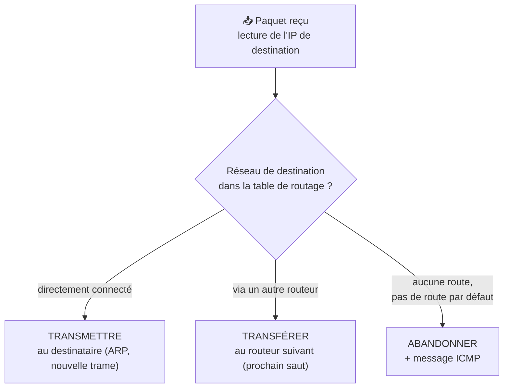
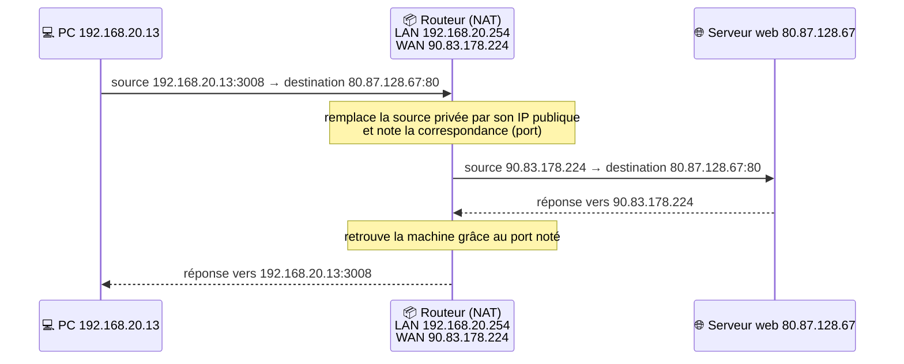
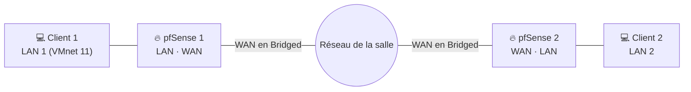

# Module 4 : Le routage

*Cours : [Cours 8 - Les services réseau en environnement Microsoft](../index.md)*

## 🎯 Objectif du module

Faire communiquer **plusieurs réseaux** : comprendre le **routage** (statique, dynamique, table de routage), la **traduction d'adresses (NAT)**, et mettre en place un routeur-pare-feu **pfSense** dans les TP.

!!! abstract "En clair"
    Ce module reprend le [cours 1 · module 4](../../cours-01-bases-des-reseaux/module-4-la-communication/index.md) et le met en pratique : un routeur **pfSense** (logiciel libre installé dans une VM) relie ton réseau de TP à Internet, et deux pfSense relient deux réseaux de TP entre eux. Le **NAT** permet aux adresses privées de sortir sur Internet derrière **une seule** adresse publique.

## 🗺️ L'essentiel en schémas

!!! info "Référentiel TSSR 2026"
    **CCP 2 · compétence 4 : Exploiter un réseau IP.** L'épreuve du CCP 2 comprend un **incident réseau traité devant le jury** : savoir lire une table de routage et suivre un paquet est indispensable.

**① Ce que fait le routeur de chaque paquet**



**② Le NAT : une seule adresse publique pour tout le réseau**



**③ Le TP : deux réseaux reliés par deux pfSense**



## 📖 Cours consolidé

### 1. Le routage, rappel

- Le **routage** fait communiquer des **réseaux logiques différents** (adresses IP qui ne partagent pas le même réseau, calculé avec le masque).
- Un poste qui veut joindre un autre réseau envoie le paquet à sa **passerelle par défaut** ; la passerelle doit être **dans son réseau** ([cours 1 · module 4](../../cours-01-bases-des-reseaux/module-4-la-communication/index.md)).
- À chaque saut, le routeur **désencapsule jusqu'à la couche 3**, lit l'IP de destination, consulte sa **table de routage**, puis **réécrit les adresses MAC**. Les **IP**, elles, ne changent pas (sauf NAT).

**Une route** = un **réseau de destination** + un **masque** + une **passerelle** (prochain saut) + une **interface** de sortie + une **métrique** (coût).

| | Statique | Dynamique |
|---|---|---|
| Comment | Saisie **à la main**, conservée au redémarrage | Les routeurs **s'échangent** leurs routes (RIP, OSPF, BGP) |
| Pour | Petits réseaux stables, labos | Réseaux moyens et grands, tolérance aux pannes |

**Le routeur a 3 choix** pour chaque paquet, traité **indépendamment** : le **transmettre** au destinataire (réseau directement connecté), le **transférer** au routeur suivant, ou l'**abandonner** (aucune route).

### 2. Exemple : A joint D, sur un autre réseau

| Étape | Ici |
|---|---|
| A : `192.168.1.10/24`, passerelle `192.168.1.254` | Réseau de A : **192.168.1.0** |
| D : `192.168.2.140/26` | Réseau de D (calculé par A avec **son** masque) : différent |
| Réseaux différents → passerelle définie ? | Oui → **ARP pour la MAC de la passerelle**, puis envoi |
| Le routeur connaît `192.168.2.128/26` ? | Oui, directement connecté → ARP pour la MAC de D, nouvelle trame |

### 3. Le NAT (traduction d'adresses)

- Les adresses **privées** (10.x, 172.16-31.x, 192.168.x) **ne sont pas routées sur Internet**. Sans NAT, le serveur web reçoit une demande venant de `192.168.20.13` et **ne peut pas répondre**.
- Avec le NAT, le routeur **remplace l'adresse source privée** par **son adresse publique** (`90.83.178.224`) et garde une **table de correspondance**.
- Quand la réponse revient, c'est le **port** noté au départ qui lui indique **quelle machine** l'attend. Cette variante, où plusieurs machines partagent une IP grâce aux ports, s'appelle le **PAT** (ou NAT dynamique avec surcharge) : c'est ce que fait ta box.

### 4. pfSense dans les TP

**pfSense** est un **routeur-pare-feu libre** basé sur **FreeBSD**, installé dans une VM et administré par une **interface web**.

| Étape | Détail |
|---|---|
| VM | 2 cartes réseau : **WAN** (vers l'extérieur, en Bridged) et **LAN** (réseau du TP, ex. VMnet 11) |
| Installation | Assistant en mode texte, clavier français |
| Console | Pas de VLAN · affecter les cartes au **WAN** et au **LAN** |
| Adresse LAN | Par défaut `192.168.1.1` : la changer si elle est déjà prise (ex. `192.168.1.254/24`) et **désactiver le DHCP** de pfSense si un serveur DHCP existe déjà |
| Interface web | `https://192.168.1.254` · identifiants par défaut `admin` / `pfsense` → **à changer immédiatement** |
| En TP seulement | Désactiver **« Block private networks »** sur le WAN (le WAN du labo est lui-même un réseau privé) |
| Routes statiques | **System → Routing** : déclarer la **passerelle** (l'autre pfSense), puis la **route statique** vers son LAN |

⚠️ Dans la démonstration ENI, une règle **WAN « Any → Any »** est créée pour simplifier le TP. En entreprise, c'est **interdit** : on n'ouvre que les flux nécessaires (cours 16).

### 5. Les commandes côté Windows

```text
route print                                          :: afficher la table de routage
route add 192.168.2.0 mask 255.255.255.0 192.168.1.250 -p   :: route statique permanente (-p)
tracert 192.168.2.140                                :: voir les routeurs traversés
```

```powershell
Get-NetRoute -AddressFamily IPv4                     # table de routage
New-NetRoute -DestinationPrefix 192.168.2.0/24 -NextHop 192.168.1.250 -InterfaceAlias Ethernet0
Test-NetConnection 192.168.2.140 -TraceRoute         # équivalent de tracert
```

## 📝 Fiche de révision

| Notion | À retenir |
|---|---|
| **Route** | Destination + masque + passerelle + interface + métrique |
| **Statique / dynamique** | À la main / échangée (RIP, OSPF, BGP) |
| **Route par défaut** | `0.0.0.0/0` : tout le reste |
| **Choix du routeur** | Transmettre · transférer · abandonner |
| **NAT** | Remplace l'IP privée par l'IP publique du routeur |
| **PAT** | Plusieurs machines derrière une IP, distinguées par le **port** |
| **pfSense** | Routeur-pare-feu libre (FreeBSD), interface web |
| **`route print` / `route add -p`** | Voir / ajouter une route permanente |

### ⚠️ Les pièges

- Une **passerelle hors du réseau** du poste ne fonctionne pas.
- `route add` **sans `-p`** : la route disparaît au redémarrage.
- Il faut une route **dans les deux sens** : l'aller ne suffit pas, la réponse doit pouvoir revenir.
- pfSense est basé sur **FreeBSD**, pas sur Linux.
- Une règle **Any → Any** sur le WAN = pare-feu inutile.

### ✏️ Entraîne-toi (clique pour voir la correction)

??? question "1. Le client 1 (LAN 192.168.10.0/24) ne joint pas le client 2 (LAN 192.168.20.0/24). Le ping du pfSense 2 côté WAN répond. Que manque-t-il probablement ?"
    Une **route statique** sur pfSense 1 vers `192.168.20.0/24` via le **WAN de pfSense 2**, et **la route retour** sur pfSense 2 vers `192.168.10.0/24` via le WAN de pfSense 1. Vérifier aussi les **règles de pare-feu** et l'option « Block private networks ».

??? question "2. Ajoute sur un serveur Windows une route permanente vers 10.0.0.0/8 via 192.168.1.250, puis vérifie."
    `route add 10.0.0.0 mask 255.0.0.0 192.168.1.250 -p`, puis `route print` (la route apparaît dans « Itinéraires persistants »).

## 🧠 Quiz — entraîne-toi

<div id="quiz-cours-08-les-services-reseau-en-environnement-microsoft-module-4-le-routage"></div>

<script type="application/json" id="quiz-cours-08-les-services-reseau-en-environnement-microsoft-module-4-le-routage-data">
[
  {
    "question": "Que contient une route ?",
    "options": [
      "Une adresse MAC et un port",
      "Un réseau de destination, un masque, une passerelle, une interface et une métrique",
      "Un nom DNS et une adresse IP",
      "Un VLAN et un SSID"
    ],
    "correctIndex": 1,
    "explanation": "C'est ce qui permet au routeur de savoir par où envoyer un paquet."
  },
  {
    "question": "Un routeur ne trouve aucune route et n'a pas de route par défaut. Que fait-il du paquet ?",
    "options": [
      "Il le renvoie à la source",
      "Il l'abandonne et peut envoyer un message ICMP",
      "Il le diffuse à tout le monde",
      "Il le garde en mémoire"
    ],
    "correctIndex": 1,
    "explanation": "Sans route, le paquet est détruit ; un message ICMP « destination inaccessible » peut prévenir l'émetteur."
  },
  {
    "question": "À quoi sert le NAT ?",
    "options": [
      "À chiffrer les données",
      "À remplacer l'adresse IP privée par l'adresse publique du routeur pour sortir sur Internet",
      "À distribuer des adresses IP",
      "À traduire les noms en adresses"
    ],
    "correctIndex": 1,
    "explanation": "Les adresses privées ne sont pas routées sur Internet : le routeur les traduit."
  },
  {
    "question": "Avec le PAT, comment le routeur sait-il à quelle machine renvoyer une réponse ?",
    "options": [
      "Grâce à l'adresse MAC du serveur",
      "Grâce au port noté dans sa table de correspondance",
      "Grâce au DNS",
      "Il l'envoie à toutes les machines"
    ],
    "correctIndex": 1,
    "explanation": "Chaque connexion sortante est associée à un port : la réponse revient sur ce port."
  },
  {
    "question": "Quelle commande Windows ajoute une route qui survit au redémarrage ?",
    "options": [
      "route add … -p",
      "route print",
      "tracert",
      "ipconfig /renew"
    ],
    "correctIndex": 0,
    "explanation": "L'option -p rend la route persistante."
  },
  {
    "question": "Sur quel système pfSense est-il basé ?",
    "options": [
      "Linux Debian",
      "FreeBSD",
      "Windows Server",
      "macOS"
    ],
    "correctIndex": 1,
    "explanation": "pfSense est un routeur-pare-feu libre basé sur FreeBSD."
  },
  {
    "question": "Quelle différence entre routage statique et dynamique ?",
    "options": [
      "Le statique est plus rapide à adapter aux pannes",
      "Le statique est saisi à la main ; le dynamique échange les routes automatiquement (RIP, OSPF…)",
      "Le dynamique n'existe qu'en IPv6",
      "Aucune"
    ],
    "correctIndex": 1,
    "explanation": "Le routage dynamique s'adapte seul aux pannes ; le statique demande une intervention."
  },
  {
    "question": "Le client 1 joint le client 2, mais les réponses n'arrivent jamais. Cause probable ?",
    "options": [
      "Pas de route retour sur l'autre routeur",
      "Le câble est débranché",
      "Le DNS est en panne",
      "Le ping est trop long"
    ],
    "correctIndex": 0,
    "explanation": "Il faut une route dans les deux sens : l'aller et le retour."
  },
  {
    "question": "What does NAT stand for?",
    "options": [
      "Network Address Translation",
      "Network Access Table",
      "Name Allocation Tool",
      "Node Address Transfer"
    ],
    "correctIndex": 0,
    "explanation": "Network Address Translation : la traduction d'adresses réseau."
  }
]
</script>

<script>
  document.addEventListener("DOMContentLoaded", function () {
    TSSRQuiz.init({
      containerId: "quiz-cours-08-les-services-reseau-en-environnement-microsoft-module-4-le-routage",
      dataId: "quiz-cours-08-les-services-reseau-en-environnement-microsoft-module-4-le-routage-data",
    });
  });
</script>
