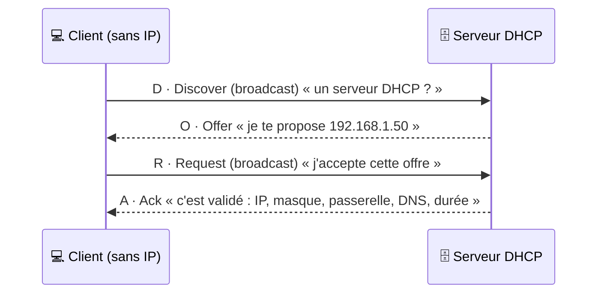
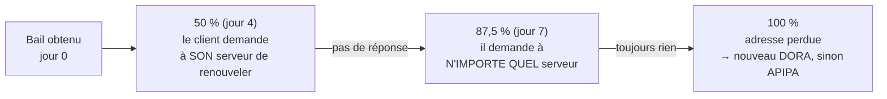
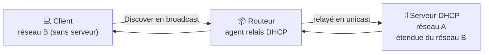
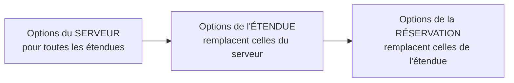

# Module 5 : Le service DHCP

*Cours : [Cours 8 - Les services réseau en environnement Microsoft](../index.md)*

## 🎯 Objectif du module

Comprendre le **DHCP** (bail, échange **DORA**, renouvellement), configurer un serveur DHCP Windows (**étendue**, **exclusions**, **réservations**, **options**), le faire servir **plusieurs réseaux** (agent relais) et le rendre **fiable** (autorisation, sauvegarde, basculement).

!!! abstract "En clair"
    Sans DHCP, il faudrait taper à la main l'IP, le masque, la passerelle et le DNS de **chaque** poste. Le serveur DHCP les **prête automatiquement** pour une durée limitée : le **bail**. S'il tombe en panne, les postes finissent en **169.254.x.x** et plus rien ne marche : c'est un service **critique**.

## 🗺️ L'essentiel en schémas

!!! info "Référentiel TSSR 2026"
    **CCP 2 · compétence 4 : Exploiter un réseau IP** et **compétence 5 : Exploiter des serveurs Windows** ; **CCP 3 · compétence 9 : Assurer la continuité** (basculement DHCP, sauvegarde).

**① DORA : comment un poste obtient son adresse**



**② La vie d'un bail (ex. 8 jours)**



**③ Un seul serveur DHCP pour plusieurs réseaux : l'agent relais**



**④ Quelles options gagnent ?**



## 📖 Cours consolidé

### 1. Le DHCP et le bail

- **DHCP** = *Dynamic Host Configuration Protocol*. Il **centralise** et **automatise** la configuration IP : moins d'erreurs, changements propagés vite.
- ➖ Service **critique** et cible d'attaques (épuisement des adresses, faux serveur DHCP) : à surveiller et à doubler.
- Le **bail** = un « contrat » : **IP**, **masque**, **durée**, et des **options** (passerelle, DNS, suffixe DNS…).
- **DORA** : **D**iscover → **O**ffer → **R**equest → **A**ck, sur les ports UDP **67** (serveur) et **68** (client). Le client n'a pas encore d'IP : il parle en **broadcast**.
- **Renouvellement** à **50 %** de la durée auprès du même serveur, puis à **87,5 %** auprès de n'importe quel serveur.
- **Libération** : `ipconfig /release` envoie un *DHCP Release*. Éteindre le poste **ne libère pas** le bail.

### 2. Configurer le serveur : étendue, exclusions, réservations

| Élément | Rôle | Exemple |
|---|---|---|
| **Étendue** | Un **nom**, une **plage** d'adresses, un **masque**, une **durée de bail** | « LAN Clients » : 192.168.1.1 → .254, bail 8 jours |
| **Plage d'exclusion** | Adresses de la plage **jamais distribuées** (serveurs, imprimantes en IP fixe) | 192.168.1.1 → .20 |
| **Réservation** | **Toujours la même IP** pour **une machine**, reconnue par son **adresse MAC** | Imprimante `A4-2B-B0-12-34-56` → 192.168.1.30 |

### 3. Les options

| Code | Option | Contient |
|---|---|---|
| **003** | Routeur | La **passerelle** par défaut |
| **006** | Serveurs DNS | Les **DNS** à utiliser |
| **015** | Nom de domaine DNS | Le **suffixe** (ex. `entreprise.local`) |

Elles se définissent à 3 niveaux : **serveur** (toutes les étendues), **étendue**, **réservation**. Le niveau le **plus précis gagne**.

### 4. Plusieurs réseaux : l'agent relais

Un broadcast **ne traverse pas** un routeur. Pour qu'un serveur DHCP serve **plusieurs réseaux**, on place un **agent relais DHCP** (sur le routeur ou un serveur) : il reçoit le *Discover* du réseau sans serveur et le **relaie en unicast** au serveur, qui choisit la **bonne étendue**. Le serveur doit donc avoir **une étendue par réseau**.

### 5. Le DHCP dans un domaine

- **Autorisation** : dans un domaine Active Directory, un serveur DHCP Windows doit être **autorisé** dans l'annuaire, sinon il **ne distribue rien**. Ça évite les serveurs DHCP « pirates ».
- **Sauvegarde** : la base est **sauvegardée automatiquement toutes les 60 minutes** (sauvegarde synchrone) dans `C:\Windows\System32\dhcp\backup` ; on peut aussi la sauvegarder et la **restaurer** à la main depuis la console.
- **Journaux** : un fichier par jour (`DhcpSrvLog-Lun.log`…) dans `C:\Windows\System32\dhcp`, et l'**Observateur d'événements**.
- **Filtrage MAC** : n'autoriser (ou refuser) que certaines adresses MAC.

### 6. Disponibilité : ne pas dépendre d'un seul serveur

| Solution | Principe |
|---|---|
| **Fractionnement d'étendue** (règle 80/20) | Deux serveurs se **partagent** la plage : 80 % sur le principal, 20 % sur le secondaire, **sans recouvrement** |
| **Basculement DHCP** (*failover*, depuis Windows Server 2012) | Deux serveurs **partagent la même étendue** et se synchronisent : en **équilibrage de charge** ou en **serveur de secours** (*hot standby*) |
| **Serveur de secours à froid** | Un serveur configuré mais **arrêté**, démarré en cas de panne |

### 7. Les commandes

```powershell
Install-WindowsFeature DHCP -IncludeManagementTools
Add-DhcpServerInDC -DnsName "srv-dc01.entreprise.local" -IPAddress 192.168.1.10      # autoriser
Add-DhcpServerv4Scope -Name "LAN Clients" -StartRange 192.168.1.1 -EndRange 192.168.1.254 -SubnetMask 255.255.255.0 -LeaseDuration 8.00:00:00
Add-DhcpServerv4ExclusionRange -ScopeId 192.168.1.0 -StartRange 192.168.1.1 -EndRange 192.168.1.20
Add-DhcpServerv4Reservation -ScopeId 192.168.1.0 -IPAddress 192.168.1.30 -ClientId "A4-2B-B0-12-34-56" -Name "Imprimante-Accueil"
Set-DhcpServerv4OptionValue -ScopeId 192.168.1.0 -Router 192.168.1.254 -DnsServer 192.168.1.10 -DnsDomain "entreprise.local"
Get-DhcpServerv4Lease -ScopeId 192.168.1.0       # baux distribués
```

Côté client : `ipconfig /all` (serveur DHCP, bail), `ipconfig /release` puis `ipconfig /renew`.

## 📝 Fiche de révision

| Notion | À retenir |
|---|---|
| **DORA** | Discover, Offer, Request, Ack · UDP 67/68 · broadcast |
| **Renouvellement** | 50 % au même serveur, 87,5 % à n'importe lequel |
| **Étendue** | Plage + masque + durée de bail |
| **Exclusion / réservation** | Jamais distribuées / toujours la même IP pour une MAC |
| **Options 003 / 006 / 015** | Passerelle / DNS / nom de domaine |
| **Priorité des options** | Réservation > étendue > serveur |
| **Agent relais** | Relaie les broadcasts DHCP vers un serveur d'un autre réseau |
| **Autorisation AD** | Sans elle, le serveur ne distribue rien |
| **Disponibilité** | 80/20 ou basculement DHCP |

### ⚠️ Les pièges

- Un poste en **169.254.x.x** = **aucun serveur DHCP n'a répondu** (serveur arrêté, non autorisé, étendue pleine ou désactivée, pas d'agent relais).
- **Oublier d'activer** l'étendue après sa création.
- Les serveurs et imprimantes en IP fixe doivent être **exclus** de la plage, sinon **conflit d'adresses**.
- Fractionnement 80/20 : les deux plages **ne doivent pas se chevaucher**.
- Éteindre un poste **ne rend pas** son adresse.

### ✏️ Entraîne-toi (clique pour voir la correction)

??? question "1. Les postes du 2ᵉ étage (réseau 192.168.2.0/24, sans serveur DHCP) reçoivent des adresses 169.254.x.x. Le serveur DHCP est au 1er étage. Que manque-t-il ?"
    Un **agent relais DHCP** sur le routeur entre les deux réseaux, et une **étendue 192.168.2.0/24** active sur le serveur (avec l'option 003 = la passerelle du 2ᵉ étage).

??? question "2. Le photocopieur doit toujours avoir 192.168.1.30, mais rester géré par le DHCP. Que fais-tu ?"
    Une **réservation** : son **adresse MAC** → 192.168.1.30. Il garde son adresse et reçoit les options (passerelle, DNS) du serveur.

## 🧠 Quiz — entraîne-toi

<div id="quiz-cours-08-les-services-reseau-en-environnement-microsoft-module-5-le-service-dhcp"></div>

<script type="application/json" id="quiz-cours-08-les-services-reseau-en-environnement-microsoft-module-5-le-service-dhcp-data">
[
  {
    "question": "Dans quel ordre se déroule l'obtention d'un bail DHCP ?",
    "options": [
      "Request, Offer, Discover, Ack",
      "Discover, Offer, Request, Ack",
      "Offer, Discover, Ack, Request",
      "Discover, Request, Offer, Ack"
    ],
    "correctIndex": 1,
    "explanation": "DORA : Discover, Offer, Request, Acknowledge."
  },
  {
    "question": "À quel moment le client tente-t-il de renouveler son bail pour la première fois ?",
    "options": [
      "À 25 %",
      "À 50 % de la durée",
      "À 87,5 %",
      "À 100 %"
    ],
    "correctIndex": 1,
    "explanation": "À 50 % auprès de son serveur, puis à 87,5 % auprès de n'importe quel serveur."
  },
  {
    "question": "Comment garantir qu'une imprimante reçoit toujours la même adresse par DHCP ?",
    "options": [
      "Une plage d'exclusion",
      "Une réservation basée sur son adresse MAC",
      "Une option 006",
      "Un bail illimité"
    ],
    "correctIndex": 1,
    "explanation": "La réservation associe une adresse IP à une adresse MAC."
  },
  {
    "question": "Quelle option DHCP donne la passerelle par défaut ?",
    "options": [
      "003 Routeur",
      "006 Serveurs DNS",
      "015 Nom de domaine",
      "044 WINS"
    ],
    "correctIndex": 0,
    "explanation": "003 = routeur (passerelle), 006 = DNS, 015 = suffixe DNS."
  },
  {
    "question": "Pourquoi faut-il un agent relais DHCP ?",
    "options": [
      "Pour chiffrer les baux",
      "Parce que les broadcasts DHCP ne traversent pas les routeurs",
      "Pour remplacer le DNS",
      "Pour sauvegarder la base"
    ],
    "correctIndex": 1,
    "explanation": "L'agent relais transmet les demandes d'un réseau sans serveur DHCP vers le serveur."
  },
  {
    "question": "Un serveur DHCP Windows installé dans un domaine ne distribue aucune adresse. Cause probable ?",
    "options": [
      "Il n'est pas autorisé dans Active Directory",
      "Il a trop de mémoire",
      "Il est en Server Core",
      "Le pare-feu du client est actif"
    ],
    "correctIndex": 0,
    "explanation": "Dans un domaine, il faut autoriser le serveur DHCP (Add-DhcpServerInDC ou la console)."
  },
  {
    "question": "Si des options sont définies au niveau du serveur et de l'étendue, lesquelles s'appliquent ?",
    "options": [
      "Celles du serveur",
      "Celles de l'étendue",
      "Aucune",
      "Les deux, au hasard"
    ],
    "correctIndex": 1,
    "explanation": "Le niveau le plus précis gagne : réservation > étendue > serveur."
  },
  {
    "question": "Qu'indique une adresse 169.254.x.x sur un poste en DHCP ?",
    "options": [
      "Le poste a une adresse publique",
      "Aucun serveur DHCP n'a répondu",
      "Le DNS est en panne",
      "Le bail est réservé"
    ],
    "correctIndex": 1,
    "explanation": "C'est une adresse APIPA, que le poste se donne lui-même faute de réponse DHCP."
  },
  {
    "question": "Quel est le principe de la règle 80/20 ?",
    "options": [
      "80 % des postes en IP fixe",
      "Deux serveurs se partagent la plage : 80 % sur le principal, 20 % sur le secondaire",
      "Un bail de 80 jours",
      "80 % de baux réservés"
    ],
    "correctIndex": 1,
    "explanation": "Le fractionnement d'étendue assure un service minimum si un serveur tombe ; les plages ne se chevauchent pas."
  },
  {
    "question": "Which UDP port does a DHCP server listen on?",
    "options": [
      "53",
      "67",
      "68",
      "80"
    ],
    "correctIndex": 1,
    "explanation": "Le serveur écoute sur le port UDP 67, le client sur le 68."
  }
]
</script>

<script>
  document.addEventListener("DOMContentLoaded", function () {
    TSSRQuiz.init({
      containerId: "quiz-cours-08-les-services-reseau-en-environnement-microsoft-module-5-le-service-dhcp",
      dataId: "quiz-cours-08-les-services-reseau-en-environnement-microsoft-module-5-le-service-dhcp-data",
    });
  });
</script>
