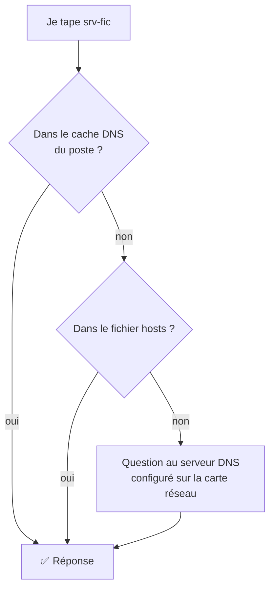
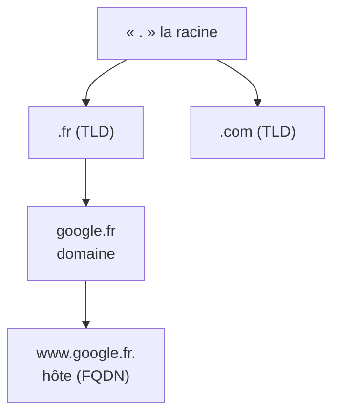
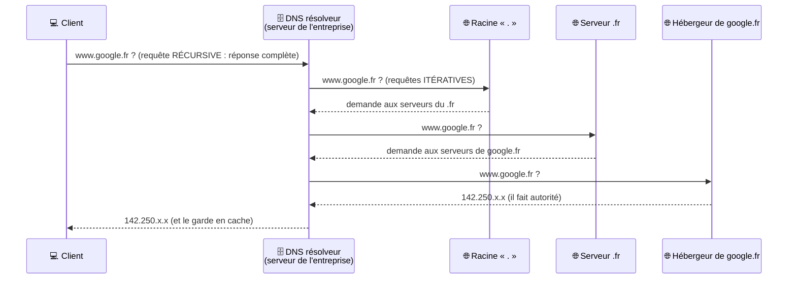
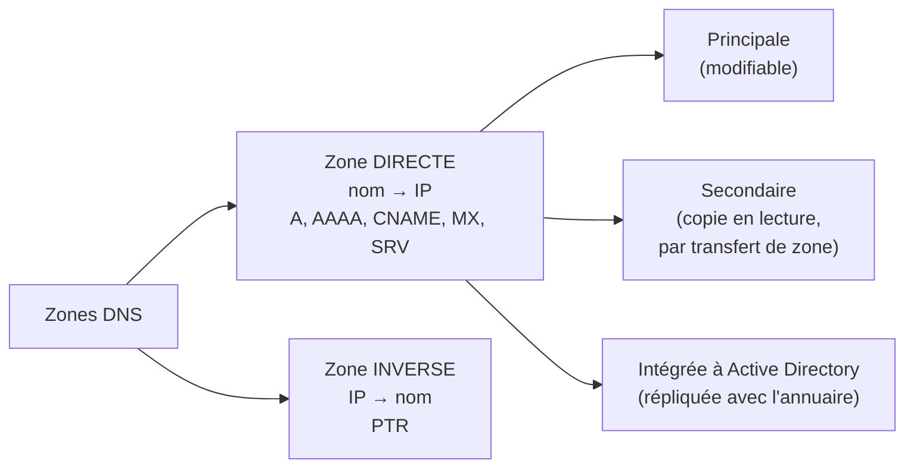

# Module 6 : Le service DNS

*Cours : [Cours 8 - Les services réseau en environnement Microsoft](../index.md)*

## 🎯 Objectif du module

Comprendre la **résolution de noms** (cache, fichier hosts, DNS), la **hiérarchie** des noms, les rôles de **résolveur** et d'**hébergeur**, les **zones** et **enregistrements**, les **redirecteurs**, les **transferts de zone** et les **délégations**.

!!! abstract "En clair"
    Les humains retiennent des **noms** (`srv-fic.entreprise.local`, `www.google.fr`), les machines utilisent des **adresses IP**. Le **DNS** est l'annuaire qui traduit les uns en les autres. Dans un domaine Active Directory, il est **vital** : c'est par le DNS que les postes trouvent le contrôleur de domaine. **Pas de DNS, pas d'Active Directory.**

## 🗺️ L'essentiel en schémas

!!! info "Référentiel TSSR 2026"
    **CCP 2 · compétence 4 : Exploiter un réseau IP** et **compétence 5 : Exploiter des serveurs Windows**. Une panne DNS est l'un des incidents les plus fréquents : « Internet marche par IP mais pas par nom ».

**① Où le poste cherche-t-il un nom ?**



**② La hiérarchie des noms : on lit de droite à gauche**



**③ Résolveur et hébergeur : une requête vers Internet**



**④ Les zones d'un serveur hébergeur**



## 📖 Cours consolidé

### 1. La résolution de noms

- Ordre de recherche sur un poste : **cache DNS** (y compris les réponses **négatives**) → **fichier hosts** (`C:\Windows\System32\drivers\etc\hosts`, l'ancêtre du DNS : une IP puis un nom par ligne) → **serveur DNS** configuré sur la carte.
- Un poste qui doit rejoindre un domaine doit avoir **le DNS du domaine** dans sa configuration IP.
- ⚠️ Le fichier hosts **passe avant** le DNS : une fausse ligne peut détourner un site (technique utilisée par des logiciels malveillants).
- Le DNS utilise le port **53** (UDP, et TCP pour les grosses réponses et les transferts de zone).

### 2. Les noms

| Terme | Sens | Exemple |
|---|---|---|
| **Nom NetBIOS** | Le nom court de la machine | `SRV-FIC` |
| **Nom de domaine DNS** | La partie commune à plusieurs hôtes | `entreprise.local` |
| **FQDN** | Nom **complet** : hôte + domaine + racine | `srv-fic.entreprise.local.` |

- Hiérarchie : la **racine** « . » (invisible à la fin du nom) → les **TLD** (`.fr`, `.com`, `.net`) → les domaines → les hôtes.
- ⚠️ Ne pas confondre **domaine DNS** (un espace de noms) et **domaine Active Directory** (un espace d'authentification), même s'ils portent souvent le même nom.
- Un espace de noms peut être **privé** (interne, ex. `.local`) ou **public** (acheté auprès d'un registraire).

### 3. Résolveur ou hébergeur ?

| Rôle | Ce qu'il fait |
|---|---|
| **DNS résolveur** | Reçoit les questions des clients, **va chercher** la réponse ailleurs, la **met en cache**. Il ne possède aucune zone |
| **DNS hébergeur** (faisant autorité) | **Héberge des zones** et répond **avec autorité** pour elles |

Un même serveur peut tenir les **deux rôles** : c'est le cas du contrôleur de domaine, hébergeur de `entreprise.local` et résolveur pour Internet.

| Requête | Principe |
|---|---|
| **Récursive** | « Donne-moi la **réponse complète** » : du client vers son résolveur |
| **Itérative** | « Dis-moi **à qui demander** » : du résolveur vers la racine, puis le TLD, puis l'hébergeur |

### 4. Redirecteurs et cache

- Sans réglage, le résolveur part des **serveurs racine** (indications de racine).
- **Redirecteur** (non conditionnel) : il transmet **toutes** les questions qu'il ne sait pas résoudre à un autre DNS (ex. celui du fournisseur d'accès).
- **Redirecteur conditionnel** : pour **un domaine précis** (ex. `partenaire.local` → le DNS du partenaire).
- **Cache** : chaque réponse est gardée pendant sa durée de vie (**TTL**). Les réponses **négatives** aussi : un site en maintenance peut rester « introuvable » quelque temps.

### 5. Zones et enregistrements

| Zone | Sert à |
|---|---|
| **Directe** | Nom → IP |
| **Inverse** | IP → nom (ex. `1.168.192.in-addr.arpa`) |
| **Principale** | La copie **modifiable** |
| **Secondaire** | Une copie en **lecture seule**, mise à jour par **transfert de zone** (secours, répartition) |
| **Intégrée à AD** | Stockée dans l'annuaire, **répliquée** avec les contrôleurs de domaine, mises à jour **sécurisées** |

| Enregistrement | Rôle | Exemple |
|---|---|---|
| **SOA** | Le serveur qui fait autorité, le **numéro de série** de la zone | — |
| **NS** | Les serveurs DNS de la zone | `ns1.entreprise.local` |
| **A** / **AAAA** | Nom → IPv4 / IPv6 | `srv-fic → 192.168.1.20` |
| **CNAME** | **Alias** vers un autre nom | `intranet → srv-web.entreprise.local` |
| **MX** | Le serveur de **messagerie** du domaine | `mail.entreprise.fr` |
| **PTR** | IP → nom (zone inverse) | `192.168.1.20 → srv-fic` |
| **SRV** | Localiser un **service** (Active Directory s'en sert pour trouver ses contrôleurs) | `_ldap._tcp.entreprise.local` |

### 6. Mises à jour et transferts

- Enregistrements **statiques** (créés à la main) ou **dynamiques** : un poste du domaine **enregistre lui-même** son nom et son IP (`ipconfig /registerdns`).
- **Transfert de zone** : le serveur **secondaire** demande régulièrement le **numéro de série** du SOA au principal ; s'il a **augmenté**, il récupère les changements.

### 7. Sous-domaines et délégation

- Un **sous-domaine** organise l'espace de noms : `nantes.entreprise.local`, `brest.entreprise.local`.
- Une **délégation** confie un sous-domaine à **un autre serveur DNS** (celui du site de Nantes, par exemple), qui fait alors **autorité** pour lui. Le serveur parent ne garde qu'un **pointeur** (enregistrement NS).

### 8. Les commandes

```text
nslookup srv-fic.entreprise.local          :: interroger le DNS
nslookup -type=mx entreprise.fr            :: un type d'enregistrement précis
ipconfig /displaydns                       :: voir le cache du poste
ipconfig /flushdns                         :: vider le cache
ipconfig /registerdns                      :: réenregistrer le poste dans le DNS
```

```powershell
Resolve-DnsName srv-fic.entreprise.local
Add-DnsServerPrimaryZone -Name "entreprise.local" -ReplicationScope Domain     # zone intégrée à AD
Add-DnsServerResourceRecordA -ZoneName "entreprise.local" -Name "srv-web" -IPv4Address 192.168.1.30
Add-DnsServerResourceRecordCName -ZoneName "entreprise.local" -Name "intranet" -HostNameAlias "srv-web.entreprise.local"
Add-DnsServerForwarder -IPAddress 1.1.1.1                                      # redirecteur
Add-DnsServerConditionalForwarderZone -Name "partenaire.local" -MasterServers 10.10.0.5
```

## 📝 Fiche de révision

| Notion | À retenir |
|---|---|
| **Ordre de résolution** | Cache → hosts → serveur DNS |
| **FQDN** | `hôte.domaine.tld.` (point final = racine) |
| **Résolveur / hébergeur** | Va chercher et met en cache / héberge des zones, fait autorité |
| **Récursive / itérative** | Réponse complète / « demande à tel serveur » |
| **Redirecteur conditionnel** | Pour un domaine précis |
| **Zone directe / inverse** | Nom → IP / IP → nom |
| **Secondaire** | Copie en lecture seule, par transfert de zone |
| **A · AAAA · CNAME · MX · PTR · SRV · NS · SOA** | IPv4 · IPv6 · alias · mail · inverse · service · serveurs DNS · autorité |
| **Délégation** | Sous-domaine confié à un autre serveur |
| **Port** | 53 (UDP et TCP) |

### ⚠️ Les pièges

- Un poste du domaine qui utilise un **DNS public** (box, 8.8.8.8) **ne trouve pas** le contrôleur de domaine.
- Après une correction, le **cache** peut garder l'ancienne réponse : `ipconfig /flushdns`.
- Le **fichier hosts** passe **avant** le DNS.
- Une **zone inverse** absente : `nslookup` affiche « serveur inconnu », sans que la résolution des noms soit en panne.
- **Domaine DNS ≠ domaine AD**.

### ✏️ Entraîne-toi (clique pour voir la correction)

??? question "1. ping 8.8.8.8 répond, ping www.google.fr répond « hôte inconnu », et le poste ne trouve pas srv-fic. Où chercher ?"
    Le réseau marche (IP OK) : c'est le **DNS**. `ipconfig /all` : le poste utilise-t-il **le DNS du domaine** ? Puis `nslookup srv-fic` et `nslookup www.google.fr` pour voir si le serveur DNS répond, et vérifier ses **redirecteurs** pour Internet.

??? question "2. Les utilisateurs doivent taper « intranet » pour joindre srv-web.entreprise.local. Quel enregistrement crées-tu ?"
    Un **CNAME** `intranet` → `srv-web.entreprise.local` dans la zone `entreprise.local` (avec le suffixe DNS `entreprise.local` distribué aux postes, par DHCP option 015).

## 🧠 Quiz — entraîne-toi

<div id="quiz-cours-08-les-services-reseau-en-environnement-microsoft-module-6-le-service-dns"></div>

<script type="application/json" id="quiz-cours-08-les-services-reseau-en-environnement-microsoft-module-6-le-service-dns-data">
[
  {
    "question": "Dans quel ordre un poste Windows cherche-t-il à résoudre un nom ?",
    "options": [
      "Serveur DNS, cache, hosts",
      "Cache DNS, fichier hosts, serveur DNS",
      "hosts, serveur DNS, cache",
      "Serveur DHCP, DNS, cache"
    ],
    "correctIndex": 1,
    "explanation": "D'abord le cache, puis le fichier hosts, puis le serveur DNS configuré."
  },
  {
    "question": "Quel enregistrement associe un nom à une adresse IPv4 ?",
    "options": [
      "MX",
      "PTR",
      "A",
      "CNAME"
    ],
    "correctIndex": 2,
    "explanation": "A = IPv4, AAAA = IPv6, PTR = inverse, CNAME = alias, MX = messagerie."
  },
  {
    "question": "Quel enregistrement crée un alias vers un autre nom ?",
    "options": [
      "CNAME",
      "SOA",
      "NS",
      "SRV"
    ],
    "correctIndex": 0,
    "explanation": "Le CNAME pointe vers un autre nom (par exemple intranet → srv-web)."
  },
  {
    "question": "À quoi sert une zone inverse ?",
    "options": [
      "À résoudre un nom en IP",
      "À résoudre une IP en nom",
      "À transférer les zones",
      "À chiffrer les requêtes"
    ],
    "correctIndex": 1,
    "explanation": "La zone inverse contient des enregistrements PTR : IP → nom."
  },
  {
    "question": "Quelle est la différence entre une requête récursive et une requête itérative ?",
    "options": [
      "Aucune",
      "La récursive exige une réponse complète ; l'itérative renvoie vers un autre serveur",
      "L'itérative est réservée aux clients",
      "La récursive n'existe qu'en IPv6"
    ],
    "correctIndex": 1,
    "explanation": "Le client pose une question récursive à son résolveur, qui interroge ensuite la racine, le TLD et l'hébergeur de façon itérative."
  },
  {
    "question": "Qu'est-ce qu'un redirecteur conditionnel ?",
    "options": [
      "Un redirecteur pour toutes les requêtes",
      "Un renvoi des requêtes d'un domaine précis vers un DNS précis",
      "Un enregistrement MX",
      "Une zone secondaire"
    ],
    "correctIndex": 1,
    "explanation": "Exemple : toutes les questions sur partenaire.local vont au DNS du partenaire."
  },
  {
    "question": "Comment un serveur DNS secondaire sait-il qu'il doit mettre à jour sa copie ?",
    "options": [
      "Il compare le numéro de série du SOA",
      "Il redémarre chaque nuit",
      "Grâce au DHCP",
      "Il ne se met jamais à jour"
    ],
    "correctIndex": 0,
    "explanation": "Si le numéro de série du SOA du principal a augmenté, un transfert de zone a lieu."
  },
  {
    "question": "Un poste du domaine a 8.8.8.8 comme serveur DNS. Que se passe-t-il ?",
    "options": [
      "Tout fonctionne mieux",
      "Il ne trouve pas le contrôleur de domaine",
      "Il obtient une adresse APIPA",
      "Le DHCP s'arrête"
    ],
    "correctIndex": 1,
    "explanation": "Le DNS public ne connaît pas entreprise.local : le poste doit utiliser le DNS du domaine."
  },
  {
    "question": "Quelle commande vide le cache DNS d'un poste Windows ?",
    "options": [
      "ipconfig /release",
      "ipconfig /flushdns",
      "nslookup -flush",
      "ipconfig /renew"
    ],
    "correctIndex": 1,
    "explanation": "ipconfig /flushdns ; ipconfig /displaydns affiche le cache."
  },
  {
    "question": "What does FQDN stand for?",
    "options": [
      "Fully Qualified Domain Name",
      "Fast Query DNS Node",
      "File Queue Domain Network",
      "Full Query Domain Number"
    ],
    "correctIndex": 0,
    "explanation": "Le nom complet, par exemple srv-fic.entreprise.local."
  }
]
</script>

<script>
  document.addEventListener("DOMContentLoaded", function () {
    TSSRQuiz.init({
      containerId: "quiz-cours-08-les-services-reseau-en-environnement-microsoft-module-6-le-service-dns",
      dataId: "quiz-cours-08-les-services-reseau-en-environnement-microsoft-module-6-le-service-dns-data",
    });
  });
</script>
