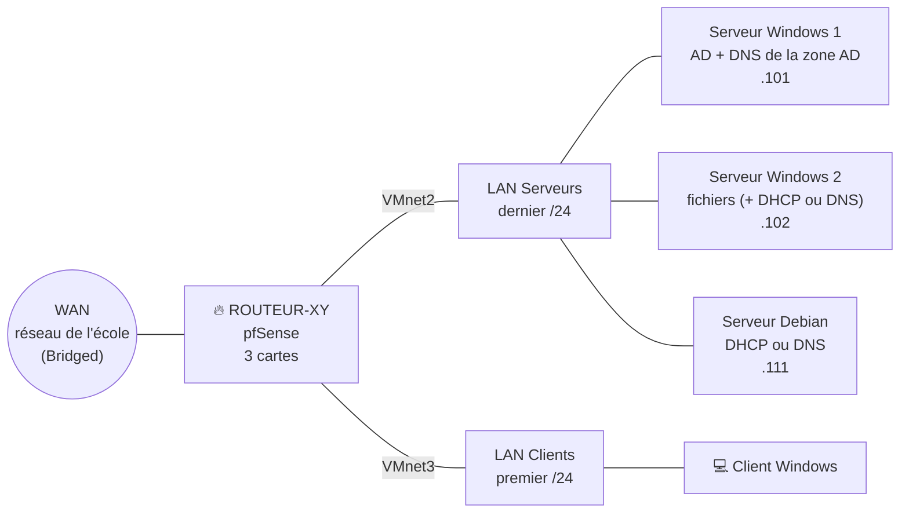
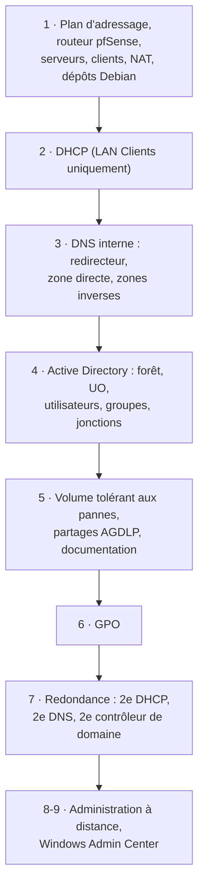
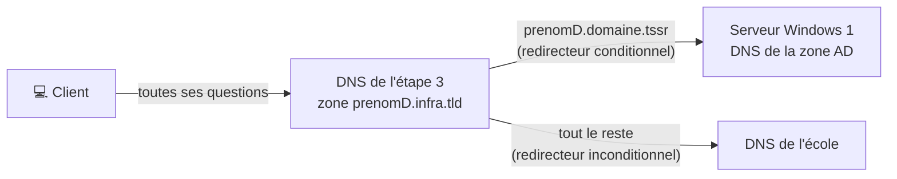

# Cours 9 - Mise en situation professionnelle : services réseau

!!! abstract "Informations pratiques"
    **Dates :** 25/01/2027 → 29/01/2027

    **Durée :** 35 h

    **Lieu :** En ligne (Campus en ligne)

    **Formateur(s) :** _à compléter_

## 🎯 Objectif

Pendant 4 jours et demi, tu **maquettes l'infrastructure complète** d'une entreprise : un routeur **pfSense**, trois serveurs (deux Windows, un Debian), des postes clients, puis **DHCP**, **DNS**, **Active Directory**, **partages**, **GPO** et **redondance**. C'est la révision pratique des [cours 7 et 8](../cours-08-les-services-reseau-en-environnement-microsoft/index.md), et le format de l'épreuve du **CCP 2**.

!!! warning "Fais-le toi-même"
    Cette page donne la **méthode**, les **calculs** et les **commandes à retrouver**, pas le corrigé. Les pistes avancées sont **repliées**. Documente au fur et à mesure : la consigne demande une **documentation** de l'espace disque et des droits de la comptabilité.

## 🗺️ L'essentiel en schémas

!!! info "Référentiel TSSR 2026"
    **CCP 2** en entier : **compétence 4** (réseau IP, routage, NAT), **5** (serveurs Windows et Linux), **6** (VM), **7** (accès, groupes, GPO) ; et **CCP 3 · compétence 9** (redondance des services). L'épreuve du CCP 2 se passe sur des **serveurs et clients virtuels**, avec un **incident réseau** traité devant le jury.

**① L'infrastructure à maquetter**

**② Les 9 étapes dans l'ordre**

**③ Qui résout quoi ? (redirecteur conditionnel)**

## 🖼️ Résumé visuel

| Étape | Ce qu'on te demande | Cours à revoir |
|---|---|---|
| **1** Préparation | Plan d'adressage /22 → 4 × /24, pfSense à 3 cartes, 3 serveurs, NAT, dépôts Debian | [Cours 1 · module 3](../cours-01-bases-des-reseaux/module-3-l-adressage-ipv4/index.md) · [Cours 8 · module 4](../cours-08-les-services-reseau-en-environnement-microsoft/module-4-le-routage/index.md) · [Cours 4 · module 6](../cours-04-administration-d-une-distribution-gnu-linux/module-6-gestion-des-paquets-logiciels/index.md) |
| **2** DHCP | Seulement le LAN Clients, moitié de la plage, passerelle, relais sur le routeur | [Cours 8 · module 5](../cours-08-les-services-reseau-en-environnement-microsoft/module-5-le-service-dhcp/index.md) |
| **3** DNS | Redirecteur inconditionnel, zone directe, SOA résolvable, zones inverses | [Cours 8 · module 6](../cours-08-les-services-reseau-en-environnement-microsoft/module-6-le-service-dns/index.md) |
| **4** AD | Nouvelle forêt (niveau 2016), étude de la zone AD, redirecteur conditionnel, UO, utilisateurs, groupes | [Cours 8 · module 2](../cours-08-les-services-reseau-en-environnement-microsoft/module-2-active-directory/index.md) |
| **5** Ressources | Volume RAID 5 sur 3 disques, partages SERVICES / PUBLIC, AGDLP, partage caché « Outils » | [Cours 8 · modules 1 et 2](../cours-08-les-services-reseau-en-environnement-microsoft/module-1-administration-windows/index.md) |
| **6** GPO | Fond d'écran, Panneau de configuration, mots de passe, lecteur réseau, pilotes, redémarrages… | [Cours 8 · module 3](../cours-08-les-services-reseau-en-environnement-microsoft/module-3-les-strategies-de-groupe/index.md) |
| **7** Redondance | 2ᵉ DHCP, 2ᵉ DNS, 2ᵉ contrôleur de domaine | Cours 8 · modules 2, 5, 6 |
| **8-9** Administration | Gérer les serveurs depuis un poste (RSAT), Windows Admin Center | [Cours 8 · module 1](../cours-08-les-services-reseau-en-environnement-microsoft/module-1-administration-windows/index.md) |

## 📖 Cours consolidé

### 📋 Contexte

La société **« Support-Terre »** fait du support informatique pour les PME. Tu rejoins le projet **« TSSRC-Série-EU »** pour **maquetter** une infrastructure selon les contraintes de l'équipe d'architecture : 3 périmètres, **LAN Serveurs**, **LAN Clients** et **WAN** (le réseau de l'école, que tu ne gères pas).

---

### Étape 1 · Plan d'adressage et préparation

**Le calcul** (D = dernier octet de l'IP de ton poste ENI) : ton réseau est **192.168.(4 × D).0/22**, découpé en **4 sous-réseaux /24**. Le **premier** /24 = **LAN Clients**, le **dernier** /24 = **LAN Serveurs**.

> Exemple de l'énoncé : D = 13 → 4 × 13 = 52 → **192.168.52.0/22**. Un /22 couvre 4 valeurs du 3ᵉ octet (52 à 55) : LAN Clients **192.168.52.0/24**, LAN Serveurs **192.168.55.0/24** ([cours 1 · module 3](../cours-01-bases-des-reseaux/module-3-l-adressage-ipv4/index.md)).

| Machine | Adressage |
|---|---|
| **ROUTEUR-XY** (pfSense, 3 cartes : Bridged, VMnet2, VMnet3) | **Dernière adresse utilisable** de chaque LAN (.254) · sur le WAN : `id_réseau.42.D` (ex. `10.3.42.13`) |
| Serveur Windows 1 (AD, DNS de la zone AD) | `.101` du LAN Serveurs |
| Serveur Windows 2 (fichiers, et DHCP ou DNS) | `.102` |
| Serveur Debian (DHCP ou DNS, **sans interface graphique**) | `.111` |

- Choisis et **écris une convention de nommage** (ex. `SRV-W1-XY`).
- pfSense : la consigne demande une règle **« any »** sur chaque interface (labo seulement, [cours 8 · module 4](../cours-08-les-services-reseau-en-environnement-microsoft/module-4-le-routage/index.md)), puis du **NAT** pour que tout sorte par le WAN.
- **Debian** : sources de sécurité depuis `security.debian.org`, le reste depuis `ftp.fr.debian.org` (pas `deb.debian.org`), puis `sudo apt update`.

🔧 Tests : `ping` entre les 3 serveurs, vers le routeur, vers la passerelle de l'école ; `tracert` depuis un client.

---

### Étape 2 · DHCP

Hébergé par le **2ᵉ serveur Windows si D est pair**, par le **serveur Debian si D est impair**.

| Contrainte | Méthode |
|---|---|
| Baux **uniquement** pour le LAN Clients | Une seule étendue : celle du LAN Clients |
| **La moitié** de la plage seulement | Plage complète /24 + **exclusion** de l'autre moitié (ou plage réduite) |
| Passerelle transmise | Option **003** = l'IP du routeur côté LAN Clients |
| Le serveur est sur le **LAN Serveurs** | **Agent relais DHCP** sur **le routeur pfSense** (Services → DHCP Relay) |

??? tip "Piste DHCP sous Debian (si D est impair)"
    Paquet `isc-dhcp-server` : déclarer l'interface d'écoute dans `/etc/default/isc-dhcp-server`, puis un bloc `subnet … netmask … { range …; option routers …; option domain-name-servers …; }` dans `/etc/dhcp/dhcpd.conf`, et `sudo systemctl restart isc-dhcp-server`. Le serveur doit aussi connaître le LAN Clients : déclare un `subnet` vide pour **son propre** réseau. (ISC DHCP n'est plus développé : son successeur est **Kea**.)

---

### Étape 3 · DNS interne

Hébergé par le **serveur Debian si D est pair**, par le **2ᵉ serveur Windows si D est impair**.

| Tâche | Rappel |
|---|---|
| Tester le DNS de l'école **depuis** ton serveur | `nslookup nom_public IP_du_DNS_école` |
| **Redirecteur inconditionnel** vers le DNS de l'école | Windows : `Add-DnsServerForwarder` · Debian : `forwarders { … };` |
| Serveurs **et** clients utilisent **ton** DNS | IP fixe des serveurs + option **006** du DHCP |
| Zone **`prenomD.infra.tld`** avec tes 3 serveurs | Enregistrements **A** |
| Le **SOA** doit être un **FQDN résolvable** | `nslookup -type=soa prenomD.infra.tld` : le nom indiqué doit lui-même avoir un **A** |
| **Résolution inverse** | Une **zone inverse** par LAN, avec un **PTR** `routeur.prenomD.infra.tld` → la dernière IP de chaque réseau |

??? tip "Piste DNS sous Debian (si D est pair)"
    Paquet `bind9` : zones déclarées dans `/etc/bind/named.conf.local`, fichiers de zone (SOA, NS, A, PTR), redirecteur dans `/etc/bind/named.conf.options`. Vérifier avec `named-checkconf` et `named-checkzone`, puis `sudo systemctl restart bind9`. Penser à **augmenter le numéro de série** du SOA à chaque modification.

---

### Étape 4 · Active Directory

- Sur le **Serveur Windows 1** : rôle AD DS, **nouvelle forêt** `prenomD.domaine.tssr`, **DNS installé** avec, niveau fonctionnel **Windows Server 2016** ([cours 8 · module 2](../cours-08-les-services-reseau-en-environnement-microsoft/module-2-active-directory/index.md)).
- **Étudie la zone** créée : à quoi servent les dossiers `_msdcs`, `_sites`, `_tcp`, `_udp` et leurs enregistrements **SRV** ?
- ⚠️ Les clients interrogent le DNS de l'étape 3, qui **ne connaît pas** la zone AD : ajoute un **redirecteur conditionnel** `prenomD.domaine.tssr` → Serveur Windows 1.
- **Joins** le client Windows et le Serveur Windows 2 au domaine.
- Si D est pair : le **DHCP** du Serveur Windows 2 fonctionne-t-il encore après la jonction ? (Indice : un serveur DHCP dans un domaine doit être… [cours 8 · module 5](../cours-08-les-services-reseau-en-environnement-microsoft/module-5-le-service-dhcp/index.md).)
- **UO** par service, et des UO séparées pour les **ordinateurs clients** et les **serveurs** ; **groupes globaux** par service ; identifiants **1ʳᵉ lettre du prénom + nom**. Services : Direction, Comptabilité, Secrétariat, Production, Support, Informatique.

🔧 Test : une ouverture de session **par service** sur le client Windows.

---

### Étape 5 · Espace disque et partages

**Volume `F:` tolérant à la perte d'un disque**, sur **3 disques** : c'est un **RAID 5** ([cours 8 · module 1](../cours-08-les-services-reseau-en-environnement-microsoft/module-1-administration-windows/index.md)).

Arborescence `F:\DATA\SERVICES\…` et `F:\DATA\PUBLIC`, partages **SERVICES** et **PUBLIC**, avec **AGDLP** : groupes globaux par service → **groupes de domaine local** par dossier et par droit → droits NTFS.

| Dossier | Modification | Lecture |
|---|---|---|
| `SERVICES\Direction` | Direction, Comptabilité | Secrétariat |
| `SERVICES\Comptabilité` | Comptabilité | Direction, Secrétariat |
| `SERVICES\Secrétariat` | Secrétariat | — |
| `SERVICES\Support` | Support, Secrétariat | Direction |
| `PUBLIC` | Toute la société | — |
| `Informatique` (partage **caché** « Outils ») | Informatique seulement | — |

Le service **Informatique** a le **contrôle total** partout. Pense à **désactiver l'héritage** quand un sous-dossier doit être plus restreint que son parent.

---

### Étape 6 · GPO

Teste **chaque** paramètre sur le client avant de passer au suivant (`gpupdate /force`, `gpresult /r`).

| Demande | Où chercher |
|---|---|
| Même fond d'écran pour tous | Configuration **utilisateur** → Modèles d'administration → Bureau |
| Panneau de configuration et Paramètres réservés aux admins | Configuration **utilisateur** + **filtrage** (ou refus aux admins) |
| Mots de passe : 30 jours, 3 caractères, sans complexité | Configuration **ordinateur** → Stratégie de comptes, dans une GPO liée **au domaine** |
| Partage SERVICES visible chez les secrétaires | **Préférences** → Mappages de lecteurs, **ciblé** sur le groupe Secrétariat |
| Pilotes installés par un admin seulement | Configuration **ordinateur** → Installation de périphériques |
| Pas de redémarrage automatique pendant l'utilisation | Configuration **ordinateur** → Windows Update |
| Pas de recherche Internet dans Windows | Configuration **ordinateur** → Rechercher |
| Pas de rapport d'erreurs à Microsoft | Configuration **ordinateur** → Rapport d'erreurs Windows |

⚠️ La politique de **mots de passe du domaine** ne fonctionne que dans une GPO **liée à la racine du domaine** (en général la Default Domain Policy).

---

### Étape 7 · Redondance

| Service | Solution |
|---|---|
| **DHCP** | Installer le service sur l'**autre** serveur (**pas le contrôleur de domaine**), puis **basculement DHCP** ou **fractionnement 80/20** |
| **DNS** | Un **2ᵉ serveur DNS** (zone **secondaire** ou zone intégrée à AD) et **deux DNS** dans la configuration des clients (option 006) |
| **Contrôleur de domaine** | Promouvoir un **2ᵉ contrôleur** dans le domaine existant |

### Étapes 8-9 · Administrer « depuis sa chaise »

Gérer les serveurs **à distance**, depuis le poste client, avec les outils **RSAT** (consoles AD, DNS, DHCP, GPO) et **Windows Admin Center**, une console web de gestion des serveurs Windows.

## 🧪 Tests et validation

- [ ] Les 3 serveurs se joignent, le routeur joint la passerelle de l'école
- [ ] Un client du LAN Clients reçoit une IP **dans la moitié autorisée**, avec la bonne **passerelle** et le bon **DNS**
- [ ] Client et serveurs résolvent un **nom public** et les **noms internes**
- [ ] `nslookup` d'une IP de serveur renvoie son **nom** (zone inverse)
- [ ] Le client et le Serveur Windows 2 sont **dans le domaine**
- [ ] Une **ouverture de session par service** fonctionne
- [ ] Chaque service a **exactement** les droits du tableau (tester avec un compte de chaque service)
- [ ] Le partage caché **Outils** n'est accessible qu'à l'informatique
- [ ] Chaque **GPO** est vérifiée avec `gpresult /r`
- [ ] Arrêter un serveur DHCP, un DNS ou un contrôleur : **le service continue**

## 📝 Fiche de révision

### ⚠️ Les pièges de cette MSP

- Le **/22** couvre **4 valeurs** du 3ᵉ octet : le premier /24 est le multiple de 4, le dernier est **ce multiple + 3** (52 → 55).
- Serveur DHCP sur un **autre réseau** que les clients → **agent relais** obligatoire.
- Le **SOA** doit être un **FQDN qui se résout** : sinon, ajoute l'enregistrement A du serveur.
- Sans **redirecteur conditionnel** vers la zone AD, la **jonction au domaine échoue**.
- Un serveur DHCP Windows joint au domaine doit être **autorisé** dans AD.
- **3 disques + perte d'un disque sans perte de données** = **RAID 5**.
- **AGDLP** : jamais de droits donnés directement aux utilisateurs.
- La **stratégie de mots de passe** du domaine se règle au niveau du **domaine**, pas d'une UO.
- Le 2ᵉ DHCP **pas sur le contrôleur de domaine** (consigne).

## 💬 Retour d'expérience

_À compléter par toi : difficultés rencontrées, ce que tu referais différemment._

## 🧠 Quiz — entraîne-toi

