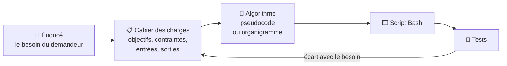
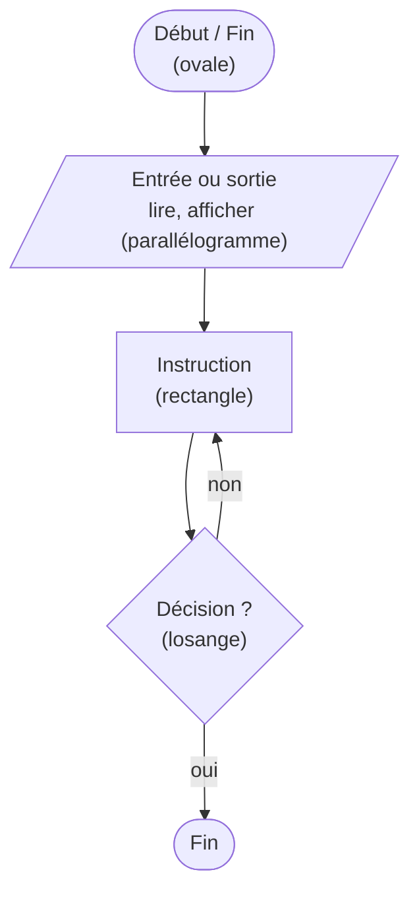
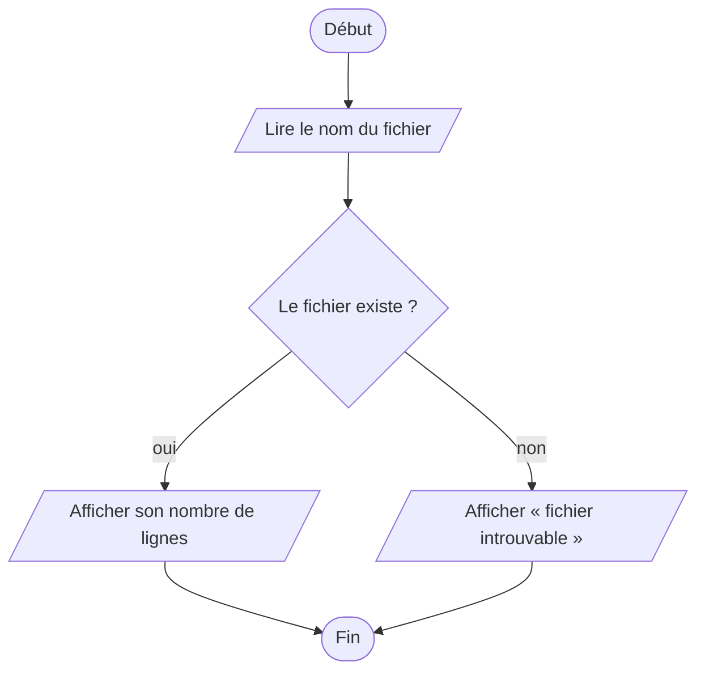

# Module 1 : Analyse

*Cours : [Cours 10 - Initiation au scripting Bash](../index.md)*

## 🎯 Objectif du module

**Réfléchir avant d'écrire** : partir d'un **besoin**, rédiger un **cahier des charges**, puis un **algorithme** (pseudocode ou organigramme), avant la moindre ligne de script.

!!! abstract "En clair"
    Un script, c'est une **recette** pour l'ordinateur. Si la recette est floue, le plat est raté. On commence donc par comprendre **ce qu'on veut** (le besoin), on l'écrit noir sur blanc (le cahier des charges), puis on découpe le travail en **étapes simples** (l'algorithme). Écrire le script devient alors presque une traduction.

## 🗺️ L'essentiel en schémas

!!! info "Référentiel TSSR 2026"
    **CCP 3 · compétence 8 : Optimiser des scripts à l'aide de l'intelligence artificielle.** Une IA écrit vite un script, mais **c'est toi** qui dois savoir décrire le besoin précisément et **vérifier** que le résultat fait ce qui est demandé ([fiche IA](../../../revisions/fiche-ia.md)).

**① De l'idée au script**



**② Les formes d'un organigramme**



**③ Exemple : vérifier qu'un fichier de log existe**



## 📖 Cours consolidé

### 1. Pourquoi analyser avant d'écrire ?

Un **script shell** est un fichier texte qui **enchaîne des commandes**. Se lancer directement dans l'écriture mène à des oublis et à des erreurs. On suit plutôt des étapes : **énoncé** → **cahier des charges** → **algorithme** → **script** → **tests**. On écrit le script avec un éditeur de texte (**vim** ou **nano**, [cours 3 · module 7](../../cours-03-utilisateur-d-une-distribution-gnu-linux/module-7-editer-du-texte-sous-linux/index.md)).

### 2. L'énoncé et le cahier des charges

- L'**énoncé** décrit le **besoin** du demandeur : il conditionne tout le reste.
- Le **cahier des charges** le formalise : **objectifs**, **contraintes** (système, droits, délais), **entrées** (arguments, fichiers, saisies), **sorties** (affichage, fichier, code de retour), **cas d'erreur**.
- On **échange** avec le demandeur tout au long du projet pour l'affiner.

### 3. L'algorithme

Un **algorithme** = une suite d'**instructions précises** pour résoudre un problème, **indépendante du langage**. Exemple de la vie courante : se laver les mains (ouvrir le robinet, prendre du savon, frotter, rincer, fermer).

**En pseudocode** :

```text
début
  lire nom_fichier
  si nom_fichier existe alors
    afficher le nombre de lignes de nom_fichier
  sinon
    afficher "fichier introuvable"
  fin si
fin
```

**En organigramme** : **ovale** = début / fin · **rectangle** = instruction · **losange** = décision · **parallélogramme** = entrée / sortie.

### 4. Et la traduction en Bash

```bash
#!/bin/bash
read -p "Nom du fichier : " nom_fichier
if [ -f "$nom_fichier" ]; then
    wc -l < "$nom_fichier"
else
    echo "fichier introuvable"
fi
```

Chaque ligne du pseudocode a son équivalent : la suite du cours montre comment (`read` au module 4, `if` au module 6).

## 📝 Fiche de révision

| Notion | À retenir |
|---|---|
| **Script shell** | Fichier texte qui enchaîne des commandes |
| **Énoncé** | Le besoin du demandeur |
| **Cahier des charges** | Objectifs, contraintes, entrées, sorties, erreurs |
| **Algorithme** | Étapes précises, indépendantes du langage |
| **Pseudocode** | L'algorithme écrit en français structuré |
| **Organigramme** | Ovale (début/fin), rectangle (instruction), losange (décision), parallélogramme (entrée/sortie) |

### ⚠️ Les pièges

- Écrire le script **avant** d'avoir compris le besoin.
- Oublier les **cas d'erreur** (fichier absent, argument manquant).
- Faire générer un script par une IA **sans le relire ni le tester**.

### ✏️ Entraîne-toi (clique pour voir la correction)

??? question "1. Écris l'algorithme d'un script qui demande un nom d'utilisateur et dit s'il existe sur la machine."
    ```text
    début
      lire nom
      si nom est présent dans /etc/passwd alors
        afficher "l'utilisateur existe"
      sinon
        afficher "utilisateur inconnu"
      fin si
    fin
    ```

## 🧠 Quiz — entraîne-toi

<div id="quiz-cours-10-initiation-au-scripting-bash-module-1-analyse"></div>

<script type="application/json" id="quiz-cours-10-initiation-au-scripting-bash-module-1-analyse-data">
[
  {
    "question": "Quelle est la bonne démarche avant d'écrire un script ?",
    "options": [
      "Écrire directement le script et corriger ensuite",
      "Énoncé, cahier des charges, algorithme, puis script et tests",
      "Copier un script trouvé sur Internet",
      "Tester puis écrire le cahier des charges"
    ],
    "correctIndex": 1,
    "explanation": "Analyser d'abord évite les oublis et les erreurs."
  },
  {
    "question": "Dans un organigramme, quelle forme représente une décision ?",
    "options": [
      "L'ovale",
      "Le rectangle",
      "Le losange",
      "Le parallélogramme"
    ],
    "correctIndex": 2,
    "explanation": "Losange = décision (oui / non). Ovale = début et fin, rectangle = instruction, parallélogramme = entrée ou sortie."
  },
  {
    "question": "Qu'est-ce qu'un algorithme ?",
    "options": [
      "Un langage de programmation",
      "Une suite d'instructions précises pour résoudre un problème, indépendante du langage",
      "Un fichier exécutable",
      "Une commande Linux"
    ],
    "correctIndex": 1,
    "explanation": "L'algorithme est ensuite traduit dans un langage, ici Bash."
  },
  {
    "question": "Que doit contenir un cahier des charges de script ?",
    "options": [
      "Seulement le nom du script",
      "Objectifs, contraintes, entrées, sorties et cas d'erreur",
      "Le code complet",
      "La liste des utilisateurs"
    ],
    "correctIndex": 1,
    "explanation": "Il formalise le besoin pour que le script y réponde exactement."
  },
  {
    "question": "Une IA te propose un script. Que fais-tu avant de l'utiliser en production ?",
    "options": [
      "Rien, l'IA ne se trompe pas",
      "Je le relis, je le comprends et je le teste sur une machine de test",
      "Je le lance directement en root",
      "Je l'envoie à un collègue sans le lire"
    ],
    "correctIndex": 1,
    "explanation": "Le référentiel demande d'encadrer l'usage de l'IA : relire, comprendre, tester."
  },
  {
    "question": "In a flowchart, which shape is used for input and output?",
    "options": [
      "Oval",
      "Rectangle",
      "Diamond",
      "Parallelogram"
    ],
    "correctIndex": 3,
    "explanation": "Le parallélogramme représente les entrées et sorties."
  }
]
</script>

<script>
  document.addEventListener("DOMContentLoaded", function () {
    TSSRQuiz.init({
      containerId: "quiz-cours-10-initiation-au-scripting-bash-module-1-analyse",
      dataId: "quiz-cours-10-initiation-au-scripting-bash-module-1-analyse-data",
    });
  });
</script>
