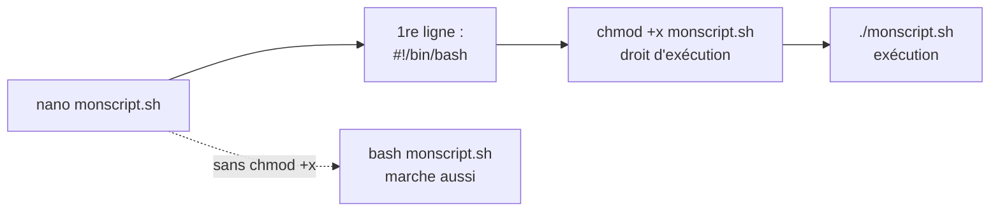
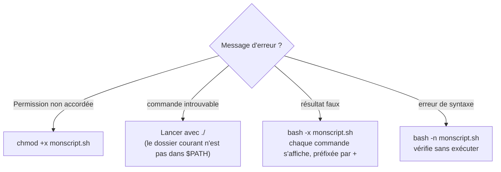

# Module 2 : Écriture des scripts

*Cours : [Cours 10 - Initiation au scripting Bash](../index.md)*

## 🎯 Objectif du module

Créer un vrai **script Bash** : le **shebang**, les **droits d'exécution**, les **commentaires**, et savoir **déboguer** un script qui ne fait pas ce qu'on attend.

!!! abstract "En clair"
    Un script, c'est un fichier texte. Pour que Linux le lance comme un programme, il faut : **1)** lui dire **quel interpréteur** utiliser (la première ligne, le *shebang*), **2)** lui donner le **droit d'exécution** (`chmod +x`). Et quand il plante, on le lance en **mode trace** pour voir chaque commande exécutée.

## 🗺️ L'essentiel en schémas

!!! info "Référentiel TSSR 2026"
    **CCP 3 · compétence 8 : Optimiser des scripts.** Un script lisible (commentaires, en-tête) et facile à déboguer est la condition pour l'améliorer, seul ou avec l'aide d'une IA.

**① Du fichier texte au programme**



**② Mon script ne marche pas**



## 📖 Cours consolidé

### 1. Le shebang

La **première ligne** d'un script indique **l'interpréteur** à utiliser :

```bash
#!/bin/bash
```

- `#!` **collés**, sans espace, suivis du **chemin complet** de l'interpréteur.
- On peut aussi utiliser `#!/bin/sh`, `#!/usr/bin/python3`, `#!/usr/bin/perl`… selon le langage du script.

### 2. Rendre le script exécutable

```bash
chmod +x monscript.sh      # exécution pour tout le monde
chmod u+x monscript.sh     # seulement pour le propriétaire
chmod ug+x monscript.sh    # propriétaire et groupe
./monscript.sh             # lancer le script du dossier courant
```

- Le `./` est obligatoire : le dossier courant **n'est pas** dans le `$PATH` (la liste des dossiers où Linux cherche les commandes).
- `bash monscript.sh` lance le script **sans** droit d'exécution : c'est `bash` qui lit le fichier.

### 3. Les commentaires

Tout ce qui suit un `#` est un **commentaire** (sauf le `#!` de la 1ʳᵉ ligne). Le premier lecteur de ton script dans 6 mois, ce sera **toi**.

```bash
#!/bin/bash
# Nom         : sauvegarde.sh
# Utilisation : ./sauvegarde.sh dossier
# Description : archive un dossier dans /sauvegardes
# Prérequis   : droits d'écriture sur /sauvegardes
# Auteur      : …          Dernière modification : …
echo "Début de la sauvegarde"   # message d'information
```

### 4. Déboguer

| Méthode | Effet |
|---|---|
| `bash -x monscript.sh` | **Mode trace** : chaque commande est affichée, précédée de `+`, **avec les variables remplacées** |
| `set -x` … `set +x` | Trace seulement **une partie** du script |
| `bash -n monscript.sh` | Vérifie la **syntaxe sans exécuter** |
| `echo "valeur : $var"` | Afficher une variable à un endroit clé (à **retirer** ensuite) |

💡 L'outil **ShellCheck** (paquet `shellcheck`) analyse un script et signale les erreurs courantes (guillemets oubliés, variables non définies…).

## 📝 Fiche de révision

| Notion | À retenir |
|---|---|
| **Shebang** | `#!/bin/bash` en 1ʳᵉ ligne |
| **Rendre exécutable** | `chmod +x script.sh` |
| **Lancer** | `./script.sh` (ou `bash script.sh`) |
| **Commentaire** | `#` |
| **Trace** | `bash -x script.sh` · `set -x` / `set +x` |
| **Syntaxe seule** | `bash -n script.sh` |

### ⚠️ Les pièges

- Un espace dans `#! /bin/bash` ou un shebang **pas sur la 1ʳᵉ ligne**.
- Taper `monscript.sh` **sans** `./` → « commande introuvable ».
- Un script écrit sous **Windows** (fins de ligne CRLF) provoque des erreurs bizarres : `$'\r': command not found`. Convertir avec `dos2unix`.
- Oublier de **retirer** les `echo` de débogage.

### ✏️ Entraîne-toi (clique pour voir la correction)

??? question "1. Crée bonjour.sh qui affiche « Bonjour » suivi de ton nom d'utilisateur, puis lance-le."
    ```bash
    #!/bin/bash
    # Affiche un message de bienvenue
    echo "Bonjour $USER"
    ```
    Puis `chmod +x bonjour.sh` et `./bonjour.sh`.

??? question "2. ./test.sh répond « Permission non accordée ». Deux solutions ?"
    `chmod +x test.sh` puis `./test.sh`, ou bien `bash test.sh` (sans droit d'exécution).

## 🧠 Quiz — entraîne-toi

<div id="quiz-cours-10-initiation-au-scripting-bash-module-2-ecriture-des-scripts"></div>

<script type="application/json" id="quiz-cours-10-initiation-au-scripting-bash-module-2-ecriture-des-scripts-data">
[
  {
    "question": "Quelle est la première ligne d'un script Bash ?",
    "options": [
      "# bash",
      "#!/bin/bash",
      "!#/bin/bash",
      "bash:"
    ],
    "correctIndex": 1,
    "explanation": "Le shebang #! suivi du chemin de l'interpréteur, sans espace."
  },
  {
    "question": "Quelle commande rend script.sh exécutable ?",
    "options": [
      "chmod 444 script.sh",
      "chmod +x script.sh",
      "chown +x script.sh",
      "exec script.sh"
    ],
    "correctIndex": 1,
    "explanation": "chmod +x ajoute le droit d'exécution."
  },
  {
    "question": "Pourquoi faut-il taper ./script.sh et pas script.sh ?",
    "options": [
      "Pour l'exécuter en root",
      "Parce que le dossier courant n'est pas dans le $PATH",
      "Pour le compiler",
      "Ce n'est pas nécessaire"
    ],
    "correctIndex": 1,
    "explanation": "Linux ne cherche les commandes que dans les dossiers du $PATH : ./ indique le dossier courant."
  },
  {
    "question": "Quelle commande exécute un script en affichant chaque commande avant son exécution ?",
    "options": [
      "bash -n script.sh",
      "bash -x script.sh",
      "bash -v script.sh --quiet",
      "sh -c script.sh"
    ],
    "correctIndex": 1,
    "explanation": "bash -x = mode trace, chaque commande est préfixée par +. bash -n vérifie seulement la syntaxe."
  },
  {
    "question": "Comment écrire un commentaire en Bash ?",
    "options": [
      "// commentaire",
      "# commentaire",
      "-- commentaire",
      "/* commentaire */"
    ],
    "correctIndex": 1,
    "explanation": "Tout ce qui suit un # est ignoré (sauf le #! de la 1ʳᵉ ligne)."
  },
  {
    "question": "Un script copié depuis Windows affiche « $'\\r': command not found ». Pourquoi ?",
    "options": [
      "Le shebang manque",
      "Les fins de ligne Windows (CRLF) ; il faut le convertir avec dos2unix",
      "Le script est trop long",
      "Il manque chmod +x"
    ],
    "correctIndex": 1,
    "explanation": "Le \\r des fins de ligne Windows perturbe Bash."
  },
  {
    "question": "Which command checks a Bash script's syntax without running it?",
    "options": [
      "bash -x",
      "bash -n",
      "bash -c",
      "bash -r"
    ],
    "correctIndex": 1,
    "explanation": "bash -n lit le script et signale les erreurs de syntaxe, sans rien exécuter."
  }
]
</script>

<script>
  document.addEventListener("DOMContentLoaded", function () {
    TSSRQuiz.init({
      containerId: "quiz-cours-10-initiation-au-scripting-bash-module-2-ecriture-des-scripts",
      dataId: "quiz-cours-10-initiation-au-scripting-bash-module-2-ecriture-des-scripts-data",
    });
  });
</script>
