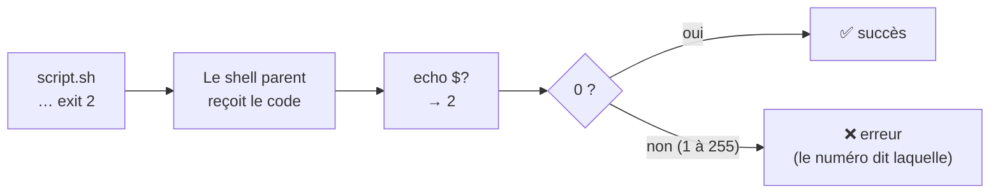
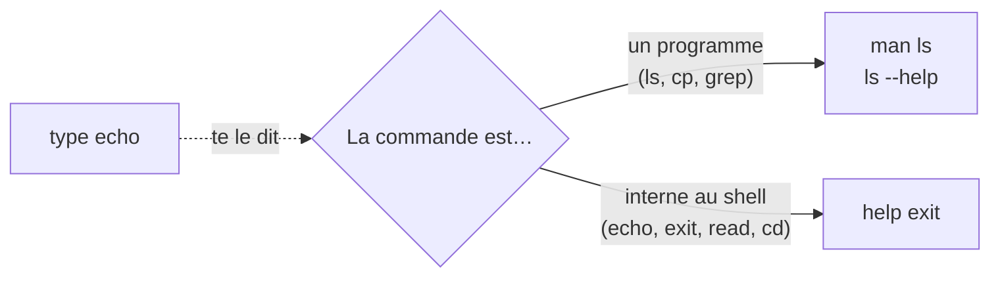

# Module 3 : Premières commandes utiles aux scripts

*Cours : [Cours 10 - Initiation au scripting Bash](../index.md)*

## 🎯 Objectif du module

Connaître les **commandes internes** de Bash les plus utiles dans un script : **`echo`** (afficher), **`clear`** (effacer l'écran), **`exit`** (sortir avec un code de retour) et **`help`** (l'aide des commandes internes).

!!! abstract "En clair"
    Ces commandes sont **intégrées au shell** : il n'y a pas de programme séparé sur le disque. `echo` parle à l'utilisateur, `exit` dit au système **si le script a réussi** (0) ou **échoué** (1 à 255), et `help` explique les commandes internes que `man` ne connaît pas toujours.

## 🗺️ L'essentiel en schémas

!!! info "Référentiel TSSR 2026"
    **CCP 3 · compétence 8 : Optimiser des scripts.** Un script bien écrit **informe** (messages clairs) et **renvoie un code de retour** fiable, que d'autres scripts ou la supervision peuvent tester.

**① Le code de retour, de exit à $?**



**② man ou help ?**



## 📖 Cours consolidé

### 1. Commandes internes

Les commandes de ce module sont des **commandes internes** (*builtins*) : elles font partie de Bash, **aucun fichier binaire** ne leur est associé. `type commande` indique si une commande est interne ou externe.

### 2. echo : afficher

```bash
echo "Bonjour $USER"              # texte + variable
echo -n "Sans retour à la ligne"  # -n : pas de saut de ligne final
echo -e "Ligne 1\nLigne 2"        # -e : interprète les séquences spéciales
```

| Séquence (avec `-e`) | Effet |
|---|---|
| `\n` | Nouvelle ligne |
| `\t` | Tabulation |
| `\c` | Pas de retour à la ligne final |
| `\\` | Le caractère `\` |

Mets le texte entre **guillemets doubles** dès qu'il contient des caractères spéciaux.

### 3. clear : effacer l'écran

`clear`, sans argument, affiche une page vierge (utile au début d'un menu).

### 4. exit : sortir avec un code de retour

- `exit` arrête le script et renvoie un **code** au shell parent, lisible dans **`$?`**.
- **0** = succès (c'est le code implicite si on ne met rien) · **1 à 255** = une erreur.
- Toutes les commandes renvoient un code : `ls /inexistant ; echo $?` affiche un code différent de 0.

```bash
#!/bin/bash
if [ ! -d /sauvegardes ]; then
    echo "Erreur : /sauvegardes n'existe pas" >&2
    exit 1          # échec
fi
echo "Tout est prêt"
exit 0              # succès
```

### 5. help : l'aide des commandes internes

- `help` seul : la **liste** des commandes internes.
- `help exit`, `help read`, `help wait` : l'aide d'une commande interne.
- `man` sert plutôt aux **programmes** (`man ls`) ; beaucoup de programmes acceptent aussi `--help`.

## 📝 Fiche de révision

| Commande | Rôle |
|---|---|
| `echo "texte"` | Afficher |
| `echo -n` | Sans retour à la ligne |
| `echo -e "a\tb\n"` | Avec séquences spéciales |
| `clear` | Effacer l'écran |
| `exit n` | Sortir avec le code n (0 = succès) |
| `echo $?` | Code de retour de la dernière commande |
| `help commande` | Aide d'une commande interne |
| `type commande` | Interne ou externe ? |

### ⚠️ Les pièges

- `echo "a\nb"` **sans `-e`** affiche `\n` tel quel.
- `$?` ne garde que le code de la **dernière** commande : lis-le **tout de suite**.
- `man echo` décrit le programme `/usr/bin/echo`, pas toujours la version **interne** de Bash : utilise `help echo`.

### ✏️ Entraîne-toi (clique pour voir la correction)

??? question "1. Affiche « Nom : » puis une tabulation puis ton nom d'utilisateur, en une commande."
    `echo -e "Nom :\t$USER"`

??? question "2. Après ls /dossier_inexistant, que vaut $? ? Et après ls /tmp ?"
    Une valeur **différente de 0** (erreur, souvent 2), puis **0** (succès).

## 🧠 Quiz — entraîne-toi

<div id="quiz-cours-10-initiation-au-scripting-bash-module-3-premieres-commandes-utiles-aux-scripts"></div>

<script type="application/json" id="quiz-cours-10-initiation-au-scripting-bash-module-3-premieres-commandes-utiles-aux-scripts-data">
[
  {
    "question": "Que renvoie $? ?",
    "options": [
      "Le nom du script",
      "Le code de retour de la dernière commande",
      "Le nombre de paramètres",
      "Le PID du script"
    ],
    "correctIndex": 1,
    "explanation": "0 = succès, toute autre valeur = erreur."
  },
  {
    "question": "Quel code de sortie signifie que tout s'est bien passé ?",
    "options": [
      "0",
      "1",
      "255",
      "-1"
    ],
    "correctIndex": 0,
    "explanation": "exit 0 (ou pas de exit) = succès ; 1 à 255 = erreur."
  },
  {
    "question": "Quelle option d'echo permet d'interpréter \\n comme un retour à la ligne ?",
    "options": [
      "-n",
      "-e",
      "-x",
      "-r"
    ],
    "correctIndex": 1,
    "explanation": "-e active les séquences spéciales ; -n supprime le retour à la ligne final."
  },
  {
    "question": "Comment obtenir l'aide de la commande interne read ?",
    "options": [
      "help read",
      "man read uniquement",
      "read --info",
      "info bash read"
    ],
    "correctIndex": 0,
    "explanation": "help affiche l'aide des commandes internes de Bash."
  },
  {
    "question": "Qu'est-ce qu'une commande interne (builtin) ?",
    "options": [
      "Un programme installé dans /usr/bin",
      "Une commande intégrée au shell, sans fichier binaire séparé",
      "Une commande réservée à root",
      "Un alias"
    ],
    "correctIndex": 1,
    "explanation": "echo, exit, cd, read sont des commandes internes ; type le confirme."
  },
  {
    "question": "What does exit 1 indicate at the end of a script?",
    "options": [
      "Success",
      "An error",
      "A restart",
      "Nothing"
    ],
    "correctIndex": 1,
    "explanation": "Any non-zero exit code means an error."
  }
]
</script>

<script>
  document.addEventListener("DOMContentLoaded", function () {
    TSSRQuiz.init({
      containerId: "quiz-cours-10-initiation-au-scripting-bash-module-3-premieres-commandes-utiles-aux-scripts",
      dataId: "quiz-cours-10-initiation-au-scripting-bash-module-3-premieres-commandes-utiles-aux-scripts-data",
    });
  });
</script>
