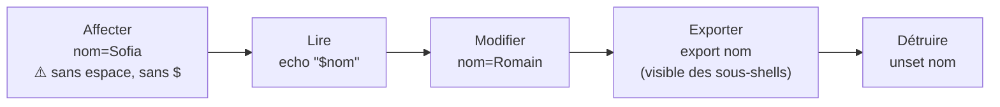
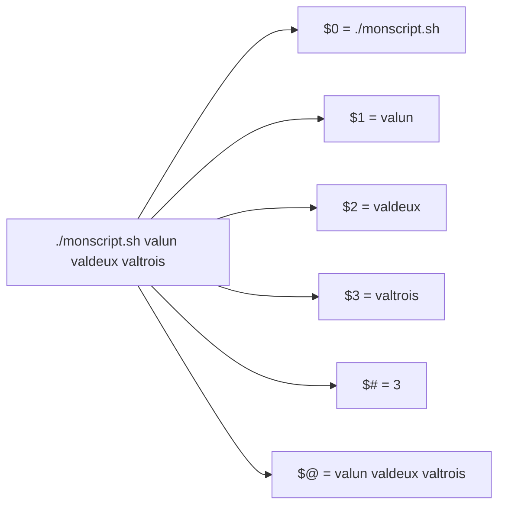
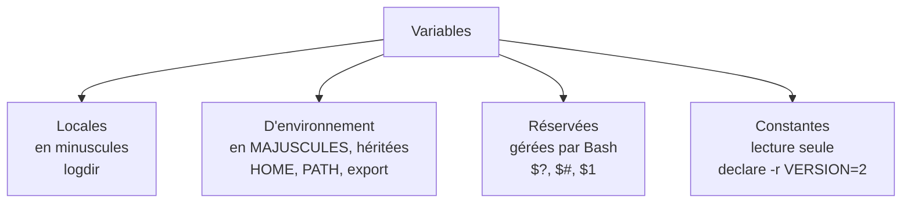

# Module 4 : Les variables dans les scripts

*Cours : [Cours 10 - Initiation au scripting Bash](../index.md)*

## 🎯 Objectif du module

Utiliser des **variables** dans un script : les créer, les lire, les **exporter**, connaître les **variables réservées** (`$1`, `$#`, `$?`…) et récupérer une **saisie** avec `read`.

!!! abstract "En clair"
    Une variable est une **boîte avec une étiquette** : on y range une valeur (`nom=Sofia`), on la relit avec un `$` (`echo $nom`). Les **variables réservées** sont remplies par Bash lui-même : par exemple, les **arguments** donnés au script arrivent dans `$1`, `$2`…

## 🗺️ L'essentiel en schémas

!!! info "Référentiel TSSR 2026"
    **CCP 3 · compétence 8 : Optimiser des scripts.** Paramètres, variables bien nommées et saisies contrôlées rendent un script **réutilisable** au lieu d'être écrit pour un seul cas.

**① La vie d'une variable**



**② Les arguments d'un script**



**③ Les 4 familles de variables**



## 📖 Cours consolidé

### 1. Créer et utiliser une variable

```bash
prenom=Sofia                 # affecter : PAS d'espace autour du =
echo "Bonjour $prenom"       # lire : avec $, entre guillemets doubles
prenom=Romain                # réaffecter
unset prenom                 # détruire
logdir="/var/log/monappli"
mkdir -p "$logdir" 2>/dev/null
```

| Famille | Règle | Exemple |
|---|---|---|
| **Locale** | Nom en **minuscules**, existe dans le shell courant | `errormsg="erreur"` |
| **D'environnement** | Nom en **MAJUSCULES**, **héritée** par les sous-shells et les programmes lancés | `HOME`, `PATH`, `export LANG=fr_FR.UTF-8` |
| **Réservée** | Nom réservé, contenu géré par Bash | `$?`, `$#` |
| **Constante** | **Lecture seule** | `declare -r VERSION=2` (ou `readonly`) |

### 2. Les variables réservées

| Variable | Contient |
|---|---|
| `$0` | Le nom du script |
| `$1` à `$9` | Les **arguments** (au-delà : `${10}`) |
| `$#` | Le **nombre** d'arguments |
| `$@` (ou `$*`) | **Tous** les arguments |
| `$?` | Le **code de retour** de la dernière commande |
| `$$` | Le numéro (PID) du processus en cours |
| `$!` | Le PID du dernier processus lancé **en arrière-plan** |

### 3. export : passer une variable aux sous-shells

```bash
export NOMVAR            # exporter une variable déjà créée
export NOMVAR=valeur     # créer et exporter en une fois
```

Une variable **non exportée** n'existe pas dans un script lancé depuis le terminal.

### 4. set : remplir $1, $2…

```bash
set "$LOGNAME" $(uname -n)
echo "$1 $2"             # → user20 serveur102
```

`set` sans argument affiche **toutes** les variables du shell.

### 5. read : lire une saisie

```bash
read -p "Votre nom : " nom              # -p : message d'invite
echo "Bonjour $nom"
read -p "Nom et prénom : " nom prenom tampon
```

- Avec **plusieurs variables**, chaque **mot** va dans une variable ; les mots **en trop** vont dans la **dernière**.
- Astuce : une variable **tampon** en dernier récupère les mots en trop (`unset tampon` ensuite).
- `read -s` cache la saisie (mot de passe).

## 📝 Fiche de révision

| Notion | À retenir |
|---|---|
| **Affecter** | `nom=valeur` (sans espace, sans `$`) |
| **Lire** | `"$nom"` |
| **Détruire** | `unset nom` |
| **Exporter** | `export NOM=valeur` |
| **Constante** | `declare -r NOM=valeur` |
| **Arguments** | `$1`…`$9`, `$#` (nombre), `$@` (tous), `$0` (script) |
| **Code retour / PID** | `$?` / `$$` · `$!` (arrière-plan) |
| **Saisie** | `read -p "Question : " var` |

### ⚠️ Les pièges

- `nom = Sofia` (avec espaces) → Bash cherche une commande `nom` : **erreur**.
- `$nom` pour **créer** : non, le `$` sert seulement à **lire**.
- Oublier les **guillemets** : `mkdir $dossier` casse si le nom contient un espace.
- Une variable non **exportée** est invisible dans un sous-shell.
- `$10` = `$1` suivi de `0` : écrire `${10}`.

### ✏️ Entraîne-toi (clique pour voir la correction)

??? question "1. Écris bonjour.sh : il prend un prénom en argument et affiche « Bonjour <prénom> (n argument(s)) »."
    ```bash
    #!/bin/bash
    echo "Bonjour $1 ($# argument(s))"
    ```
    `./bonjour.sh Sofia` → `Bonjour Sofia (1 argument(s))`.

??? question "2. Demande la ville de l'utilisateur et affiche-la en une ligne."
    ```bash
    read -p "Votre ville : " ville
    echo "Vous habitez $ville"
    ```

## 🧠 Quiz — entraîne-toi

<div id="quiz-cours-10-initiation-au-scripting-bash-module-4-les-variables-dans-les-scripts"></div>

<script type="application/json" id="quiz-cours-10-initiation-au-scripting-bash-module-4-les-variables-dans-les-scripts-data">
[
  {
    "question": "Quelle est la bonne façon d'affecter une variable en Bash ?",
    "options": [
      "nom = Sofia",
      "$nom=Sofia",
      "nom=Sofia",
      "set nom Sofia"
    ],
    "correctIndex": 2,
    "explanation": "Pas d'espace autour du = et pas de $ pour affecter."
  },
  {
    "question": "Que contient $# ?",
    "options": [
      "Le nom du script",
      "Le nombre d'arguments reçus",
      "Le code de retour",
      "Le PID"
    ],
    "correctIndex": 1,
    "explanation": "$# = nombre d'arguments ; $@ = tous les arguments ; $0 = le nom du script."
  },
  {
    "question": "Le script est lancé avec ./s.sh a b c. Que vaut $2 ?",
    "options": [
      "a",
      "b",
      "c",
      "./s.sh"
    ],
    "correctIndex": 1,
    "explanation": "$1 = a, $2 = b, $3 = c."
  },
  {
    "question": "Comment rendre une variable visible dans les sous-shells ?",
    "options": [
      "declare -r",
      "export",
      "unset",
      "read"
    ],
    "correctIndex": 1,
    "explanation": "export en fait une variable d'environnement, héritée par les processus lancés ensuite."
  },
  {
    "question": "Quelle commande demande une saisie avec un message ?",
    "options": [
      "echo -p",
      "read -p \"Question : \" var",
      "input var",
      "get var"
    ],
    "correctIndex": 1,
    "explanation": "read -p affiche l'invite puis stocke la saisie dans la variable."
  },
  {
    "question": "read nom prenom reçoit « Dupont Jean Pierre ». Que contient prenom ?",
    "options": [
      "Jean",
      "Jean Pierre",
      "Pierre",
      "Rien"
    ],
    "correctIndex": 1,
    "explanation": "Les mots en trop vont dans la dernière variable : prenom = « Jean Pierre »."
  },
  {
    "question": "Comment créer une constante (variable en lecture seule) ?",
    "options": [
      "const VERSION=2",
      "declare -r VERSION=2",
      "export -c VERSION=2",
      "VERSION==2"
    ],
    "correctIndex": 1,
    "explanation": "declare -r (ou readonly) interdit toute modification ensuite."
  },
  {
    "question": "Which variable holds the exit status of the last command?",
    "options": [
      "$#",
      "$?",
      "$$",
      "$0"
    ],
    "correctIndex": 1,
    "explanation": "$? holds the exit status : 0 means success."
  }
]
</script>

<script>
  document.addEventListener("DOMContentLoaded", function () {
    TSSRQuiz.init({
      containerId: "quiz-cours-10-initiation-au-scripting-bash-module-4-les-variables-dans-les-scripts",
      dataId: "quiz-cours-10-initiation-au-scripting-bash-module-4-les-variables-dans-les-scripts-data",
    });
  });
</script>
