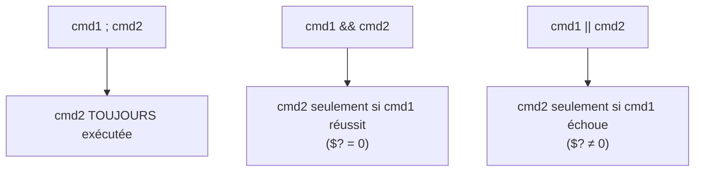
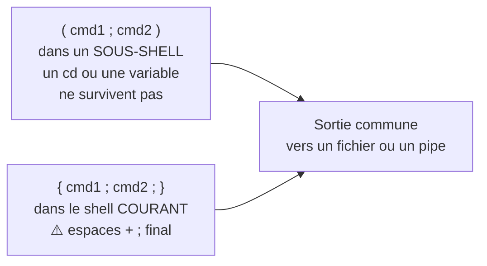

# Module 5 : Les caractères spéciaux du shell

*Cours : [Cours 10 - Initiation au scripting Bash](../index.md)*

## 🎯 Objectif du module

**Enchaîner** des commandes avec ou sans condition (`;`, `&&`, `||`), les **regrouper** (`( )` et `{ }`), et **colorer** l'affichage.

!!! abstract "En clair"
    `;` = « fais ceci, puis cela, quoi qu'il arrive ». `&&` = « fais cela **seulement si** ceci a **réussi** ». `||` = « fais cela **seulement si** ceci a **échoué** ». C'est le **code de retour** `$?` (module 3) qui décide.

## 🗺️ L'essentiel en schémas

!!! info "Référentiel TSSR 2026"
    **CCP 3 · compétence 8 : Optimiser des scripts.** `&&` et `||` remplacent souvent un `if` complet : un script plus court, qui **s'arrête proprement** en cas d'erreur.

**① Les trois enchaînements**



**② Regrouper : avec ou sans sous-shell**



## 📖 Cours consolidé

### 1. L'enchaînement inconditionnel : `;`

```bash
mkdir /data ; touch /data/file1 ; cat /home/bonjour.txt
```

Les trois commandes s'exécutent **l'une après l'autre**, même si les premières échouent. Dans un script, un **retour à la ligne** joue le même rôle que le `;`.

### 2. L'enchaînement conditionnel : `&&` et `||`

```bash
mkdir ./data && touch ./data/file1                               # touch seulement si mkdir a réussi
mkdir ./data 2>/dev/null || echo "Erreur de création de 'data'"   # message seulement en cas d'échec
ping -c 1 srv01 >/dev/null && echo "srv01 répond" || echo "srv01 ne répond pas"
```

| Opérateur | Se lit | Condition |
|---|---|---|
| `&&` | « et alors » | La commande précédente a **réussi** (`$?` = 0) |
| **\|\|** | « sinon » | La commande précédente a **échoué** (`$?` ≠ 0) |

### 3. Les regroupements

| Syntaxe | Où ? | Usage |
|---|---|---|
| `( cmd1 ; cmd2 )` | Dans un **sous-shell** (environnement enfant) | Isoler : un `cd` ou une variable modifiés **ne restent pas** |
| `{ cmd1 ; cmd2 ; }` | Dans le **shell courant** | Grouper sans créer de sous-shell · **espaces** après `{` et avant `}`, **`;` final obligatoire** |

```bash
(ls /bin ; ls /usr/bin) | wc -l            # nombre total de fichiers des deux dossiers
{ date ; uptime ; df -h ; } > etat.txt      # 3 résultats dans un seul fichier
```

### 4. Les couleurs

Une couleur s'écrit `\e[`**codes**`m` (ou `\033[`), et on revient à la normale avec `\e[0m`. Il faut `echo -e`.

| Couleur | Texte | Fond | | Attribut | Code |
|---|---|---|---|---|---|
| Noir | 30 | 40 | | Normal | 0 |
| Rouge | 31 | 41 | | Gras | 1 |
| Vert | 32 | 42 | | Souligné | 4 |
| Jaune | 33 | 43 | | Inversé | 7 |
| Bleu | 34 | 44 | | Invisible | 8 |
| Magenta | 35 | 45 | | Barré | 9 |
| Cyan | 36 | 46 | | | |
| Gris clair | 37 | 47 | | | |

```bash
echo -e "Statut : \e[1;32mOK\e[0m"        # OK en vert gras
echo -e "\e[1;31mERREUR\e[0m disque plein"   # ERREUR en rouge gras
```

## 📝 Fiche de révision

| Notion | À retenir |
|---|---|
| `;` | Toujours |
| `&&` | Si succès |
| **\|\|** | Si échec |
| `( … )` | Sous-shell, isolé |
| `{ … ; }` | Shell courant, espaces et `;` final |
| **Couleur** | `echo -e "\e[1;32mtexte\e[0m"` |
| **Codes** | 31 rouge · 32 vert · 33 jaune · 34 bleu · 1 gras · 0 normal |

### ⚠️ Les pièges

- `{cmd1; cmd2}` **sans espaces** ni `;` final : erreur de syntaxe.
- Un `cd` dans `( … )` **ne change pas** le dossier du script.
- Oublier `\e[0m` : **tout le reste** du terminal reste en couleur.
- `cmd && ok || ko` : `ko` s'exécute aussi si **`ok` échoue**, ce n'est pas un vrai si/sinon.

### ✏️ Entraîne-toi (clique pour voir la correction)

??? question "1. Crée le dossier /tmp/rapport ; s'il est créé, affiche « dossier prêt », sinon « impossible »."
    `mkdir /tmp/rapport 2>/dev/null && echo "dossier prêt" || echo "impossible"`

??? question "2. Écris date, whoami et pwd dans un seul fichier infos.txt, sans sous-shell."
    `{ date ; whoami ; pwd ; } > infos.txt`

## 🧠 Quiz — entraîne-toi

<div id="quiz-cours-10-initiation-au-scripting-bash-module-5-les-caracteres-speciaux-du-shell"></div>

<script type="application/json" id="quiz-cours-10-initiation-au-scripting-bash-module-5-les-caracteres-speciaux-du-shell-data">
[
  {
    "question": "Que fait cmd1 && cmd2 ?",
    "options": [
      "cmd2 s'exécute toujours",
      "cmd2 s'exécute seulement si cmd1 réussit",
      "cmd2 s'exécute seulement si cmd1 échoue",
      "Les deux s'exécutent en même temps"
    ],
    "correctIndex": 1,
    "explanation": "&& vérifie que $? vaut 0 avant de lancer la suite."
  },
  {
    "question": "Que fait cmd1 || cmd2 ?",
    "options": [
      "cmd2 seulement si cmd1 échoue",
      "cmd2 seulement si cmd1 réussit",
      "cmd2 toujours",
      "cmd1 et cmd2 dans un sous-shell"
    ],
    "correctIndex": 0,
    "explanation": "|| lance la suite seulement en cas d'échec."
  },
  {
    "question": "Quelle différence entre ( ) et { } ?",
    "options": [
      "Aucune",
      "( ) crée un sous-shell, { } reste dans le shell courant",
      "{ } crée un sous-shell",
      "( ) ne marche que dans un script"
    ],
    "correctIndex": 1,
    "explanation": "Dans ( ), un cd ou une variable modifiés ne survivent pas à la parenthèse fermante."
  },
  {
    "question": "Quelle syntaxe est correcte ?",
    "options": [
      "{date;uptime}",
      "{ date ; uptime ; }",
      "{ date ; uptime }",
      "{date ; uptime ;}"
    ],
    "correctIndex": 1,
    "explanation": "Espaces après { et avant }, et un ; après la dernière commande."
  },
  {
    "question": "Quel code colore le texte en rouge ?",
    "options": [
      "30",
      "31",
      "32",
      "34"
    ],
    "correctIndex": 1,
    "explanation": "31 = rouge, 32 = vert, 33 = jaune, 34 = bleu."
  },
  {
    "question": "Comment revenir à l'affichage normal après une couleur ?",
    "options": [
      "\\e[1m",
      "\\e[0m",
      "\\e[37m",
      "clear"
    ],
    "correctIndex": 1,
    "explanation": "\\e[0m remet tous les attributs à zéro."
  },
  {
    "question": "In Bash, which operator runs the next command only if the previous one succeeded?",
    "options": [
      ";",
      "&&",
      "||",
      "|"
    ],
    "correctIndex": 1,
    "explanation": "&& checks that the exit status is 0."
  }
]
</script>

<script>
  document.addEventListener("DOMContentLoaded", function () {
    TSSRQuiz.init({
      containerId: "quiz-cours-10-initiation-au-scripting-bash-module-5-les-caracteres-speciaux-du-shell",
      dataId: "quiz-cours-10-initiation-au-scripting-bash-module-5-les-caracteres-speciaux-du-shell-data",
    });
  });
</script>
