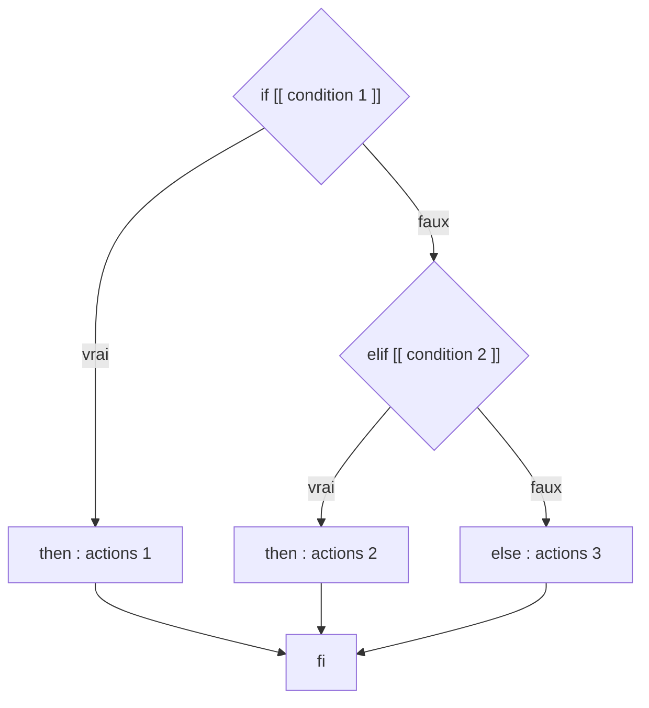
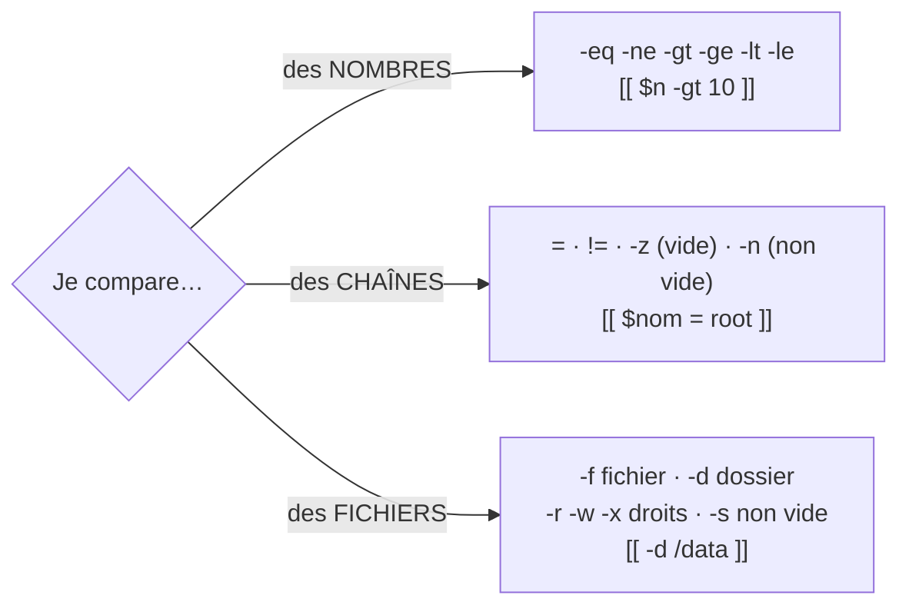
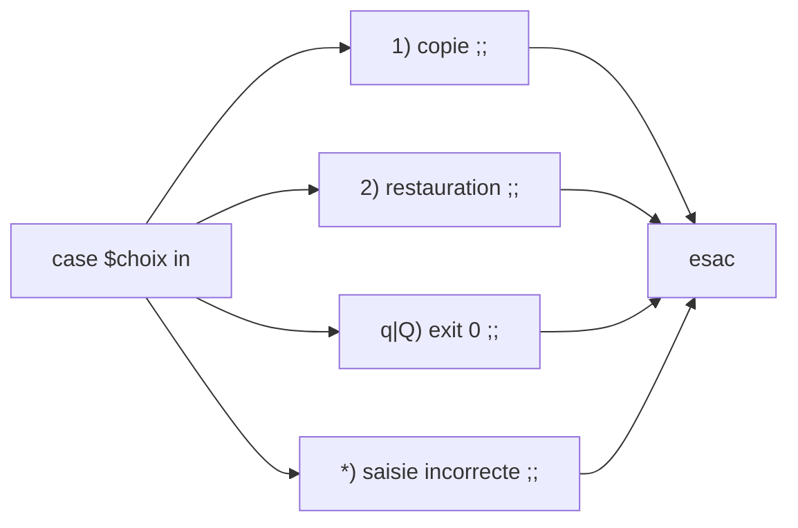

# Module 6 : Exécution conditionnelle

*Cours : [Cours 10 - Initiation au scripting Bash](../index.md)*

## 🎯 Objectif du module

Faire **décider** un script : la structure **`if`** (avec `else`, `elif`), les **tests** sur les nombres, les chaînes et les fichiers, et la structure **`case`** pour choisir parmi plusieurs valeurs.

!!! abstract "En clair"
    « **Si** le dossier existe, **alors** je copie, **sinon** j'affiche une erreur. » C'est un `if`. Le **test** entre `[[ ]]` répond vrai (code 0) ou faux (code 1), et le `if` choisit la branche. Quand une variable peut prendre **plusieurs valeurs** (un choix de menu), `case` est plus lisible qu'une suite de `if`.

## 🗺️ L'essentiel en schémas

!!! info "Référentiel TSSR 2026"
    **CCP 3 · compétence 8 : Optimiser des scripts.** Tester les cas d'erreur (fichier absent, argument manquant, mauvais utilisateur) est ce qui distingue un script **fiable** d'un script qui casse.

**① if, elif, else**



**② Quel test pour quel type de donnée ?**



**③ case : un choix parmi plusieurs valeurs**



## 📖 Cours consolidé

### 1. La structure if

```bash
if [[ "$LOGNAME" = root ]] ; then
    echo "Ne pas se connecter en root"
    exit 1
else
    echo "Bienvenue sur la machine $HOSTNAME"
fi
```

- Obligatoire : `if` … `then` … `fi`. Optionnels : `elif` (sinon si) et `else` (sinon).
- Deux écritures possibles : `if condition ; then` sur une ligne (moderne), ou `then` sur la ligne suivante (classique).
- La « condition » est en fait **n'importe quelle commande** : `if` regarde son **code de retour** (0 = vrai).

```bash
if ping -c 1 srv01 >/dev/null ; then echo "srv01 répond" ; fi
```

### 2. Les commandes de test

| Commande | Particularité |
|---|---|
| `test condition` / `[ condition ]` | Compatible avec **tous** les shells |
| `[[ condition ]]` | **Interne à Bash**, plus de possibilités (jokers, `&&`, **\|\|**) : celle du cours |
| `(( condition ))` | Tests **arithmétiques** : `(( n > 10 ))` |

⚠️ Il faut un **espace** après `[[` et avant `]]`.

### 3. Les opérateurs

| Nombres | | Chaînes | | Fichiers | |
|---|---|---|---|---|---|
| `-eq` | égal | `=` | égales | `-f` | fichier ordinaire existe |
| `-ne` | différent | `!=` | différentes | `-d` | dossier existe |
| `-gt` | plus grand | `-z` | **vide** | `-r` `-w` `-x` | droit de lecture, écriture, exécution |
| `-ge` | plus grand ou égal | `-n` | **non vide** | `-s` | taille > 0 |
| `-lt` | plus petit | | | `-e` | existe (tout type) |
| `-le` | plus petit ou égal | | | | |

**Combiner** : `&&` (et), `||` (ou), `!` (non), `( )` (regrouper).

```bash
if [[ -f fic1 && ( -d rep1 || -d rep2 ) ]] ; then
    echo "fic1 est présent, ainsi que rep1 ou rep2"
fi
```

### 4. Les jokers dans les tests

Dans `[[ ]]`, à droite de `=`, les jokers du shell fonctionnent : `*` (0 à n caractères), `?` (1 caractère), `[abc]` (un caractère parmi), `[!abc]` (sauf).

```bash
[[ $fichier = *.log ]] && echo "c'est un journal"
```

Avec `shopt -s extglob`, on peut aussi utiliser `?(…)`, `*(…)`, `+(…)`, `@(…)`, `!(…)` : par exemple `[[ $n = ?([+-])+([0-9]) ]]` vérifie que `$n` est un nombre entier.

### 5. Test et regroupement : la forme courte

```bash
[[ -d /data ]] && {
    mkdir /data/perso
    cp -a ~/documents/* /data/perso
}
```

C'est l'équivalent d'un `if [[ -d /data ]] ; then … fi` ([module 5](../module-5-les-caracteres-speciaux-du-shell/index.md)).

### 6. La structure case

```bash
case $saisie in
    p)       echo "la lettre est p" ;;
    [0-9])   echo "un chiffre" ;;
    a|b)     echo "a ou b" ;;
    *)       echo "n'importe quel autre caractère" ;;
esac
```

- Chaque cas finit par **`;;`**. Le **premier** cas qui correspond est exécuté, puis on **sort** du `case`.
- Les valeurs acceptent les **jokers** et le **`|`** (ou). `*)` = **tous les autres cas**, à mettre **en dernier**.

## 📝 Fiche de révision

| Notion | À retenir |
|---|---|
| **if** | `if [[ … ]] ; then … elif … else … fi` |
| **Vrai / faux** | Code de retour 0 / différent de 0 |
| **`[[ ]]`** | Test Bash, espaces obligatoires |
| **Nombres** | `-eq -ne -gt -ge -lt -le` |
| **Chaînes** | `=`, `!=`, `-z` (vide), `-n` (non vide) |
| **Fichiers** | `-f`, `-d`, `-e`, `-r`, `-w`, `-x`, `-s` |
| **Combiner** | `&&`, **\|\|**, `!` |
| **case** | `case $v in val) … ;; *) … ;; esac` |

### ⚠️ Les pièges

- `[[$a = b]]` **sans espaces** → erreur.
- `=` compare des **chaînes**, `-eq` des **nombres** : `[[ 10 = 10.0 ]]` est faux (textes différents). Pour des nombres, utilise toujours `-eq`, `-gt`…
- Oublier `fi`, `esac` ou un `;;`.
- Mettre `*)` **avant** les autres cas : il les intercepte tous.
- Ne pas mettre de **guillemets** autour d'une variable vide avec `[ ]` (l'ancienne syntaxe) provoque une erreur.

### ✏️ Entraîne-toi (clique pour voir la correction)

??? question "1. Le script reçoit un nom de dossier en argument. S'il n'y a pas d'argument, afficher l'usage et sortir en erreur ; si le dossier n'existe pas, le dire ; sinon, afficher son contenu."
    ```bash
    #!/bin/bash
    if [[ $# -ne 1 ]] ; then
        echo "Usage : $0 dossier"
        exit 1
    elif [[ ! -d $1 ]] ; then
        echo "$1 n'existe pas"
        exit 2
    else
        ls -l "$1"
    fi
    ```

??? question "2. Écris un case qui répond « matin », « après-midi » ou « inconnu » selon qu'on saisit m, a ou autre chose (majuscules acceptées)."
    ```bash
    read -p "m ou a ? " r
    case $r in
        m|M) echo "matin" ;;
        a|A) echo "après-midi" ;;
        *)   echo "inconnu" ;;
    esac
    ```

## 🧠 Quiz — entraîne-toi

<div id="quiz-cours-10-initiation-au-scripting-bash-module-6-execution-conditionnelle"></div>

<script type="application/json" id="quiz-cours-10-initiation-au-scripting-bash-module-6-execution-conditionnelle-data">
[
  {
    "question": "Comment se termine une structure if ?",
    "options": [
      "end",
      "fi",
      "done",
      "esac"
    ],
    "correctIndex": 1,
    "explanation": "if … fi ; case … esac ; while / for … done."
  },
  {
    "question": "Quel opérateur teste qu'un nombre est strictement supérieur à un autre ?",
    "options": [
      "-ge",
      "-gt",
      ">",
      "-sup"
    ],
    "correctIndex": 1,
    "explanation": "-gt = greater than ; -ge = supérieur ou égal."
  },
  {
    "question": "Quel test vérifie qu'un dossier existe ?",
    "options": [
      "[[ -f /data ]]",
      "[[ -d /data ]]",
      "[[ -z /data ]]",
      "[[ -x /data ]]"
    ],
    "correctIndex": 1,
    "explanation": "-d = dossier, -f = fichier ordinaire, -e = existe (tout type)."
  },
  {
    "question": "Que teste [[ -z $nom ]] ?",
    "options": [
      "Que $nom est un nombre",
      "Que $nom est vide",
      "Que $nom est un fichier",
      "Que $nom est non vide"
    ],
    "correctIndex": 1,
    "explanation": "-z = chaîne vide ; -n = chaîne non vide."
  },
  {
    "question": "Dans un case, que signifie *) ?",
    "options": [
      "Les fichiers du dossier",
      "Tous les autres cas",
      "Une erreur de syntaxe",
      "Le premier cas"
    ],
    "correctIndex": 1,
    "explanation": "*) attrape tout ce qui n'a pas correspondu aux cas précédents : on le met en dernier."
  },
  {
    "question": "Comment se termine chaque cas d'un case ?",
    "options": [
      ";",
      ";;",
      "break",
      "done"
    ],
    "correctIndex": 1,
    "explanation": "Le ;; fait sortir du case après les actions du cas."
  },
  {
    "question": "Que vaut le code de retour d'un test vrai ?",
    "options": [
      "1",
      "0",
      "true",
      "-1"
    ],
    "correctIndex": 1,
    "explanation": "En shell, 0 = vrai / succès, différent de 0 = faux / échec."
  },
  {
    "question": "Which operator tests that two strings are different?",
    "options": [
      "-ne",
      "!=",
      "<>",
      "-diff"
    ],
    "correctIndex": 1,
    "explanation": "!= compare des chaînes ; -ne compare des nombres."
  }
]
</script>

<script>
  document.addEventListener("DOMContentLoaded", function () {
    TSSRQuiz.init({
      containerId: "quiz-cours-10-initiation-au-scripting-bash-module-6-execution-conditionnelle",
      dataId: "quiz-cours-10-initiation-au-scripting-bash-module-6-execution-conditionnelle-data",
    });
  });
</script>
