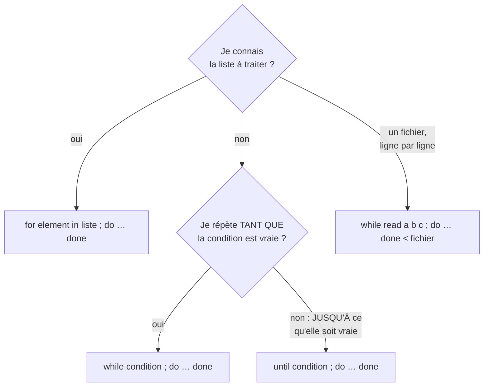
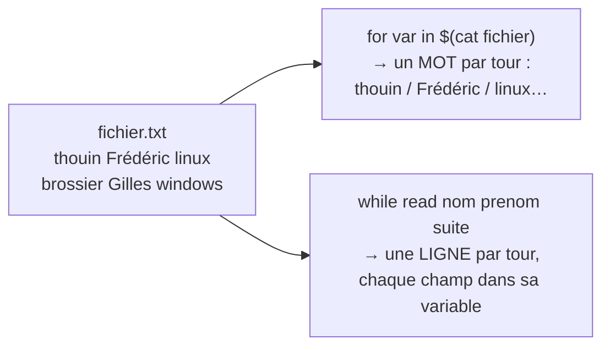

# Module 7 : Les structures de boucle

*Cours : [Cours 10 - Initiation au scripting Bash](../index.md)*

## 🎯 Objectif du module

**Répéter** des actions avec les boucles **`while`** (tant que), **`until`** (jusqu'à ce que) et **`for`** (pour chaque), faire des **calculs**, et **lire un fichier ligne par ligne** avec `while read`.

!!! abstract "En clair"
    Créer 50 comptes, vérifier 20 serveurs, traiter chaque ligne d'un fichier CSV : c'est le travail des **boucles**. `for` parcourt une **liste**, `while` tourne **tant qu'une condition est vraie**, `until` **jusqu'à ce qu'elle le devienne**.

## 🗺️ L'essentiel en schémas

!!! info "Référentiel TSSR 2026"
    **CCP 3 · compétence 8 : Optimiser des scripts.** L'automatisation de tâches répétitives (comptes, sauvegardes, vérifications) repose sur les boucles.

**① Quelle boucle choisir ?**



**② Pourquoi while read plutôt que for pour un fichier ?**



## 📖 Cours consolidé

### 1. Calculer

```bash
expr 2 + 7          # 9 · espaces obligatoires autour de l'opérateur
expr 2 \* 7         # 14 · l'étoile doit être protégée
i=$((i + 1))        # forme moderne : $(( … ))
(( i++ ))           # incrémenter
```

### 2. while : tant que

```bash
while [[ -z "$nom" ]] ; do          # tant que $nom est vide
    read -p "Votre nom : " nom
done
echo "Bonjour $nom"
```

- La boucle continue **tant que** la condition renvoie 0. Pense à **faire évoluer** la condition dans la boucle, sinon elle ne s'arrête jamais.
- **Boucle infinie** volontaire (menus) : `while true ; do … done`, avec une sortie par `exit` ou `break`.

```bash
while true ; do
    echo "1) copie   2) restauration   q) quitter"
    read -p "Choix : " choix
    case $choix in
        1) echo "copie des fichiers" ;;
        2) echo "restauration des fichiers" ;;
        q) clear ; exit 0 ;;
        *) echo -e "\e[41msaisie incorrecte\e[0m" ;;
    esac
done
```

### 3. until : jusqu'à ce que

Identique à `while`, mais la boucle tourne **jusqu'à ce que** la condition devienne vraie.

```bash
until [[ -n "$age" ]] ; do
    read -p "Votre âge : " age
done
```

### 4. for : pour chaque élément d'une liste

```bash
for serveur in srv01 srv02 srv03 ; do
    ping -c 1 "$serveur" >/dev/null && echo "$serveur OK" || echo "$serveur KO"
done

for fichier in /var/log/*.log ; do echo "$fichier" ; done     # liste de fichiers
for i in {1..5} ; do echo "Tour $i" ; done                       # nombre de tours connu
for (( i=1 ; i<=5 ; i++ )) ; do echo "Tour $i" ; done           # forme « compteur »
```

La liste est découpée selon les séparateurs de la variable **`IFS`** (espace, tabulation, retour à la ligne par défaut).

### 5. while read : lire un fichier ligne par ligne

```bash
while read nom prenom suite ; do
    echo "$prenom $nom"
done < fichier.txt
```

- Chaque **ligne** est lue, chaque **mot** va dans une variable ; `suite` récupère le reste de la ligne.
- Depuis une commande : `done < <(commande)` (garder les espaces), ou `commande | while read …` (plus lisible, mais le **pipe crée un sous-shell** : les variables modifiées dans la boucle sont perdues après).
- Pour lire un fichier CSV : `while IFS=";" read nom prenom service ; do … done < users.csv`.

### 6. break et continue

`break` **sort** de la boucle ; `continue` passe **directement au tour suivant**.

## 📝 Fiche de révision

| Notion | À retenir |
|---|---|
| **for** | `for x in liste ; do … done` |
| **while** | Tant que la condition est vraie |
| **until** | Jusqu'à ce que la condition soit vraie |
| **Boucle infinie** | `while true ; do … done` |
| **Fichier ligne à ligne** | `while read a b ; do … done < fichier` |
| **CSV** | `while IFS=";" read … ; do … done < f.csv` |
| **Calcul** | `$(( a + b ))` · `expr 2 \* 7` |
| **break / continue** | Sortir / tour suivant |

### ⚠️ Les pièges

- Une condition qui **n'évolue jamais** = boucle infinie involontaire.
- `for ligne in $(cat fichier)` découpe par **mot**, pas par ligne.
- `cat f | while read …` : les variables modifiées dans la boucle **disparaissent** ensuite (sous-shell).
- `expr 2*7` sans espaces ni `\` : erreur.

### ✏️ Entraîne-toi (clique pour voir la correction)

??? question "1. Crée les dossiers rapport1 à rapport5 avec une boucle for."
    `for i in {1..5} ; do mkdir "rapport$i" ; done`

??? question "2. users.csv contient « nom;prenom;service » sur chaque ligne. Affiche « prenom NOM (service) » pour chaque ligne."
    ```bash
    while IFS=";" read nom prenom service ; do
        echo "$prenom ${nom^^} ($service)"
    done < users.csv
    ```
    (`${nom^^}` met en majuscules.)

## 🧠 Quiz — entraîne-toi

<div id="quiz-cours-10-initiation-au-scripting-bash-module-7-les-structures-de-boucle"></div>

<script type="application/json" id="quiz-cours-10-initiation-au-scripting-bash-module-7-les-structures-de-boucle-data">
[
  {
    "question": "Quelle boucle parcourt une liste de valeurs connue ?",
    "options": [
      "while",
      "until",
      "for",
      "case"
    ],
    "correctIndex": 2,
    "explanation": "for element in liste ; do … done."
  },
  {
    "question": "Quelle est la différence entre while et until ?",
    "options": [
      "Aucune",
      "while tourne tant que la condition est vraie, until jusqu'à ce qu'elle le devienne",
      "until est plus rapide",
      "while ne marche qu'avec des nombres"
    ],
    "correctIndex": 1,
    "explanation": "Même syntaxe, condition de bouclage inversée."
  },
  {
    "question": "Comment lire un fichier ligne par ligne en séparant les champs ?",
    "options": [
      "for l in $(cat fichier)",
      "while read a b c ; do … done < fichier",
      "cat fichier | for",
      "case fichier in"
    ],
    "correctIndex": 1,
    "explanation": "while read lit une ligne par tour et range chaque champ dans une variable."
  },
  {
    "question": "Comment calculer i + 1 en Bash moderne ?",
    "options": [
      "i = i + 1",
      "i=$((i + 1))",
      "i=i+1",
      "expr i+1"
    ],
    "correctIndex": 1,
    "explanation": "$(( … )) fait l'arithmétique entière ; expr demande des espaces et des $."
  },
  {
    "question": "Comment créer une boucle infinie pour un menu ?",
    "options": [
      "while true ; do … done",
      "for ever",
      "until true ; do … done",
      "loop forever"
    ],
    "correctIndex": 0,
    "explanation": "while true tourne sans fin ; on sort avec exit ou break."
  },
  {
    "question": "Que fait break dans une boucle ?",
    "options": [
      "Il passe au tour suivant",
      "Il sort de la boucle",
      "Il arrête le script avec une erreur",
      "Il met en pause"
    ],
    "correctIndex": 1,
    "explanation": "break sort de la boucle ; continue passe au tour suivant."
  },
  {
    "question": "Pourquoi éviter for ligne in $(cat fichier) pour lire des lignes ?",
    "options": [
      "C'est trop lent",
      "La liste est découpée par mot (espaces), pas par ligne",
      "for ne lit pas les fichiers",
      "Ça efface le fichier"
    ],
    "correctIndex": 1,
    "explanation": "La variable IFS découpe sur les espaces, tabulations et retours à la ligne."
  },
  {
    "question": "Which loop keeps running as long as its condition is true?",
    "options": [
      "until",
      "while",
      "case",
      "if"
    ],
    "correctIndex": 1,
    "explanation": "while = as long as ; until = until the condition becomes true."
  }
]
</script>

<script>
  document.addEventListener("DOMContentLoaded", function () {
    TSSRQuiz.init({
      containerId: "quiz-cours-10-initiation-au-scripting-bash-module-7-les-structures-de-boucle",
      dataId: "quiz-cours-10-initiation-au-scripting-bash-module-7-les-structures-de-boucle-data",
    });
  });
</script>
