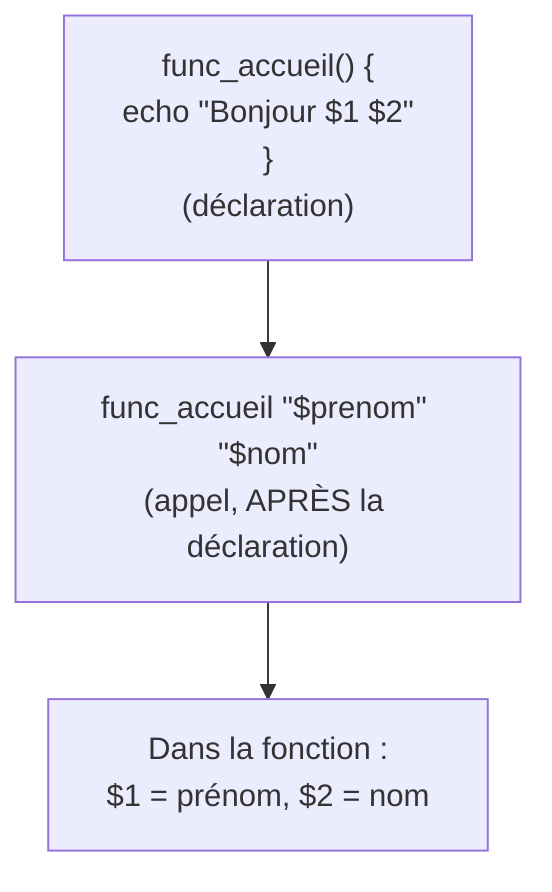
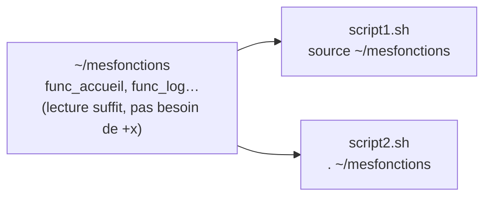

# Module 8 : Les fonctions

*Cours : [Cours 10 - Initiation au scripting Bash](../index.md)*

## 🎯 Objectif du module

Écrire des **fonctions** pour **réutiliser** du code, leur passer des **paramètres**, et les ranger dans un **fichier séparé** partagé par plusieurs scripts.

!!! abstract "En clair"
    Si tu écris trois fois le même bloc de commandes dans un script, fais-en une **fonction** : un bloc qui porte un **nom** et qu'on **appelle** quand on en a besoin. On corrige à un seul endroit, et le script devient plus lisible.

## 🗺️ L'essentiel en schémas

!!! info "Référentiel TSSR 2026"
    **CCP 3 · compétence 8 : Optimiser des scripts.** Découper un script en fonctions est la première étape pour le **rendre maintenable**, et c'est souvent ce qu'une IA propose pour « optimiser » un script : à toi de comprendre et vérifier le résultat.

**① Déclarer, puis appeler**



**② Des fonctions partagées entre scripts**



## 📖 Cours consolidé

### 1. Déclarer et appeler une fonction

```bash
#!/bin/bash
func_infos() {
    echo "Informations sur la distribution utilisée"
    lsb_release -dric
}

func_infos          # appel : APRÈS la déclaration
```

- Nom en **minuscules**, préfixé par `func_` ou `function_` : on voit tout de suite qu'il s'agit d'une fonction et pas d'une commande.
- Une fonction doit être **déclarée avant** d'être appelée.

### 2. Les variables dans les fonctions

```bash
nbr=50
func_majnbr() { nbr=100 ; }
func_majnbr
echo "$nbr"         # → 100 : la fonction a modifié la variable du script
```

Par défaut, les variables **traversent** les fonctions : une modification dans la fonction **est visible** dans le reste du script. Pour une variable **propre à la fonction**, on la déclare avec **`local`** :

```bash
func_calcul() {
    local resultat=$(( $1 * 2 ))
    echo "$resultat"
}
```

### 3. Les paramètres

Une fonction reçoit ses arguments dans **`$1`, `$2`…, `$#`, `$@`**, comme un script.

```bash
func_accueil() {
    echo "Bonjour $1 $2"
    echo "Bienvenue sur la machine $HOSTNAME"
}
read -p "Prénom et nom : " prenom nom
func_accueil "$prenom" "$nom"
```

Une fonction peut aussi renvoyer un **code de retour** avec `return n` (0 = succès), testable avec `$?` ou dans un `if`.

### 4. Un fichier de fonctions partagé

```bash
# fichier ~/mesfonctions : il suffit qu'il soit LISIBLE
func_accueil() { echo "Bonjour $1 $2" ; }

# dans le script :
#!/bin/bash
source ~/mesfonctions          # ou : . ~/mesfonctions
func_accueil "Marc" "Dubois"
```

`source` (ou `.`) **lit le fichier dans le shell courant** : ses fonctions deviennent disponibles. ➕ Scripts plus lisibles, plus faciles à déboguer, fonctions **réutilisées** par plusieurs scripts.

## 📝 Fiche de révision

| Notion | À retenir |
|---|---|
| **Déclarer** | `func_nom() { … }` |
| **Appeler** | `func_nom arg1 arg2` (après la déclaration) |
| **Paramètres** | `$1`, `$2`, `$#`, `$@` dans la fonction |
| **Variable propre** | `local var=…` |
| **Code de retour** | `return n` |
| **Fichier de fonctions** | `source fichier` ou `. fichier` |
| **Nommage** | `func_` + minuscules |

### ⚠️ Les pièges

- Appeler une fonction **avant** de l'avoir déclarée → « commande introuvable ».
- Oublier `local` : la fonction **écrase** une variable du script qui porte le même nom.
- Dans une fonction, `$1` est l'argument **de la fonction**, pas celui du script.
- `exit` dans une fonction **arrête tout le script** ; pour sortir de la fonction seulement : `return`.

### ✏️ Entraîne-toi (clique pour voir la correction)

??? question "1. Écris une fonction func_log qui ajoute la date et un message dans /tmp/script.log, et appelle-la deux fois."
    ```bash
    #!/bin/bash
    func_log() {
        echo "$(date '+%F %T') $1" >> /tmp/script.log
    }
    func_log "Début du script"
    func_log "Fin du script"
    ```

## 🧠 Quiz — entraîne-toi

<div id="quiz-cours-10-initiation-au-scripting-bash-module-8-les-fonctions"></div>

<script type="application/json" id="quiz-cours-10-initiation-au-scripting-bash-module-8-les-fonctions-data">
[
  {
    "question": "Où doit se trouver l'appel d'une fonction ?",
    "options": [
      "Avant sa déclaration",
      "Après sa déclaration",
      "N'importe où",
      "Dans un autre script uniquement"
    ],
    "correctIndex": 1,
    "explanation": "Bash lit le script de haut en bas : la fonction doit être connue avant d'être appelée."
  },
  {
    "question": "Comment une fonction récupère-t-elle son premier argument ?",
    "options": [
      "$0",
      "$1",
      "$ARG1",
      "${first}"
    ],
    "correctIndex": 1,
    "explanation": "Comme un script : $1, $2… et $# pour le nombre."
  },
  {
    "question": "Comment déclarer une variable propre à la fonction ?",
    "options": [
      "private var=…",
      "local var=…",
      "export var=…",
      "declare -g var=…"
    ],
    "correctIndex": 1,
    "explanation": "local évite d'écraser une variable du même nom dans le script."
  },
  {
    "question": "Comment charger un fichier de fonctions dans un script ?",
    "options": [
      "include fichier",
      "source fichier (ou . fichier)",
      "import fichier",
      "exec fichier"
    ],
    "correctIndex": 1,
    "explanation": "source lit le fichier dans le shell courant ; le fichier n'a pas besoin d'être exécutable."
  },
  {
    "question": "Comment sortir d'une fonction sans arrêter le script ?",
    "options": [
      "exit",
      "return",
      "break",
      "stop"
    ],
    "correctIndex": 1,
    "explanation": "return quitte la fonction avec un code ; exit arrête tout le script."
  },
  {
    "question": "Why use functions in a script?",
    "options": [
      "To make the script slower",
      "To reuse code and make the script easier to read and maintain",
      "Functions are mandatory in Bash",
      "To hide the code"
    ],
    "correctIndex": 1,
    "explanation": "Une fonction écrite une fois peut être appelée plusieurs fois et corrigée à un seul endroit."
  }
]
</script>

<script>
  document.addEventListener("DOMContentLoaded", function () {
    TSSRQuiz.init({
      containerId: "quiz-cours-10-initiation-au-scripting-bash-module-8-les-fonctions",
      dataId: "quiz-cours-10-initiation-au-scripting-bash-module-8-les-fonctions-data",
    });
  });
</script>
