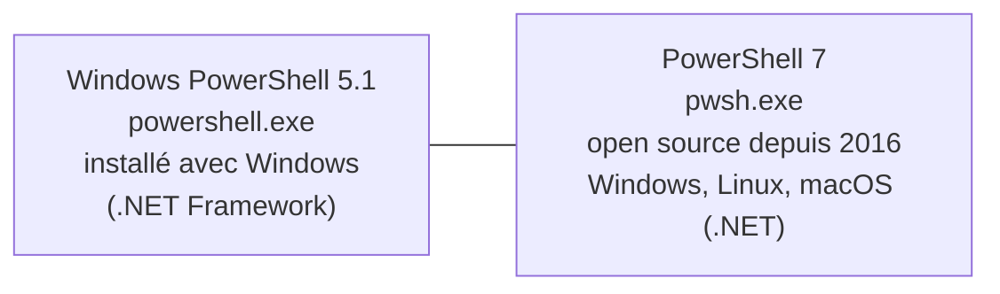
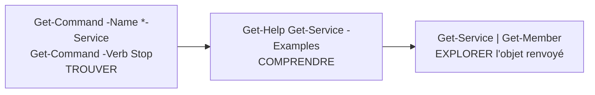
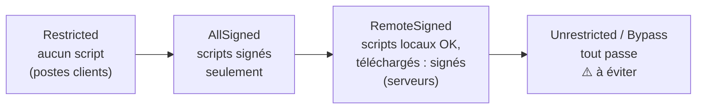

# Module 1 : Découverte de PowerShell Core

*Cours : [Cours 11 - Initiation à PowerShell](../index.md)*

## 🎯 Objectif du module

Connaître les **versions** de PowerShell (Windows PowerShell 5.1 et PowerShell 7), la forme **Verbe-Nom** des cmdlets, et les trois réflexes pour **trouver** et **comprendre** une commande : `Get-Command`, `Get-Help`, `Get-Member`. Savoir aussi régler la **stratégie d'exécution**, gérer les **modules** et le **profil**.

!!! abstract "En clair"
    PowerShell est le **shell d'administration** de Microsoft. Ses commandes (les *cmdlets*) se lisent comme une phrase : `Get-Service` = « obtenir les services », `Stop-Process` = « arrêter un processus ». Il en existe des milliers : on ne les apprend pas par cœur, on apprend à **les trouver**.

## 🗺️ L'essentiel en schémas

!!! info "Référentiel TSSR 2026"
    **CCP 3 · compétence 8 : Optimiser des scripts à l'aide de l'intelligence artificielle** et **CCP 2 · compétence 5** (administrer des serveurs Windows). Une IA propose vite une commande PowerShell : `Get-Help` et `Get-Member` servent à **vérifier** qu'elle existe et fait bien ce qu'on croit.

**① Deux PowerShell aujourd'hui**



**② Trouver, comprendre, explorer une commande**



**③ La stratégie d'exécution des scripts**



## 📖 Cours consolidé

### 1. Un peu d'histoire

| Version | Ce qu'il faut retenir |
|---|---|
| **1.0** (2006) | Windows XP SP2, Vista, Server 2003 · 129 commandes |
| **5.1** | **Windows PowerShell**, installé par défaut sur Windows 10/11 et Windows Server · des milliers de commandes |
| **6 puis 7** | **PowerShell (Core)** : **open source** depuis 2016, **multiplateforme** (Windows, Linux, macOS), s'installe à côté de la 5.1 |

Les grands éditeurs (VMware, Cisco, Veeam…) fournissent des **modules** pour piloter leurs produits en PowerShell.

**Particularités de PowerShell 7 hors de Windows** : pas de commandes **WMI/CIM** ni de tâches planifiées (propres à Windows), certains **alias** absents, et sous Linux **la casse compte** dans les chemins.

### 2. Les cmdlets : Verbe-Nom

- Toujours **Verbe-Nom**, le nom **au singulier** : `Get-Service`, `Get-Process`, `Get-ChildItem`, `Get-SmbShare`, `Stop-Service`, `New-LocalUser`.
- Les **paramètres** commencent par un **tiret**, leur valeur est l'**argument** : `Get-LocalUser -Name "Marie"`.
- Une commande peut avoir **plusieurs** paramètres : `Get-LocalGroupMember -Group "Administrateurs" -Member "Marie"`.

### 3. Les trois commandes clés

| Commande | Rôle | Exemples |
|---|---|---|
| **`Get-Command`** | **Trouver** une commande | `Get-Command -Name *-Service` · `Get-Command -Verb Stop` · `Get-Command -Module ActiveDirectory` |
| **`Get-Help`** | **Lire** l'aide | `Get-Help Get-Service -Examples` · `-Full` · `-Online` (navigateur) · `-ShowWindow` (fenêtre avec recherche) |
| **`Get-Member`** | **Voir** propriétés et méthodes d'un objet ([module 2](../module-2-structure-des-commandes/index.md)) | `Get-Service` **\|** `Get-Member` |

`Update-Help` télécharge l'aide à jour (en **administrateur**, avec Internet) ; sans Internet : `Update-Help -SourcePath D:\Aide`.

### 4. La stratégie d'exécution

Par défaut, Windows **bloque** les scripts `.ps1` sur les postes clients (**Restricted**) ; les serveurs sont en **RemoteSigned**.

```powershell
Get-ExecutionPolicy                              # voir le réglage actuel
Set-ExecutionPolicy RemoteSigned                 # en administrateur
Set-ExecutionPolicy RemoteSigned -Scope CurrentUser   # seulement pour moi
```

| Niveau | Effet |
|---|---|
| **Restricted** | Aucun script |
| **AllSigned** | Seulement les scripts **signés** |
| **RemoteSigned** | Scripts locaux autorisés, scripts **téléchargés** signés |
| **Unrestricted** / **Bypass** | Tout passe (Bypass sans même d'avertissement) |

### 5. Les modules

- Chaque cmdlet vient d'un **module** (fichiers `.psm1`).
- `Get-Module` (chargés) · `Get-Module -ListAvailable` (installés) · `Import-Module NomDuModule` · `$env:PSModulePath` (dossiers où PowerShell les cherche).
- Depuis la galerie en ligne : `Install-Module NomDuModule` (ex. `ImportExcel`).

### 6. Personnaliser la console et le profil

Police, taille et couleurs : clic droit sur la barre de titre → Propriétés. Le **profil** est un script lancé **à chaque ouverture** de la console (alias, fonctions, messages) :

```powershell
$PROFILE                                        # son chemin
New-Item -Path $PROFILE -ItemType File -Force   # le créer
notepad $PROFILE                                # le modifier
```

## 📝 Fiche de révision

| Notion | À retenir |
|---|---|
| **5.1 / 7** | `powershell.exe` (Windows) / `pwsh` (multiplateforme, open source) |
| **Cmdlet** | Verbe-Nom, nom au singulier |
| **Paramètre / argument** | `-Name` / sa valeur |
| **Trouver** | `Get-Command -Name *mot*` · `-Verb` · `-Module` |
| **Aide** | `Get-Help cmd -Examples` · `-Full` · `-Online` |
| **Objet** | `cmd` **\|** `Get-Member` |
| **Scripts bloqués ?** | `Set-ExecutionPolicy RemoteSigned` (administrateur) |
| **Modules** | `Get-Module -ListAvailable` · `Import-Module` · `Install-Module` |
| **Profil** | `$PROFILE` |

### ⚠️ Les pièges

- « L'exécution de scripts est désactivée sur ce système » = stratégie **Restricted** : pas une erreur dans ton script.
- `Update-Help` et `Set-ExecutionPolicy` (pour la machine) demandent une console **en administrateur**.
- Mettre **Unrestricted** ou **Bypass** « pour que ça marche » ouvre la porte aux scripts malveillants.
- Une commande trouvée sur Internet ou proposée par une IA peut **ne pas exister** : vérifie avec `Get-Command`.

### ✏️ Entraîne-toi (clique pour voir la correction)

??? question "1. Trouve toutes les commandes qui gèrent les utilisateurs locaux, puis affiche des exemples pour l'une d'elles."
    `Get-Command -Name *LocalUser*` (ou `Get-Command -Noun LocalUser`), puis `Get-Help New-LocalUser -Examples`.

??? question "2. Ton script .ps1 refuse de se lancer sur un poste client. Que fais-tu ?"
    Vérifier avec `Get-ExecutionPolicy` (sans doute **Restricted**), puis `Set-ExecutionPolicy RemoteSigned -Scope CurrentUser` pour autoriser tes scripts locaux.

## 🧠 Quiz — entraîne-toi

<div id="quiz-cours-11-initiation-a-powershell-module-1-decouverte-de-powershell-core"></div>

<script type="application/json" id="quiz-cours-11-initiation-a-powershell-module-1-decouverte-de-powershell-core-data">
[
  {
    "question": "Comment sont construits les noms des cmdlets PowerShell ?",
    "options": [
      "Nom-Verbe",
      "Verbe-Nom, avec un nom au singulier",
      "Un seul mot",
      "Verbe_Nom en minuscules"
    ],
    "correctIndex": 1,
    "explanation": "Exemples : Get-Service, Stop-Process, New-LocalUser."
  },
  {
    "question": "Quelle commande permet de trouver toutes les cmdlets qui finissent par « Service » ?",
    "options": [
      "Get-Help *Service",
      "Get-Command -Name *-Service",
      "Find-Command Service",
      "Get-Member Service"
    ],
    "correctIndex": 1,
    "explanation": "Get-Command cherche les commandes ; * remplace n'importe quels caractères."
  },
  {
    "question": "Comment afficher uniquement les exemples d'une commande ?",
    "options": [
      "Get-Help Get-Service -Examples",
      "Get-Command Get-Service -Examples",
      "Get-Service -Help",
      "help -Full"
    ],
    "correctIndex": 0,
    "explanation": "-Examples montre les exemples ; -Full toute l'aide ; -Online ouvre la page web."
  },
  {
    "question": "Un script .ps1 ne se lance pas : « l'exécution de scripts est désactivée ». Que faire ?",
    "options": [
      "Renommer le fichier en .bat",
      "Régler la stratégie d'exécution, par exemple Set-ExecutionPolicy RemoteSigned",
      "Réinstaller Windows",
      "Le lancer dans cmd"
    ],
    "correctIndex": 1,
    "explanation": "Les postes clients sont en Restricted par défaut."
  },
  {
    "question": "Quelle est la particularité de PowerShell 7 par rapport à Windows PowerShell 5.1 ?",
    "options": [
      "Il ne fonctionne que sous Windows",
      "Il est open source et multiplateforme (Windows, Linux, macOS)",
      "Il remplace cmd sur tous les PC",
      "Il n'a pas de cmdlets"
    ],
    "correctIndex": 1,
    "explanation": "PowerShell 7 (pwsh) s'installe à côté de la 5.1."
  },
  {
    "question": "Quelle commande liste les modules installés ?",
    "options": [
      "Get-Module -ListAvailable",
      "Get-Command -Module",
      "Import-Module *",
      "Get-Help modules"
    ],
    "correctIndex": 0,
    "explanation": "Get-Module seul montre ceux qui sont chargés dans la session."
  },
  {
    "question": "Qu'est-ce que le profil PowerShell ($PROFILE) ?",
    "options": [
      "Le compte administrateur",
      "Un script lancé à chaque ouverture de la console",
      "Le dossier des modules",
      "Le fichier d'aide"
    ],
    "correctIndex": 1,
    "explanation": "On y met ses alias, fonctions et réglages personnels."
  },
  {
    "question": "Which cmdlet shows the properties and methods of an object?",
    "options": [
      "Get-Help",
      "Get-Command",
      "Get-Member",
      "Get-Object"
    ],
    "correctIndex": 2,
    "explanation": "Get-Member s'utilise derrière un pipe : Get-Service | Get-Member."
  }
]
</script>

<script>
  document.addEventListener("DOMContentLoaded", function () {
    TSSRQuiz.init({
      containerId: "quiz-cours-11-initiation-a-powershell-module-1-decouverte-de-powershell-core",
      dataId: "quiz-cours-11-initiation-a-powershell-module-1-decouverte-de-powershell-core-data",
    });
  });
</script>
