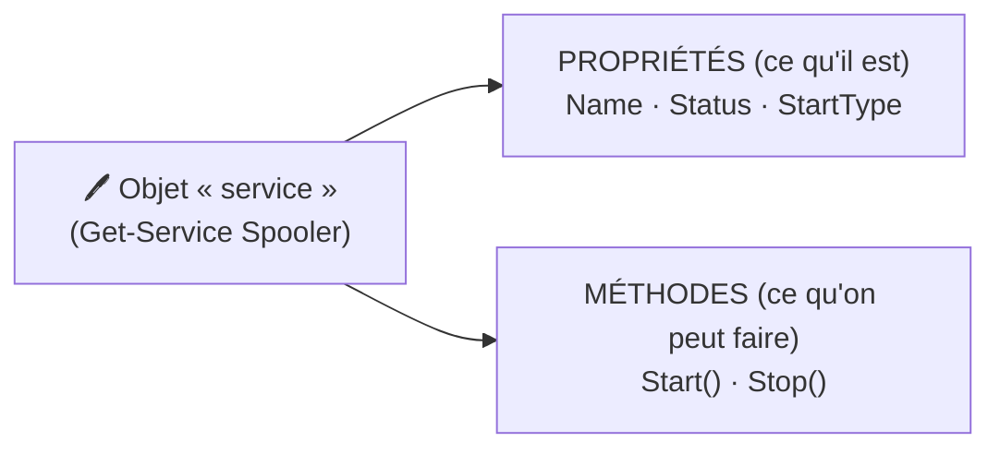
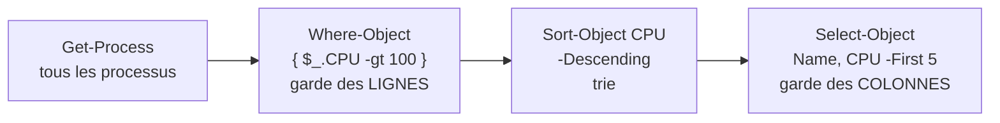

# Module 2 : Structure des commandes

*Cours : [Cours 11 - Initiation à PowerShell](../index.md)*

## 🎯 Objectif du module

Comprendre que PowerShell manipule des **objets** (propriétés et méthodes), puis **traiter** ces objets dans le **pipeline** : choisir des colonnes (`Select-Object`), trier (`Sort-Object`), compter (`Measure-Object`) et filtrer (`Where-Object`).

!!! abstract "En clair"
    En cmd ou en Bash, une commande renvoie du **texte**. En PowerShell, elle renvoie des **objets**, comme des fiches remplies : un service a un **nom**, un **état**, un **type de démarrage** (ses *propriétés*) et on peut le **démarrer** ou l'**arrêter** (ses *méthodes*). Le **pipe** `|` passe ces fiches à la commande suivante, qui peut les trier ou les filtrer **sans découper de texte**.

## 🗺️ L'essentiel en schémas

!!! info "Référentiel TSSR 2026"
    **CCP 3 · compétence 8 : Optimiser des scripts** et **CCP 1 · compétence 3** (retrouver vite une information sur un poste ou un serveur). Le pipeline est la base de toutes les commandes d'administration.

**① Un objet : des propriétés et des méthodes**



**② Le pipeline : récupérer, filtrer, trier, choisir**



## 📖 Cours consolidé

### 1. Un langage objet

| | cmd / Bash | PowerShell |
|---|---|---|
| Ce que renvoie une commande | Du **texte** | Des **objets** |
| Pour en extraire une info | Découper le texte (`cut`, `findstr`) | Demander la **propriété** (`.Name`) |

Un **objet** = des **propriétés** (caractéristiques, chacune avec un **type** de valeur) + des **méthodes** (actions). Comme un feutre : couleur, marque, taille (propriétés) ; ôter le bouchon, écrire (méthodes).

| Type | Contient |
|---|---|
| **String** | Du texte |
| **Int** | Un nombre entier |
| **Bool** | `$true` ou `$false` |
| **Array** | Un tableau de valeurs |
| **Object** | Un objet complet |

```powershell
Get-Service | Get-Member                 # type d'objet, propriétés, méthodes
(Get-Service Spooler).Status             # une propriété
(Get-Date).AddDays(1)                    # une méthode : demain
Set-Service -Name WSearch -StartupType Disabled   # le verbe Set modifie une propriété
```

### 2. Le pipe et $_

- `|` passe les objets d'une commande à la suivante, autant de fois que nécessaire.
- Dans un bloc `{ }`, l'objet en cours s'appelle **`$PSItem`**, abrégé **`$_`**.

### 3. Select-Object : choisir

```powershell
Get-Service | Select-Object -Property Name, Status     # des colonnes (alias : select)
Get-Service | Select-Object -First 5                    # les 5 premiers (ou -Last 5)
Get-Process | Select-Object -Unique Name                # sans doublons
Get-Service | Select-Object -ExpandProperty Name        # juste les valeurs, sans en-tête
```

### 4. Sort-Object : trier

```powershell
Get-Service | Sort-Object Status
Get-Process | Sort-Object Id -Descending                         # ordre décroissant
Get-ChildItem C:\Windows -File | Sort-Object Length               # du plus léger au plus lourd
```

### 5. Measure-Object : compter et calculer

```powershell
Get-Process | Measure-Object                                       # combien ?
Get-ChildItem -File | Measure-Object -Property Length -Average -Minimum -Maximum -Sum
```

### 6. Where-Object : filtrer

```powershell
Get-Service | Where-Object -Property Status -EQ "Running"          # syntaxe simple
Get-Process | Where-Object { $_.Name -like "Power*" }               # avec un bloc
Get-Process | Where-Object { $_.Id -gt 1500 -and $_.Id -lt 2000 }   # deux conditions
```

| Comparaison | Opérateur | Sensible à la casse |
|---|---|---|
| Égal / différent | `-eq` / `-ne` | `-ceq` / `-cne` |
| Plus grand / plus grand ou égal | `-gt` / `-ge` | `-cgt` / `-cge` |
| Plus petit / plus petit ou égal | `-lt` / `-le` | `-clt` / `-cle` |
| Ressemble (jokers `*`) / ne ressemble pas | `-like` / `-notlike` | `-clike` / `-cnotlike` |
| Et / ou / non | `-and` / `-or` / `-not` | |

📌 Ces outils sont aussi vus dans le [cours 2 · module 11](../../cours-02-systeme-client-microsoft/module-11-aller-plus-loin-avec-powershell/index.md).

## 📝 Fiche de révision

| Notion | À retenir |
|---|---|
| **Objet** | Propriétés (ce qu'il est) + méthodes (ce qu'il fait) |
| **Get-Member** | Liste propriétés et méthodes |
| **$_ / $PSItem** | L'objet en cours dans le pipeline |
| **Select-Object** | Colonnes, `-First`, `-Last`, `-Unique`, `-ExpandProperty` |
| **Sort-Object** | Trier, `-Descending` |
| **Measure-Object** | Compter, `-Average -Sum -Minimum -Maximum` |
| **Where-Object** | Filtrer les lignes |
| **Opérateurs** | `-eq -ne -gt -ge -lt -le -like` · `-and -or` |

### ⚠️ Les pièges

- `=` ou `==` ne comparent **pas** en PowerShell : c'est **`-eq`**.
- Les comparaisons ignorent la **casse** par défaut (`"ABC" -eq "abc"` est vrai) : `-ceq` pour la respecter.
- `-like "Power"` cherche exactement « Power » : pour « commence par », mettre `"Power*"`.
- Après un `Select-Object`, seules les propriétés gardées existent encore : filtre **avant**, ou garde la propriété testée.

### ✏️ Entraîne-toi (clique pour voir la correction)

??? question "1. Affiche les 5 processus qui consomment le plus de mémoire (propriété WorkingSet), avec leur nom."
    `Get-Process | Sort-Object WorkingSet -Descending | Select-Object Name, WorkingSet -First 5`

??? question "2. Combien de services sont arrêtés ?"
    `Get-Service | Where-Object Status -eq "Stopped" | Measure-Object` (propriété **Count** du résultat).

## 🧠 Quiz — entraîne-toi

<div id="quiz-cours-11-initiation-a-powershell-module-2-structure-des-commandes"></div>

<script type="application/json" id="quiz-cours-11-initiation-a-powershell-module-2-structure-des-commandes-data">
[
  {
    "question": "Que renvoie une cmdlet PowerShell ?",
    "options": [
      "Du texte brut",
      "Des objets avec des propriétés et des méthodes",
      "Un fichier",
      "Un code d'erreur seulement"
    ],
    "correctIndex": 1,
    "explanation": "C'est la grande différence avec cmd et Bash."
  },
  {
    "question": "Que représente $_ dans un bloc Where-Object ?",
    "options": [
      "La dernière erreur",
      "L'objet en cours dans le pipeline",
      "Le dossier courant",
      "Une variable vide"
    ],
    "correctIndex": 1,
    "explanation": "$_ est l'abréviation de $PSItem."
  },
  {
    "question": "Quel opérateur teste l'égalité en PowerShell ?",
    "options": [
      "=",
      "==",
      "-eq",
      "-is"
    ],
    "correctIndex": 2,
    "explanation": "= sert à affecter une valeur ; -eq compare."
  },
  {
    "question": "Quelle commande garde seulement certaines colonnes ?",
    "options": [
      "Where-Object",
      "Select-Object",
      "Sort-Object",
      "Measure-Object"
    ],
    "correctIndex": 1,
    "explanation": "Select-Object choisit les propriétés ; Where-Object filtre les lignes."
  },
  {
    "question": "Comment trier du plus grand au plus petit ?",
    "options": [
      "Sort-Object -Reverse",
      "Sort-Object -Descending",
      "Sort-Object -Desc:$false",
      "Order-Object"
    ],
    "correctIndex": 1,
    "explanation": "Sort-Object Propriété -Descending."
  },
  {
    "question": "Comment garder les processus dont le nom commence par « Power » ?",
    "options": [
      "Where-Object { $_.Name -eq \"Power\" }",
      "Where-Object { $_.Name -like \"Power*\" }",
      "Select-Object Power*",
      "Get-Process -Like Power"
    ],
    "correctIndex": 1,
    "explanation": "-like avec le joker * ; -eq demanderait le nom exact."
  },
  {
    "question": "Quelle commande calcule la taille moyenne des fichiers d'un dossier ?",
    "options": [
      "Get-ChildItem -File | Measure-Object -Property Length -Average",
      "Get-ChildItem | Sort-Object -Average",
      "Get-Size -Average",
      "Measure-Folder"
    ],
    "correctIndex": 0,
    "explanation": "Measure-Object compte, et calcule moyenne, somme, minimum et maximum d'une propriété."
  },
  {
    "question": "Which operator combines two conditions where both must be true?",
    "options": [
      "-or",
      "-and",
      "-not",
      "&&"
    ],
    "correctIndex": 1,
    "explanation": "-and : les deux conditions doivent être vraies."
  }
]
</script>

<script>
  document.addEventListener("DOMContentLoaded", function () {
    TSSRQuiz.init({
      containerId: "quiz-cours-11-initiation-a-powershell-module-2-structure-des-commandes",
      dataId: "quiz-cours-11-initiation-a-powershell-module-2-structure-des-commandes-data",
    });
  });
</script>
