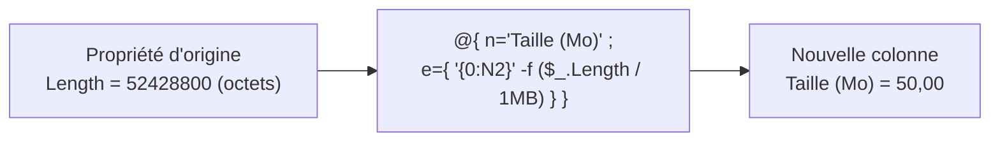
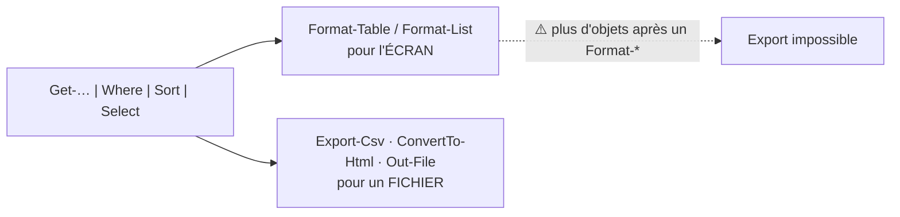

# Module 3 : Propriétés calculées

*Cours : [Cours 11 - Initiation à PowerShell](../index.md)*

## 🎯 Objectif du module

**Présenter** et **exporter** le résultat d'une commande (`Format-Table`, `Format-List`, `Export-Csv`, `Out-File`), **lire** et **importer** des fichiers (`Get-Content`, `Import-Csv`), et créer des **propriétés calculées** pour renommer une colonne ou convertir une valeur.

!!! abstract "En clair"
    Une **propriété calculée** est une colonne que tu **inventes** à partir d'une autre : renommer `Length` en `Taille (Mo)` et convertir les octets en mégaoctets, par exemple. C'est aussi la solution quand les colonnes d'un fichier CSV ne portent pas le nom attendu par une commande.

## 🗺️ L'essentiel en schémas

!!! info "Référentiel TSSR 2026"
    **CCP 3 · compétence 8 : Optimiser des scripts** et **compétence 10 : Superviser** (produire des rapports lisibles : espace disque, services, comptes).

**① Une propriété calculée**



**② Afficher ou exporter : toujours en dernier**



## 📖 Cours consolidé

### 1. Mettre en forme pour l'écran

```powershell
Get-Service | Format-Table Name, Status -AutoSize      # tableau, colonnes au choix
Get-Service | Format-Table -GroupBy Status              # regrouper par valeur
Get-Service | Format-Table -Wrap                         # retour à la ligne au lieu de couper
Get-Service | Format-Table -HideTableHeaders             # sans les en-têtes
Get-Service | Format-Wide -Column 4                      # une seule propriété, en colonnes
Get-LocalUser | Format-List Name, Enabled, LastLogon     # une fiche par objet
```

⚠️ Une commande `Format-*` produit de l'**affichage**, plus des objets : elle se met **en dernier**.

### 2. Exporter

```powershell
Get-LocalUser | Export-Csv C:\Rapports\users.csv -Delimiter ";" -NoTypeInformation -Encoding UTF8
Get-Service | ConvertTo-Html | Out-File C:\Rapports\services.html
Get-Service | ConvertTo-Json | Out-File C:\Rapports\services.json
Get-Service | Out-File C:\Rapports\services.txt               # texte (comme >)
Get-Date    | Out-File C:\Rapports\journal.txt -Append        # ajouter à la fin (comme >>)
```

- `-Delimiter ";"` : le séparateur attendu par Excel en français.
- `-NoTypeInformation` : sans la ligne `#TYPE` en tête (c'est le comportement par défaut de PowerShell 7).
- Formats gérés nativement : **CSV**, **CliXML**, **JSON**, **HTML**. Pour Excel, le module **ImportExcel**.

### 3. Lire et importer

```powershell
Get-Content C:\Rapports\journal.txt              # afficher un fichier (alias : cat)
Get-Content C:\Rapports\journal.txt -Tail 10     # les 10 dernières lignes
Import-Csv C:\Rapports\users.csv -Delimiter ";"  # chaque ligne devient un OBJET
```

### 4. Les propriétés calculées

Syntaxe : `@{ n = 'Nouveau nom' ; e = { expression } }` (`n` pour *Name*, `e` pour *Expression*).

```powershell
# Taille des fichiers en Mo, avec 2 décimales
Get-ChildItem -File | Select-Object Name, @{ n='Taille (Mo)'; e={ '{0:N2}' -f ($_.Length / 1MB) } }

# Espace disque par volume, en Go
Get-Volume | Select-Object DriveLetter,
    @{ n='Taille (Go)';       e={ '{0:N2}' -f ($_.Size / 1GB) } },
    @{ n='Espace libre (Go)'; e={ '{0:N2}' -f ($_.SizeRemaining / 1GB) } }
```

- `1KB`, `1MB`, `1GB`, `1TB` sont compris par PowerShell.
- `'{0:N2}' -f valeur` = un nombre avec **2 décimales**.

**Adapter un CSV à une commande** : si le CSV a une colonne `nom` mais que la commande attend `Name`, on **renomme** avec une propriété calculée avant le pipe :

```powershell
Import-Csv users.csv -Delimiter ";" | Select-Object @{ n='Name'; e={ $_.nom } }, @{ n='GivenName'; e={ $_.prenom } } | New-ADUser
```

## 📝 Fiche de révision

| Commande | Rôle |
|---|---|
| `Format-Table` · `Format-List` · `Format-Wide` | Afficher en tableau, en fiche, en colonnes |
| `Export-Csv -Delimiter ";" -NoTypeInformation` | Exporter pour Excel |
| `ConvertTo-Html` / `ConvertTo-Json` + `Out-File` | Rapport web / JSON |
| `Out-File -Append` | Écrire / ajouter dans un fichier texte |
| `Get-Content -Tail 10` | Lire un fichier, ses dernières lignes |
| `Import-Csv` | Un CSV → des objets |
| `@{ n='…'; e={…} }` | Propriété calculée |
| `'{0:N2}' -f ($_.Length / 1MB)` | Conversion en Mo, 2 décimales |

### ⚠️ Les pièges

- `Format-Table | Export-Csv` : le fichier contient des **informations d'affichage**, pas tes données. Exporte **sans** `Format-*`.
- Oublier `-Delimiter ";"` : Excel en français affiche tout dans une seule colonne.
- Dans une propriété calculée, l'expression va **entre accolades** : `e={ … }`.
- `1MB` en PowerShell = **1 048 576** octets (base 1024).

### ✏️ Entraîne-toi (clique pour voir la correction)

??? question "1. Exporte la liste des services arrêtés (nom et nom affiché) dans C:\Rapports\arretes.csv, lisible dans Excel."
    `Get-Service | Where-Object Status -eq "Stopped" | Select-Object Name, DisplayName | Export-Csv C:\Rapports\arretes.csv -Delimiter ";" -NoTypeInformation -Encoding UTF8`

??? question "2. Affiche les 5 plus gros fichiers de C:\Windows avec leur taille en Mo."
    `Get-ChildItem C:\Windows -File | Sort-Object Length -Descending | Select-Object Name, @{ n='Mo'; e={ '{0:N2}' -f ($_.Length / 1MB) } } -First 5`

## 🧠 Quiz — entraîne-toi

<div id="quiz-cours-11-initiation-a-powershell-module-3-proprietes-calculees"></div>

<script type="application/json" id="quiz-cours-11-initiation-a-powershell-module-3-proprietes-calculees-data">
[
  {
    "question": "Quelle est la syntaxe d'une propriété calculée ?",
    "options": [
      "[n='Nom', e=expression]",
      "@{ n='Nom'; e={ expression } }",
      "$prop = Nom + expression",
      "Calc-Property"
    ],
    "correctIndex": 1,
    "explanation": "Une table de hachage avec n (le nom) et e (l'expression entre accolades)."
  },
  {
    "question": "Pourquoi ne faut-il pas mettre Format-Table avant Export-Csv ?",
    "options": [
      "Format-Table est trop lent",
      "Format-Table produit de l'affichage, plus des objets : le CSV serait inutilisable",
      "Export-Csv refuse les tableaux",
      "C'est permis"
    ],
    "correctIndex": 1,
    "explanation": "Les commandes Format-* se mettent toujours en dernier, pour l'écran."
  },
  {
    "question": "Quel paramètre d'Export-Csv supprime la ligne #TYPE en tête du fichier ?",
    "options": [
      "-NoHeader",
      "-NoTypeInformation",
      "-Clean",
      "-Raw"
    ],
    "correctIndex": 1,
    "explanation": "Utile avec Windows PowerShell 5.1 ; PowerShell 7 ne l'ajoute plus par défaut."
  },
  {
    "question": "Que fait Import-Csv ?",
    "options": [
      "Il affiche le fichier en texte",
      "Il transforme chaque ligne du CSV en objet",
      "Il supprime le fichier",
      "Il convertit en Excel"
    ],
    "correctIndex": 1,
    "explanation": "Les en-têtes deviennent les noms des propriétés."
  },
  {
    "question": "Comment afficher les 10 dernières lignes d'un fichier ?",
    "options": [
      "Get-Content f.txt -Last",
      "Get-Content f.txt -Tail 10",
      "Out-File -Tail 10",
      "Select-Object -Tail 10"
    ],
    "correctIndex": 1,
    "explanation": "Get-Content -Tail, comme tail sous Linux."
  },
  {
    "question": "Comment ajouter du texte à la fin d'un fichier sans l'écraser ?",
    "options": [
      "Out-File -Append",
      "Out-File -Force",
      "Export-Csv -Add",
      "Set-Content -End"
    ],
    "correctIndex": 0,
    "explanation": "-Append ajoute, comme >> ; sans lui, Out-File écrase, comme >."
  },
  {
    "question": "What does '{0:N2}' -f 3.14159 return?",
    "options": [
      "3",
      "3.14 (ou 3,14 selon la langue)",
      "3.14159",
      "N2"
    ],
    "correctIndex": 1,
    "explanation": "Le format N2 affiche le nombre avec 2 décimales."
  }
]
</script>

<script>
  document.addEventListener("DOMContentLoaded", function () {
    TSSRQuiz.init({
      containerId: "quiz-cours-11-initiation-a-powershell-module-3-proprietes-calculees",
      dataId: "quiz-cours-11-initiation-a-powershell-module-3-proprietes-calculees-data",
    });
  });
</script>
