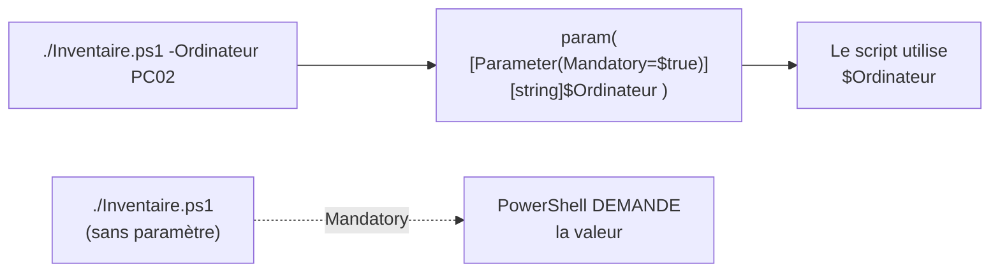
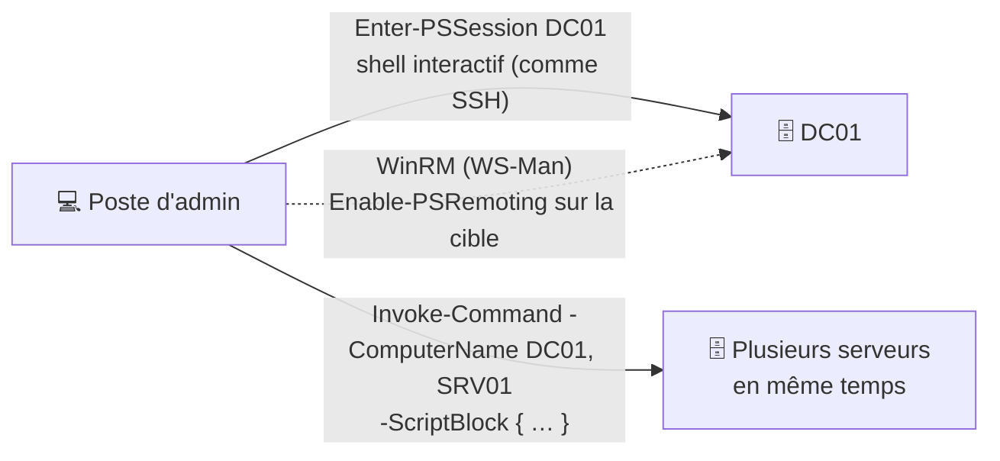

# Module 4 : Passage de paramètres

*Cours : [Cours 11 - Initiation à PowerShell](../index.md)*

## 🎯 Objectif du module

Écrire un **vrai script** PowerShell : préparer l'algorithme, utiliser un **éditeur** (VS Code, ISE), **commenter**, créer des **fonctions** et des **scripts avec paramètres** (`param()`, paramètres obligatoires), demander des **identifiants**, et **exécuter à distance** (PowerShell Remoting).

!!! abstract "En clair"
    Un script qui contient `"PC01"` en dur ne sert qu'à PC01. Avec un **paramètre** (`./Inventaire.ps1 -Ordinateur PC02`), le même script sert à **tout le parc**. Et avec le **Remoting**, une seule commande s'exécute sur **plusieurs serveurs** à la fois.

## 🗺️ L'essentiel en schémas

!!! info "Référentiel TSSR 2026"
    **CCP 3 · compétence 8 : Optimiser des scripts à l'aide de l'intelligence artificielle.** Paramètres, fonctions et exécution à distance sont exactement ce qu'on cherche à améliorer dans un script ; l'IA peut aider à les écrire, à toi de les **tester**.

**① Un script paramétré**



**② Travailler sur des machines distantes**



## 📖 Cours consolidé

### 1. Préparer avant d'écrire

Comme en Bash ([cours 10 · module 1](../../cours-10-initiation-au-scripting-bash/module-1-analyse/index.md)) : définir l'**utilité**, le **fonctionnement attendu**, puis un **algorithme** (actions, tests, vérifications, boucles, dans l'ordre). Le script parfait n'existe pas du premier coup : on **teste ligne par ligne** et on améliore.

### 2. L'éditeur

| Éditeur | Points forts |
|---|---|
| **Windows PowerShell ISE** | Installé avec Windows (depuis la v3), console intégrée, IntelliSense, coloration, *snippets*, erreurs en direct · **plus développé** et limité à Windows PowerShell 5.1 |
| **Visual Studio Code** + extension PowerShell | Gratuit, Windows/Linux/macOS, PowerShell 7, **débogueur**, Git… : c'est l'outil **recommandé** aujourd'hui |

### 3. Commentaires et lignes longues

```powershell
# Commentaire sur une ligne
Get-Service   # commentaire en fin de commande
<#
   Bloc de commentaires
   sur plusieurs lignes
#>
Get-Date ; Get-Location                       # deux commandes sur une ligne
Get-ChildItem -Path C:\Windows `
    -Filter *.log -Recurse                    # ` (backtick, Alt Gr + 7) : la commande continue à la ligne suivante
```

### 4. Les fonctions

```powershell
function Get-Addition {
    param([int]$a, [int]$b)
    $a + $b                  # la valeur est RENVOYÉE (pas besoin de Write-Host)
}
Get-Addition -a 1 -b 2       # → 3
```

- Une fonction se **déclare avant** d'être appelée, en général en **début** de script.
- Donne-lui un **nom explicite**, idéalement **Verbe-Nom** comme les cmdlets.
- Elle s'appelle **comme une commande**, avec ses paramètres.

### 5. Les paramètres d'un script

Un bloc `param()` placé **en tête** du fichier `.ps1` :

```powershell
param(
    [Parameter(Mandatory=$true)]   # obligatoire : demandé s'il manque
    [string]$Ordinateur,           # type : texte uniquement
    [int]$Jours = 7                # facultatif, avec une valeur par défaut
)
Write-Host "Inventaire de $Ordinateur sur $Jours jours"
```

```powershell
./Inventaire.ps1 -Ordinateur PC02 -Jours 30
```

### 6. S'authentifier dans un script

On travaille avec un compte **aux droits réduits** ; pour une action d'administration, le script **demande** les identifiants :

```powershell
$Cred = Get-Credential -Message "Compte administrateur du domaine" -UserName ENTREPRISE\Administrateur
Invoke-Command -ComputerName DC01 -Credential $Cred -ScriptBlock { Get-ADUser -Filter * }
```

Le mot de passe est stocké **chiffré** dans l'objet, jamais en clair dans le script.

### 7. PowerShell Remoting

- Repose sur **WinRM** (protocole **WS-Man**). **Actif par défaut sur les serveurs** depuis Windows Server 2012, **désactivé sur les postes clients** : `Enable-PSRemoting` (ou par GPO).

```powershell
Enter-PSSession -ComputerName DC01        # le prompt devient [DC01] PS>
Exit-PSSession

$s = New-PSSession -ComputerName DC01     # session réutilisable
Invoke-Command -Session $s -ScriptBlock { Get-Service }
Get-PSSession | Remove-PSSession          # fermer

Invoke-Command -ComputerName DC01, SRV01 -ScriptBlock { Get-Process powershell* }   # plusieurs machines
$motif = "powershell*"
Invoke-Command -ComputerName DC01 -ScriptBlock { Get-Process $Using:motif }          # passer une variable locale
```

- Par défaut, pas de **rebond** (se connecter à DC01 puis, de là, à une 3ᵉ machine).
- On peut **importer** les commandes d'un module d'une machine distante sans l'installer localement : `Import-Module -PSSession $s -Name ActiveDirectory -Prefix DC`, puis `Get-DCADUser`.

## 📝 Fiche de révision

| Notion | À retenir |
|---|---|
| **Éditeur** | VS Code + extension PowerShell (ISE = ancien, Windows PowerShell seulement) |
| **Commentaires** | `#` · `<# … #>` |
| **Continuer une ligne** | `` ` `` (backtick) |
| **Fonction** | `function Verbe-Nom { param(…) … }` |
| **Paramètres de script** | `param([Parameter(Mandatory=$true)][string]$Nom)` |
| **Identifiants** | `Get-Credential` |
| **Remoting** | WinRM · `Enable-PSRemoting` |
| **Session interactive** | `Enter-PSSession` / `Exit-PSSession` |
| **Plusieurs machines** | `Invoke-Command -ComputerName A, B -ScriptBlock { }` |
| **Variable locale à distance** | `$Using:variable` |

### ⚠️ Les pièges

- Le bloc `param()` doit être la **première instruction** du script (après les commentaires).
- Ne **jamais** écrire un mot de passe en clair dans un script : `Get-Credential`.
- Dans un `-ScriptBlock`, une variable locale est **inconnue** de la machine distante : `$Using:variable`.
- Remoting vers un **poste client** : il faut d'abord `Enable-PSRemoting` sur ce poste.

### ✏️ Entraîne-toi (clique pour voir la correction)

??? question "1. Écris Espace.ps1 : il reçoit obligatoirement une lettre de lecteur et affiche son espace libre en Go."
    ```powershell
    param([Parameter(Mandatory=$true)][string]$Lettre)
    $v = Get-Volume -DriveLetter $Lettre
    '{0:N2} Go libres sur {1}:' -f ($v.SizeRemaining / 1GB), $Lettre
    ```

??? question "2. Affiche l'état du service Spooler sur SRV01 et SRV02 en une commande."
    `Invoke-Command -ComputerName SRV01, SRV02 -ScriptBlock { Get-Service Spooler }`

## 🧠 Quiz — entraîne-toi

<div id="quiz-cours-11-initiation-a-powershell-module-4-passage-de-parametres"></div>

<script type="application/json" id="quiz-cours-11-initiation-a-powershell-module-4-passage-de-parametres-data">
[
  {
    "question": "Comment rendre un paramètre de script obligatoire ?",
    "options": [
      "[Required]$Nom",
      "[Parameter(Mandatory=$true)][string]$Nom",
      "param($Nom = obligatoire)",
      "-Force"
    ],
    "correctIndex": 1,
    "explanation": "S'il manque, PowerShell demande la valeur à l'exécution."
  },
  {
    "question": "À quoi sert Get-Credential ?",
    "options": [
      "À afficher les mots de passe",
      "À demander un identifiant et un mot de passe et les stocker de façon sécurisée",
      "À créer un compte",
      "À désactiver l'UAC"
    ],
    "correctIndex": 1,
    "explanation": "L'objet obtenu se passe au paramètre -Credential d'autres commandes."
  },
  {
    "question": "Quelle commande exécute un bloc de commandes sur plusieurs serveurs à la fois ?",
    "options": [
      "Enter-PSSession",
      "Invoke-Command -ComputerName A, B -ScriptBlock { … }",
      "Start-Process",
      "New-Item"
    ],
    "correctIndex": 1,
    "explanation": "Enter-PSSession ouvre un shell interactif sur une seule machine."
  },
  {
    "question": "Sur quel service repose le PowerShell Remoting ?",
    "options": [
      "SSH uniquement",
      "WinRM (protocole WS-Man)",
      "SMB",
      "RDP"
    ],
    "correctIndex": 1,
    "explanation": "Actif par défaut sur les serveurs, à activer avec Enable-PSRemoting sur les postes clients."
  },
  {
    "question": "Comment utiliser une variable locale dans un -ScriptBlock exécuté à distance ?",
    "options": [
      "$Global:var",
      "$Using:var",
      "$Remote:var",
      "Elle est transmise automatiquement"
    ],
    "correctIndex": 1,
    "explanation": "Sans $Using:, la variable n'existe pas sur la machine distante."
  },
  {
    "question": "Comment écrire un bloc de commentaires sur plusieurs lignes ?",
    "options": [
      "/* … */",
      "<# … #>",
      "## … ##",
      "-- … --"
    ],
    "correctIndex": 1,
    "explanation": "# pour une ligne, <# … #> pour un bloc."
  },
  {
    "question": "Quel caractère permet de continuer une commande sur la ligne suivante ?",
    "options": [
      "\\",
      "` (backtick)",
      "&",
      "+"
    ],
    "correctIndex": 1,
    "explanation": "Le backtick (Alt Gr + 7) en fin de ligne."
  },
  {
    "question": "Which cmdlet opens an interactive session on a remote computer?",
    "options": [
      "Invoke-Command",
      "Enter-PSSession",
      "Connect-Computer",
      "Open-Remote"
    ],
    "correctIndex": 1,
    "explanation": "Enter-PSSession DC01 ; on en sort avec Exit-PSSession."
  }
]
</script>

<script>
  document.addEventListener("DOMContentLoaded", function () {
    TSSRQuiz.init({
      containerId: "quiz-cours-11-initiation-a-powershell-module-4-passage-de-parametres",
      dataId: "quiz-cours-11-initiation-a-powershell-module-4-passage-de-parametres-data",
    });
  });
</script>
