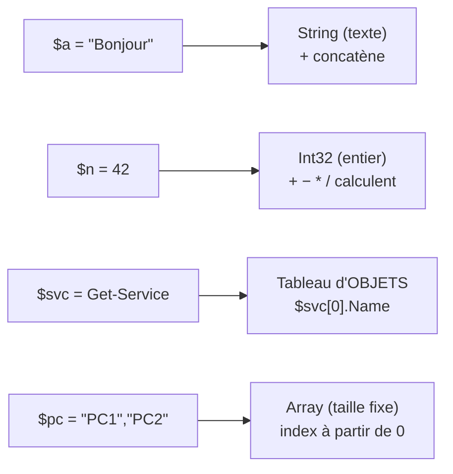
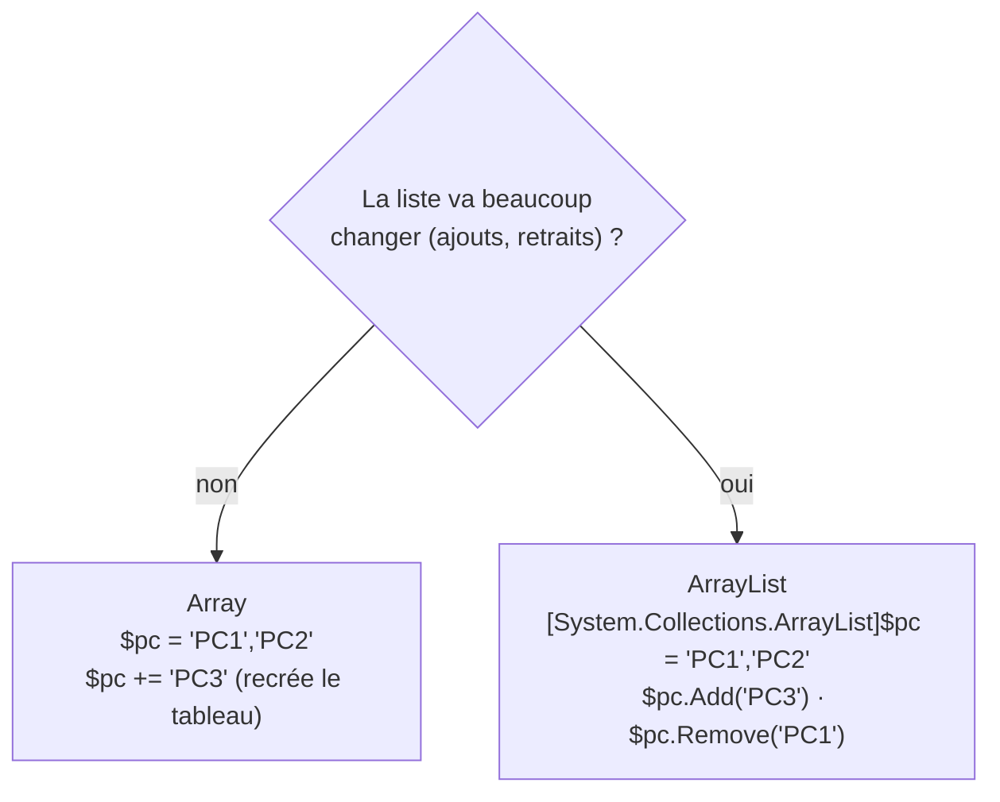

# Module 5 : Les variables

*Cours : [Cours 11 - Initiation à PowerShell](../index.md)*

## 🎯 Objectif du module

Utiliser des **variables** : les créer, connaître leur **type**, y stocker du **texte**, des **nombres**, des **objets**, des **tableaux** (Array, ArrayList), et récupérer une **saisie** avec `Read-Host`.

!!! abstract "En clair"
    En PowerShell, une variable commence toujours par **`$`** et peut contenir **n'importe quoi** : un texte, un nombre, ou le résultat complet d'une commande. `$users = Get-LocalUser` range **tous les comptes** dans `$users` : on peut ensuite lire `$users[0].Name` sans relancer la commande.

## 🗺️ L'essentiel en schémas

!!! info "Référentiel TSSR 2026"
    **CCP 3 · compétence 8 : Optimiser des scripts.** Bien nommer et bien typer ses variables rend un script lisible et évite les erreurs de calcul.

**① Une variable contient ce qu'on lui donne**



**② Array ou ArrayList ?**



## 📖 Cours consolidé

### 1. Créer et lire une variable

```powershell
$a = 1                         # Int
$a = "Bonjour"                 # String : le type suit la valeur
$users = Get-LocalUser         # des objets
$a.GetType()                   # le type de la variable
Get-Variable                   # toutes les variables de la session
```

- Une variable garde sa valeur **jusqu'à ce qu'on la change** ou qu'on **ferme la console**.
- Donne des noms **explicites** : `$LogFile`, `$NbUtilisateurs`.
- On peut **forcer** un type : `[int]$age = "30"` (converti en nombre).

### 2. Saisie et affichage

```powershell
$choix = Read-Host "Veuillez saisir votre choix"
Write-Host "Voici votre choix : $choix"                # variable remplacée dans les guillemets DOUBLES
Write-Host 'Voici votre choix : $choix'                # guillemets simples : texte brut
$mdp = Read-Host "Mot de passe" -AsSecureString        # saisie masquée
```

### 3. Variables contenant des objets

```powershell
$services = Get-Service
$services                        # tout afficher
$services.Name                   # la propriété Name de tous les objets
$services[2]                     # le 3e objet (on compte à partir de 0)
$services[3].Stop()              # appeler une méthode sur le 4e
$date = (Get-Date).ToString("yyyyMMdd")   # méthode de conversion : $date est un texte, ex. 20261121
"Utilisateur : $($users[0].Name)"         # $( ) pour une propriété dans un texte
```

### 4. Texte et nombres

```powershell
$c = "abc" + "def"          # "abcdef" : concaténation de textes
$n = 1 + 2                  # 3 : addition de nombres
$e = (Get-Process)[1].Id - (Get-Process)[2].Id
```

⚠️ On n'additionne que des valeurs de **même type** : `"5" + 3` donne `"53"` (texte), `3 + "5"` donne `8`.

### 5. Les tableaux

```powershell
$pc = "PC1", "PC2", "PC3"        # Array : séparateur virgule
$pc[1]                            # PC2
$pc += "PC4"                      # ajout (PowerShell recrée le tableau)
$pc.Count                         # 4

[System.Collections.ArrayList]$machines = "PC1", "PC2"   # ArrayList : taille variable
$machines.Add("PC3") | Out-Null                           # Add renvoie l'index : on le masque
$machines.Remove("PC2")
```

`Get-Help about_Arrays` explique tout sur les tableaux.

### 6. Les variables d'environnement et automatiques

| Variable | Contient |
|---|---|
| `$env:USERNAME` · `$env:COMPUTERNAME` · `$env:PATH` | Variables d'**environnement** de Windows |
| `$true` · `$false` · `$null` | Vrai, faux, vide |
| `$_` | L'objet en cours dans le pipeline |
| `$Error` | Les erreurs de la session ([module 7](../module-7-gestion-des-erreurs/index.md)) |
| `$PROFILE` · `$HOME` | Le profil, le dossier personnel |

## 📝 Fiche de révision

| Notion | À retenir |
|---|---|
| **Créer** | `$nom = valeur` |
| **Type** | `$var.GetType()` · forcer : `[int]$x` |
| **Saisie** | `Read-Host "Question"` (`-AsSecureString` pour masquer) |
| **Afficher** | `Write-Host "Texte $var"` (guillemets doubles) |
| **Propriété dans un texte** | `"$($obj.Name)"` |
| **Objet n° x** | `$var[x]`, à partir de 0 |
| **Array** | `$t = "a","b"` · `$t += "c"` · `$t.Count` |
| **ArrayList** | `.Add()` · `.Remove()` |
| **Environnement** | `$env:COMPUTERNAME` |

### ⚠️ Les pièges

- Les tableaux commencent à **0** : `$t[1]` est le **2ᵉ** élément.
- `'$var'` (guillemets simples) n'est **pas** remplacé.
- `"Nom : $user.Name"` affiche l'objet puis `.Name` : écrire `"Nom : $($user.Name)"`.
- `"5" + 3` = `"53"` : attention aux **types**.

### ✏️ Entraîne-toi (clique pour voir la correction)

??? question "1. Demande un prénom et affiche « Bonjour <prénom>, nous sommes le <date du jour au format jj/MM/aaaa> »."
    ```powershell
    $prenom = Read-Host "Votre prénom"
    $jour = (Get-Date).ToString("dd/MM/yyyy")
    Write-Host "Bonjour $prenom, nous sommes le $jour"
    ```

??? question "2. Range les utilisateurs locaux dans une variable et affiche le nom du premier et le nombre total."
    ```powershell
    $users = Get-LocalUser
    $users[0].Name
    $users.Count
    ```

## 🧠 Quiz — entraîne-toi

<div id="quiz-cours-11-initiation-a-powershell-module-5-les-variables"></div>

<script type="application/json" id="quiz-cours-11-initiation-a-powershell-module-5-les-variables-data">
[
  {
    "question": "Par quel caractère commence une variable PowerShell ?",
    "options": [
      "%",
      "$",
      "@",
      "#"
    ],
    "correctIndex": 1,
    "explanation": "Exemples : $a, $users, $env:USERNAME."
  },
  {
    "question": "Comment connaître le type d'une variable ?",
    "options": [
      "$var.Type",
      "$var.GetType()",
      "typeof $var",
      "Get-Type $var"
    ],
    "correctIndex": 1,
    "explanation": "La méthode GetType() renvoie le type (.NET) de la valeur."
  },
  {
    "question": "$t = 'PC1','PC2','PC3'. Que vaut $t[1] ?",
    "options": [
      "PC1",
      "PC2",
      "PC3",
      "Une erreur"
    ],
    "correctIndex": 1,
    "explanation": "Les index commencent à 0."
  },
  {
    "question": "Comment récupérer une saisie de l'utilisateur ?",
    "options": [
      "Read-Host",
      "Get-Input",
      "Write-Host -Input",
      "Input-Box"
    ],
    "correctIndex": 0,
    "explanation": "$x = Read-Host \"Question\" ; -AsSecureString masque la saisie."
  },
  {
    "question": "Que donne \"5\" + 3 en PowerShell ?",
    "options": [
      "8",
      "\"53\"",
      "Une erreur",
      "\"8\""
    ],
    "correctIndex": 1,
    "explanation": "Le premier élément est un texte : PowerShell concatène."
  },
  {
    "question": "Quelle est l'avantage d'une ArrayList sur un Array ?",
    "options": [
      "Elle est plus courte à écrire",
      "Sa taille est variable : Add() et Remove() sont faciles",
      "Elle ne contient que du texte",
      "Elle commence à l'index 1"
    ],
    "correctIndex": 1,
    "explanation": "Un Array a une taille fixe : += recrée tout le tableau."
  },
  {
    "question": "Comment afficher le nom de l'ordinateur ?",
    "options": [
      "$env:COMPUTERNAME",
      "$COMPUTERNAME",
      "%COMPUTERNAME%",
      "Get-Name"
    ],
    "correctIndex": 0,
    "explanation": "$env: donne accès aux variables d'environnement de Windows."
  },
  {
    "question": "In PowerShell, which quotes allow variables to be expanded inside a string?",
    "options": [
      "Single quotes 'text'",
      "Double quotes \"text\"",
      "Backticks",
      "None"
    ],
    "correctIndex": 1,
    "explanation": "\"Bonjour $nom\" remplace $nom ; 'Bonjour $nom' l'affiche tel quel."
  }
]
</script>

<script>
  document.addEventListener("DOMContentLoaded", function () {
    TSSRQuiz.init({
      containerId: "quiz-cours-11-initiation-a-powershell-module-5-les-variables",
      dataId: "quiz-cours-11-initiation-a-powershell-module-5-les-variables-data",
    });
  });
</script>
