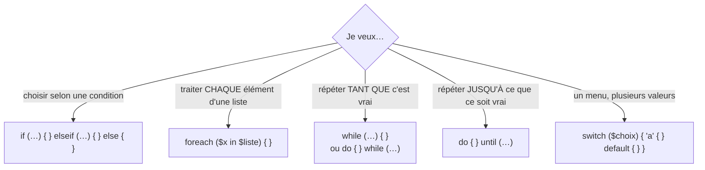
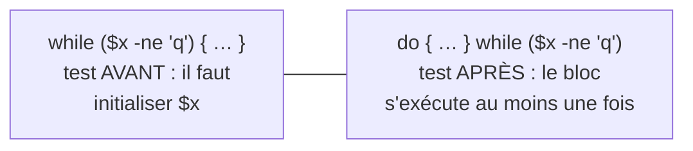

# Module 6 : Les structures de contrôle

*Cours : [Cours 11 - Initiation à PowerShell](../index.md)*

## 🎯 Objectif du module

Utiliser les **structures de contrôle** : la condition **`if` / `elseif` / `else`**, les boucles **`while`**, **`do while`**, **`do until`**, **`foreach`**, et le menu **`switch`**, avec `break` et `continue`.

!!! abstract "En clair"
    Mêmes idées qu'en Bash ([cours 10](../../cours-10-initiation-au-scripting-bash/module-6-execution-conditionnelle/index.md)), autre écriture : en PowerShell, la **condition** se met entre **parenthèses** `( )` et les **actions** entre **accolades** `{ }`. `foreach` est la boucle reine : elle parcourt une liste d'objets (utilisateurs, PC, services…).

## 🗺️ L'essentiel en schémas

!!! info "Référentiel TSSR 2026"
    **CCP 3 · compétence 8 : Optimiser des scripts.** Les conditions et les boucles transforment une suite de commandes en un **outil** qui s'adapte à chaque cas.

**① Quelle structure choisir ?**



**② while ou do while ?**



## 📖 Cours consolidé

### 1. if, elseif, else

```powershell
if ($x -eq $y) {
    Write-Host "Le test est vrai"
}
elseif ($x -eq $z) {
    Write-Host "Le second test est vrai"
}
else {
    Write-Host "Aucun test n'est vrai"
}
```

La condition renvoie `$true` ou `$false` ; on utilise les opérateurs `-eq -ne -gt -ge -lt -le -like -and -or -not` ([module 2](../module-2-structure-des-commandes/index.md)).

### 2. Les boucles conditionnelles

```powershell
$x = "A"                                   # initialiser, sinon on n'entre jamais dans la boucle
while ($x -ne "q") {
    $x = Read-Host "Votre choix (q pour quitter)"
}

do {
    $x = Read-Host "Votre choix (q pour quitter)"
} while ($x -ne "q")                       # test en FIN : au moins un passage

do {
    $x = Read-Host "Votre choix (q pour quitter)"
} until ($x -eq "q")                       # s'arrête quand la condition devient VRAIE
```

### 3. foreach : pour chaque élément

```powershell
$liste = "PC1", "PC2", "PC3"
foreach ($pc in $liste) {
    Write-Host "Le nom de la machine est $pc"
}

foreach ($u in Get-LocalUser) {
    Write-Host "$($u.Name) : actif = $($u.Enabled)"
}
```

| Mot-clé | Effet |
|---|---|
| `continue` | Passe **directement** à l'élément suivant |
| `break` | **Sort** de la boucle |

```powershell
foreach ($pc in $liste) {
    if ($pc -eq "PC2") { continue }        # on saute PC2
    Write-Host $pc
}
```

💡 Dans un pipeline, l'équivalent est `ForEach-Object` : `Get-LocalUser | ForEach-Object { $_.Name }`.

### 4. switch : le menu

```powershell
switch ($choix) {
    "1"     { Write-Host "Sauvegarde" }
    "2"     { Write-Host "Restauration" }
    "q"     { Write-Host "Au revoir" ; break }
    default { Write-Host "Choix invalide" }
}
```

- `default` = toutes les autres valeurs.
- Si **plusieurs** cas correspondent, **tous** sont exécutés : `break` arrête le `switch`.
- `switch -Wildcard` accepte les jokers (`"PC*"`).

### 5. Imbriquer

Les structures s'imbriquent ; ce sont les **accolades** qui délimitent chaque bloc. Indente ton code pour t'y retrouver.

```powershell
do {
    $x = [int](Read-Host "Saisissez un nombre")
    if ($x -gt 10) {
        switch ($x) {
            11 { Write-Host "La valeur est 11" }
            12 { Write-Host "La valeur est 12" }
        }
    }
    else { Write-Host "Saisissez une valeur supérieure à 10" }
} while ($x -lt 100)
```

## 📝 Fiche de révision

| Structure | Syntaxe |
|---|---|
| **if** | `if (cond) { } elseif (cond) { } else { }` |
| **while** | `while (cond) { }` (test avant) |
| **do while** | `do { } while (cond)` (test après) |
| **do until** | `do { } until (cond)` (s'arrête quand c'est vrai) |
| **foreach** | `foreach ($x in $liste) { }` |
| **ForEach-Object** | `…` **\|** `ForEach-Object { $_ }` |
| **switch** | `switch ($v) { 'a' { } default { } }` |
| **break / continue** | Sortir / élément suivant |

### ⚠️ Les pièges

- `if ($x = 5)` **affecte** 5 au lieu de comparer : écrire `-eq`.
- `while` avec une variable **non initialisée** : on n'entre jamais dans la boucle.
- `switch` exécute **tous** les cas qui correspondent : pense à `break`.
- Une accolade **oubliée** décale toute la logique du script.

### ✏️ Entraîne-toi (clique pour voir la correction)

??? question "1. Pour chaque service arrêté dont le nom commence par « Win », affiche « <nom> est arrêté »."
    ```powershell
    foreach ($s in Get-Service -Name Win*) {
        if ($s.Status -eq "Stopped") { Write-Host "$($s.Name) est arrêté" }
    }
    ```

??? question "2. Écris un menu qui tourne jusqu'à ce qu'on tape q : 1 affiche la date, 2 le nom de l'ordinateur."
    ```powershell
    do {
        $c = Read-Host "1) date  2) nom du PC  q) quitter"
        switch ($c) {
            "1" { Get-Date }
            "2" { $env:COMPUTERNAME }
            "q" { break }
            default { Write-Host "Choix invalide" }
        }
    } until ($c -eq "q")
    ```

## 🧠 Quiz — entraîne-toi

<div id="quiz-cours-11-initiation-a-powershell-module-6-les-structures-de-controle"></div>

<script type="application/json" id="quiz-cours-11-initiation-a-powershell-module-6-les-structures-de-controle-data">
[
  {
    "question": "Où se met la condition d'un if en PowerShell ?",
    "options": [
      "Entre crochets [ ]",
      "Entre parenthèses ( )",
      "Entre accolades { }",
      "Après then"
    ],
    "correctIndex": 1,
    "explanation": "if (condition) { actions } : parenthèses pour la condition, accolades pour les actions."
  },
  {
    "question": "Quelle boucle exécute son bloc au moins une fois ?",
    "options": [
      "while",
      "do while",
      "foreach",
      "switch"
    ],
    "correctIndex": 1,
    "explanation": "do { } while (…) teste la condition à la fin."
  },
  {
    "question": "Quelle structure parcourt chaque élément d'une liste ?",
    "options": [
      "switch",
      "foreach",
      "if",
      "until"
    ],
    "correctIndex": 1,
    "explanation": "foreach ($x in $liste) { … }."
  },
  {
    "question": "Que fait continue dans un foreach ?",
    "options": [
      "Il sort de la boucle",
      "Il passe directement à l'élément suivant",
      "Il recommence la boucle",
      "Il arrête le script"
    ],
    "correctIndex": 1,
    "explanation": "break sort de la boucle ; continue passe au suivant."
  },
  {
    "question": "Dans un switch, que signifie default ?",
    "options": [
      "La première valeur",
      "Toutes les valeurs qui n'ont pas de cas prévu",
      "Une erreur",
      "La valeur 0"
    ],
    "correctIndex": 1,
    "explanation": "C'est l'équivalent du *) de Bash."
  },
  {
    "question": "do { } until ($x -eq 'q') s'arrête quand…",
    "options": [
      "$x est différent de q",
      "$x vaut q",
      "Jamais",
      "Au premier tour"
    ],
    "correctIndex": 1,
    "explanation": "until : on répète jusqu'à ce que la condition devienne vraie."
  },
  {
    "question": "Pourquoi if ($x = 5) est une erreur classique ?",
    "options": [
      "Les parenthèses sont interdites",
      "= affecte la valeur au lieu de comparer : il faut -eq",
      "5 n'est pas un nombre",
      "Ce n'est pas une erreur"
    ],
    "correctIndex": 1,
    "explanation": "La comparaison se fait avec -eq."
  },
  {
    "question": "Which loop structure is best for processing every user returned by Get-LocalUser?",
    "options": [
      "switch",
      "foreach",
      "do until",
      "if"
    ],
    "correctIndex": 1,
    "explanation": "foreach ($u in Get-LocalUser) { … }"
  }
]
</script>

<script>
  document.addEventListener("DOMContentLoaded", function () {
    TSSRQuiz.init({
      containerId: "quiz-cours-11-initiation-a-powershell-module-6-les-structures-de-controle",
      dataId: "quiz-cours-11-initiation-a-powershell-module-6-les-structures-de-controle-data",
    });
  });
</script>
