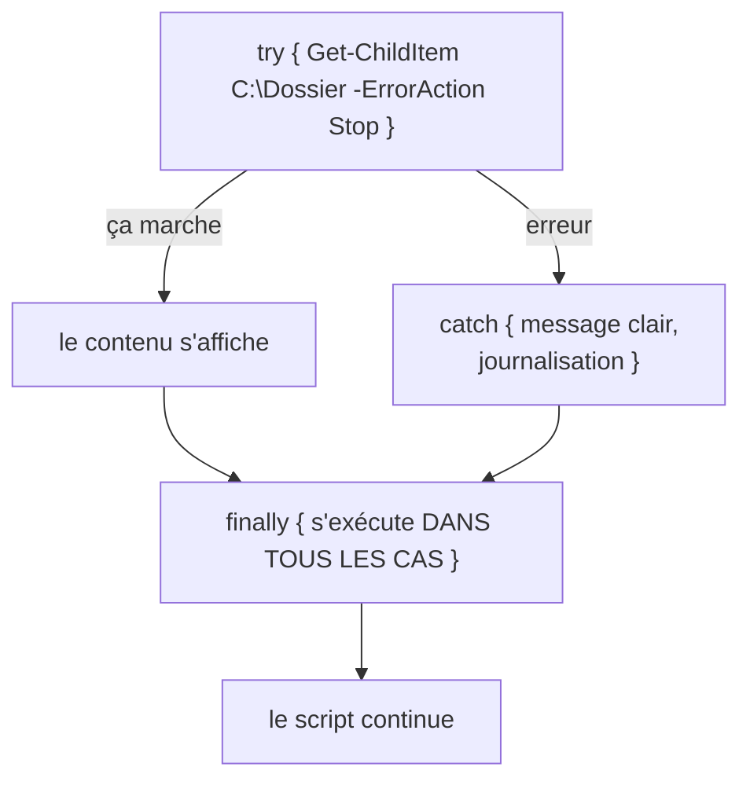
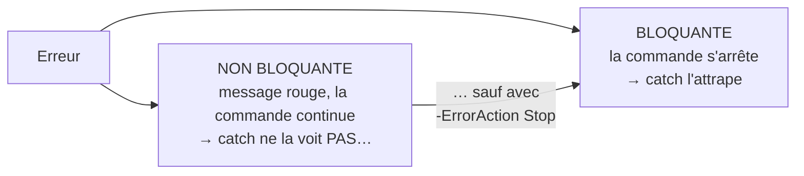

# Module 7 : Gestion des erreurs

*Cours : [Cours 11 - Initiation à PowerShell](../index.md)*

## 🎯 Objectif du module

**Gérer les erreurs** dans un script : où elles sont stockées (`$Error`), la différence entre erreur **bloquante** et **non bloquante**, le paramètre **`-ErrorAction`**, et la structure **`try` / `catch` / `finally`**.

!!! abstract "En clair"
    Un dossier absent, un serveur éteint, un droit manquant : un script **va** rencontrer des erreurs. Un bon script les **attrape** (`try` / `catch`), **affiche un message clair**, puis **continue** ou **s'arrête proprement**, au lieu de vomir du rouge à l'écran.

## 🗺️ L'essentiel en schémas

!!! info "Référentiel TSSR 2026"
    **CCP 3 · compétence 8 : Optimiser des scripts** et **compétence 10 : Superviser** (un script qui journalise ses erreurs peut être surveillé).

**① try, catch, finally**



**② Bloquante ou non bloquante ?**



## 📖 Cours consolidé

### 1. Où sont les erreurs ?

- Toutes les erreurs de la session sont rangées dans le tableau **`$Error`** ; la **plus récente** est **`$Error[0]`**.
- `-ErrorVariable nom` range en plus les erreurs **d'une commande** dans `$nom` : `Get-ChildItem C:\Dossier -ErrorVariable erreurs`.
- `$?` vaut `$true` si la dernière commande a réussi.

### 2. Bloquante ou non bloquante

| Type | Effet |
|---|---|
| **Bloquante** (*terminating*) | La commande **s'arrête** |
| **Non bloquante** | L'erreur s'affiche, mais la commande **continue** (ex. un dossier sur 10 inaccessible) |

On choisit le comportement en cas d'erreur **non bloquante** :

- pour **une** commande : le paramètre **`-ErrorAction`** ;
- pour **toute** la session ou le script : la variable **`$ErrorActionPreference`**.

| Valeur | Comportement |
|---|---|
| **Continue** | Affiche l'erreur et continue (**par défaut**) |
| **SilentlyContinue** | N'affiche rien, continue, mais **garde** l'erreur dans `$Error` |
| **Ignore** | N'affiche rien et **ne garde pas** l'erreur |
| **Inquire** | **Demande** à l'utilisateur quoi faire |
| **Stop** | **Arrête** la commande (l'erreur devient bloquante) |

```powershell
Get-ChildItem C:\Inexistant -ErrorAction SilentlyContinue   # pas de rouge à l'écran
$ErrorActionPreference = "Stop"                               # tout le script s'arrête à la 1re erreur
```

### 3. try, catch, finally

```powershell
try {
    Get-ChildItem -Path C:\Dossier -ErrorAction Stop     # Stop : sinon catch ne voit pas l'erreur
    Write-Host "Contenu affiché"
}
catch {
    Write-Host "Le dossier est introuvable : $($_.Exception.Message)"
}
finally {
    Write-Host "Vérification terminée"                    # dans tous les cas
}
```

- **`try`** : les commandes à risque.
- **`catch`** : ce qu'on fait **si** une erreur bloquante survient ; **`$_`** contient l'erreur (`$_.Exception.Message` = le message).
- **`finally`** (facultatif) : s'exécute **dans tous les cas** (fermer une connexion, écrire dans un journal).
- ➕ Le script **continue** après le bloc, au lieu de s'arrêter n'importe où.

### 4. Journaliser ses erreurs

```powershell
catch {
    "$(Get-Date -Format 'yyyy-MM-dd HH:mm') ERREUR : $($_.Exception.Message)" |
        Out-File C:\Scripts\erreurs.log -Append
}
```

## 📝 Fiche de révision

| Notion | À retenir |
|---|---|
| **`$Error[0]`** | La dernière erreur |
| **`-ErrorVariable x`** | Erreurs d'une commande dans `$x` |
| **`-ErrorAction`** | Comportement pour une commande |
| **`$ErrorActionPreference`** | Comportement pour tout le script |
| **Valeurs** | Continue (défaut) · SilentlyContinue · Ignore · Inquire · Stop |
| **try / catch / finally** | Essayer / si erreur / toujours |
| **Message** | `$_.Exception.Message` dans le catch |

### ⚠️ Les pièges

- Un `catch` ne voit **pas** les erreurs **non bloquantes** : ajoute **`-ErrorAction Stop`** dans le `try`.
- `SilentlyContinue` partout **cache les problèmes** : à réserver aux erreurs prévues.
- `Ignore` ne garde **aucune trace** de l'erreur.
- Écrire un message **utile** dans le `catch` : « Erreur » seul n'aide personne.

### ✏️ Entraîne-toi (clique pour voir la correction)

??? question "1. Tente de lire C:\Rapports\stats.txt ; s'il n'existe pas, affiche « Fichier absent, rapport ignoré » sans message rouge, puis « Fin » dans tous les cas."
    ```powershell
    try {
        Get-Content C:\Rapports\stats.txt -ErrorAction Stop
    }
    catch {
        Write-Host "Fichier absent, rapport ignoré"
    }
    finally {
        Write-Host "Fin"
    }
    ```

## 🧠 Quiz — entraîne-toi

<div id="quiz-cours-11-initiation-a-powershell-module-7-gestion-des-erreurs"></div>

<script type="application/json" id="quiz-cours-11-initiation-a-powershell-module-7-gestion-des-erreurs-data">
[
  {
    "question": "Où trouver la dernière erreur survenue dans la session ?",
    "options": [
      "$LastError",
      "$Error[0]",
      "$Error[-1]",
      "Get-Error -Last"
    ],
    "correctIndex": 1,
    "explanation": "$Error est un tableau ; l'index 0 est la plus récente."
  },
  {
    "question": "Pourquoi ajouter -ErrorAction Stop dans un bloc try ?",
    "options": [
      "Pour accélérer la commande",
      "Pour rendre l'erreur bloquante, sinon catch ne l'attrape pas",
      "Pour masquer l'erreur",
      "Ce n'est jamais utile"
    ],
    "correctIndex": 1,
    "explanation": "catch ne réagit qu'aux erreurs bloquantes."
  },
  {
    "question": "Quel est le comportement par défaut face à une erreur non bloquante ?",
    "options": [
      "Stop",
      "Continue : affiche l'erreur et continue",
      "Ignore",
      "Inquire"
    ],
    "correctIndex": 1,
    "explanation": "$ErrorActionPreference vaut Continue par défaut."
  },
  {
    "question": "Quand s'exécute le bloc finally ?",
    "options": [
      "Seulement s'il n'y a pas d'erreur",
      "Seulement en cas d'erreur",
      "Dans tous les cas",
      "Jamais"
    ],
    "correctIndex": 2,
    "explanation": "On y met ce qui doit toujours être fait (fermer, journaliser)."
  },
  {
    "question": "Quelle valeur masque l'erreur à l'écran tout en la gardant dans $Error ?",
    "options": [
      "Ignore",
      "SilentlyContinue",
      "Stop",
      "Inquire"
    ],
    "correctIndex": 1,
    "explanation": "Ignore la masque et ne la garde pas du tout."
  },
  {
    "question": "Dans un catch, comment afficher le message de l'erreur ?",
    "options": [
      "$Error.Text",
      "$_.Exception.Message",
      "$catch.Message",
      "Write-Error"
    ],
    "correctIndex": 1,
    "explanation": "$_ contient l'erreur attrapée."
  },
  {
    "question": "What happens in a try/catch block when a terminating error occurs inside try?",
    "options": [
      "The script stops immediately",
      "The catch block runs",
      "Nothing",
      "The error is ignored"
    ],
    "correctIndex": 1,
    "explanation": "Le catch s'exécute, puis le finally, et le script continue."
  }
]
</script>

<script>
  document.addEventListener("DOMContentLoaded", function () {
    TSSRQuiz.init({
      containerId: "quiz-cours-11-initiation-a-powershell-module-7-gestion-des-erreurs",
      dataId: "quiz-cours-11-initiation-a-powershell-module-7-gestion-des-erreurs-data",
    });
  });
</script>
