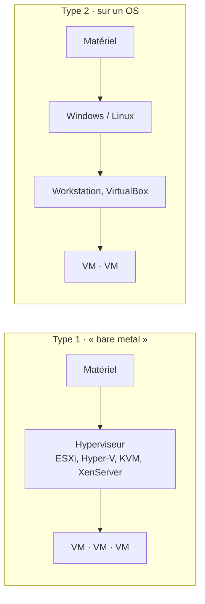
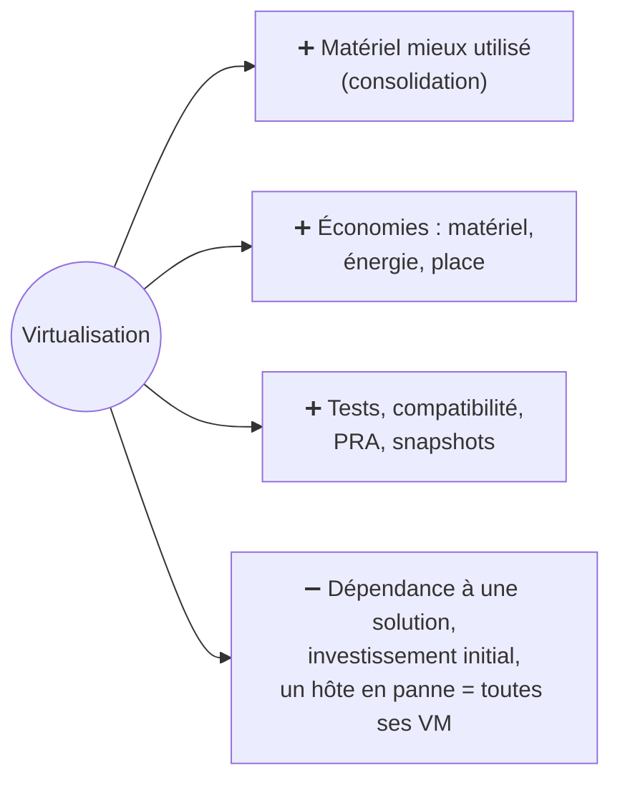

# Module 1 : Présentation

*Cours : [Cours 13 - Virtualisation de serveurs](../index.md)*

## 🎯 Objectif du module

Comprendre **pourquoi** on virtualise (consolidation, économies, PRA), distinguer les **hyperviseurs de type 1 et 2**, la **paravirtualisation**, et savoir utiliser **VMware Workstation** pour ses VM de travail.

!!! abstract "En clair"
    Un serveur physique utilisé à 10 % gaspille du matériel, de l'électricité et de la place. La **virtualisation** fait tourner **plusieurs machines virtuelles (VM)** sur un seul serveur physique, chacune croyant avoir son propre matériel. Le logiciel qui partage le matériel entre elles s'appelle l'**hyperviseur**.

## 🗺️ L'essentiel en schémas

!!! info "Référentiel TSSR 2026"
    **CCP 2 · compétence 6 : Exploiter des serveurs dans une infrastructure virtualisée** et **CCP 3 · compétence 9** (la virtualisation facilite le **PRA**). Les épreuves des CCP se passent **sur des machines virtuelles**.

**① Hyperviseur de type 1 ou de type 2**

**② Virtualiser : pour quoi faire ?**

**③ Le mode réseau d'une VM sous Workstation**

## 📖 Cours consolidé

### 1. Un peu d'histoire

| Période | Étape |
|---|---|
| Années 60-70 | **IBM** virtualise ses **mainframes** |
| Années 90 | **Émulateurs** (consoles, Atari, Amiga) |
| Début des années 2000 | **VMware** popularise la virtualisation sur **x86** |
| 2006 | Les **processeurs** prennent en charge la virtualisation (**Intel VT-x**, **AMD-V**) |
| 2007 | **KVM** intégré au noyau Linux · Citrix rachète **XenSource** |
| 2009 | Plus de serveurs **virtuels** que **physiques** |

💡 Depuis 2023, VMware appartient à **Broadcom**, qui a changé les licences et les éditions gratuites : vérifie avec ton formateur les versions utilisées en TP. **Proxmox VE** (libre, basé sur KVM) est aujourd'hui une alternative très répandue.

### 2. Pourquoi virtualiser ?

| Usages | Avantages | Inconvénients |
|---|---|---|
| Serveurs d'infrastructure (locaux, cloud) | Matériel **mieux utilisé** | **Dépendance** à une solution |
| Tests, compatibilité | **Économies** (matériel, gestion, **énergie**) | Investissement initial, mise en œuvre complexe |
| **PRA** (plan de reprise d'activité) | Gestion **facilitée** (snapshots, clonage, migration) | Administration spécifique (sauvegarde des VM…) |

Le vocabulaire : **mutualiser** (partager le matériel), **consolider** (moins de serveurs physiques), **rationaliser** (simplifier et réduire les coûts).

### 3. Ce qu'on virtualise

Postes de travail (VM sur un PC), **applications**, **serveurs**, bureaux (VDI), mais aussi le **réseau** (switchs virtuels), le **stockage** et des **services**.

| Pour le poste de travail (type 2) | Pour les serveurs (type 1) |
|---|---|
| VMware Workstation, Player | **VMware vSphere (ESXi)** |
| Oracle VirtualBox | **Microsoft Hyper-V** |
| Hyper-V Client (Windows Pro) | **KVM** (Red Hat, Proxmox) · Xen (Citrix) |

### 4. Les types d'hyperviseurs

| | **Type 1** | **Type 2** |
|---|---|---|
| Installé | **Directement sur le matériel**, il fait office de système | **Comme une application** sur un Windows ou un Linux |
| Performances | Élevées | Moindres (une couche de plus) |
| Usage | **Serveurs** de production | Postes, **TP**, tests |
| Exemples | ESXi, Hyper-V, KVM, XenServer | Workstation, VirtualBox |

**Virtualisation ou paravirtualisation ?** En virtualisation classique, la VM **ignore** qu'elle est virtuelle : l'hyperviseur **traduit** ses instructions. En **paravirtualisation**, la VM est **préparée** (pilotes adaptés) et **appelle directement** l'hyperviseur : plus rapide.

### 5. Les éléments d'une VM

Paramètres matériels (processeur, mémoire, BIOS/UEFI), **médias** (ISO, USB), **réseaux virtuels**, un ou plusieurs **disques virtuels** (`.vmdk` VMware, `.vhdx` Hyper-V, `.vdi` VirtualBox) et un **fichier de configuration** (`.vmx`, XML…).

### 6. VMware Workstation en pratique

- **Prérequis** : processeur avec **Intel VT-x** ou **AMD-V** activé dans le **BIOS/UEFI**, assez de RAM et de disque.
- Une VM d'une **version récente** ne s'ouvre pas dans une version plus ancienne de Workstation.
- **Créer une VM** : « I will install the operating system **later** » · choisir le système · **un dossier par VM** (pas « Mes Documents ») · taille du disque · *Customize Hardware* (CPU, RAM, ISO, réseau).
- **Clavier et souris** : ++ctrl+alt++ pour reprendre la main · ++ctrl+alt+insert++ pour un ++ctrl+alt+del++ dans la VM.
- **Dossier partagé** (*Shared Folder*) : un dossier de l'hôte visible dans la VM.
- **Réseaux** : VMnet1 (Host-only) et VMnet8 (NAT) avec leurs services **DHCP** et **NAT** VMware (à désactiver si tu fournis ton propre DHCP).

| Problème | Solution |
|---|---|
| La VM ne démarre pas sur l'ISO | Cliquer dans la VM puis **Échap** au logo VMware, ou régler l'ordre de démarrage dans son BIOS |
| Réseau capricieux | Désactiver puis réactiver la carte réseau de l'hôte |
| Disque de l'hôte plein | Déplacer le dossier de la VM, surveiller l'espace libre |
| Disque de la VM plein | **Ajouter** un disque (plus simple que l'agrandir) : bien dimensionner dès le départ |

Revois aussi le [cours 2 · module 2bis](../../cours-02-systeme-client-microsoft/module-2bis-vmware-workstation/index.md).

## 📝 Fiche de révision

| Notion | À retenir |
|---|---|
| **Hyperviseur** | Logiciel qui partage le matériel entre les VM |
| **Type 1** | Sur le matériel : ESXi, Hyper-V, KVM |
| **Type 2** | Sur un OS : Workstation, VirtualBox |
| **Paravirtualisation** | La VM appelle directement l'hyperviseur |
| **VT-x / AMD-V** | Prise en charge processeur, à activer dans le BIOS |
| **Disques** | `.vmdk` · `.vhdx` · `.vdi` |
| **Consolidation** | Moins de serveurs physiques |
| **Workstation** | Bridged · NAT (VMnet8) · Host-only (VMnet1) · LAN Segment |

### ⚠️ Les pièges

- **VT-x / AMD-V désactivé** dans le BIOS : impossible de lancer une VM 64 bits.
- Toutes les VM d'un hôte **tombent avec lui** : la virtualisation demande de la **redondance**.
- Un **snapshot n'est pas une sauvegarde**.
- Un **type 2** n'est pas fait pour la **production**.

### ✏️ Entraîne-toi (clique pour voir la correction)

??? question "1. Une PME a 8 serveurs physiques chargés à 15 %. Que lui apporterait la virtualisation, et quel risque nouveau apparaît ?"
    Les regrouper sur **1 ou 2 hôtes** (consolidation) : moins de matériel, d'énergie et de place, snapshots et PRA plus simples. Risque : **un hôte en panne arrête toutes ses VM** → prévoir au moins **deux hôtes** et des sauvegardes.

## 🧠 Quiz — entraîne-toi

