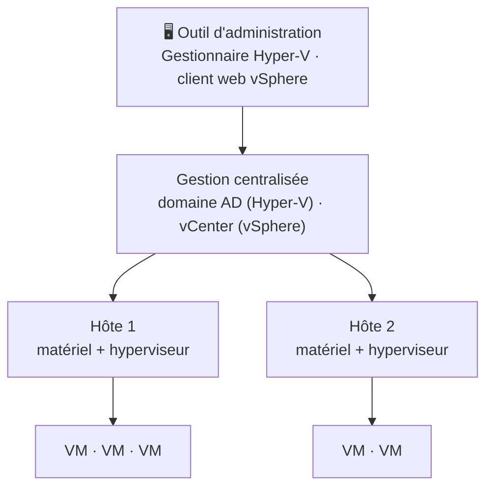
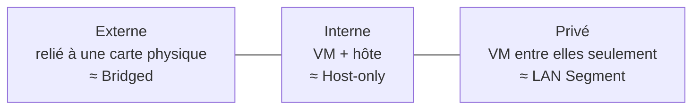

# Module 2 : La virtualisation de serveurs

*Cours : [Cours 13 - Virtualisation de serveurs](../index.md)*

## 🎯 Objectif du module

Connaître les **composants** d'une infrastructure de virtualisation de serveurs (hôte, hyperviseur, outil de gestion, VM), et découvrir **Hyper-V**, l'hyperviseur de Microsoft : installation, réseaux virtuels, création, export et import de VM.

!!! abstract "En clair"
    En entreprise, les VM tournent sur des **serveurs physiques puissants** (les **hôtes**), gérés par un **hyperviseur de type 1** : **Hyper-V** chez Microsoft, **ESXi** chez VMware. Plusieurs hôtes sont pilotés depuis **une seule console** (vCenter, ou le domaine Active Directory pour Hyper-V).

## 🗺️ L'essentiel en schémas

!!! info "Référentiel TSSR 2026"
    **CCP 2 · compétence 6 : Exploiter des serveurs dans une infrastructure virtualisée.**

**① Les composants d'une infrastructure virtualisée**



**② Les commutateurs virtuels d'Hyper-V**



**③ Déplacer une VM Hyper-V**


## 📖 Cours consolidé

### 1. Les composants

| Composant | Rôle |
|---|---|
| **Hôte** | Le **serveur physique** et ses ressources (format tour, rack ou lame dans un châssis) |
| **Processeur** | Doit gérer la virtualisation : **Intel VT-x** / **AMD-V**, et la traduction d'adresses mémoire **SLAT** (**EPT** chez Intel, **NPT/RVI** chez AMD) |
| **Hyperviseur** | Gère le matériel de l'hôte et héberge les VM : **Hyper-V** (Microsoft), **ESXi** (VMware) |
| **Gestionnaire (VMM)** | Crée et gère les VM, les réseaux, le stockage : **Gestionnaire Hyper-V**, **client web vSphere** |
| **Machine virtuelle** | Un fichier de configuration, un fichier par disque, de la RAM, des vCPU, des cartes réseau virtuelles |
| **Gestion centralisée** | Hôtes Hyper-V **membres d'un domaine AD** · hôtes ESXi rattachés à **vCenter** |

### 2. Installer Hyper-V

- **Prérequis** : processeur **64 bits** avec VT-x/AMD-V (et SLAT), activé dans le BIOS/UEFI.
- **Sur un serveur** : rôle **Hyper-V** du Gestionnaire de serveur (`Install-WindowsFeature Hyper-V -IncludeManagementTools -Restart`). Les **redémarrages** font passer Windows **au-dessus** de l'hyperviseur, qui devient un **type 1**.
- **Sur un poste Windows Pro ou Entreprise** : fonctionnalité **Hyper-V** à activer.

### 3. Utiliser Hyper-V

- Console **Gestionnaire Hyper-V** : la liste des hôtes, des VM et de leur état, et une **console de connexion** par VM (la fermer **n'arrête pas** la VM).
- ++ctrl+alt+left++ pour libérer la souris · ++ctrl+alt+end++ pour un ++ctrl+alt+del++ dans la VM.
- **Services d'intégration** : pilotes et outils dans la VM pour de meilleures performances.
- **Points de contrôle** (*checkpoints*, l'équivalent des snapshots), paramètres matériels détaillés.
- **Génération 1** (BIOS, démarrage sur disque **IDE**) ou **génération 2** (**UEFI**, Secure Boot, démarrage SCSI) : pour un Windows récent, choisir la **génération 2**.

### 4. Les réseaux virtuels

Ils se créent avec le **Gestionnaire de commutateur virtuel** ; **aucun** n'existe par défaut.

| Commutateur | Communique avec | Équivalent Workstation |
|---|---|---|
| **Externe** | Le **réseau physique** (via une carte de l'hôte) | Bridged |
| **Interne** | Les VM **et l'hôte** | Host-only |
| **Privé** | Les VM **entre elles** seulement | LAN Segment |

- **Un seul** commutateur externe par carte physique : Hyper-V « s'approprie » la carte (l'hôte passe par une carte virtuelle).
- Un **identifiant de VLAN** peut être défini sur une carte de VM.

### 5. Créer, exporter, importer

- Créer : **Nouveau → Ordinateur virtuel** : nom, **emplacement**, génération, mémoire, réseau, disque `.vhdx`, ISO.
- Pour **copier** ou **déplacer** une VM, on l'**exporte**, on copie le dossier, puis on l'**importe** en sélectionnant le dossier qui contient **tous** ses fichiers.
- Option « **Copier la machine virtuelle** (créer un nouvel ID unique) » à l'import : pour importer **plusieurs fois** la même VM exportée.

```powershell
Get-VM                                              # les VM de l'hôte
New-VM -Name SRV01 -MemoryStartupBytes 4GB -Generation 2 -NewVHDPath D:\VM\SRV01.vhdx -NewVHDSizeBytes 60GB -SwitchName "LAN"
Start-VM SRV01 ; Stop-VM SRV01
Checkpoint-VM -Name SRV01 -SnapshotName "Avant mise à jour"
Export-VM -Name SRV01 -Path E:\Exports
```

## 📝 Fiche de révision

| Notion | À retenir |
|---|---|
| **Hôte** | Serveur physique |
| **SLAT** | EPT (Intel) · NPT/RVI (AMD) |
| **Hyper-V** | Hyperviseur type 1 de Microsoft (rôle ou fonctionnalité) |
| **Gestion centralisée** | Domaine AD (Hyper-V) · vCenter (vSphere) |
| **Commutateurs Hyper-V** | Externe · Interne · Privé |
| **Génération 2** | UEFI, Secure Boot : pour les systèmes récents |
| **Point de contrôle** | Le snapshot d'Hyper-V |
| **Déplacer une VM** | Exporter → copier → importer |
| **PowerShell** | `Get-VM` · `New-VM` · `Checkpoint-VM` · `Export-VM` |

### ⚠️ Les pièges

- Aucun commutateur virtuel par défaut : une VM sans commutateur **n'a pas de réseau**.
- Créer un commutateur **externe** sur la seule carte de l'hôte coupe brièvement son réseau (prévoir l'accès console).
- Copier les fichiers d'une VM **à la main** au lieu d'**exporter** : l'import échoue.
- Un **point de contrôle** n'est **pas une sauvegarde**.

### ✏️ Entraîne-toi (clique pour voir la correction)

??? question "1. Tes VM de TP doivent communiquer entre elles et avec ton serveur Hyper-V, mais pas avec le réseau de l'entreprise. Quel commutateur ?"
    Un commutateur **Interne** (VM + hôte). S'il ne faut même pas l'hôte : **Privé**.

## 🧠 Quiz — entraîne-toi

<div id="quiz-cours-13-virtualisation-de-serveurs-module-2-la-virtualisation-de-serveurs"></div>

<script type="application/json" id="quiz-cours-13-virtualisation-de-serveurs-module-2-la-virtualisation-de-serveurs-data">
[
  {
    "question": "Quel est le rôle de l'hyperviseur ?",
    "options": [
      "Sauvegarder les VM",
      "Gérer le matériel de l'hôte et héberger les machines virtuelles",
      "Remplacer le DNS",
      "Distribuer les adresses IP"
    ],
    "correctIndex": 1,
    "explanation": "Hyper-V et ESXi sont des hyperviseurs de type 1."
  },
  {
    "question": "Quel commutateur virtuel Hyper-V relie les VM au réseau physique ?",
    "options": [
      "Privé",
      "Interne",
      "Externe",
      "NAT"
    ],
    "correctIndex": 2,
    "explanation": "Externe ≈ Bridged ; Interne ≈ Host-only ; Privé = VM entre elles."
  },
  {
    "question": "Quel commutateur ne permet la communication qu'entre les VM ?",
    "options": [
      "Externe",
      "Interne",
      "Privé",
      "Bridged"
    ],
    "correctIndex": 2,
    "explanation": "Le commutateur privé exclut même l'hôte."
  },
  {
    "question": "Comment déplacer proprement une VM Hyper-V vers un autre hôte ?",
    "options": [
      "Copier le .vhdx seul",
      "Exporter, copier le dossier, puis importer",
      "Faire un point de contrôle",
      "Renommer la VM"
    ],
    "correctIndex": 1,
    "explanation": "L'import a besoin de tous les fichiers produits par l'export."
  },
  {
    "question": "Quelle génération de VM Hyper-V choisir pour Windows Server 2025 ?",
    "options": [
      "Génération 1",
      "Génération 2 (UEFI, Secure Boot)",
      "Peu importe",
      "Génération 3"
    ],
    "correctIndex": 1,
    "explanation": "La génération 1 (BIOS, démarrage IDE) est réservée aux systèmes anciens."
  },
  {
    "question": "Comment gère-t-on plusieurs hôtes ESXi depuis une seule console ?",
    "options": [
      "Avec vCenter",
      "Avec Hyper-V",
      "Avec le DHCP",
      "C'est impossible"
    ],
    "correctIndex": 0,
    "explanation": "vCenter centralise la gestion des hôtes ESXi ; pour Hyper-V, les hôtes sont joints au domaine."
  },
  {
    "question": "Quelle cmdlet crée un point de contrôle d'une VM Hyper-V ?",
    "options": [
      "New-Snapshot",
      "Checkpoint-VM",
      "Backup-VM",
      "Save-VM"
    ],
    "correctIndex": 1,
    "explanation": "Checkpoint-VM -Name SRV01 -SnapshotName \"…\"."
  },
  {
    "question": "What is the Hyper-V equivalent of a VMware snapshot called?",
    "options": [
      "Checkpoint",
      "Restore point",
      "Backup",
      "Clone"
    ],
    "correctIndex": 0,
    "explanation": "Hyper-V parle de points de contrôle (checkpoints)."
  }
]
</script>

<script>
  document.addEventListener("DOMContentLoaded", function () {
    TSSRQuiz.init({
      containerId: "quiz-cours-13-virtualisation-de-serveurs-module-2-la-virtualisation-de-serveurs",
      dataId: "quiz-cours-13-virtualisation-de-serveurs-module-2-la-virtualisation-de-serveurs-data",
    });
  });
</script>
