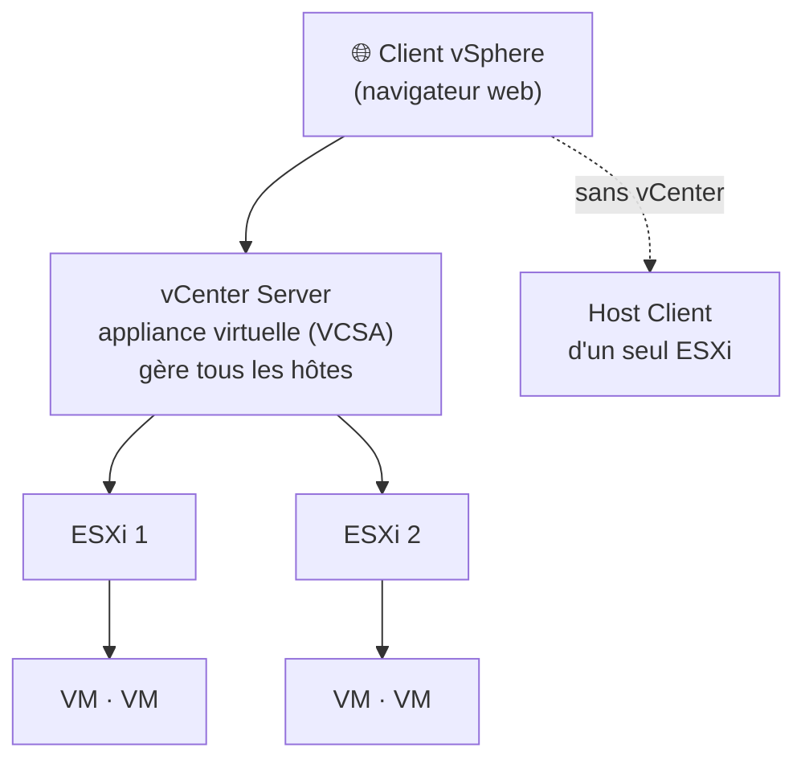
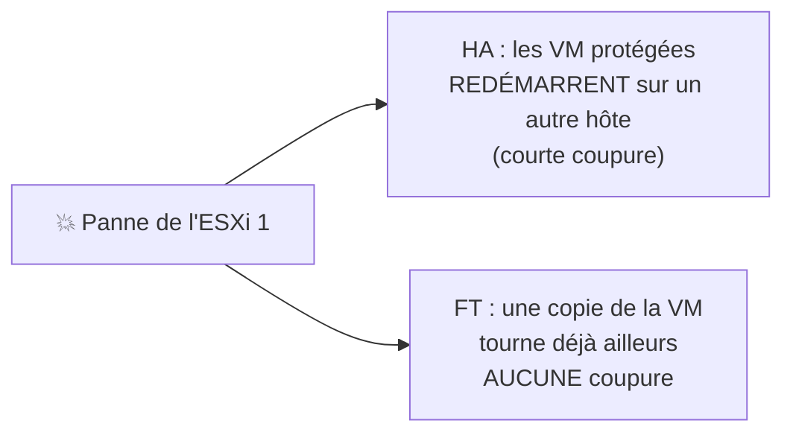

# Module 3 : Les composantes d'une infrastructure vSphere

*Cours : [Cours 13 - Virtualisation de serveurs](../index.md)*

## 🎯 Objectif du module

Connaître les **composants** d'une infrastructure **VMware vSphere** (ESXi, vCenter, client vSphere) et ses grandes **fonctionnalités** (vMotion, DRS, HA, FT…).

!!! abstract "En clair"
    **vSphere** est le nom de toute la solution VMware. Sur chaque serveur physique tourne **ESXi** (l'hyperviseur). **vCenter** est le **chef d'orchestre** qui pilote tous les ESXi et rend possibles les fonctions avancées : déplacer une VM **à chaud** d'un serveur à l'autre, la **redémarrer ailleurs** si son serveur tombe…

## 🗺️ L'essentiel en schémas

!!! info "Référentiel TSSR 2026"
    **CCP 2 · compétence 6 : Exploiter des serveurs dans une infrastructure virtualisée** et **CCP 3 · compétence 9 : Assurer la continuité** (HA, FT, vMotion).

**① Les composants de vSphere**

**② Que se passe-t-il si un hôte tombe ?**

## 📖 Cours consolidé

### 1. Les composants

| Élément | Nom chez VMware | Rôle |
|---|---|---|
| Solution complète | **vSphere** | L'ensemble de la plateforme |
| Hyperviseur | **ESXi** | Installé sur chaque serveur physique (type 1) |
| Gestion centralisée | **vCenter Server** | Regroupe et pilote les ESXi ; fourni en **appliance virtuelle** (VCSA) |
| Client d'administration | **Client vSphere** (web, via vCenter) · **Host Client** (web, un seul ESXi) | L'interface d'administration |
| Machines | **VM** | Les serveurs virtuels |

- Depuis vSphere 6 : l'ancien **ESX** et le client **lourd** Windows ont disparu ; tout se fait par le **navigateur**.
- ⚠️ Les **versions** d'ESXi et de vCenter doivent être **compatibles** (vCenter au moins aussi récent que ses ESXi).

### 2. Les fonctionnalités

| Fonctionnalité | Ce qu'elle fait |
|---|---|
| **vMotion** | **Déplacer une VM allumée** d'un hôte à un autre, sans coupure |
| **Storage vMotion** | Déplacer **les disques** d'une VM vers une autre banque de données, à chaud |
| **DRS** | **Répartir automatiquement** les VM sur les hôtes les moins chargés (avec vMotion) |
| **Storage DRS** | Pareil pour les **banques de données** |
| **DPM** | Mettre en **veille** des hôtes quand la charge baisse, les réveiller ensuite |
| **HA** (*High Availability*) | Si un hôte tombe, ses VM **redémarrent** sur un autre hôte du **cluster** |
| **FT** (*Fault Tolerance*) | Une **copie synchronisée** de la VM tourne sur un autre hôte : **aucune** interruption |

Ces fonctions demandent **vCenter**, un **cluster** d'hôtes et un **stockage partagé** ([module 5](../module-5-gestion-du-stockage-sous-vsphere/index.md)) ; elles sont détaillées au [module 6](../module-6-gestion-du-datacenter/index.md).

### 3. Les licences

ESXi seul peut s'utiliser avec une licence de base ; les fonctions avancées (vMotion, HA, DRS, vSwitch distribué) dépendent du **niveau de licence** (Essentials, Standard, Enterprise Plus…). Depuis le rachat de VMware par **Broadcom** (2023), les offres sont passées en **abonnement** et ont été regroupées : les tarifs des supports de cours ne sont plus d'actualité.

## 📝 Fiche de révision

| Notion | À retenir |
|---|---|
| **vSphere** | La solution VMware complète |
| **ESXi** | L'hyperviseur, sur chaque hôte |
| **vCenter** | Gestion centralisée, appliance VCSA |
| **Client vSphere** | Interface web d'administration |
| **vMotion** | VM déplacée à chaud |
| **DRS** | Répartition automatique de la charge |
| **HA** | Redémarrage des VM sur un autre hôte |
| **FT** | Copie en direct, zéro coupure |

### ⚠️ Les pièges

- **HA ≠ FT** : HA **redémarre** la VM (courte coupure), FT n'a **aucune** coupure.
- Sans **vCenter** ni **stockage partagé** : pas de vMotion, HA ou DRS.
- **vMotion** déplace le **calcul** (CPU, RAM) ; **Storage vMotion** déplace les **disques**.

### ✏️ Entraîne-toi (clique pour voir la correction)

??? question "1. Tu dois redémarrer un ESXi pour une mise à jour sans arrêter ses VM. Quelle fonctionnalité utilises-tu ?"
    **vMotion** : on déplace à chaud les VM vers un autre hôte (ou on met l'hôte en **mode maintenance**, et DRS s'en charge), puis on met à jour et on redémarre l'hôte.

## 🧠 Quiz — entraîne-toi

