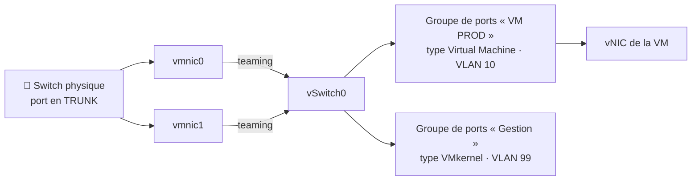
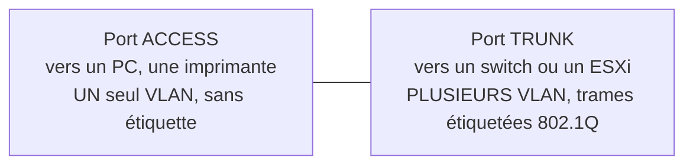

# Module 4 : Gestion du réseau sous vSphere

*Cours : [Cours 13 - Virtualisation de serveurs](../index.md)*

## 🎯 Objectif du module

Configurer le **réseau** d'un hôte ESXi : comprendre les **VLAN** (802.1Q, ports *access* et *trunk*), les **vSwitch** standard et distribué, les **groupes de ports**, les cartes **physiques** (vmnic) et **virtuelles** (vNIC), et le **teaming**.

!!! abstract "En clair"
    Dans un ESXi, les VM sont branchées sur des **switchs virtuels**, eux-mêmes reliés aux **cartes réseau physiques** du serveur. On sépare les usages (VM de production, administration, stockage, vMotion) avec des **groupes de ports** et des **VLAN**, et on double les cartes pour qu'une panne ne coupe rien (**teaming**).

## 🗺️ L'essentiel en schémas

!!! info "Référentiel TSSR 2026"
    **CCP 2 · compétence 4 : Exploiter un réseau IP** (VLAN, 802.1Q) et **compétence 6 : Exploiter des serveurs dans une infrastructure virtualisée**.

**① Du réseau physique à la VM**

**② Port access ou port trunk ?**

## 📖 Cours consolidé

### 1. Les VLAN

Un **VLAN** est un **réseau logique** isolé : seuls les équipements d'un même VLAN communiquent directement entre eux, même s'ils sont sur le même switch.

| ➕ | ➖ |
|---|---|
| **Sécurité** (isoler serveurs, postes, téléphones) | Les switchs doivent les **gérer** |
| **Performances** (domaines de diffusion plus petits) | Il faut les **configurer** |
| **Priorité** à certains flux, matériel mieux utilisé | |

- Standard : **IEEE 802.1Q**. Une **étiquette** de 4 octets est ajoutée dans la trame Ethernet : **VLAN ID** (12 bits, de **1 à 4094**) et une **priorité** (3 bits, de 0 à 7, la qualité de service 802.1p).
- Affectation à un VLAN selon le **port** du switch (le plus courant), l'**adresse MAC** ou l'**adresse IP**.

| Port | Relié à | VLAN |
|---|---|---|
| **Access** | Un équipement terminal (PC, imprimante) | **Un seul**, trames **sans** étiquette |
| **Trunk** | Un autre switch, un ESXi | **Plusieurs**, trames **étiquetées** |

Le VLAN par défaut est le **VLAN 1**. Certains équipements (cartes réseau, systèmes, **téléphones IP**) savent eux-mêmes étiqueter leurs trames : ils se branchent sur un port **trunk**.

### 2. Les composants réseau de vSphere

| Composant | Rôle |
|---|---|
| **vmnic** (pNIC) | Une **carte physique** de l'hôte. Une vmnic est liée à **un seul** vSwitch ; un vSwitch peut avoir **plusieurs** vmnic |
| **vSwitch standard** (VSS) | Switch virtuel **propre à chaque ESXi**. `vSwitch0` existe dès l'installation (gestion + VM) |
| **vSwitch distribué** (VDS) | **Un seul switch** partagé par **tous** les hôtes, géré depuis **vCenter** : configuration identique partout, pas de coupure lors d'un vMotion (licence élevée) |
| **Groupe de ports** | Un « type d'usage » sur un vSwitch : **Virtual Machine** (réseau des VM) ou **VMkernel** (besoins de l'hyperviseur : gestion, **vMotion**, stockage **iSCSI/NFS**, FT). Le **VLAN** se règle souvent ici |
| **vNIC** | La carte réseau **de la VM**, branchée sur un groupe de ports |

⚠️ Deux VM sur **deux groupes de ports différents** d'un même vSwitch **ne communiquent pas** directement.

### 3. Le teaming (regroupement de cartes)

Avec **au moins 2 vmnic** sur un vSwitch : **tolérance de panne** (une carte lâche, l'autre continue) et, en mode actif-actif, **débit cumulé**.

| Répartition de charge | Principe |
|---|---|
| Par **port virtuel** (par VM) | Chaque VM utilise une carte (le mode par défaut) |
| Par **adresse MAC** source | Selon la MAC de l'émetteur |
| Par **hachage IP** | Selon les adresses source et destination (demande une configuration du switch) |
| **Basculement explicite** | Pas de répartition : la carte suivante ne sert qu'en cas de panne (actif-passif) |

### 4. Organiser les flux d'un hôte

On **recense les besoins** (VM, gestion, vMotion, stockage iSCSI, FT), puis on choisit lesquels **regrouper** et lesquels **isoler**, par exemple :

| vSwitch | Groupes de ports | Cartes |
|---|---|---|
| vSwitch0 | VM PROD (Virtual Machine) | vmnic0 + vmnic1 |
| vSwitch1 | Gestion, vMotion (VMkernel) | vmnic2 |
| vSwitch2 | Stockage iSCSI (VMkernel) | vmnic3 |

Si les VLAN sont étiquetés **dans l'ESXi** (sur les groupes de ports), le port du switch physique doit être en **trunk** avec tous ces VLAN autorisés.

## 📝 Fiche de révision

| Notion | À retenir |
|---|---|
| **VLAN** | Réseau logique isolé, ID de 1 à 4094 |
| **802.1Q** | Étiquette de 4 octets dans la trame |
| **Access / trunk** | Un VLAN non étiqueté / plusieurs VLAN étiquetés |
| **vmnic** | Carte physique de l'ESXi |
| **vSwitch standard / distribué** | Par hôte / commun à tous, via vCenter |
| **Groupe de ports** | Virtual Machine ou VMkernel, porte le VLAN |
| **VMkernel** | Gestion, vMotion, iSCSI, FT |
| **vNIC** | Carte réseau d'une VM |
| **Teaming** | Plusieurs vmnic : tolérance de panne et débit |

### ⚠️ Les pièges

- VLAN étiqueté dans l'ESXi mais port du switch en **access** : le réseau ne passe pas.
- Une seule vmnic par vSwitch = un **point unique de défaillance**.
- Mettre **vMotion** ou l'**iSCSI** sur le même réseau que les VM : performances et sécurité en baisse.
- Une vmnic ne peut appartenir qu'à **un seul** vSwitch.

### ✏️ Entraîne-toi (clique pour voir la correction)

??? question "1. Les VM du groupe de ports « VM PROD » (VLAN 10) n'ont plus de réseau depuis qu'on a branché l'ESXi sur un nouveau port du switch. Cause probable ?"
    Le nouveau port est en **access** (ou le VLAN 10 n'est pas autorisé sur le trunk) : les trames étiquetées VLAN 10 sont rejetées. Il faut un port **trunk** qui autorise le VLAN 10.

## 🧠 Quiz — entraîne-toi

