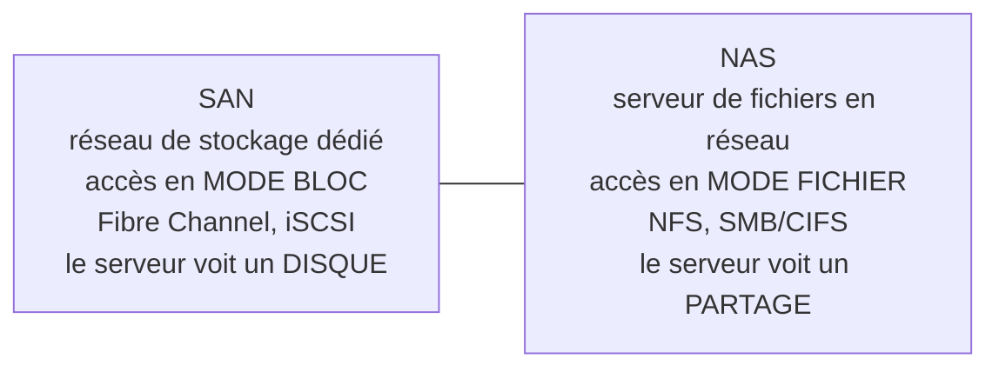
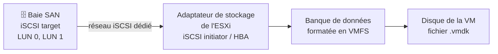
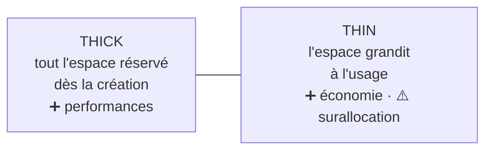

# Module 5 : Gestion du stockage sous vSphere

*Cours : [Cours 13 - Virtualisation de serveurs](../index.md)*

## 🎯 Objectif du module

Choisir et configurer le **stockage** d'une infrastructure vSphere : stockage **local** ou **partagé** (SAN, NAS), protocoles (**iSCSI**, Fibre Channel, NFS), **banques de données** (VMFS, NFS), disques de VM (**VMDK** ou **RDM**) et provisionnement **thick** ou **thin**.

!!! abstract "En clair"
    Pour que vMotion ou HA fonctionnent, **tous les hôtes** doivent voir **les mêmes disques** : on range donc les VM sur un **stockage partagé** (une baie de disques) plutôt que sur les disques internes de chaque serveur. Dans vSphere, ce stockage devient une **banque de données** (*datastore*) dans laquelle les VM sont des fichiers.

## 🗺️ L'essentiel en schémas

!!! info "Référentiel TSSR 2026"
    **CCP 2 · compétence 6 : Exploiter des serveurs dans une infrastructure virtualisée** et **CCP 3 · compétence 9 : Assurer la continuité** (stockage partagé, tolérance de panne).

**① SAN ou NAS ?**

**② Du disque de la baie au disque de la VM**

**③ Thick ou thin ?**

## 📖 Cours consolidé

### 1. Le vocabulaire du stockage

| Terme | Sens |
|---|---|
| **Mode bloc** | Les données sont lues et écrites par **blocs** (commandes **SCSI**) : le serveur voit un **disque** |
| **Mode fichier** | Le serveur accède à des **fichiers** sur un partage |
| **DAS** | Stockage **attaché directement** au serveur (disques internes, SAS, SATA) |
| **SAN** | Réseau **dédié** au stockage en **mode bloc** : **Fibre Channel**, **FCoE**, **iSCSI** |
| **NAS** | Serveur de fichiers autonome en réseau : **NFS** (Unix/Linux), **SMB/CIFS** (Windows) |
| **LUN** | Une unité de stockage présentée par la baie (un « disque » logique) |
| **HBA** | Carte d'accès au stockage (*Host Bus Adapter*) |
| **iSCSI target / initiator** | Celui qui **fournit** l'espace disque / celui qui l'**utilise** (l'ESXi) |

### 2. Les limites du stockage local

Chaque serveur doit gérer sa propre tolérance de panne, l'espace est mal partagé, les sauvegardes pèsent sur chaque machine, et les autres hôtes **ne voient pas** les VM : **pas de vMotion ni de HA**. D'où le stockage **centralisé** (SAN ou NAS).

### 3. Le stockage dans vSphere

- **Adaptateurs de stockage** : relient l'hôte au stockage (disques locaux, **HBA** physiques, adaptateurs **logiciels** iSCSI et FCoE de l'ESXi). Les adaptateurs **matériels** sont plus performants que les logiciels.
- **iSCSI** : très courant en virtualisation. Il faut un **réseau dédié** (une vmnic et un groupe de ports VMkernel réservés), idéalement **redondant**, et si tout le chemin le permet des **trames jumbo** (**MTU 9000**).
- **Banques de données** (*datastores*) : rendent l'espace utilisable par les VM.

| Type de banque | Principe |
|---|---|
| **VMFS** | Système de fichiers de VMware sur un disque en mode bloc ; **plusieurs hôtes** y accèdent **en même temps**. Version actuelle : **VMFS 6** (GPT, volumes jusqu'à 64 To) |
| **NFS** | Un partage NFS d'un NAS monté comme banque de données |
| **RDM** | Un LUN **donné directement** à une VM, sans passer par un fichier VMDK |

**Avant de créer les banques**, recense les besoins : une banque **VM_PROD** (performances, tolérance aux pannes, criticité élevées, donc plus chère), **VM_TESTS**, **MODÈLES**, **ISO**.

Tâches courantes : créer et formater, **suivre le taux d'utilisation**, **agrandir** à chaud, parcourir, importer et exporter des fichiers, démonter.

### 4. Les disques des VM

| Format | Usage |
|---|---|
| **VMDK** | Le cas général : un **fichier** dans la banque, simple à gérer et à sauvegarder (jusqu'à **62 To**) |
| **RDM** | Cas particuliers : clusters Microsoft, outils de la baie SAN. Performances proches du VMDK |

| Provisionnement | Espace occupé | ➕ | ➖ |
|---|---|---|---|
| **Thick** | **Tout** l'espace dès la création | Meilleures performances | Création plus longue, espace bloqué |
| **Thin** | Seulement l'espace **réellement utilisé** | Création immédiate, économie d'espace | **Surallocation** : si toutes les VM grossissent, la banque **se remplit** et les VM s'arrêtent |

## 📝 Fiche de révision

| Notion | À retenir |
|---|---|
| **SAN** | Mode bloc : FC, FCoE, iSCSI |
| **NAS** | Mode fichier : NFS, SMB |
| **LUN** | Disque logique fourni par la baie |
| **Target / initiator** | Fournit / utilise l'espace |
| **Datastore** | Banque de données : VMFS, NFS |
| **VMFS** | Système de fichiers partagé entre hôtes (VMFS 6) |
| **VMDK / RDM** | Fichier disque / LUN direct |
| **Thick / thin** | Tout réservé / à la demande |
| **iSCSI** | Réseau dédié, MTU 9000 si possible |

### ⚠️ Les pièges

- **Thin** sur toutes les VM sans **surveiller** la banque : elle se remplit et les VM se figent.
- Stockage **local** uniquement : pas de vMotion classique ni de HA.
- Mettre le trafic **iSCSI** sur le réseau des utilisateurs : lenteurs et risques.
- MTU 9000 **d'un seul côté** : il doit être réglé **de bout en bout** (ESXi, switchs, baie).

### ✏️ Entraîne-toi (clique pour voir la correction)

??? question "1. Une banque de 2 To contient 10 VM en thin de 300 Go chacune. Est-ce un problème ?"
    10 × 300 Go = **3 To promis** pour 2 To réels : c'est une **surallocation**. Ça marche tant que les VM n'utilisent pas tout leur espace, mais il faut **surveiller** le taux d'occupation et prévoir d'agrandir la banque ou de déplacer des VM (Storage vMotion).

## 🧠 Quiz — entraîne-toi

