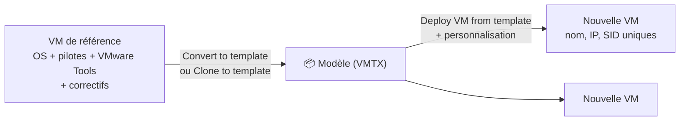
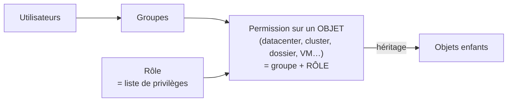
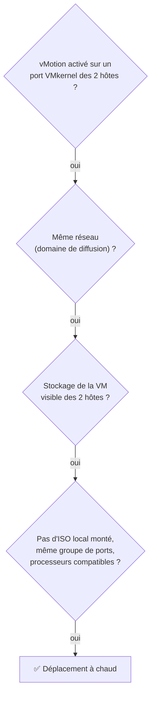

# Module 6 : Gestion du datacenter

*Cours : [Cours 13 - Virtualisation de serveurs](../index.md)*

## 🎯 Objectif du module

Administrer un **datacenter** vSphere avec **vCenter** : **pools de ressources** et réservations, **modèles** de VM (VMTX, OVF/OVA), **utilisateurs, rôles et privilèges**, et **déplacement** de VM avec **vMotion** et **Storage vMotion**.

!!! abstract "En clair"
    Avec vCenter, les hôtes ne sont plus gérés un par un : ils forment un **datacenter**. On y **réserve** des ressources pour les VM importantes, on crée de nouvelles VM en quelques clics à partir de **modèles**, on donne à chacun **juste les droits** nécessaires, et on **déplace** les VM sans les arrêter.

## 🗺️ L'essentiel en schémas

!!! info "Référentiel TSSR 2026"
    **CCP 2 · compétence 6** (exploiter l'infrastructure virtualisée) et **compétence 7** (gérer les accès : rôles et privilèges), **CCP 1 · compétence 2** (déployer vite des serveurs à partir de modèles).

**① Créer des VM à partir d'un modèle**

**② Donner des droits dans vCenter**

**③ vMotion : les conditions**

## 📖 Cours consolidé

### 1. Hôte autonome ou datacenter

Certaines tâches marchent sur un **hôte autonome** (gestion des ressources de cet hôte) ; d'autres demandent **vCenter** : **vMotion**, **Storage vMotion**, **modèles VMTX**, objets réseau et stockage **communs**, **clusters** (HA, DRS). vCenter doit lui-même être **hautement disponible** : c'est une VM critique.

- **VCSA** (l'appliance Linux de VMware) est aujourd'hui **la seule forme** de vCenter (la version à installer sur Windows a disparu).
- Accès : **client vSphere** en HTTPS (port **443**) · administration de l'appliance sur le port **5480**.

### 2. Gérer les ressources

- On peut **promettre** aux VM plus de ressources que l'hôte n'en a (toutes ne tournent pas à fond en même temps).
- Risque : une VM **importante** ne démarre pas faute de ressources → **réservation** (RAM, CPU garantis) pour une VM, un **pool** ou le cluster.
- **Pool de ressources** : une part des CPU et de la RAM réservée ou **limitée** pour un ensemble de VM (ex. garantir la **production**, brider les **tests**).

### 3. Les modèles

| | **VMTX** (modèle vSphere) | **OVF / OVA** |
|---|---|---|
| Où ? | Dans un **datacenter** vCenter | **Format standard**, échangeable : Workstation, vSphere, VirtualBox… |
| Pour | Déployer de nouvelles VM **en série** | **Importer / exporter** une VM |
| Format | — | **OVF** = un dossier de fichiers · **OVA** = ces fichiers dans **une seule archive** |

**Créer et utiliser un modèle VMTX** :

1. Préparer une **VM de référence** (OS, pilotes, applications, correctifs) et y installer les **VMware Tools**.
2. La **convertir** en modèle (*Convert to template*, l'original devient le modèle) ou la **cloner** en modèle (*Clone to template*, l'original reste).
3. **Déployer** des VM depuis le modèle (*Deploy VM from this template*), avec une **spécification de personnalisation** : **nom**, **adresse IP**, **SID** régénéré (sysprep pour Windows, [cours 2 · module 12](../../cours-02-systeme-client-microsoft/module-12-introduction-a-la-capture-et-au-deploiement-d-images/index.md)).

### 4. Utilisateurs, rôles et privilèges

- Comptes créés sur **vCenter** (droits possibles sur **toute** l'infrastructure) ou sur un **ESXi** (droits sur cet hôte seulement). Avec le **SSO**, vCenter peut utiliser les comptes du **domaine Active Directory**.
- **Méthode** : créer les utilisateurs → les mettre dans des **groupes** → créer des **rôles** (une liste de **privilèges**) → sur un **objet** de l'inventaire, associer un **groupe** et un **rôle** = une **permission**.
- **Bonnes pratiques** : des **groupes** plutôt que des utilisateurs · le **moindre privilège** (dupliquer un rôle trop large et le réduire) · définir les permissions **en haut** de l'arborescence et laisser l'**héritage** agir.

### 5. Déplacer des VM

| Outil | Ce qui bouge |
|---|---|
| **vMotion** | La VM (CPU, RAM, réseau) **vers un autre hôte**, allumée |
| **Storage vMotion** | Les **disques** de la VM **vers une autre banque de données**, allumée |

**Prérequis vMotion** : vMotion activé sur un **port VMkernel** des hôtes source et destination, dans le **même domaine de diffusion** ; stockage de la VM **accessible aux deux hôtes**.

**Causes d'échec fréquentes** : un **ISO local** monté dans la VM, un **groupe de ports** absent sur l'hôte de destination, des **processeurs** de générations incompatibles (à régler avec le mode **EVC** du cluster).

## 📝 Fiche de révision

| Notion | À retenir |
|---|---|
| **Datacenter** | Hôtes regroupés sous vCenter |
| **VCSA** | vCenter en appliance, client web (443), admin (5480) |
| **Réservation** | Ressources garanties à une VM ou un pool |
| **Pool de ressources** | Part de CPU/RAM pour un groupe de VM |
| **VMTX** | Modèle vSphere pour déployer en série |
| **OVF / OVA** | Format d'échange : dossier / archive unique |
| **Personnalisation** | Nom, IP, SID uniques (sysprep) |
| **Permission** | Objet + groupe + rôle (privilèges), héritée |
| **vMotion / Storage vMotion** | Déplace la VM / ses disques, à chaud |

### ⚠️ Les pièges

- Déployer un modèle **sans personnalisation** : noms et **SID en double**.
- Donner le rôle **Administrateur** à tout le monde : ignore le **moindre privilège**.
- Un **ISO monté** depuis un datastore local bloque vMotion.
- vCenter en panne = plus de gestion centralisée (les VM continuent de tourner, HA aussi).

### ✏️ Entraîne-toi (clique pour voir la correction)

??? question "1. Le vMotion d'une VM échoue : « le réseau VM-PROD n'existe pas sur l'hôte de destination ». Que corriges-tu ?"
    Créer le **même groupe de ports** (même nom, même VLAN) sur l'hôte de destination, ou mieux, utiliser un **vSwitch distribué** commun aux deux hôtes.

??? question "2. L'équipe support doit pouvoir allumer, éteindre et ouvrir la console des VM de test, rien d'autre. Comment faire ?"
    Créer un groupe **Support**, un **rôle** avec seulement les privilèges *alimentation* et *console*, puis une **permission** (groupe Support + ce rôle) sur le **dossier** ou le **pool** des VM de test.

## 🧠 Quiz — entraîne-toi

