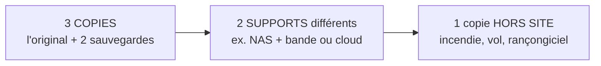
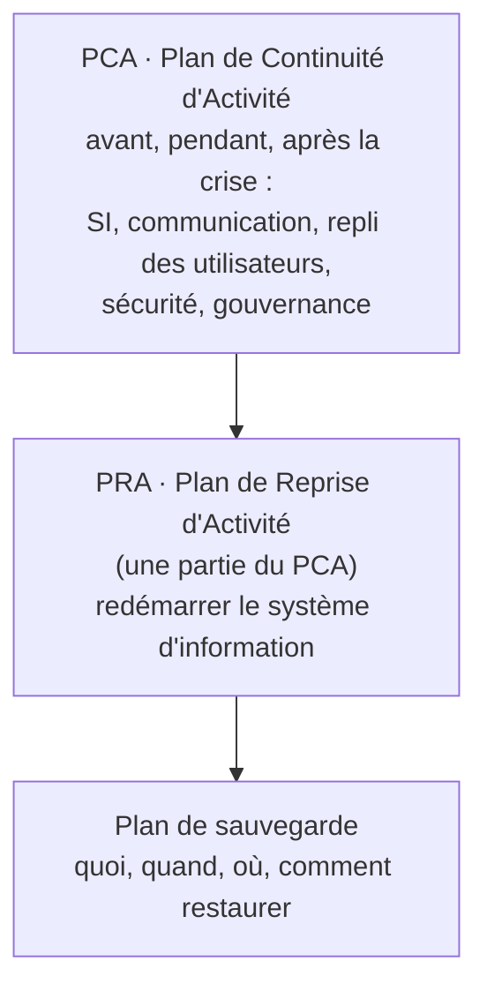

# Module 1 : Concepts, enjeux, définitions

*Cours : [Cours 15 - Sauvegarde et restauration](../index.md)*

## 🎯 Objectif du module

Comprendre **pourquoi** on sauvegarde, la **règle 3-2-1**, la différence entre **PCA** et **PRA**, ce que contient un **plan de sauvegarde**, et connaître les principaux **logiciels** (Veeam, Backup Exec…).

!!! abstract "En clair"
    Une panne de disque, une erreur de manipulation, un **rançongiciel** ou un incendie : un jour, des données disparaîtront. La sauvegarde, c'est l'assurance de pouvoir les **récupérer**. Et une sauvegarde ne vaut rien tant qu'on n'a pas **testé la restauration**.

## 🗺️ L'essentiel en schémas

!!! info "Référentiel TSSR 2026"
    **CCP 3 · compétence 9 : Assurer la continuité et la reprise de l'infrastructure.** Sauvegarder, restaurer, participer au PRA : c'est le cœur de cette compétence.

**① La règle 3-2-1**

**② PCA et PRA**

## 📖 Cours consolidé

### 1. Pourquoi sauvegarder ?

**Objectifs** : garantir la **pérennité** des données, pouvoir **récupérer** ce qui est indispensable au système d'information après un incident ou un sinistre, et répondre aux besoins de **disponibilité**.

**Enjeux** : éviter la **perte** de données, avoir un **plan de secours** en cas de panne, respecter la **durée de conservation** légale de certaines données, se protéger des **cyberattaques**, des intrusions et des **incendies**.

### 2. Les bonnes pratiques

- Un **compte de service dédié** à la sauvegarde dans l'Active Directory : plus sûr, et plus facile à **tracer** dans les journaux.
- Sur les postes Windows, utiliser le groupe **Opérateurs de sauvegarde** plutôt que les droits d'administrateur.
- **Rédiger** et tenir à jour un **plan de sauvegarde**.
- **Tester** les restaurations régulièrement.

### 3. La restauration

**Restaurer** = récupérer des fichiers, des données ou des systèmes **perdus, abîmés ou inaccessibles** et les remettre dans un état utilisable, en limitant la perte d'informations et la durée d'interruption. C'est **le but** de toute sauvegarde ([module 2](../module-2-types-de-sauvegarde/index.md)).

### 4. La règle 3-2-1

| Chiffre | Règle | Contre quoi |
|---|---|---|
| **3** | **Trois copies** : l'original et au moins **deux** sauvegardes | La panne d'une copie |
| **2** | Sur **deux supports différents** | La défaillance d'un type de support |
| **1** | Dont **une hors site** | Sinistre, vol, **rançongiciel**, erreur humaine |

💡 On parle aujourd'hui souvent de **3-2-1-1-0** : une copie **hors ligne ou non modifiable** (*immuable*, à l'abri d'un rançongiciel) et **0 erreur** aux tests de restauration.

### 5. PCA, PRA et plan de sauvegarde

| Plan | Contient |
|---|---|
| **PCA** | Tout ce qui est prévu **avant, pendant et après** une crise : rétablir le SI, **communiquer** en interne et en externe, **reloger** les utilisateurs, gérer la sécurité et la **gouvernance** de crise |
| **PRA** (une partie du PCA) | Ce qu'il faut pour **remettre en route le SI** : politique de sauvegarde, stockage des éléments de restauration, **procédures** de restauration, **licences** des applications |
| **Plan de sauvegarde** | **Périmètre** (ce qu'on sauvegarde), **contraintes**, **types** de sauvegarde, **fréquence**, **où** sont stockées les sauvegardes, **procédures de test** de restauration, **destruction** des anciens supports |

Deux indicateurs, vus au [cours 6](../../cours-06-sensibilisation-itil-et-gestion-de-parc/module-3-les-publications-centrales-strategie-et-conception-des-services/index.md), guident ces plans : le **RPO** (combien de données on accepte de **perdre**, donc la fréquence des sauvegardes) et le **RTO** (en combien de temps il faut **redémarrer**).

### 6. Les logiciels de sauvegarde

Nombreux, gratuits ou payants : **Veeam Backup & Replication**, **Veritas Backup Exec** et NetBackup, Commvault, Arcserve, Rubrik, Cohesity, IBM Spectrum Protect, HYCU…

| Logiciel | Points clés |
|---|---|
| **Veritas Backup Exec** | Sauvegarde et restauration de serveurs et de fichiers ; console avec ruban, gestion des **travaux** (jobs) |
| **Veeam Backup & Replication** | Spécialiste des **VM** VMware et Hyper-V : sauvegarde, **réplication**, restauration complète ou **granulaire** ([module 4](../module-4-sauvegarder-des-machines-virtuelles/index.md)) |

## 📝 Fiche de révision

| Notion | À retenir |
|---|---|
| **Sauvegarde** | Pouvoir récupérer les données après un incident |
| **3-2-1** | 3 copies, 2 supports, 1 hors site |
| **PCA** | Continuer l'activité pendant la crise (tout l'organisme) |
| **PRA** | Redémarrer le SI (partie du PCA) |
| **Plan de sauvegarde** | Périmètre, fréquence, stockage, tests, destruction |
| **RPO / RTO** | Perte de données acceptable / délai de reprise |
| **Compte dédié** | Compte de service AD, groupe Opérateurs de sauvegarde |

### ⚠️ Les pièges

- **Toutes les copies au même endroit** : un incendie ou un rançongiciel les détruit toutes.
- Une sauvegarde **jamais restaurée** n'est pas une sauvegarde.
- **PCA ≠ PRA** : le PRA n'est qu'**une partie** du PCA.
- Sauvegarder avec un compte **administrateur du domaine** : trop de droits, et une cible idéale pour un attaquant.

### ✏️ Entraîne-toi (clique pour voir la correction)

??? question "1. Une PME sauvegarde son serveur chaque nuit sur un disque USB toujours branché au serveur. Respecte-t-elle la règle 3-2-1 ?"
    **Non** : il n'y a qu'**une** sauvegarde, sur **un seul** support, **sur place** et **toujours connecté** (un rançongiciel le chiffrera aussi). Il faut au moins une 2ᵉ copie sur un autre support, dont une **hors site** (rotation de disques emportés, cloud, autre site).

## 🧠 Quiz — entraîne-toi

