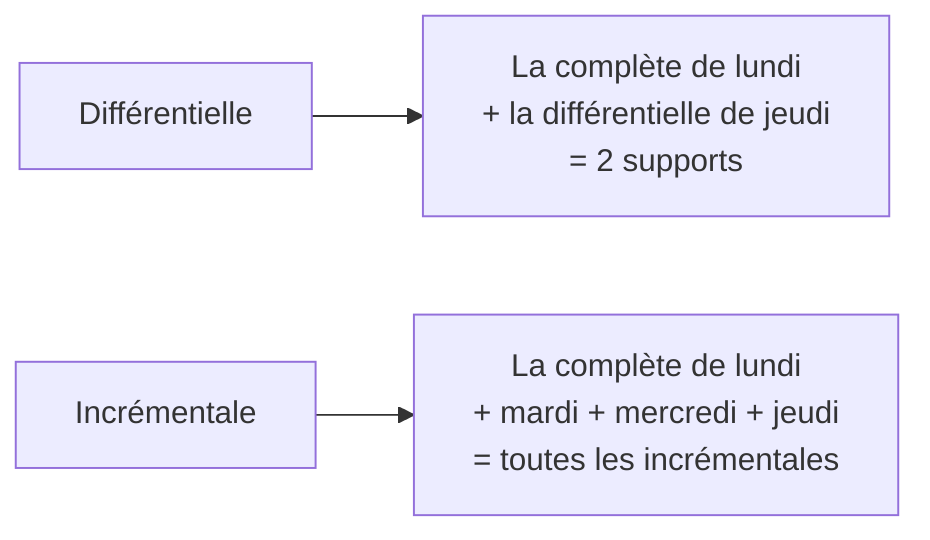

# Module 2 : Types de sauvegarde

*Cours : [Cours 15 - Sauvegarde et restauration](../index.md)*

## 🎯 Objectif du module

Connaître les **types de sauvegarde** (complète, différentielle, incrémentale), le **bit d'archive**, la sauvegarde **à chaud** ou **à froid**, la **rotation** des supports (GFS), la sauvegarde des **bases de données**, et les **méthodes de restauration**.

!!! abstract "En clair"
    Tout sauvegarder chaque jour prend du temps et de la place. On fait donc **une sauvegarde complète** de temps en temps, puis seulement **ce qui a changé** : soit depuis la dernière complète (**différentielle**), soit depuis la dernière sauvegarde quelle qu'elle soit (**incrémentale**). Le choix est un compromis entre **vitesse de sauvegarde** et **facilité de restauration**.

## 🗺️ L'essentiel en schémas

!!! info "Référentiel TSSR 2026"
    **CCP 3 · compétence 9 : Assurer la continuité et la reprise de l'infrastructure.**

**① Complète, différentielle, incrémentale (semaine type)**

**② Restaurer vendredi : quels supports ?**

**③ La rotation Grand-père / Père / Fils**

## 📖 Cours consolidé

### 1. À chaud ou à froid

| | **À chaud** | **À froid** |
|---|---|---|
| Pendant la sauvegarde | Les données restent **utilisées** | Les utilisateurs **n'y ont plus accès** |
| ➕ | **Pas d'interruption** de service | Mise en œuvre **simple**, restauration facile |
| ➖ | Mise en œuvre **complexe** (fichiers ouverts, cohérence : Windows utilise **VSS**) | **Interruption** du service |

### 2. Comment savoir ce qui a changé ?

- **Bit d'archive** (Windows) : quand un fichier est **créé ou modifié**, son attribut « archive » passe à **1**. Une sauvegarde complète ou incrémentale le remet à **0**.
- **Date** (Unix/Linux) : on compare la date de **modification** du fichier à celle de la **dernière sauvegarde**.

### 3. Les trois types

| Type | Sauvegarde… | Bit d'archive | ➕ | ➖ |
|---|---|---|---|---|
| **Complète** | **Tout**, modifié ou non | Remis à 0 | Restauration **la plus simple et rapide**, la plus fiable | **Lente**, prend **beaucoup de place** |
| **Différentielle** | Ce qui a changé **depuis la dernière complète** | **Pas** remis à 0 (cumulative) | Restauration avec **2 supports** seulement | **Grossit** chaque jour |
| **Incrémentale** | Ce qui a changé **depuis la dernière sauvegarde** (complète ou incrémentale) | Remis à 0 | **Rapide**, **peu de place**, peu de bande passante | Restauration **plus longue** : il faut **toute la chaîne** |

### 4. La rotation des supports : GFS

**Grand-père / Père / Fils** (*Grandfather-Father-Son*), la rotation la plus utilisée : supports **quotidiens** (fils, réutilisés chaque semaine), **hebdomadaires** (père, gardés environ 5 semaines), **mensuels** (grand-père, gardés 12 mois). Sur 5 jours ouvrés, il faut environ **21 bandes** pour un an.

### 5. Les bases de données

Chaque base a **sa** méthode, pour obtenir une sauvegarde **cohérente** :

| Base | Sauvegarde | Restauration |
|---|---|---|
| **SQL Server** | SQL Server Management Studio (ou un agent compatible VSS) | SQL Server Management Studio |
| **MySQL / MariaDB** | `mysqldump -u utilisateur -p base > sauvegarde.sql` | `mysql -u utilisateur -p base < sauvegarde.sql` |
| **Oracle** | **RMAN** | RMAN, Data Pump |

### 6. La restauration

« On n'a jamais de problème de **sauvegarde**, que des problèmes de **restauration** » : les sauvegardes doivent **obligatoirement être testées** régulièrement.

| Restauration | Quand |
|---|---|
| **Sur l'emplacement d'origine** | Risque d'**écraser** les données actuelles |
| **À un autre emplacement** du même système | Le plus courant : aucun écrasement, on compare avant de remplacer |
| **Sur un autre système** | Vérifier avant de remettre en production, problème de place |
| **Une ancienne version** | Grâce au **versioning** |
| **Système complet** (*bare metal recovery*) | Reconstruire un serveur sur un disque **vierge** : matériel compatible, restauration de l'**image**, puis des données modifiées depuis |

## 📝 Fiche de révision

| Notion | À retenir |
|---|---|
| **Complète** | Tout · restauration simple · lente et volumineuse |
| **Différentielle** | Depuis la dernière **complète** · restauration : complète + dernière diff |
| **Incrémentale** | Depuis la dernière **sauvegarde** · restauration : complète + toutes les incr |
| **Bit d'archive** | 1 = modifié · remis à 0 par complète et incrémentale |
| **À chaud / à froid** | Sans / avec interruption de service |
| **GFS** | Fils (jour), Père (semaine), Grand-père (mois) |
| **MySQL** | `mysqldump` / `mysql < fichier.sql` |
| **Bare metal** | Restaurer un système complet sur un disque vierge |

### ⚠️ Les pièges

- **Différentielle ≠ incrémentale** : « depuis la dernière **complète** » contre « depuis la dernière **sauvegarde** ».
- Avec des incrémentales, **un seul support manquant** casse la chaîne de restauration.
- Restaurer **sur l'original** sans réfléchir écrase les fichiers actuels.
- Copier les fichiers d'une base **ouverte** donne une sauvegarde **incohérente** : utiliser l'outil de la base.

### ✏️ Entraîne-toi (clique pour voir la correction)

??? question "1. Complète le dimanche, incrémentales du lundi au samedi. Le serveur tombe jeudi midi. Quels supports pour restaurer ?"
    La **complète** du dimanche, puis les incrémentales du **lundi, mardi et mercredi** (celle de jeudi n'a pas encore été faite). Les données de jeudi matin sont perdues.

??? question "2. Même cas, mais avec des différentielles. Quels supports ?"
    La **complète** du dimanche et la **différentielle de mercredi** seulement.

## 🧠 Quiz — entraîne-toi

