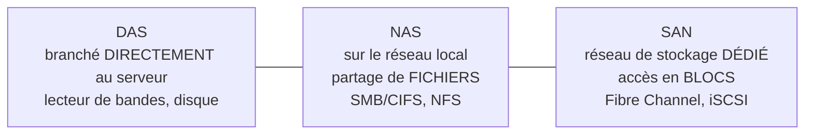
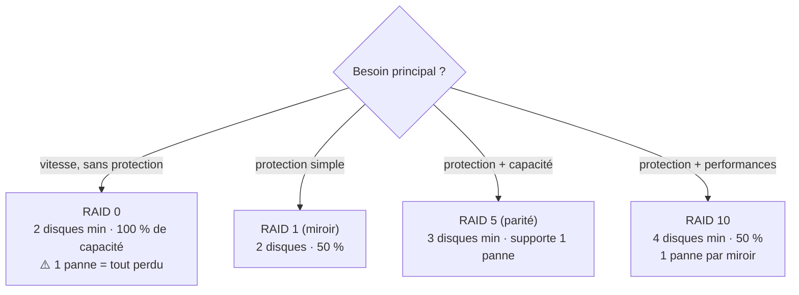

# Module 3 : Stocker les sauvegardes

*Cours : [Cours 15 - Sauvegarde et restauration](../index.md)*

## 🎯 Objectif du module

Choisir **où** stocker les sauvegardes : critères de choix, **supports** (disques, bandes LTO, NAS, cloud…), solutions **DAS**, **SAN** et **NAS**, sauvegarde **locale** ou **externalisée**, et la **redondance** des disques avec le **RAID**.

!!! abstract "En clair"
    Une sauvegarde a besoin d'un **endroit** où être rangée, et chaque support a ses forces : la **bande** est peu chère et se range dans un coffre, le **NAS** est simple et rapide, le **cloud** est hors site par nature. Le **RAID**, lui, protège contre la panne d'un **disque**, mais **ce n'est pas une sauvegarde**.

## 🗺️ L'essentiel en schémas

!!! info "Référentiel TSSR 2026"
    **CCP 3 · compétence 9 : Assurer la continuité et la reprise** et **CCP 2 · compétence 5** (le RAID des serveurs).

**① DAS, NAS, SAN**

**② Quel RAID ?**

## 📖 Cours consolidé

### 1. L'infrastructure de sauvegarde

- **Matériel** : les **supports**, les **lecteurs** et **robots** (une librairie de bandes charge les cartouches toute seule).
- **Logiciel** : le **logiciel de sauvegarde** et l'**ordonnanceur** qui lance les travaux à l'heure prévue.

**Critères de choix d'un support** : **capacité**, **fiabilité** (durée de vie), **vitesse** de lecture et d'écriture, **consommation** électrique, **sécurité**.

| Support | ➕ | ➖ |
|---|---|---|
| CD, DVD, Blu-ray | Peu encombrant | Faible capacité, durée de vie limitée |
| Disque dur (HDD) | Peu coûteux, simple | Sensible aux chocs |
| SSD | Rapide, résiste aux chocs | Plus cher |
| Clé USB, carte mémoire | Simple | Capacité limitée, facile à perdre |
| **Bande magnétique (LTO)** | **Très grande capacité**, **longue durée de vie**, peu chère au To, **hors ligne** | Lente à relire, manipulation |
| Cartouche RDX | Disque amovible robuste | Capacité limitée |
| **NAS** | Simple, rapide, RAID | Sur le même réseau (rançongiciel) |
| **SAN** | Centralisé, performant | Complexe et cher |
| **Cloud** | Hors site, accessible partout | Dépend de la **connexion**, on **confie** ses données à un tiers |

**Les bandes** : formats DDS/DAT, DLT/SDLT et surtout **LTO** (*Linear Tape-Open*, format ouvert). Une cartouche **LTO-9** contient **18 To** (natifs). Une bande **retirée du lecteur** est **hors ligne** : un rançongiciel ne peut pas la chiffrer.

### 2. DAS, SAN, NAS

| | **DAS** | **NAS** | **SAN** |
|---|---|---|---|
| Principe | Connecté **directement** au serveur | **Serveur de fichiers** sur le réseau local | **Réseau dédié** au stockage |
| Accès | Local | Par **fichier** : **SMB/CIFS** (Windows), **NFS** (Unix/Linux) | Par **bloc** : **Fibre Channel**, **iSCSI** |
| Système de fichiers géré par | Le serveur | **Le NAS** | **Le serveur** (il voit un disque) |
| Coût | Faible | Abordable, simple | **Cher**, complexe |

### 3. Local ou externalisé

| Sauvegarde | Principe | Exemple |
|---|---|---|
| **Locale** | Sur le site, les données **restent** dans le réseau de l'entreprise | Serveur de stockage, disque, bande (qu'on peut ensuite **emporter**) |
| **Externalisée** | **Hors du site** : autre site ou Internet, par une **connexion sécurisée** | Cloud, réplication vers une agence |

Pour respecter la **règle 3-2-1** ([module 1](../module-1-concepts-enjeux-definitions/index.md)), on combine les deux.

### 4. La redondance et le RAID

**Redondance** = **doubler** des composants ou des données pour qu'une panne n'arrête rien : **disques** (RAID), **serveurs** (réplication, cluster), **sites** (un 2ᵉ site en cas de sinistre majeur).

**RAID** (*Redundant Array of Independent Disks*) : répartir les données sur plusieurs disques. **Logiciel** (géré par le système, moins cher) ou **matériel** (carte contrôleur, plus performant).

| RAID | Principe | Disques min. | Supporte | Capacité utile |
|---|---|---|---|---|
| **0** | **Bandes** (*striping*) : les blocs alternent entre les disques | 2 | **Aucune** panne | 100 % |
| **1** | **Miroir** : tout est écrit sur 2 disques | 2 | 1 panne | 50 % |
| **5** | Bandes avec **parité** répartie | 3 | 1 panne | (n − 1) / n : 67 % à 94 % |
| **10** | **Miroirs** (RAID 1) assemblés en **bandes** (RAID 0) | 4 | 1 panne **par miroir** | 50 % |

## 📝 Fiche de révision

| Notion | À retenir |
|---|---|
| **Critères** | Capacité, fiabilité, vitesse, consommation, sécurité |
| **LTO** | Bande, format ouvert, grande capacité, hors ligne |
| **DAS / NAS / SAN** | Direct / fichiers en réseau / blocs sur réseau dédié |
| **NAS** | SMB/CIFS, NFS |
| **SAN** | Fibre Channel, iSCSI |
| **RAID 0 / 1 / 5 / 10** | Vitesse / miroir / parité / miroirs en bandes |
| **Disques minimum** | 2 / 2 / 3 / 4 |

### ⚠️ Les pièges

- **Le RAID n'est pas une sauvegarde** : un fichier supprimé ou chiffré l'est aussi sur tous les disques.
- **RAID 0** : aucune tolérance de panne.
- Un **NAS** de sauvegarde accessible en permanence avec les droits d'un administrateur : le **rançongiciel** le chiffre aussi.
- Sauvegarde **cloud** : vérifier le **temps de restauration** avec la connexion réelle.

### ✏️ Entraîne-toi (clique pour voir la correction)

??? question "1. 4 disques de 2 To : quelle capacité utile en RAID 5 ? En RAID 10 ?"
    RAID 5 : (4 − 1) × 2 = **6 To**, supporte 1 panne. RAID 10 : 4 × 2 / 2 = **4 To**, supporte 1 panne par miroir (jusqu'à 2 si elles ne touchent pas le même miroir), avec de meilleures performances en écriture.

## 🧠 Quiz — entraîne-toi

