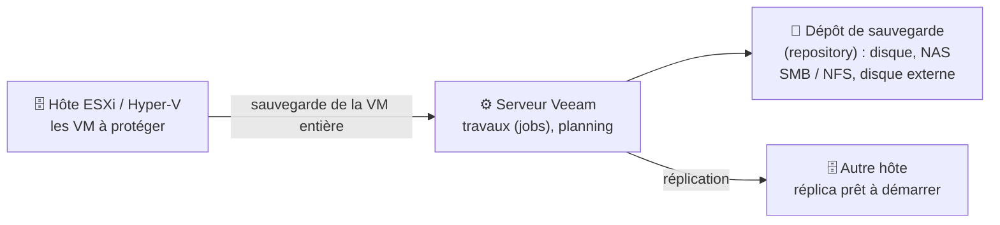
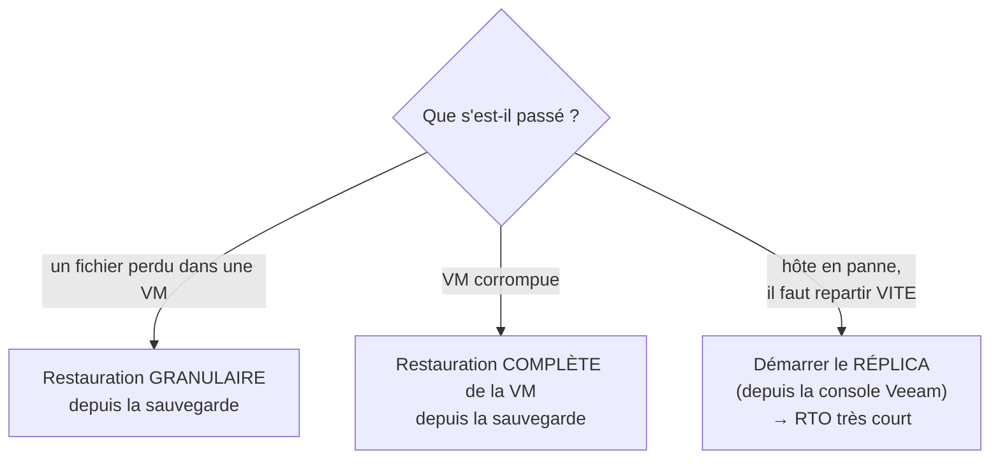

# Module 4 : Sauvegarder des machines virtuelles

*Cours : [Cours 15 - Sauvegarde et restauration](../index.md)*

## 🎯 Objectif du module

Sauvegarder et restaurer des **machines virtuelles** avec un outil spécialisé comme **Veeam Backup & Replication** : dépôts, travaux, modes de sauvegarde, restauration **complète** ou **granulaire**, et **réplication** pour redémarrer vite.

!!! abstract "En clair"
    Sauvegarder une VM, ce n'est pas copier des fichiers à l'intérieur : l'outil sauvegarde **la VM entière** depuis l'hyperviseur, sans rien installer dedans. Ensuite on peut tout restaurer, ou seulement **un fichier** de la VM. Avec la **réplication**, une copie de la VM est **prête à démarrer** sur un autre serveur.

## 🗺️ L'essentiel en schémas

!!! info "Référentiel TSSR 2026"
    **CCP 3 · compétence 9 : Assurer la continuité et la reprise de l'infrastructure** et **CCP 2 · compétence 6** (infrastructure virtualisée).

**① L'architecture d'une sauvegarde de VM**

**② Restaurer : sauvegarde ou réplica ?**

## 📖 Cours consolidé

### 1. Pourquoi un outil dédié aux VM ?

- La VM est sauvegardée **depuis l'hyperviseur** (VMware vSphere, Microsoft Hyper-V), **sans agent** dans chaque VM.
- Les **instantanés** de l'hyperviseur et **VSS** (Windows) donnent une sauvegarde **cohérente** même pour une **base de données** Microsoft qui tourne.
- On restaure **la VM entière** ou **seulement des éléments** (fichiers, objets) : c'est la restauration **granulaire**.

### 2. Configurer Veeam Backup & Replication

1. Ajouter l'**infrastructure** à protéger (hôtes ESXi ou Hyper-V, vCenter).
2. Déclarer les **dépôts de sauvegarde** (*Backup Repositories*) : disques locaux, partages **SMB/CIFS** ou **NFS**, disques externes.
3. Créer des **travaux** (*jobs*) : les VM à sauvegarder (on peut **exclure** des disques), le dépôt, le **mode**, la **planification**, la **rétention**.
4. Configurer les **alertes par mail** : un rapport de chaque sauvegarde et réplication ([module 5](../module-5-superviser-les-sauvegardes/index.md)).

| Mode | Principe |
|---|---|
| **Incrémental** (*forward*) | Une complète, puis des incrémentales qui s'ajoutent derrière |
| **Incrémental inversé** (*reverse incremental*) | La **dernière** sauvegarde est toujours une **complète** à jour ; les anciennes versions sont gardées sous forme de différences : la restauration du dernier état est la plus rapide |

### 3. La réplication

- Une **copie** de la VM (le **réplica**) est tenue à jour sur un **autre hôte**, dans un **datastore** ESXi ou Hyper-V : elle occupe **la même taille** que la VM d'origine.
- En cas de panne, on **démarre le réplica** : le service repart **très vite**, d'où un **RTO** très court.
- ⚠️ Un réplica se démarre **uniquement depuis la console Veeam** (*failover*), jamais à la main. Une fois la VM d'origine réparée, on revient dessus (*failback*) sans perdre les données écrites entre-temps.

| | Sauvegarde | Réplication |
|---|---|---|
| Stockée | Dans un **dépôt**, compressée, plusieurs versions | Sur un **hôte**, prête à démarrer |
| Pour | **Conserver** des versions, restaurer | **Redémarrer vite** après une panne |
| Remplace l'autre ? | **Non** : on utilise les **deux** | |

### 4. Restaurer

| Restauration | Quand |
|---|---|
| **VM complète** | VM supprimée, corrompue, plantée après une mise à jour |
| **Granulaire** (fichiers, objets) | Un utilisateur a perdu un fichier dans une VM serveur de fichiers |
| **Démarrage du réplica** | Hôte en panne, il faut repartir **immédiatement** |

💡 Un **snapshot** de VM ([cours 13](../../cours-13-virtualisation-de-serveurs/module-6-gestion-du-datacenter/index.md)) **n'est pas une sauvegarde** : il dépend du disque d'origine et reste sur le même stockage.

## 📝 Fiche de révision

| Notion | À retenir |
|---|---|
| **Veeam B&R** | Sauvegarde et réplication de VM VMware et Hyper-V |
| **Dépôt (repository)** | Où sont stockées les sauvegardes |
| **Job** | Un travail planifié : VM, dépôt, mode, rétention |
| **Incrémental inversé** | Dernière sauvegarde toujours complète |
| **Granulaire** | Restaurer un fichier d'une VM |
| **Réplica** | Copie prête à démarrer, RTO court |
| **VSS** | Cohérence des données Windows ouvertes |

### ⚠️ Les pièges

- **Snapshot ≠ sauvegarde**.
- **Réplica ≠ sauvegarde** : une corruption ou un chiffrement est **répliqué** aussi.
- Démarrer un réplica **à la main** dans l'hyperviseur : à éviter, passer par la **console Veeam**.
- Dépôt de sauvegarde sur le **même stockage** que les VM : une panne de la baie emporte tout.

### ✏️ Entraîne-toi (clique pour voir la correction)

??? question "1. Un utilisateur a supprimé un dossier hier sur la VM serveur de fichiers. Que fais-tu ?"
    Une restauration **granulaire** : depuis la sauvegarde d'hier, restaurer **seulement ce dossier**, de préférence à un **autre emplacement** pour vérifier avant de le remettre en place.

## 🧠 Quiz — entraîne-toi

