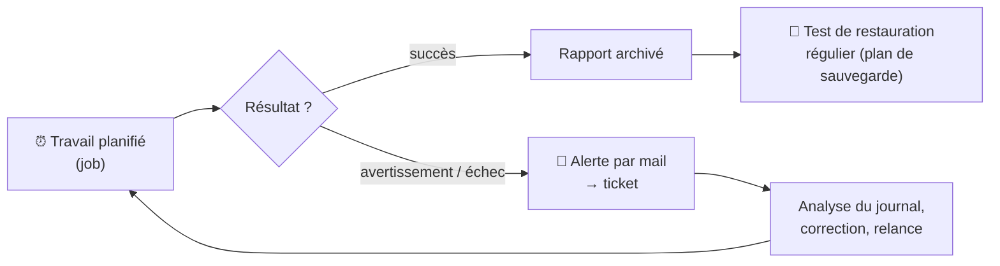
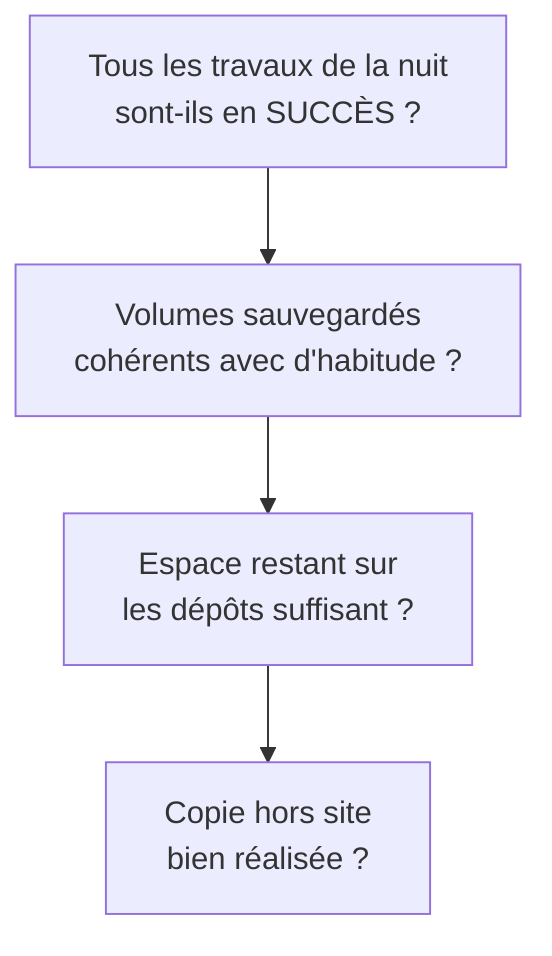

# Module 5 : Superviser les sauvegardes

*Cours : [Cours 15 - Sauvegarde et restauration](../index.md)*

## 🎯 Objectif du module

**Surveiller** les sauvegardes : lire les **rapports** et **journaux** des travaux, recevoir des **alertes**, et **tester régulièrement** les restaurations, comme le prévoit le **plan de sauvegarde**.

!!! abstract "En clair"
    Une sauvegarde qui échoue en silence pendant trois semaines, c'est trois semaines de données **non protégées**. Superviser, c'est vérifier **chaque jour** que les sauvegardes ont réussi, être **prévenu** quand elles échouent, et **prouver** régulièrement qu'on sait restaurer.

## 🗺️ L'essentiel en schémas

!!! info "Référentiel TSSR 2026"
    **CCP 3 · compétence 10 : Superviser les éléments de l'infrastructure** et **compétence 9 : Assurer la continuité et la reprise.**

**① La boucle de supervision des sauvegardes**

**② Que vérifier chaque matin ?**

## 📖 Cours consolidé

### 1. Les rapports et les journaux

Chaque travail de sauvegarde (Backup Exec, Veeam…) produit un **état** : **succès**, **avertissement** (terminé avec des éléments ignorés, par exemple un fichier verrouillé) ou **échec**, avec un **journal** détaillé. Le **compte de service dédié** à la sauvegarde ([module 1](../module-1-concepts-enjeux-definitions/index.md)) rend ces journaux plus **lisibles** et plus faciles à tracer.

### 2. Les alertes

Les logiciels de sauvegarde envoient des **rapports par mail** pour chaque sauvegarde et réplication. Bonne pratique : être **alerté** en cas d'**échec** ou d'**avertissement**, et ouvrir un **ticket** pour en garder la trace ([cours 6](../../cours-06-sensibilisation-itil-et-gestion-de-parc/module-9-assistance-avec-glpi/index.md)).

⚠️ L'**absence** de mail doit aussi alerter : un travail qui n'a **pas tourné** ne signale aucune erreur.

### 3. Les points de contrôle

| Vérifier | Pourquoi |
|---|---|
| **État** de chaque travail | Repérer les échecs et avertissements |
| **Volume** sauvegardé | Une sauvegarde beaucoup plus petite que d'habitude cache souvent un oubli |
| **Espace libre** des dépôts et supports | Un dépôt plein fait échouer les sauvegardes suivantes |
| **Rotation** et **copie hors site** | La règle **3-2-1** doit être respectée dans les faits |
| **Durée** des travaux | Une sauvegarde qui déborde sur la journée gêne les utilisateurs |

### 4. Tester les restaurations

« On n'a jamais de problème de sauvegarde, que des problèmes de **restauration** » ([module 2](../module-2-types-de-sauvegarde/index.md)). Le **plan de sauvegarde** prévoit des **procédures de test** : restaurer régulièrement des fichiers, une VM, une base, **à un autre emplacement**, et **noter** le résultat et la **durée** (pour vérifier que le **RTO** est tenu). Un plan de sauvegarde n'est **complet** qu'après ces tests.

## 📝 Fiche de révision

| Notion | À retenir |
|---|---|
| **États d'un travail** | Succès · avertissement · échec |
| **Alerte mail** | Rapport de chaque sauvegarde et réplication |
| **Chaque jour** | État, volume, espace des dépôts, copie hors site |
| **Test de restauration** | Régulier, à un autre emplacement, résultat et durée notés |
| **Plan de sauvegarde** | Contient les procédures de test |

### ⚠️ Les pièges

- **Pas de mail** ne veut pas dire « tout va bien » : le travail n'a peut-être pas tourné.
- Ignorer les **avertissements** : des fichiers ne sont peut-être **jamais** sauvegardés.
- Ne jamais **tester** une restauration avant le jour de la panne.

### ✏️ Entraîne-toi (clique pour voir la correction)

??? question "1. Le travail de sauvegarde du serveur de fichiers est en « avertissement » depuis 10 jours. Que fais-tu ?"
    Lire le **journal** : quels éléments sont ignorés et pourquoi (fichiers ouverts, droits du compte de sauvegarde, chemin supprimé…). Corriger, **relancer**, vérifier que le travail repasse en **succès**, et tracer l'action dans un **ticket**.

## 🧠 Quiz — entraîne-toi

