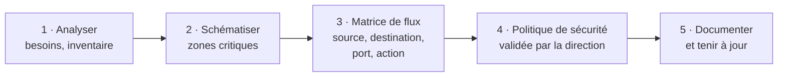
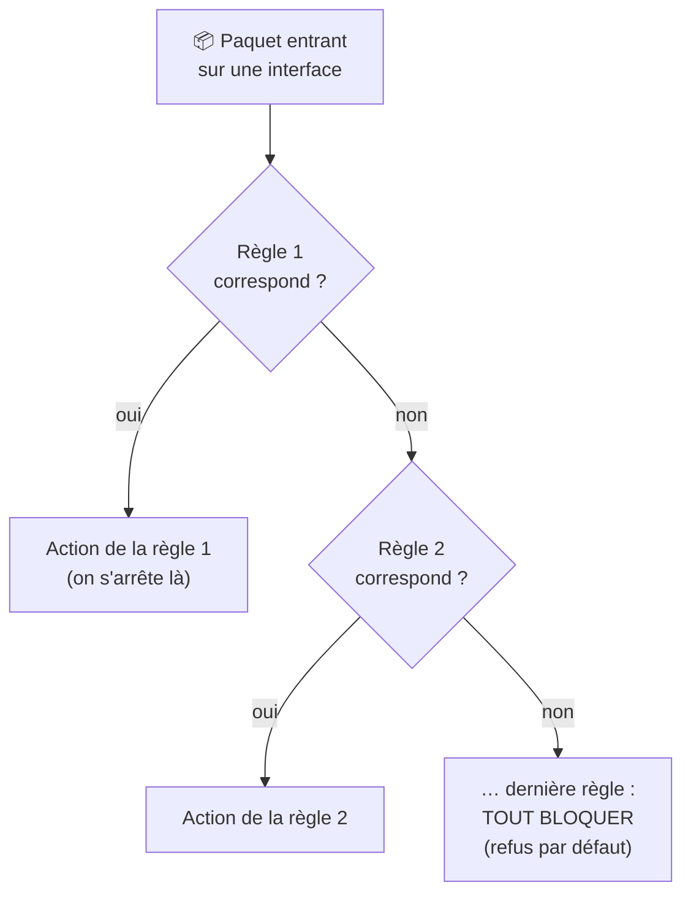

# Module 1 : Sécuriser les accès réseau

*Cours : [Cours 16 - Réseau et sécurité](../index.md)*

## 🎯 Objectif du module

Préparer la sécurité d'un réseau : **analyser** les flux (commandes, **matrice de flux**), comprendre le rôle d'un **pare-feu**, les **règles** (ordre, actions) et les fonctions d'un pare-feu **pfSense** (alias, IP virtuelles, plannings, QoS).

!!! abstract "En clair"
    On ne protège bien que ce qu'on connaît. Avant d'écrire la moindre règle, on **liste les flux** dont l'entreprise a besoin (qui parle à qui, sur quel port) dans une **matrice de flux**. Le **pare-feu** laisse passer **ces flux-là** et **bloque tout le reste**.

## 🗺️ L'essentiel en schémas

!!! info "Référentiel TSSR 2026"
    **CCP 2 · compétence 7 : Gérer les accès et la sécurité dans un environnement hybride** et **compétence 4 : Exploiter un réseau IP**. Analyser un flux bloqué est un incident réseau typique de l'épreuve.

**① Mettre en place un pare-feu, dans l'ordre**

**② Comment le pare-feu lit ses règles**

## 📖 Cours consolidé

### 1. Rappels utiles

Le modèle OSI ([cours 1 · module 1](../../cours-01-bases-des-reseaux/module-1-le-modele-osi/index.md)) aide à situer un filtrage : un switch travaille en **couche 2** (adresses **MAC**, avec sa **table MAC**), un routeur en **couche 3** (**IP**), un pare-feu filtre en **couches 3 et 4** (**IP** et **ports TCP/UDP**), un proxy en **couche 7** (URL, contenu).

| Je veux… | Windows | Linux |
|---|---|---|
| Voir les ports ouverts et les connexions | `netstat -an` | `ss -tuln` (ou `netstat` du paquet `net-tools`) |
| Suivre le chemin vers une machine | `tracert exemple.com` | `traceroute exemple.com` |
| Tester qu'un **port** répond | `Test-NetConnection srv -Port 443` · `telnet srv 80` | `nc -zv srv 443` · `telnet srv 80` |
| Repérer les machines et ports d'un réseau | `nmap` (outil à installer) | `nmap -sn 192.168.1.0/24` (machines) · `nmap -p 1-1024 srv` (ports) |
| Voir le contenu des échanges | **Wireshark** | Wireshark, `tcpdump` |

⚠️ N'utilise `nmap` que sur **ton** réseau, avec autorisation : scanner un réseau sans accord est illégal.

### 2. La matrice de flux

**Matrice de flux** = le tableau de tous les flux **autorisés** entre une **source** et une **destination** : c'est le **préalable** à toute règle de pare-feu. L'ANSSI recommande de **segmenter** le réseau en **zones de confiance**, de **mettre à part** en **DMZ** les services exposés à Internet ([module 2](../module-2-exposer-des-services-vers-l-exterieur/index.md)), et de **documenter** les flux.

| Source | Destination | Port | Action |
|---|---|---|---|
| LAN Clients | Serveur web Internet | TCP 443 | Accepter |
| LAN Clients | Serveur web Internet | TCP 80 | Refuser |
| LAN Admin | Serveurs | TCP 3389 | Accepter |

### 3. Le pare-feu

Un **pare-feu** filtre les échanges **entre deux réseaux** (par exemple le LAN et Internet) selon des **règles** : adresses, **ports**, protocole, interface.

| Action | Effet |
|---|---|
| **Pass** (*permit*) | Laisser passer |
| **Block** | Bloquer **sans rien dire** (l'émetteur attend dans le vide) |
| **Reject** | Bloquer **en prévenant** l'émetteur (réponse de refus) |

- Les règles sont lues **dans l'ordre** : la **première** qui correspond s'applique. Mets les règles **précises** **au-dessus** des règles générales.
- **Refus par défaut** : tout ce qui n'est pas autorisé est bloqué.
- Exemples de pare-feux : **Pare-feu Windows** ([cours 2 · module 7](../../cours-02-systeme-client-microsoft/module-7-la-gestion-du-reseau-et-du-pare-feu/index.md)), **pfSense**, OPNsense, Stormshield, Fortinet…

### 4. Les fonctions de pfSense

| Fonction | À quoi elle sert |
|---|---|
| **Alias** | Donner un **nom** à un groupe d'adresses ou de ports (`SRV_WEB`, `PORTS_ADMIN`) et l'utiliser dans les règles : plus lisible, une seule modification |
| **IP virtuelles** | Plusieurs adresses IP sur une même interface (plusieurs IP publiques côté WAN, par exemple) |
| **Planning** (*schedule*) | Une règle **active seulement** sur un créneau (ex. 8 h - 17 h) |
| **Règles** | Par **interface**, dans un **ordre**, avec les alias |
| **QoS** (*traffic shaper*) | Répartir la **bande passante** et donner la **priorité** à certains flux (VoIP…) |
| **Services** | DNS, NTP, DHCP, **portail captif** ([module 5](../module-5-authentifier-et-securiser-les-echanges/index.md)) |

**Réglages de base** : un **nom d'hôte** propre (pas « pfSense »), le **nom de domaine**, les **DNS**, la **passerelle** par défaut, et un mot de passe administrateur changé dès l'installation ([cours 8 · module 4](../../cours-08-les-services-reseau-en-environnement-microsoft/module-4-le-routage/index.md)).

## 📝 Fiche de révision

| Notion | À retenir |
|---|---|
| **Matrice de flux** | Source, destination, port, action : avant toute règle |
| **Pass / block / reject** | Passer / bloquer en silence / bloquer en prévenant |
| **Ordre des règles** | La première qui correspond gagne |
| **Refus par défaut** | Tout ce qui n'est pas autorisé est bloqué |
| **Alias** | Groupe nommé d'adresses ou de ports |
| **Planning** | Règle active sur un créneau horaire |
| **Tester un port** | `Test-NetConnection -Port` · `nc -zv` · `telnet` |
| **Voir les ports** | `netstat -an` · `ss -tuln` |

### ⚠️ Les pièges

- Une règle **« tout autoriser »** placée **en haut** rend toutes les autres inutiles.
- **Block** et **reject** bloquent tous les deux : seul **reject** prévient l'émetteur.
- Ouvrir un flux « pour voir si ça marche » et **l'oublier** : documente et referme.
- Scanner avec `nmap` un réseau qui n'est pas le tien.

### ✏️ Entraîne-toi (clique pour voir la correction)

??? question "1. Les postes du LAN n'accèdent plus à un site en HTTPS depuis l'ajout d'une règle. Comment enquêter ?"
    1) `Test-NetConnection site -Port 443` depuis un poste (le port répond-il ?) · 2) dans pfSense, l'**ordre** des règles de l'interface LAN : une règle de **blocage** plus haut correspond-elle ? · 3) les **journaux** du pare-feu (*Status → System Logs → Firewall*) montrent quelle règle a bloqué.

## 🧠 Quiz — entraîne-toi

